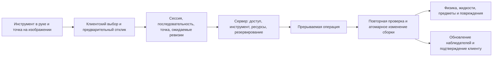

# Визуальная интерактивная автомеханика

Дата: 2026-09-08. Статус: план, реализация этого расширения не начата.

Цель: игрок ремонтирует конкретный автомобиль, действуя инструментом по изображённым деталям, крепежу и соединениям. Рабочее поле показывает фактическое состояние сборки. Снятый элемент становится игровым предметом; ошибка при сборке меняет работу машины. Список модулей не является основным способом ремонта.

Область: транспорт и мастерские игроков, Supra как первый полностью законченный автомобиль, затем эвакуатор. Без A-Life, NPC-механиков, сохранения между раундами и изменений RobustToolbox. Существующие физика, управление, владение, жидкости и повреждения остаются владельцами своих игровых эффектов.

## 1. Что изучено в репозитории

| Реальная реализация | Что переносим в автомеханику |
|---|---|
| `Content.Client/_NC/Medical/Surgery/NCFreeformSurgeryFieldControl.cs` | Одно поле в общей системе координат, слои спрайтов, сохранение пропорций, попадание мышью по видимому объекту, локальный предварительный отклик |
| `NCFreeformSurgeryWindow.xaml` в том же каталоге | Центральная рабочая область, активный инструмент, состояние выбранного участка, явная обратная связь |
| `NCFreeformSurgeryClientSystem.cs` | Привязка ответа к сессии и последовательности запросов; старое обновление не должно затирать незавершённое действие |
| `Content.Server/_NC/Medical/Surgery/NCFreeformSurgerySystem.cs` | Проверка инструмента в руке, доступности, геометрии, ревизии, DoAfter и повторная проверка перед изменением состояния |
| `Content.Shared/_NC/Medical/Surgery/NCFreeformSurgeryPrototype.cs` и `Resources/Prototypes/_NC/Medical/Surgery/freeform.yml` | Геометрия, изображения и поведение инструментов задаются данными |
| `NCSurgeryDirectClientSystem.cs` | Небольшое контекстное меню только при неоднозначности действия |

Просмотрены также реальные атласы `Resources/Textures/_NC/Interface/Surgery/surgical_body_layers_v4.png` и `surgical_anatomy_atlas_v3.png`: поле собирается из отдельных визуальных слоёв и изображений структур, а не из единственной иллюстрации.

Важное уточнение: текущая хирургия создаёт каноническую геометрию операции на сервере по точке клика; название freeform не означает произвольное вырезание пикселей мышью. Не следует обещать уже существующие свободные траектории или переносить медицинские типы в транспорт.

Хирургия изучена по коду, XAML и изображениям. Живой игровой прогон её интерфейса в рамках подготовки плана не выполнялся. Жёстко заданные английские подписи и размеры её окна не копируем: новый интерфейс сразу локализуем и адаптируем к разрешению.

Текущая автомеханика:

- `NCVehicleServiceWindow.xaml`: список `Modules` и кнопки общих операций.
- `NCVehicleServiceSystem`: настоящие инструменты, прерываемые DoAfter, капот, подъёмник, кран, крепёж, снятие и установка предметов.
- `NCVehicleAssemblyComponent`: серверная сборка, общая ревизия, резервирование слотов, общие результаты диагностики.
- `NCVehicleInstalledPart`: прототип, состояние, `Connected`, `Fastened`, заряд аккумулятора. Отдельных болтов и портов пока нет.
- `NCVehiclePartRepairSystem`: ремонт предмета повышает общий Condition в пределах ограничений. Это основа, но ещё не визуальная переборка агрегата.
- Каталог содержит 66 определений деталей: 52 в `parts.yml`, 7 в `accessories.yml`, 5 в `conversions.yml`, 2 в `assembly.yml`. Наличие прототипа само по себе не означает готовый визуальный ремонт.

## 2. Опыт игрока

Механик подходит к нужной стороне автомобиля и открывает рабочее поле. В центре — увеличенная композиция именно этой машины. Справа — предмет в активной руке, режим инструмента, выбранная точка, показания приборов и причина недоступности действия. Масштабирование и панорамирование не меняют геометрию взаимодействия.

Виды: кузов сверху, моторный отсек, левый и правый борта, четыре колёсные ниши, днище, салон/электрика, снятый агрегат на верстаке. Это рабочие ракурсы, а не обязательные направления мирового RSI. Днище доступно через соответствующее оборудование, закрытый моторный отсек — после открытия капота. Вращение изображения не позволяет работать через кузов с противоположной стороны: сервер проверяет реальную позицию персонажа.

Управление:

- Наведение подсвечивает точную видимую цель и объясняет, что доступно текущему инструменту.
- ЛКМ применяет активный инструмент; удержание выполняет длительную операцию с видимым прогрессом в месте работы.
- ПКМ открывает короткий выбор режима, если инструмент допускает несколько операций. Прикрепление прибора или крана — такой же конкретный режим.
- Колесо мыши масштабирует поле; средняя кнопка перемещает его. Слои открываются реальным разбором, а не «рентгеновским» ползунком.
- Перетаскивание установленной детали запрашивает извлечение, а детали из руки — установку в показанное посадочное место. Это визуальный запрос, не обход проверки массы, совместимости и свободного места.
- Esc отменяет локальный выбор/жест; закрытие окна и уход прекращают текущую работу. Уже законченные откручивания сохраняются внутри раунда.

Не заставлять игрока десятки раз обводить болт мышью. Вращение ключа анимируется во время удержания; длительность, момент и последовательность имеют смысл, моторная ловкость игрока не заменяет механику. Увеличение изображения и удобная область выбора помогают работать с мелким крепежом, но не позволяют выбирать закрытые точки сквозь детали.

## 3. Полная интерактивность по операциям

| Объект | Действие и визуальное изменение | Игровое последствие |
|---|---|---|
| Капот, кожух, защита, обшивка | Открытие/снятие, отображение петель, фиксаторов и освободившегося доступа | Появляются реальные рабочие точки; закрыть мешающую сборку нельзя |
| Болт, гайка, хомут | Подходящая головка, удержание ключа, ослабление, извлечение, затяжка | Отдельное состояние резьбы и затяжки, неверный момент и отсутствие крепежа влияют на надёжность |
| Электрический разъём, клемма | Отжать фиксатор, разъединить, соединить совместимые контакты | Разрыв цепи, потеря запуска/зарядки/света; короткое замыкание только там, где оно задано моделью |
| Шланг и штуцер | Зажать, снять хомут, отсоединить, проложить, подключить | Реальный слив, утечка, воздух в контуре; совместимость среды и диаметров |
| Колесо | Вывесить нужный угол, открутить гайки, снять колесо | Открываются тормоз и ступица; отсутствие и дефекты меняют соответствующий угол подвески |
| Тормоз | Снять суппорт/колодки/диск, обслужить магистраль, прокачать | Толщина, перегрев и воздух в гидравлике меняют торможение; новая колодка не ремонтирует течь |
| Подвеска и рулевое | Опоры, шарниры, тяги, пружина с подходящим приспособлением | Люфт, геометрия и повреждение отражаются на управлении; неподдержанный узел нельзя безопасно снять |
| Двигатель и коробка | Отсоединить конкретные линии и опоры, закрепить кран, извлечь на стойку | Масса переносится между машиной и агрегатом; нельзя «удалить» оставшийся подключённым двигатель |
| Снятый агрегат | Открыть собственное поле на верстаке; разобрать и заменить внутренние элементы | Состояние внутренней сборки сохраняется при установке обратно; повреждённая деталь не становится новой |
| Жидкости | Крышка/щуп/сливная пробка, поддон, воронка, заправка, прокачка | Реальные объёмы, составы, температуры и утечки через существующие системы растворов |
| Диагностика | Щупы к портам, манометр к штуцеру, сканер к разъёму | Измерение конкретной цепи или агрегата вместо мгновенного раскрытия состояния всей машины |
| Кузов | Очистка, правка выбранной зоны, сварка заданного шва, герметизация, окраска | Изменяется именно эта зона; косметическая обработка не восстанавливает скрытые узлы |
| Тюнинг | Реальная замена совместимых узлов, настройка доступных регуляторов и приборная проверка | Используются существующие варианты АКПП/AWD и калибровки, а не кнопка бесплатного преобразования |

Внутренняя разборка — ограниченное, заданное прототипами дерево обслуживаемых элементов. Поршни, уплотнения, подшипники и другие внутренние детали добавляются там, где предусмотрена отдельная операция и результат. Не моделировать каждый винт автомобиля ради количества сущностей.

Диагностика на работающем двигателе требует отдельной категории операций: измерение допускается при подходящих условиях, разборка — нет. Нынешний общий `CanWork`, запрещающий всё при работающем двигателе, для этого надо разделить. Перед запуском проверяются установленные приборы, люди в опасной зоне и состояние оборудования по данным конкретной операции.

## 4. Визуальные данные и ассеты

Три согласованных представления:

1. **Мир:** небольшой автомобильный RSI, вращающийся с кузовом; отдельные слои открытого капота, отсутствующих колёс, снятых панелей, повреждений и подключённого оборудования. Не раздувать мировой спрайт до размеров рабочего окна.
2. **Рабочее поле:** отдельные атласы с достаточной детализацией для крепежа; общие координаты деталей, масок и точек доступа для каждого ракурса.
3. **Предмет/верстак:** RSI снятой детали и её собственная композиция для переборки. Один и тот же экземпляр состояния переходит между этими представлениями.

Слои поля: фон отсека → несущая конструкция → задние линии → узлы → передние линии → крепёж → закрывающие элементы → следы повреждения/жидкости → инструмент и предварительное действие. Порядок и перекрытие задаёт профиль ракурса, а не имена деталей в коде.

Для каждой обслуживаемой детали нужны: положение, масштаб, опорная точка, допустимые ракурсы, область попадания, маска перекрытия, точки крепежа/портов, изображение посадочного места и состояния повреждения. Выделение рисуется поверх предметного изображения, не заменяет его прямоугольником.

Клиент использует прозрачность текстуры для точного выбора. Сервер использует общие авторские области/маски, доступные без загрузки GPU-текстур. Их соответствие проверяет инструмент валидации. Клиентский идентификатор цели не считается доказательством попадания.

Для Supra требуется ведомость покрытия: каждая деталь каталога помечена как внешний обслуживаемый узел, внутренняя деталь агрегата либо установленное оборудование; для каждой поддерживаемой операции указан готовый ракурс и визуальный результат. Общие гайки, хомуты и инструменты переиспользуются, крупные агрегаты получают собственные изображения. Заглушки допустимы на техническом этапе, но не считаются готовым визуалом.

Стиль — читаемые предметные спрайты, согласованные размеры и прозрачность. Грязь, коррозия, трещины, сорванный крепёж, течи и нагрев показываются по фактическому состоянию. Точные дефекты не подсвечиваются сквозь непрозрачные крышки. RSI не требует четырёх направлений: рабочие ракурсы создаются для доступа и различимой геометрии, а не простым поворотом одной картинки.

## 5. Архитектура ECS

Предлагаемые имена ниже обозначают новые типы, а не уже имеющийся код.

| Размещение | Ответственность |
|---|---|
| `Content.Shared/_NC/Vehicle/Workshop/` | Определения рабочих точек, действий, состояний крепежа/соединений, геометрия доступа, сообщения и чистые проверки для предварительного отображения |
| `Content.Shared/_NC/Vehicle/Prototypes/` | Профили поля и узлов, инструментов и операций; балансовые значения и геометрия в YAML |
| `Content.Server/_NC/Vehicle/Workshop/` | `NCVehicleWorkshopSystem`: сессии, запросы, DoAfter, повторная проверка, адресные ответы; `NCVehicleWorkshopAccessSystem`: доступ и перекрытия; `NCVehicleWorkshopDiagnosticSystem`: измерения; `NCVehicleWorkshopTransferSystem`: перенос предмета и его состояния |
| `Content.Client/_NC/Vehicle/Workshop/` | `NCVehicleWorkshopWindow.xaml`, `NCVehicleWorkshopFieldControl`, клиентская сессия, масштаб, попадание мышью, анимации, предварительное отображение и согласование ответов |
| `Resources/Prototypes/_NC/Vehicle/Workshop/` | Профили Supra, эвакуатора, верстаков, точек, операций и инструментов |
| `Resources/Textures/_NC/Vehicle/` и `_NC/Interface/VehicleWorkshop/` | Соответственно мировые/предметные RSI и атласы рабочего поля |

Существующий `NCVehicleAssemblyComponent` остаётся единственным владельцем установленной сборки. Расширяем его данные, не заводим независимую «картинку автомобиля» с другим состоянием. Компоненты содержат только данные; логика находится в системах.

Нужны раздельные графы:

- **Состав и опора:** что установлено, где находится масса и на чём держится узел; расширяет существующий `Requires`.
- **Доступ:** что закрывает конкретную рабочую точку, с какой стороны и каким инструментом до неё можно дотянуться.
- **Соединения:** электрические, жидкостные и механические порты, их совместимость и состояние.

Нельзя использовать `Requires` сразу для всех трёх задач: закрывающий кожух не обязательно является опорой детали. Валидация запрещает тупики разборки и циклы опор, но допускает осмысленные замкнутые электрические и гидравлические контуры.

`NCVehicleInstalledPart` расширяется состоянием конкретного экземпляра и его обслуживаемых точек. `Connected` и `Fastened` становятся производными итогами подключения и необходимого крепежа. Их нельзя независимо редактировать поверх новых данных. Вложенная сборка переносится вместе с агрегатом; масса дочерних элементов учитывается ровно один раз, без добавления поверх старой полной массы агрегата.

Не создавать физическую ECS-сущность для каждого установленного болта. Малые точки живут в данных сборки. Снятые предметы, присоединённые приборы, кран и поддон — настоящие сущности. Идентификатор экземпляра нужен только в текущем раунде, без БД и глобальной регистрации деталей.

`NCVehiclePerformanceCompiler` получает результаты фактической сборки и соединений и выдаёт прежние входы для физики/состояния автомобиля. Изменение рабочего поля не пишет обороты, сцепление или тягу напрямую. Неисправность визуализируется из той же причины, которая влияет на движение.

## 6. Действие, сеть и совместная работа

Сессия привязана к персонажу и машине/верстаку. Запрос содержит ракурс, нормализованную точку, непрозрачный идентификатор ранее показанной цели, режим, последовательность и ожидаемую версию. Сервер сам определяет предмет в руке и перепроверяет видимость, доступность, диапазон координат и актуальность цели. Старый идентификатор снятой детали не должен внезапно указывать на новую деталь того же слота.

Полное состояние неисправностей остаётся серверным. Всем в PVS достаточно внешнего визуального состояния. Участник мастерской получает адресное состояние доступного поля и собственных измерений через сессионный обмен по образцу хирургии. Не рассылать полный граф каждой машины всем клиентам. При переходе на новое окно существующий Service BUI заменяется, а не работает как второй независимый редактор.

До подтверждения клиент может показывать курсор, инструмент, маршрут перетаскивания и начало операции. Расход материала, выпадение предмета и подтверждённый демонтаж выполняет сервер. Отклонённое действие убирает предварительный результат и показывает причину. Старый телеметрический ответ не стирает более новое действие.

Для двух механиков нужны ревизии точек/узлов и версии зависимостей. Общая ревизия машины остаётся для пересборки, но не должна отменять замену заднего колеса из-за работы с передним. Резервируется затрагиваемая точка и конфликтующие зависимости; поднятие машины или извлечение двигателя требует более широкой блокировки. Резервирование ограничено по времени и снимается при отмене, отключении клиента, смерти, удалении машины и оборудования.

При завершении снова проверяются тот же инструмент, расходники, поддержка узла, удерживаемый предмет, доступ и версии. Перенос состояния предмета и изменение слота выполняются как одна серверная операция с компенсацией при неудаче. Нельзя получить две детали повторной отправкой запроса; нельзя потерять деталь, если заняты руки или исчез верстак. Тяжёлый узел остаётся закреплённым либо переносится в проверенное место/контейнер оборудования.

Снимки поля обновляются по изменениям; частота телеметрии и пределы пакетов — в прототипах. Геометрия кэшируется по профилю/ракурсу, а не строится заново каждый кадр. Поиск оборудования — через EntityLookupSystem. Нет глобального обхода всех деталей всех машин в Update.

## 7. Диагностика и ошибки

Разделить внешний осмотр, измерение и вывод о причине. Механик видит течь, трещину или снятый разъём; мультиметр показывает результат между выбранными контактами; сканер сообщает предусмотренные контроллером ошибки. Универсальных процентов здоровья при наведении нет.

Измерение хранит цель/экземпляр, прибор, значение, время и версию. Старый замер остаётся записью с пометкой устаревания, а не обновляется магически после чужого ремонта. Обмен диагностикой между игроками — явное действие/общий рабочий отчёт, а не нынешний общий `DiagnosedSlots` на машине.

Ошибки имеют конкретные причины: неподходящая головка, сорванная резьба, неверный момент, незакреплённый узел, несовместимый порт, незакрытая пробка, непрокачанная магистраль. Риск и последствия задаются операцией и состоянием, не скрытым универсальным броском «ремонт не удался». Временный ремонт и окончательное восстановление различаются доступными материалами, пределами и надёжностью.

Привязанные приборы и магистрали имеют сущность/соединение: зарядник занимает клеммы, манометр — штуцер, кран — монтажные петли. Их нельзя убрать из инвентаря и оставить действующий визуальный фантом.

## 8. Порядок реализации и критерии этапов

| Этап | Работы | Критерий завершения |
|---|---|---|
| 1. Контракт и инвентаризация | Карта всех существующих деталей, рабочих точек, опор, перекрытий и операций; профиль одной колёсной ниши; схема переноса состояния | У каждого действия есть реальный вход, цель, требование и последствие; нет тупиков сборки |
| 2. Законченный пример | Поле переднего колеса Supra: гайки, колесо, суппорт, колодки, диск, ступица; инструмент в руке; снятие и установка | Весь цикл проходит по изображению без списка слотов, результат меняет торможение соответствующего колеса |
| 3. Данные и совместная работа | Поэлементный крепёж, порты, версии, резервирование, перенос состояния, личная диагностика | Два механика работают независимо; дубликаты и устаревшие запросы не изменяют сборку |
| 4. Моторный отсек | Капот, аккумулятор, цепь запуска, охлаждение, впуск, жидкости, приборные точки | По изображению обнаруживается и устраняется отказ запуска; течь устраняется ремонтом реального соединения |
| 5. Днище и тяжёлые узлы | Подъёмник, опоры, кран, подвеска, рулевое, выпуск, коробка, привод и дифференциалы | Демонтаж двигателя/коробки требует фактического освобождения связей и переносит массу без потерь |
| 6. Верстак | Поля снятых агрегатов, внутренние детали, дефекты, измерение и переборка | Отремонтированный агрегат устанавливается обратно с тем же экземпляром и новым фактическим состоянием |
| 7. Кузов, электрика, тюнинг | Панели, салон, повреждения, окраска, проводка, АКПП/AWD, настройка и контрольные измерения | Переделка и кузовной ремонт проходят через физические операции и отражаются в мире и движении |
| 8. Полное покрытие | Финальные спрайты Supra, затем профиль эвакуатора и его оборудование; подсказки, звук, масштабирование | Каждая заявленная обслуживаемая часть обоих автомобилей имеет рабочее поле и завершённый путь обслуживания |
| 9. Приёмка и отключение старого пути | Игровой прогон, сеть, нагрузка, документация; старые команды направлены в те же проверки либо удалены | Нельзя обойти крепёж/доступ старой кнопкой; пройдены все сценарии ниже |

Первый колёсный пример проверяет архитектуру, но не считается полной реализацией. Нельзя объявлять этапы 4–8 завершёнными на основании количества прототипов или общей кнопки «починить».

## 9. Приёмочные сценарии

1. Колёсный ремонт: подъём, гайки, снятие колеса, замена колодок, сборка с правильным крепежом, тормозной прогон. Незатянутый крепёж остаётся видимой и действующей неисправностью.
2. Не запускается двигатель: осмотр, измерение батареи и цепи, обнаружение отключённой/неисправной точки, ремонт, фактический запуск.
3. Охлаждение: выявление течи, слив в поддон, замена повреждённой линии, заправка и проверка температуры. Объём не появляется из UI.
4. Электрика: два щупа на разных точках дают результат соответствующего соединения, а не универсальный процент Condition.
5. Двигатель: все линии и опоры освобождены, кран присоединён, узел перенесён на стойку, перебран и возвращён; масса и вложенные детали учтены один раз.
6. Сеть: задержанные ответы, двойной клик, повтор пакета, старый handle после замены детали, закрытие окна в процессе операции, переподключение.
7. Совместная работа: разные колёса обслуживаются одновременно; один и тот же болт или конфликтующие опоры — нет; результат одного действия не откатывает другое.
8. Доступ: нельзя выбрать скрытый объект сквозь крышку, работать с другой стороны кузова, с днищем без доступа или через стену мастерской.
9. Жизненный цикл: удаление машины, крана, верстака или инструмента не дублирует предметы и освобождает резервирование.
10. Читаемость: ручная проверка окна на 1280×720 и 1920×1080, разных масштабах UI, всех ракурсах; русские строки помещаются; мелкие точки доступны без точных круговых жестов.

Тесты: чистая геометрия/графы и перенос состояния — Content.Tests; реальные руки, DoAfter, сборка, два клиента, физика и жидкости — целевые Content.IntegrationTests. Отдельно штатные YAML/RSI проверки и ручной визуальный прогон. Проверка алгоритма задержанных сообщений не выдаётся за полноценный сетевой прогон. Производительность измеряется на машине с полным каталогом точек и нескольких активных мастерских; кадровые и сетевые бюджеты фиксируются после базового замера, до масштабирования контента.

## 10. Совместимость и граница готовности

Переход поэтапный: старые исправные Connected/Fastened преобразуются в корректно собранные точки; повреждения, заряд, жидкости и вложенное состояние сохраняются внутри раунда. Изменение сетевых контрактов требует совместной сборки клиента и сервера. Не поддерживать два расходящихся формата записи в течение обычной игры. Медицинские файлы и RobustToolbox не изменяются.

Полная готовность означает: все заявленные операции Supra и эвакуатора выполняются через изображения и реальные инструменты; видимое состояние соответствует доступу и физике; ни одна основная операция не требует выбора скрытого slot ID из списка; рабочие ассеты не заменены заглушками; ошибки объясняются; совместная работа, перенос предметов и восстановление после прерывания проверены.

Самая большая работа здесь — авторская геометрия, поэлементное состояние сборки и покрытие ассетами. Само окно является только одним из этапов. Сроки следует оценить после законченного колёсного примера и ведомости ассетов, а не по числу существующих C#-файлов.
