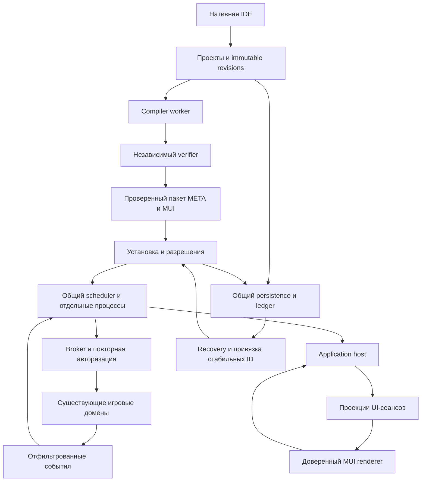

# Полный план реализации META в Night City 2045

Дата: 22 октября 2026 года. Состояние: план полной реализации. База проверки кода: `359e0f3fb8e34f20345fca4a56e7b2e1cff4f219` и рабочее дерево на момент подготовки.

Цель — за одну сквозную задачу собрать всю систему: язык, компилятор, VM, IDE, оборудование, приложения MUI, сайты CitiNet, сети и нетраннинг, транспорт, дронов, автоматику, медицинские приборы, рынок ПО и восстановление после аварии. Блоки ниже определяют порядок разработки и проверки внутри одной поставки. Завершение примера с дверью не завершает задачу.

Один прогон означает непрерывное выполнение этого плана с сохранением прогресса между техническими продолжениями контекста. Он включает исправление обнаруженных дефектов и обязательную проверку результата. Календарная длительность и возможность уместить весь объём в один ответ модели не предполагаются.

## 1 Источники и полный объём

Основная спецификация — [28 META](https://app.notion.com/p/4018867306b180c2a1b9ffe68cf4c5ff), META Hybrid GDD/TDD v1.0 от 22 октября 2026 года. Дополнение — [META UI Framework](https://app.notion.com/p/4018867306b1808b9045ddc39ce996a5), концепция v0.2. Учитываются также [Agent и CitiNet](https://app.notion.com/p/3b38867306b18136a142df6c010b9954), [Persistence](https://app.notion.com/p/3b38867306b1816ca90af041ad7f1414), [экономика](https://app.notion.com/p/3b38867306b1818283a2d3788b419fd3) и [открытая модель персонажа](https://app.notion.com/p/3b38867306b1811f8c87e784119f32c6).

Основная спецификация проверяла код на `612529554ec12457ca9c2c34f86b9a8631e23ef0`. Её перечень готовых API требуется сверять с текущим деревом. Старый источник N09 о нетраннинге при чтении оказался удалённой пустой страницей; нормативная основа NET в этой задаче — главы VIII, XIII, XVI, XVII основной спецификации и решения этого плана. Исторические описания materialization, downtime и A-Life не отменяют текущие правила репозитория.

Приложенные PDF, DOCX и Engineering Kit ZIP не являются обязательной внешней зависимостью выполнения: текст страницы содержит грамматику, числовые реестры, схемы и все пятнадцать программ. При старте реализации фиксируется локальный нормативный корпус из этого текста. Архив можно использовать после проверки его состава, но нельзя считать готовым компилятором или работающим модом.

В поставку входят:

- Полный язык Hybrid 1.0, модули, библиотеки, алгоритмы, коллекции, события, async и диагностика.
- Воспроизводимая серверная сборка, отдельные compiler workers, независимый verifier и изолированная VM.
- Аппаратные профили, права, supervisor, виртуальные файлы, физические носители, прошивки, установка и recovery.
- Полноценная нативная IDE с отладчиком, тестовым стендом, документацией и средствами разработки MUI.
- MUI Core и расширенная библиотека: стили, адаптивность, формы, виртуализированные таблицы, графики, карты, схемы, анимации и компоненты.
- Общая платформа приложений для терминалов, Агента, приборных панелей и сайтов CitiNet.
- Игровой транспорт сообщений, локальные NET-архитектуры, кибердеки, ICE, Black ICE и программируемые инструменты.
- Автомобильные ECU/TCU, сенсоры, дроны, роботы, промышленная и лабораторная автоматика.
- Совместимые импланты, кибероптика, диагностика и медицинские приборы.
- Продажа ПО, лицензии, библиотеки, обновления, заказная разработка, аренда хостинга и прикладные сервисы.
- Обе БД, аварийное восстановление, инструменты оператора, безопасность, нагрузочные измерения и игровые руководства.

Архитектурные ограничения сохраняются и при полном объёме: нет произвольного CLR/C#/JS, пользовательского XAML, внешнего HTML, интернет-сокетов, FFI, reflection, WASM/JIT, CRDT, автоматического сохранения стека VM или новой универсальной системы характеристик персонажа. Эти альтернативы не нужны для завершения описанной системы. META не становится мозгом жителей Living City и не добавляет симуляцию выключенного мира.

## 2 Подтверждённые точки подключения

| Область | Проверенный путь | Следствие для реализации |
| --- | --- | --- |
| Дверь | `Content.Shared/Doors/Systems/SharedDoorSystem.cs`, `TryOpen`, `TryClose`, `HasAccess` | `user == null` разрешает внутренний доступ. Требуется явный bridge авторизации service principal; прямой вызов без него недопустим. |
| DeviceNetwork | `Content.Server/DeviceNetwork/Systems/DeviceNetworkSystem.cs` | Двойная очередь есть, активная очередь вычитывается целиком. META ограничивает сообщения и fan-out до входа в этот транспорт. |
| Автомобиль | `Content.Shared/_NC/Vehicle/NCVehicleControlSystem.cs` | `TryControl` требует настоящего водителя и authority. Для META нужен отдельный вход надзорной политики. |
| Тепло и жидкости | `Content.Shared/_NC/Vehicle/NCVehicleConditionSystem.cs`, `Components/NCVehicleConditionComponent.cs`, `Content.Server/_NC/Vehicle/NCVehicleFluidsSystem.cs` | Проверить единицы каждого измерения и сохранить нативную физику, расход и износ. |
| Сервис автомобиля | `Content.Server/_NC/Vehicle/NCVehicleServiceSystem.Tuning.cs` | Установка и калибровка учитывают мастерскую, инструменты, капот, DoAfter и revision. |
| Агент | `Content.Server/_NC/Agent/NCAgentSystem*.cs`, `Content.Client/_NC/Agent/`, `Content.Shared/_NC/Agent/` | Расширить действующий Agent, его авторизацию и сетевые состояния прикладными сеансами. |
| Диагностика | `Content.Server/_NC/Medical/Diagnostics/Detail/NCDiagnosticsSystem.cs` | `TryBuildForActor` проверяет actor, прибор, питание, дистанцию и пациента; `AdminExact` запрещён публичному API. |
| Кибернетика | `Content.Server/_NC/Medical/Cyberware/NCCyberwareSystem*.cs` | Подключаться к текущим power/heat/EMP/нейронной нагрузке. `AdvanceModule` не экспортировать. |
| Навигация | `Content.Server/NPC/Systems/NPCSteeringSystem.cs`, `Content.Server/NPC/Pathfinding/` | Использовать native steering/pathfinding как исполнителей. Готовый контроллер дрона из этого не следует. |
| Транзакции | `Content.Server/Database/_NC/Persistence/NCPersistentMutationPersistence.cs` | Использовать `ApplyNCPersistentMutationAsync` и batch с journal, optimistic versions, receipts и outbox. |
| Повтор команды | Тот же файл, `ApplyNCPersistentMutationAsync` | Существующий receipt возвращается по CommandId. META обязан дополнительно связать ID с авторизованным scope и payload hash. |
| Clock | `Content.Server/Database/_NC/Persistence/NCActiveWorldClockPersistence.cs` | Игровые durable mutations требуют активную эпоху мира. Не подделывать epoch для сохранения из лобби. |
| Общий snapshot | `Content.Server/_NC/Persistence/RoundSnapshot/NCRoundSnapshotModels.cs` и coordinator | Добавить immutable sections через `NCRoundSnapshotCaptureEvent`, без I/O внутри capture. |
| Чтение snapshot | `Content.Server/Database/_NC/Persistence/NCRoundSnapshotPersistence.cs` | Текущий latest API выбирает snapshot при каждом вызове. Добавить чтение по однажды выбранному SnapshotId. |
| Экономика | `Content.Server/_NC/LivingCity/Economy/NCEconomyLedgerSystem.cs` | Деньги и лицензия/заказ/аренда меняются через atomic participants одной ledger-транзакции. |
| Границы доменов | `Docs/Design/_NC/LivingCity/ADR-0002-domain-action-execution.md`, `ADR-0006-atomic-ledger-participants.md` | Не создавать общий RED Rules Engine и второй источник балансов. |
| Редактор | `RobustToolbox/Robust.Client/UserInterface/Controls/TextEdit.cs` | `TextEdit` sealed. Готовый редактор — отдельный Content Control с проверенным вводом и layout. |
| Проверки | `Content.Tests`, `Content.IntegrationTests`, `Content.Benchmarks`, `Content.YAMLLinter` | Использовать существующие инструменты, дополняя их META fixtures и workload. |

Выделенные META runtime, MUI и полная NET/ICE подсистема не найдены в проверенных `_NC` деревьях. Их создание входит в задачу. То же относится к недостающим контроллерам дронов, медицинских приборов и промышленным исполнителям, необходимым для заявленных функций.

В рабочем дереве уже есть изменения медицинской системы, включая Borg и хирургию. Их сохраняют. Перед редактированием пересекающихся файлов повторно читают актуальное содержимое; изменения этой задачи не откатывают чужую работу.

## 3 Решения для выполнения без дополнительного проектирования

Следующие решения дополняют места, которые спецификация оставляет открытыми. При запуске реализации по этому плану они являются выбранным вариантом, а не списком альтернатив.

| Вопрос | Принятое решение плана |
| --- | --- |
| Чистое ядро | Один технический проект `Content.Meta`, .NET 10, без зависимостей от ECS, Client, Server, Database и IoC. В нём Language, Bytecode, Verification, VM, декларативные схемы API/MUI и тестовые интерфейсы хоста. |
| Слой Content | Данные и сетевые DTO — `Content.Shared/_NC/Meta`; авторитетность и адаптеры — `Content.Server/_NC/Meta`; представление — `Content.Client/_NC/Meta`. Чистая библиотека сама мир не изменяет. |
| Компилятор | Отдельный исполняемый worker под `Tools/_NC/Meta/CompilerWorker`, с зависимостью только от чистого ядра. Parent контролирует размер IPC, deadline, память и перезапуск. Никакой ECS или секретов в worker. |
| Пакет | Авторский `manifest.json`, точный `meta.lock.json`, `src/*.meta`, `ui/*.mui`, `styles/*.mstyle`, fixtures и разрешённые ресурсы. TOML из концептуального UI-примера не вводит второй обязательный manifest. |
| Версии | Language, bytecode, runtime ABI, API contracts, MUI, package, state schema, gas policy и verifier policy версионируются отдельно. |
| Расширения UI | Использовать обычные `pub fn` и `pub async fn` Hybrid. Новое ключевое слово `action` из концептуального примера не добавлять. |
| App contract | Внешняя декларативная схема пакета связывает ViewId/ActionId с конкретными публичными META-функциями и типами. Сервер проверяет сигнатуры и допустимость entrypoints по VerifiedArtifact. |
| Bytecode и UI | Формат контейнера 1.0 сохраняется. App contract и проверенные MUI-документы входят во внешний package digest вместе с bytecode digest; не добавляются неизвестные ключи в нормативный Manifest и неизвестная секция v1. |
| Данные приложения | Одна серверная установка и последовательные активации обслуживают много UI-сеансов. У каждого сеанса свои разрешения, проекция данных, подписки и revision. |
| NET resolution | Отдельный resolver внутри домена NET. Начальные профили учитывают разрешённый инструмент, параметры оборудования, защиту, затраты времени, trace и условия подключения. Новые атрибуты/XP персонажа не вводятся. |
| Формула NET | Базовый профиль сравнивает совместимость и рейтинг инструмента с рейтингом защиты; допустимая попытка занимает заданное профилем время и тратит общий бюджет. Успех/неуспех/trace и эффекты задаются серверными профилями. Будущий resolver можно заменить без изменения META ABI. |
| Полномочия | Service grant установки пересекается с запрошенными scopes, hardware policy, маршрутами и действующим контекстом инициатора там, где действие интерактивно. Никаких ambient admin и фиктивных actor. |
| Остановка | Supervisor и физические interlocks независимы от пользовательского handler. Приоритет: защита оборудования, аварийное/ручное управление, действующий lease, автоматика. |
| Постоянное состояние | Только явные записи виртуальных файлов и allowlisted native metadata. Globals, очереди, stack, heap, capabilities и UI-сеансы не сохраняются. |
| Blob storage | Immutable bytes первоначально в существующей БД. Blob сначала durable, затем ссылка на него в domain transaction; orphan разрешён до bounded GC. Подтверждённая ссылка на отсутствующие bytes запрещена. |
| Проекции БД | Авторитетные META aggregates используют общий persistence foundation. Дополнительные таблицы blobs, admission records и поисковых индексов не становятся вторым источником собственности или балансов. |
| Время | VM работает только при активном мире. Редактор и сохранение игровых проектов v1 доступны в активной сессии; отдельный режим авторинга в лобби не требуется. |
| Дроны | Реализовать совместимые физические ground/hover movers и явные переходы между разрешёнными зонами. Не обещать произвольную трёхмерную авиационную навигацию. Все заявленные модели имеют реально работающий mover. |
| Игровые сервисы | Сайт мастерской использует общий API заказов, договоров, уведомлений и оплаты. C#-логика отдельного гаража в платформу не добавляется. |
| Миграции данных | Зарегистрированные доверенные transformers, staging и атомарная пара code/state. Пользовательского migrate hook нет. |
| Ресурсы | Штатные UI-контролы и проверенные локальные ресурсы; оригинальные дополнения с корректными лицензиями. Новая внешняя платная инфраструктура не требуется. |

NET-профили — выбранный стартовый баланс плана, а не утверждённая новая модель развития персонажа. Для demo нужны конкретные варианты: успешный совместимый probe, проигрыш защите, несовместимый инструмент, блокировка ICE, рост trace, разрыв соединения и Black ICE с медицинским последствием. Все параметры поставляются прототипами, поэтому баланс меняется без переписывания VM.

Для API из дополнения MUI нормативные имена и правила основной спецификации имеют приоритет. Например, вместо несогласованного `gate.requestOpen()` используется `await door.setOpen(true)` с исчерпывающим разбором `result`. Такие расхождения исправляются в shipped samples, а не поддерживаются вторым несовместимым языком.

## 4 Архитектура и владение файлами



| Путь | Содержимое новой реализации |
| --- | --- |
| `Content.Meta/` | SourceText, AST, binding/types/effects, IR, emitter, loader/verifier, interpreter, heap, schema models; без ECS. |
| `Tools/_NC/Meta/CompilerWorker/` | Worker executable, bounded IPC и запуск чистого компилятора. |
| `Tools/_NC/Meta/` | Генерация/проверка реестров, CLI для corpus, fuzz runner, фиксированные validation scripts. |
| `Content.Shared/_NC/Meta/` | Typed IDs, data-only компоненты, прототипы профилей, сетевые DTO и BUI contracts. |
| `Content.Server/_NC/Meta/` | Projects, Compilation, Runtime, Scheduling, Devices, Permissions, Installation, Files, Applications, Persistence, Audit и domain adapters. |
| `Content.Client/_NC/Meta/` | IDE, CodeEditor, language service, debugger UI, MUI renderer, app session manager, browser. |
| `Content.Server.Database/_NC/Meta/` | EF models/configuration blobs, admission, query indexes и необходимые ограничения. |
| `Content.Server/Database/_NC/Meta/` | Репозитории и реализации `IServerDbManager` в существующем контуре. |
| `Content.Shared/_NC/Net/`, `Content.Server/_NC/Net/`, `Content.Client/_NC/Net/` | Local NET, deck/session, native resolution, ICE/Black ICE и операторский UI. |
| Существующие `_NC/Vehicle`, `_NC/Medical`, `_NC/Agent` | Узкие native hooks, supervisor и интеграции своего домена. |
| `Content.Shared/_NC/Robotics/`, `Content.Server/_NC/Robotics/` | Недостающие собственность, задачи и исполнители программируемых дронов/роботов. |
| `Content.Server/_NC/Industrial/` и shared contracts | Недостающие контроллеры станков, манипуляторов и партий; существующие производства расширяются у своего владельца. |
| `Resources/Prototypes/_NC/Meta/`, `_NC/Net/` и существующие domain folders | Оборудование, hardware/quota/action profiles, совместимость, базовые приложения и demo fixtures. |
| `Resources/Locale/en-US/_NC/meta/`, `ru-RU/_NC/meta/` и domain locale | Все системные сообщения, IDE, MUI, ошибки, гайды и прототипы. |
| `Resources/Meta/` | Поставляемые исходники приложений, схемы, MUI, стили и тестовые проекты. |
| `Resources/Maps/_NC/Meta/` | Отдельные учебные и приёмочные сцены. Без массовой перестройки городских карт. |
| `Content.Tests/Shared/_NC/Meta/`, `Content.Tests/Server/_NC/Meta/` | Чистые тесты, negative corpus, модели квот/состояния/разрешений. |
| `Content.IntegrationTests/Tests/_NC/Meta/` | ECS, BUI, реальные устройства, обе БД, crash/restart и cross-domain scenarios. |
| `Content.Benchmarks/_NC/Meta/` | VM/compiler/MUI benchmarks и воспроизводимые смешанные workload. |
| `Docs/Design/_NC/Meta/` | Язык, контракты, compatibility matrix, операции и результаты приёмки. |

Новые пути — целевая структура. Если при preflight обнаружен подходящий существующий владелец, расширяется он; параллельная копия подсистемы не создаётся. Новые технические файлы за пределами лицензируемых `_NC` корней получают явный корректный SPDX. В inherited content правки узкие и маркируются по правилам репозитория. Engine edits в план не входят.

## 5 Сквозные контракты

### 5.1 Язык и артефакт

- Исходник UTF-8/LF; ASCII identifiers, Unicode strings/comments. SourceSpan — полуинтервал UTF-8 bytes конкретной revision; GUI хранит корректное отображение UTF-16/grapheme positions.
- Весь Hybrid 1.0 обязателен: checked int64, byte, finite binary64, нормализация минус нуля, strings, struct/enum, array/list/map, option/result, функции, рекурсия, модули, const, link/watch, async/await/yield.
- Сохранить value semantics struct и локальный aliasing коллекций. Изменение длины перебираемого list даёт `CollectionModified`; map сохраняет порядок вставки.
- Один процесс имеет одну активную main/watch/app активацию и максимум одну ожидаемую внешнюю операцию. Await не запускает другой handler этого процесса параллельно.
- Заголовок байткода 64 bytes, little-endian, нормативные секции 1–10 и numeric opcode/intrinsic IDs из §§4.11–4.13. `RESET_LOCAL`, void/unit ABI, variant refinement и initializer restrictions обязательны.
- Канонический metadata JSON, числовые представления и digest реализуются буквально по §4.12. Не заменять байткод сериализованным AST или произвольным JSON dispatch.
- Только verifier создаёт `VerifiedArtifact`. Его acceptance не выдаёт grants и не заменяет актуальный server admission.

### 5.2 Идентичность и команда

`ProjectId`, `PackageId`, `ReleaseId`, `InstallationId`, `VolumeId`, `LicenseId`, `ProcessId`, `UiSessionId` и `CommandId` — разные типы. Владение переиспользует `NCPartyRef`. Портативное устройство связано с существующим `NCItemId`; неподвижное — со стабильным city/device identity. Координаты, имя, EntityUid и NetEntity не являются durable ключом.

Команда хранит process/installation generation, binding/device/authority/connection epochs, operation ID, deadline, payload hash и server-created контекст инициатора. Путь: quota reservation → admission → bounded очередь → повторная проверка на commit → native `Try...` → результат/receipt → completion. Callback не меняет ECS из фонового потока и не оживляет устаревшую установку.

Для desired-state операций повтор допустим только с действующими полномочиями. Для покупки, производства и медицинской процедуры после неопределённого исхода требуется domain reconciliation. `OutcomeUnknown` хранится в META reconciliation record; существующий enum receipt не считается уже содержащим такой статус.

### 5.3 Приложения и UI

Пакет описывает публичные view/action contracts, их DTO, функции, права и представления `desktop`, `agent`, `website`, `dashboard`. Функция построения view получает доверенный контекст сеанса и возвращает сериализуемую ограниченную проекцию. Action получает проверенные входные данные и доверенный инициаторский контекст. UserRef/SessionRef непрозрачны, не конструируются и не сохраняются программой.

Рендерер получает только проверенный документ, разрешённые ресурсы и собственное состояние сеанса. Клиент посылает SessionId, ActionId, request ID, base revision и typed form data; actor устанавливает сервер. Действие проходит текущую авторизацию приложения и целевого домена. UUID сеанса и существование кнопки сами по себе права не дают.

Используются initial snapshot, последовательные patches с base/new revision, ACK, bounded replay window и resync при gap. Частный state никогда не рассылается публичным подписчикам. Закрытие окна, logout, потеря сети, смена владельца и обновление отзывают соответствующие сеансы. По умолчанию одно действие UI не создаёт новый постоянный VM-процесс.

MUI — собственный XML-подобный формат с allowlist, запретом DTD/entities/external resolution, произвольных CLR типов и user code. `.mstyle` — ограниченная декларативная схема tokens, brushes, rules и анимаций. Выражения binding — проверяемый доступ к полям, условиям отображения и форматированию; не второй язык общего назначения.

### 5.4 Persistence

Состояния проекта, установки, лицензии, тома и сайта — версионируемые aggregates общего foundation. Immutable source/artifact/UI blobs дедуплицируются, но логическая ёмкость и ACL учитываются независимо. Source/debug ACL проверяется даже при известном digest и cache hit.

Для каждой durable команды проверяются scope, principal и payload hash перед выдачей прежнего результата, а неизменность этой привязки обеспечивается транзакционно. Конкурирующий повтор с другим payload не должен успеть пройти между проверкой и commit. Нужен META command binding в той же транзакции либо узкое расширение foundation с таким инвариантом, а не только проверка в RAM.

Покупка ПО использует один ledger settlement с participant writes лицензии/заказа/квоты. Проверить денежный путь текущего `NCPlayerContractSystem`; при необходимости подключить typed software acceptance к ledger, сохраняя existing contracts API. Последовательность «списать, потом выдать лицензию» запрещена.

## 6 Порядок реализации

Порядок D00–D24 ниже топологический. Зависимости перечислены явно; успешный gate блока разрешает следующий зависимый блок, но не сокращает конечный объём. Тесты и наблюдаемость создаются одновременно с соответствующей функциональностью.

### D00 Подготовка рабочей базы

Зависимости: отсутствуют.

- Прочитать актуальные AGENTS, все rules и тематические skills; сверить HEAD, SDK, submodule и build graph.
- Снять перечень существующих пользовательских изменений. При пересечении адаптироваться к текущему коду, не сбрасывая рабочее дерево.
- Зафиксировать baseline restore/build и доступные проверки. Если RobustToolbox не инициализирован, инициализировать перед сборкой, сохраняя текущий gitlink.
- Проверить возможность compiler child processes, SQLite/Postgres, локального сервера и графического клиента; записать конкретные ограничения среды.

Результат: воспроизводимая рабочая база и исходный отчёт проверки. Обнаруженные baseline failures отделены от новых. Отсутствие инфраструктуры не превращается в фиктивный успешный gate.

### D01 Нормативный корпус и договорённости

Зависимости: D00.

- Создать versioned EBNF, catalogs типов/диагностики, opcode/intrinsic/container registries и точные Device API schemas.
- Перенести пятнадцать программ главы XVII, пример библиотеки и отрицательные примеры в реальные source fixtures с ожидаемыми значениями/командами.
- Зафиксировать внешний package/app manifest, app entrypoint ABI, MUI/mstyle schema, версии, recovery и compatibility matrix.
- Зафиксировать полный перечень контролов MUI, профилей оборудования и доменных capability; каждому назначить реализацию, ошибки, scopes, стоимость и тест.
- Проверить внутренние конфликты источников: концептуальный UI-синтаксис привести к Hybrid; semantic decisions сохранять как ADR рядом с контрактами.

Результат: единый корпус, по которому строятся compiler, verifier, VM, IDE и приложения. Реестры имеют один источник истины; генерация и проверка таблиц воспроизводимы. Нет нераспределённых обязательных требований.

### D02 Стабильные ID и durable foundation META

Зависимости: D01.

- Добавить typed IDs, стабильную идентичность устройств, tombstones и runtime registry стабильный ID → EntityUid. Дубликат блокируется.
- Создать source/artifact/resource blob store с hash/size/integrity, reference ownership, retention и bounded orphan GC.
- Добавить META aggregate contracts, command bindings с payload hash, admission/revocation records и query projections.
- Добавить snapshot-pinned чтение и общий restore context с выбранным committed SnapshotId; подключить участвующие META/device restore paths.
- Создать migrations и snapshots для SQLite и PostgreSQL. Проверить unique indexes, existing rows и конкурентные записи.

Результат: byte store и транзакционные primitives доступны до установки первой программы. Два конкурентных запроса не создают две версии одного receipt или две активные физические идентичности. Подтверждённые bytes переживают перезапуск.

### D03 Lexer parser и SourceText

Зависимости: D01.

- Реализовать bounded lexer, recoverable syntax tree/AST, precedence, trivia и line/span mapping.
- Поддержать все declarations/statements/expressions, nested type closings `>>`, named struct constructors и Unicode string escapes.
- Ограничивать source/tokens/nodes/depth до выделения следующего объекта; error recovery всегда продвигает input.
- Создать локальные incremental caches, пригодные для IDE, без зависимости от renderer.

Результат: весь положительный корпус разбирается; malformed/oversized input даёт стабильную bounded диагностику. EOF, CRLF, кириллица, emoji и combining sequences не смещают spans.

### D04 Полный компилятор и compiler workers

Зависимости: D02, D03.

- Реализовать module DAG, exact dependency locks, symbols, nominal types, видимость, запрет shadowing, type/effect checking, exhaustive match и return analysis.
- Реализовать ограниченный const evaluator, typed IR, left-to-right/short-circuit lowering, async resume, globals initializer и value semantics.
- Добавить только разрешённые локальные оптимизации, сохраняя faults, yield, host effects и порядок вызовов.
- Генерировать normative bytecode, debug maps, diagnostics и воспроизводимый artifact hash.
- Реализовать fair compile queue, cancellation, negative cache, права закрытых dependencies и compiler worker pool. Worker получает только bounded immutable source bundle.
- Добавить проверяемые parent watchdog/memory caps для поддерживаемой серверной ОС. Исполнение worker без рабочей политики ограничений не считается production gate.
- Включить worker и его чистые зависимости в сборку и поставляемый server bundle. Проверить запуск из опубликованного каталога без исходников, dev tools и произвольного поиска executable в PATH.

Результат: все конструкции Hybrid и весь source corpus компилируются; одинаковый input даёт одинаковые bytes. Compile flood, deep types и зависший worker не блокируют игровой тик. Нет финального `FeatureNotImplemented` для обязательных конструкций.

### D05 Формат байткода и независимый verifier

Зависимости: D01, D04.

- Реализовать bounded loader, canonical metadata, digest, section ordering/ranges/counts, type/layout validation и полный decode неизвестных/недостижимых инструкций.
- Независимо построить CFG, stack typing, definite assignment, `RESET_LOCAL` lifetimes, readonly rules и tag refinement для `VARIANT_PAYLOAD`.
- Проверить calls, initializer effects, host signatures, links/watch signatures, maxStack и отсутствие capabilities/opaque значений в constants.
- Проверять app entrypoint contract отдельно по верифицированным функциям и типам, не расширяя бинарный формат скрытым полем.
- Добавить golden binaries, mutations каждого поля/операнда и invalidation по verifier policy.

Результат: только проверенный artifact может попасть в VM. Ошибочный branch в operand, цикл value types, forged stack/DTO/handle и неизвестный intrinsic отвергаются до исполнения и опасного allocation.

### D06 Interpreter heap и полная семантика VM

Зависимости: D05.

- Реализовать все numeric opcodes и intrinsics, explicit frame/operand buffers, globals, process-local handles и поколения объектов.
- Реализовать checked arithmetic, крайние `minInt / -1` и `minInt % -1`, finite float, shifts, string scalar indexing и byte conversions.
- Реализовать structs с value semantics, containers, list structural version, ordered map, deep-copy границу native DTO.
- Реализовать single activation, call/return, await/resume, yield, traps и bounded debug snapshots.
- Создать порционный mark/sweep, полное memory accounting и порционную очистку/возврат в pools без раскрытия предыдущих данных.
- Добавить тестовый AST oracle для чистого bounded подмножества и differential/property tests по результатам и traces.

Результат: эталонные вычисления, ошибки и traces совпадают; guest recursion не использует CLR recursion. HeapLimit/StackLimit/GasLimit остаются отказами конкретного процесса.

### D07 Scheduler sandbox и наблюдаемость

Зависимости: D06.

- Реализовать weighted deficit round-robin по server → principal/organization → device → process, bounded debt и timers/wake queues.
- Разделить slice gas, activation gas/deadline, window gas, wall ceiling, allocation churn, message/event quotas и pending operations.
- События Latest объединять, Ordered помещать в FIFO; overflow приводит к supervisor stop. Completion и revoke имеют зарезервированный независимый путь.
- Встроить phase order: ingress → revoke/power/stop → commit предыдущих intents → bounded admission → VM/GC slices → публикация deltas.
- Реализовать lifecycle states, quarantine/restart limits, hash revocation, metrics, logs и kill switches по process/device/principal/global.
- Проверить отсутствие линейного сканирования спящих установок каждый tick и невозможность умножить бюджет через дополнительные процессы/пакеты.

Результат: враждебный процесс не вытесняет admitted работу другого владельца, yield не обнуляет lifetime budget, дорогое native действие нельзя скрыть за одним gas opcode.

### D08 Оборудование power и firmware supervisor

Зависимости: D02, D07.

- Реализовать `NCMetaHostComponent`, Device/Port/Storage/Terminal data components и versioned hardware/quota/boot/failure profiles.
- Поставить все классы из §5.2: встроенный контроллер, PC, промышленный PC, сервер, кибердека, мобильный терминал, Агент, ECU/TCU, дрон и имплант.
- Подключить питание и повреждения через существующие системы. Учесть Off/Booting/On/Brownout/ShuttingDown и независимые health states.
- Реализовать физические slots/ports, логическую ёмкость, boot admission, trusted baseline, watchdog, fallback и maintenance/recovery.
- Нагрузка и тепло берутся из разрешённой игровой работы и hardware coefficients, а не времени конкретного CPU хоста.

Результат: совместимость проверяется независимо по ABI, hardware, resources и правам. Отказ/удаление VM не ломает штатное управление оборудованием.

### D09 Broker права и базовые Device API

Зависимости: D07, D08.

- Создать descriptor registry с TypeId/MemberId/hash, permissions, payload, deadlines, cost и idempotency.
- Реализовать service grants, event authority, binding и control leases, все epochs, admission/commit и stale completion rejection.
- Подключить настоящие Door/DoorPanel, FileStore contract, Camera/Alarm, TemperatureSensor и system services.
- Если для штатного устройства нет подходящего публичного пути, добавить узкий native bridge у его владельца, сохранив access/power/interlock/collision проверки.
- Камера фильтрует наблюдения по настоящему сенсору; панель создаёт доверенное физическое событие. Чужой DTO не может имитировать происхождение события.

Результат: обычная дверь работает через META; отказ доступа, болты, сварка, питание, смена владельца и revoke между admission/commit проверены. Принятие команды и физическое завершение различимы.

### D10 Проекты файлы носители установка и обновление

Зависимости: D02, D04, D09.

- Реализовать project/file revisions, ACL, одну write lease на файл, revision conflicts, compile snapshots и release history.
- Реализовать virtual volumes и атомарные файлы, quotas, нормализацию путей, mounts и закрытые библиотеки; запрет host paths/UNC/symlinks.
- Реализовать физический persistent носитель, запись/чтение, перенос, проверку целостности и логической вместимости.
- Реализовать Stage → Validate → Dependencies → Permissions → PersistIntent → Activate → HealthCheck и Active/Staged/Recovery slots.
- Ресурсные и scope changes показываются перед установкой. Обновление не расширяет права молча; rollback выбирает совместимую пару code/state.

Результат: полная цепочка source → build → носитель → установка → запуск доступна без admin bypass. Любое подтверждение сохранения означает durable commit; interrupted write не активирует половину пакета.

### D11 Recovery миграции и общий конец мира

Зависимости: D10.

- Реализовать restore по одному committed SnapshotId, immutable refs, journal/receipts/outbox и current revocation policy.
- Подключить device-ready/rebind для city objects, dropped items и позднего появления inventory на PlayerSpawnComplete.
- На cold boot создать новые handles/epochs, заново проверить owner/routes/hardware/grants и ограниченно запустить unattended-службы.
- Реализовать доверенные state transformers, code/state staging, retention и восстановление last-known-good.
- Добавить META provider общего snapshot; перед capture остановить новые side effects, bounded drain/cancel и сохранить уже подтверждённые refs.
- Проверить backup/restore, missing blob, duplicate stable ID, tombstone, revoked hash и неопределённый физический результат.

Результат: ни старый stack, ни queued event, ни временное право не воскресают. Авария в каждой точке установки оставляет согласованное состояние и не повторяет инъекцию/покупку/производство.

### D12 Полноценная внутриигровая IDE

Зависимости: D03–D11.

- Создать XAML workspace: дерево, вкладки, editor, diagnostics, symbol docs, devices, builds/releases, logs, tests и debugger.
- Реализовать отдельный `NCMetaCodeEditor : Control`: Rope/text model, line index, виртуальный gutter/layout, caret/selection, syntax spans, wrap, IME, clipboard и bounded undo/redo.
- Реализовать search/replace, bracket/indent operations, completion, definition/reference navigation и revision-tagged diagnostics.
- Использовать lazy chunks, hash verification, edit ACK, stale result rejection и явный conflict/merge UX. Local input откликается сразу, сборка и запись остаются серверными.
- Реализовать attach/detach, breakpoints по artifact/source span, bounded step into/over/out, read-only variables и pure expression evaluation.
- Пауза не останавливает мир; debug lease имеет timeout, опасные actuators переходят в maintenance/fallback. Закрытые symbols не выдаются покупателю.
- Встроить mock test host с fixtures, воспроизводимым временем/seed, ожиданиями событий и команд.

Результат: весь путь разработчика выполняется из клиента. Кириллица, emoji, combining marks, IME, максимальный файл, большой paste и ошибки старой revision проверены на графическом клиенте. Простая композиция с TextEdit не является финалом этого блока.

### D13 MUI Core и безопасный renderer

Зависимости: D01, D05, D12.

- Реализовать parser/AST/schema validator и компиляцию проверенного UI document. Проверять bindings, actions, типы, IDs, глубину и ресурсы.
- Реализовать Window/Page, Row/Column/Grid, Panel, Text/Header, Button, forms/inputs, select/toggle, tabs, scroll, dialogs, list/table и validation messages.
- Renderer создаёт только разрешённые Robust controls. Пользовательские строки проходят как текст; стили не затрагивают системные окна и confirmation UI.
- Реализовать bind/update/dispose по stable node IDs, повторное использование controls, lifecycle подписок и закрытие modal/session.

Результат: приложение с формой, таблицей и действиями создаётся META/MUI-пакетом без отдельного C# окна. Вредоносный XML, неизвестный control/property и запрещённый resource отклоняются.

### D14 Application framework и несколько сеансов

Зависимости: D07, D09–D13.

- Реализовать package app contracts, проверку exported functions, typed view/action DTO и server-created AppContext.
- AppHost запускает view/action как ограниченные последовательные активации той же установки; применяются общий scheduler и квоты.
- Добавить physical BUI host и virtual session manager для Агента/CitiNet, единый protocol snapshot/patch/ACK/resync.
- Реализовать per-user projection, subscriptions, permission changes, session expiry, idempotent request handling и race с закрытием/обновлением.
- Настроить invalidation views и coalescing так, чтобы пятьдесят открытых окон не запускали пятьдесят копий backend или полный rebuild UI каждый tick.

Результат: два пользователя видят разные разрешённые данные одного backend; действие одного обновляет нужные views. Stale revision, чужой SessionId и поддельный user не дают действие или чужое состояние.

### D15 Полный MUI стили визуализации и IDE tooling

Зависимости: D13, D14.

- Реализовать `.mstyle`, theme tokens, цвета/градиенты/фоны, отступы, состояния, разрешённые fonts/images и reusable component composition.
- Добавить responsive breakpoints для Агента/desktop/dashboard, bounded animations и осмысленную keyboard/focus navigation.
- Реализовать virtualized tables/lists, sorting/filtering/paging в разрешённых пределах; большие наборы подгружаются страницами, не целиком.
- Реализовать ограниченные графики/telemetry buffers, схемы оборудования и карты на разрешённых map snapshots/markers. UI не раскрывает скрытые комнаты и позиции.
- Добавить в IDE completion/diagnostics для MUI/styles, preview с mock view state, проверку разных размеров, state/action inspector и profiler разрешённых UI costs.

Результат: вся библиотека UI из дополнения работает в этой поставке. Графики, карты, стили и адаптивность не остаются пунктами «позже». Preview не исполняет пользовательский код в клиенте и не выдаёт world capabilities.

### D16 Транспорт сообщений и локальная связность

Зависимости: D09–D11.

- Реализовать MessagePort, typed envelopes, server-authenticated sender, адресацию, topics, route scopes, correlation, deadlines и bounded payloads.
- Подключить DeviceNetwork через quotas до enqueue; учитывать каждого получателя и каждую доставленную копию, а также route work.
- Реализовать физические порты/кабель, coverage/interference profiles, connection epochs и разрешённый gateway между CitiNet и локальным оборудованием.
- Обработать delayed/lost/duplicate messages, backpressure и disconnect без реальных TCP/UDP/DNS/HTTP из guest.

Результат: ping/pong fixture даёт один ответ, broadcast storm ограничен до native queue, поддельный sender остаётся недоверенными данными. Городская сеть не открывает локальную NET автоматически.

### D17 Полная локальная NET и нетраннинг

Зависимости: D08–D11, D14, D16.

- Создать architecture/node/access-point/credential/session/defense/action records, stable graph IDs, discoverability и persistent security policy.
- Создать кибердеку, физический/радиовход, UI известных узлов, ручные действия и аварийный выход, работающий без META.
- Реализовать native NET action resolver с заполненными профилями из раздела 3. Бюджет общий для персонажа, деки и сессии; максимум одно активное NET-действие.
- Реализовать scan/probe, легальное администрирование, обход защиты, разрешённое чтение/копирование, получение ограниченного control grant, защиту и evidence.
- Реализовать ICE и Black ICE как native конечные автоматы; последствия для оборудования и медицины идут через соответствующий домен. Debug pause/закрытие программы не останавливает угрозу.
- Подключить `NetSession.listVisibleNodes/probe` и разрешённые расширения API. Выдавать только известные узлы и opaque refs текущего session epoch.
- Разрыв пути, потеря питания/порта, owner change и disconnect отзывают временные права; reconnect проходит новую проверку.

Результат: есть законченный игровой цикл входа, исследования, атаки, получения ограниченного доступа, защиты и выхода. Это работающая NET-система с META-инструментами, а не интерфейс к отсутствующему внешнему resolver.

### D18 Транспорт и программируемые приборные панели

Зависимости: D09–D11, D14–D16.

- Создать telemetry mapping с доказанными единицами Celsius/kPa/rpm, SampleStamp, bounded faults и отсутствием ложных нулей при неисправном датчике.
- Реализовать ECU Normal/Economy/Safe, TCU допустимые стратегии/передачи, диагностические ABS/ESC/traction scopes, охрану и бортовые уведомления.
- Добавить native supervisor hook в действующую модель drive/condition; bounds зависят от сборки и аппаратуры, lease/TTL — от текущего контроллера.
- Реализовать MUI dashboard и сервисную установку/rollback через штатную мастерскую. Механическая коробка не получает исполнительный механизм из программы.
- Проверить ручной приоритет, смену водителя, исчезновение ECU, overheat, sensor faults, stale commands и попытку установки на движущейся машине.

Результат: программы диагностики и гистерезиса работают на настоящем автомобиле; базовая физика/сцепление/расход и штатная защита сохраняются при stop META. Автопилот не возникает из одного наличия языка.

### D19 Дроны роботы и промышленная автоматика

Зависимости: D09–D11, D14, D16.

- Реализовать drone host/ownership, режимы manual/assistant/autonomous/maintenance/emergency и control leases.
- Реализовать разрешённые waypoints, mover-specific navigation, task generations, cancel/replace, arrival/blocked/no-path outcomes и bounded replan.
- Сенсоры используют настоящую дальность, препятствия, свет и разрешённую карту; устаревший контакт не раскрывает текущую позицию цели.
- Добавить наблюдение, доставку/манипуляции и оснащённую боевую модель через native inventory/interaction/weapon systems. Боезапас, прицеливание и cooldown обязательны.
- Подключить Conveyor/LoadSensor и недостающие контроллеры станков/манипуляторов. Партии и реальные ресурсы резервируются, списываются и выпускаются штатным производством.
- Добавить idempotent operation receipts, остановку и reconciliation незавершённых партий, а также безопасный local fallback без сетевого round trip.

Результат: патруль, доставка, ручной перехват, оснащённое боевое действие и производственная очередь работают физически. Старый path result не возобновляет отменённое движение, а crash не удваивает выпуск продукции.

### D20 Импланты медицинские и лабораторные приборы

Зависимости: D09–D11, D14, D16, медицинская интеграция D17 для Black ICE.

- Подключить совместимые импланты к существующему module identity и power/heat/EMP/neural state, без второй модели импланта.
- Реализовать Optics и native LowLight/Clear mode, сенсорные предупреждения и разрешённые функциональные/боевые команды оснащённых модулей.
- Реализовать diagnostics gateway через `TryBuildForActor` и эквивалентный проверенный стационарный путь. Exact/admin snapshots недоступны.
- Создать недостающий bedside/dosing controller и patient context epoch; сохранить физические ёмкости, остатки, совместимость, interlocks и manual stop.
- Реализовать bounded procedures, лабораторные очереди, operation status/receipts и recovery без слепого повтора необратимой операции.
- Установка firmware требует нужного обслуживания, совместимости и допустимого состояния; last-known-good доступен без META-программиста.

Результат: optics, мониторинг пациента и разрешённая процедура работают на реальном оборудовании. Смена пациента/EMP/снятие модуля/отзыв прав отменяют старые команды; guest не изменяет органы/HP и не вызывает продвижение симуляции.

### D21 Экономика ПО лицензии и прикладные услуги

Зависимости: D02, D10, D11, D14, D16.

- Реализовать product/release/source policy, бессрочную лицензию major на устройство и организационные seats, transfer/offline/support policies.
- Реализовать публикацию, просмотр совместимости/scopes/resources/changelog, покупку и передачу через atomic ledger participants.
- Реализовать заказную разработку с условиями, fixtures, передачей исходников и server-owned acceptance receipt; escrow не освобождается заявлением META «тест пройден».
- Реализовать update policy, scope diff, license seat accounting, resale и смену владельца устройства с отзывом старого remote control.
- Реализовать игровые пути кражи файлов/пиратской entitlement через NET с evidence, без отключения verifier и sandbox.
- Дать приложениям typed API общего service order: заказ, статусы, назначенный исполнитель, счёт/предоплата, уведомление. Оплата требует проверенного пользовательского подтверждения и лимитов.

Результат: деньги, лицензия и услуга имеют единственный durable outcome. Concurrent purchase, повтор после ACK loss и попытка скачать закрытый source по hash проверены.

### D22 CitiNet Browser публикация и хостинг

Зависимости: D14–D16, D21.

- Расширить Agent браузером игровых `citi://` адресов, переходами, историей и понятными online/degraded/local-only/disconnected/service-unavailable состояниями.
- Реализовать каталог имён, нормализацию адресов, владение/коллизии, маршруты, публикацию и отзыв immutable app releases.
- Реализовать физический вычислительный сервер и аренду квоты/места с durable entitlement, платежом, сроком активного игрового времени и политикой отказа.
- AppHost сайта использует ту же META установку и MUI views; logout/ACL/host power/network меняют сеансы и доступность.
- Разрешённый шлюз сайта к локальным воротам/оборудованию требует отдельные route и grants. Публичность страницы не равна control authority.
- Реализовать полный сценарий мастерской: публикация → заказ клиента → просмотр/назначение → диагностика автомобиля → счёт → подтверждённая оплата → завершение → уведомление.

Результат: этот сценарий реализован поставляемыми `.meta/.mui/.mstyle` файлами поверх общих доменных API. Два игрока пользуются сайтом и внутренним приложением; отдельного C# backend именно этой мастерской нет.

### D23 Готовый контент обучение и сквозная приёмка

Зависимости: D12–D22.

- Поставить все пятнадцать программ XVII и библиотечный пример как открываемые проекты с manifests, bindings, fixtures и объяснением expected outcomes.
- Поставить полный garage app/site и базовые приложения конечного пользователя: installer/recovery, hardware monitor, диагностика, журнал охраны и управление собственными устройствами.
- Создать учебный цикл порог температуры → гистерезис → файл → панель → установка; покупатель может пользоваться готовым продуктом без IDE.
- Добавить оборудование в подходящие каталоги и vendor lists; каждая заявленная категория имеет поставляемый работающий прототип и понятный путь получения.
- Создать отдельные demo/test scenes: дверь, автомастерская, NET, патруль/доставка, конвейер, bedside/lab. Production-карты не переделываются массово.
- Завершить en-US/ru-RU UI, diagnostics, errors, guidebook и operation docs. Пользовательский текст приложения остаётся содержимым игрока; системный UI и shipped templates локализуются.
- Подключить `Resources/Meta` к реальной загрузке и валидации ресурсов: CI проверяет manifests, META/MUI/styles, bindings fixtures и hashes поставляемых пакетов. Проверка только YAML этих ресурсов не покрывает.
- Проверить все штатные окна на desktop/Agent, масштабах UI, узком размере, EN/RU, клавиатуре и мыши.

Результат: игрок получает законченную доступную систему и документацию. Прототипы, samples, шрифт/иконки/звуки и localization не остаются скрытыми незавершёнными зависимостями.

### D24 Безопасность нагрузка и итоговый выпуск

Зависимости: D00–D23.

- Пройти все AT-01–AT-14 и расширенные сценарии раздела 9; исправить каждый воспроизводимый дефект и сохранить regression fixture.
- Провести отдельный review границ compiler/verifier/VM, authority, DTO/markup, persistence и каждого native adapter. Наличие автоматических тестов само по себе review не заменяет.
- Выполнить fuzz source/bytecode/MUI/state/protocol sequences с сохранением seed/build/policy и минимизацией crashing inputs.
- Выполнить baseline/candidate workload A/B/C/C-resident, UI/multi-session, domain-heavy, burst/hostile и boot wave; откалибровать gas и admission по измерениям.
- Проверить global kill/revoke/quarantine, восстановление known-good, backup/restore и сохранение ручного управления при полной остановке META.
- Выполнить smoke test собранного server/client bundle, включая worker, ресурсы приложений, schemas, локализацию и чистую БД, затем восстановление существующей БД после миграций.
- Обновить compatibility/support envelope и операционные инструкции фактическими результатами. Подготовить changelog `:cl:` без редактирования generated artifacts.

Результат: все критерии раздела 10 выполнены и приложены проверяемые результаты. Неизмеренный масштаб, пропущенный обязательный домен или stub не выдаётся за завершённую систему.

## 7 Полнота API и игровых моделей

Каждый API получает schema/hash, DTO, effects/scopes, аппаратную поддержку, предельный размер, цену/частоту/deadline, native executor, lifecycle, error mapping, audit и позитивные/негативные тесты. Наличие метода в compiler catalog без рабочего executor не считается реализацией.

| Семейство | Обязательный результат | Блок |
| --- | --- | --- |
| system/text/numeric/collections | Все intrinsics §§2/4/17, включая bytes/scalars и крайние числа | D03–D07 |
| Files | `readText`, durable `writeTextAtomic`, private/prefix mounts и physical media | D10–D11 |
| Door/Panel | snapshot, desired-state, настоящее requested/stateChanged, native ограничения | D09 |
| Camera/Alarm/Temperature | Реальные filtered observations, alarm control и sensor quality | D09 |
| MessagePort | send/receive, sender envelope, route policy, quotas и transport failures | D16 |
| NET | Visible nodes, probe, native offensive/defensive lifecycle и ICE consequences | D17 |
| Vehicle | ECU, TCU, diagnostic aids, охрана, dashboard, workshop installation | D18 |
| Robotics | Route, sensors, delivery/manipulation, equipped combat и manual override | D19 |
| Industrial | Conveyor/load, machine jobs, batches/reservations и reconciliation | D19 |
| Implants/Medical/Lab | Optics, оснащённые функции, filtered diagnosis, bedside/procedures | D20 |
| Applications | View/action contracts, scoped sessions, notifications и settings schema | D14 |
| Services/Economy | Software products, licenses, orders, invoices, consent и ledger receipts | D21 |
| CitiNet | In-game router/browser, publication, rented hosting и local gateways | D22 |

Для функций сверх точного API главы XVII в D01 создаются новые версионируемые contracts. Это входит в работу, а не откладывается на отдельную неизвестную систему. Экспорт не должен открывать внутренние методы симуляции, balances или arbitrary entity lookup.

## 8 Начальные лимиты и измерение стоимости

Числа из спецификации — стартовые настройки стенда. Они не заявляют уже измеренную ёмкость сервера. Профили устройств сохраняют свои различия RAM/storage/processes из §5.2; общий admission действует поверх них.

| Ресурс | Стартовый предел |
| --- | --- |
| Исходник | 256 KiB/file, 1 MiB/project, 64 files/modules |
| Compiler work | 200 000 tokens, 100 000 AST nodes, depth 128, type depth 16, 50 000 const steps |
| Compiler jobs | 1 pending/running на principal, максимум 2 running на сервер; watchdog 5 s, worker memory budget 256 MiB |
| Diagnostics | 100/job, 8 related locations/message, общий ответ до 64 KiB |
| Bytecode | 1 MiB, до 16 sections, 4096 functions; все дополнительные format caps по IV |
| Stack | До 64 кадров, hardware profile может уменьшать |
| Events | До 64 и 64 KiB/process; отдельные completion slot и supervisor flags |
| IDE transport | Chunk до 32 KiB, максимум 4 неподтверждённых chunks/session |
| Logs | До 1024 UTF-8 bytes/message, 10/s burst 20, bounded ring buffer |
| File API fixture | 32 KiB/file, 2 ops/s burst 4, deadline 3 s |
| Message fixture | Address 96 bytes, topic 48, payload 2048; 5 sends/s burst 10; queue 16/32 KiB |
| Door fixture | 2 commands/s burst 2; admission deadline 1 s; panel Ordered capacity 16 |
| Vehicle fixture | Telemetry 5 Hz; commands 2/s burst 2; Safe lease 1.5 s |
| Robotics fixture | Navigation commands 1/s burst 2; bounded admission до 500 ms; completion queue 8 |
| Industrial fixture | Load 2 Hz, включая unchanged samples; actuator lease 1.5 s |
| Optics fixture | Light 2 Hz, commands 2/s burst 2; manual override отзывает control |
| NET fixture | До 64 visible nodes; observe 1/s; одно активное действие; hard cap 5 s для базового профиля |

Дополнительные стартовые caps MUI/App, вводимые этим планом: документ 256 KiB; до 2048 декларативных узлов, depth 32; до 512 реально созданных controls на view с виртуализацией; initial state 64 KiB; patch 16 KiB; form action 8 KiB; максимум 4 одновременно открытых app-сеанса клиента и 64 сеанса одной установки. State публикуется не чаще 10 Hz; form actions — 10/s burst 20. До 8 графиков по 512 точек на view; невидимые анимации приостанавливаются. Повторно используемые компоненты разворачиваются в пределах общего node budget.

Эти MUI caps — новые инженерные настройки плана; калибровка D24 может их изменить. Лимиты проверяются до parse/allocation, encoded и decoded representations учитываются вместе. Большая таблица использует серверную пагинацию и небольшой visible window. Закрытый view освобождает controls, subscriptions, buffers и caches.

Цели обычной admitted нагрузки из XV: main-thread META p95 ≤1 ms и p99 ≤2 ms/tick; planning ceiling 2 ms плюс один bounded primitive с целевой стоимостью ≤0.1 ms; дополнительный tick p99 ≤2 ms; enqueue→handler и command→admission p95 ≤100 ms, p99 ≤250 ms. Native world work, GC, serialization и UI fan-out учитываются отдельно и в общей стоимости. Время физического движения двери/дрона в эти latency не подменяется.

Обязательные workloads: A — 40 активных игроков/ботов и 100 служб; B — 40 и 500 служб; C — 2000 установок, из них 200 служб и 1800 stopped; C-resident — 2000 загруженных idle/waiting контекстов. Для исходного синтетического расчёта — 2 events/s, 500 gas/handler, 0.1 command/event и условные 64 KiB/process. Реальные bytes/allocations измеряются. Дополнительно: пятьдесят пользователей/сеансов одного приложения, mixed devices, compiler flood, медленная БД и одновременная boot wave.

Для каждой смеси нужны обычный, burst, тяжёлый разрешённый и враждебный режимы. Одинаковые карта, actions, seed, tickrate, CPU/OS/.NET, число NPC и состояние БД фиксируются в отчёте; сохраняются raw distributions и несколько повторов. Если B не проходит, задача оптимизации/корректировки admission остаётся открытой; нельзя подтвердить 500 служб результатом более лёгкого C.

## 9 План проверки

### 9.1 Проверки по слоям

| Слой | Обязательная проверка |
| --- | --- |
| Язык | Golden tokens/AST/IR, все конструкции, module/type/effect errors, Unicode spans и diagnostics |
| VM | Все opcodes/intrinsics, numeric boundaries, struct copy, aliasing, list version, await/yield/GC, fault semantics |
| Verifier | Повреждение каждой схемы/операнда, CFG joins, forged DTO/capability, bounds до allocation |
| Sandbox | Infinite loop с/без yield, recursion, allocation/compile/event/message storms, denied-call flood и fair share |
| Право | Чужие IDs, null actor, revoke между admission/commit, stale callback, смена владельца/пациента/водителя |
| Установка | Media capacity, corrupt image, interrupted write, health-check failure, несовместимость и rollback |
| БД | SQLite/Postgres, concurrent duplicate command, другой payload под тем же ID, version conflict, torn staging |
| Recovery | Crash до/после commit/ACK/activation, late inventory, pinned snapshot, revoked hash, missing blob и tombstone |
| IDE | IME, Unicode, paste, undo/redo, revision conflict, old diagnostics, debug pause/timeouts и closed source |
| MUI | Hostile XML/style/binding, layout, focus, disposal, virtualization, patch gap/resync и resource quotas |
| Apps/CitiNet | Много сеансов, изоляция views, forged session/action, logout, host power/network и gateway ACL |
| Домены | Реальные native outcomes и interlocks для каждого публичного capability |
| Экономика | Single payment/license/order, concurrent seat sale, escrow receipt, transfer/revocation и private source ACL |
| Нагрузка | A/B/C/C-resident, UI fan-out, domain work, idle cost, boot recovery, backpressure и bounded memory |

AT-01–AT-14 основной спецификации сохраняются под исходными ID. Дополнительно создаются:

- AT-15: один garage backend обслуживает независимые desktop/Agent/site views; private данные клиента A не попадают B.
- AT-16: неизвестный/закрытый SessionId, ActionId, replay и stale revision отклоняются; actor нельзя подменить полем формы.
- AT-17: hostile MUI/mstyle, XML entities, глубокие компоненты и огромные bindings не создают CLR controls вне allowlist.
- AT-18: потеря/дублирование patch вызывает resync без полной пересборки окна на каждом tick; disposal освобождает состояние.
- AT-19: полный сайт мастерской, реальная диагностика, order/invoice/payment и уведомление второго игрока.
- AT-20: отключение физического host и local gateway; сайт/локальные ворота показывают правильную доступность и права.
- AT-21: mixed drone/industrial/medical actions, manual takeover и crash после необратимого эффекта без дублирования.
- AT-22: повтор одного CommandId с разными payload/principal/scope, включая конкурентный запрос, не возвращает чужой receipt.
- AT-23: backup/restore, policy revocation и startup wave; старые sessions/handles не восстанавливаются.
- AT-24: полная остановка META оставляет штатную дверь, автомобиль, деку и медицинское оборудование управляемыми.

### 9.2 Команды и порядок

Обычная проверка после соответствующего изменения:

```powershell
dotnet restore
dotnet build --configuration DebugOpt --no-restore /m
dotnet test --no-build --configuration DebugOpt Content.Tests/Content.Tests.csproj -- NUnit.ConsoleOut=0
dotnet run --project Content.YAMLLinter/Content.YAMLLinter.csproj -c DebugOpt
```

Чистое ядро, worker и новые tests включаются в build graph `SpaceStation14.slnx`. Шаги с `--no-build` выполняются после успешной сборки нужной конфигурации. Если менялись RSI, запускается `python3 RobustToolbox/Schemas/validate_rsis.py Resources/` с нужными зависимостями.

Integration tests в этом репозитории разрешены только при явном согласии пользователя. Для полного исполнения за один прогон это согласие должно входить в стартовую команду из раздела 11. После него выполняются целевые META/domain проверки, затем необходимая расширенная выборка:

```powershell
dotnet test --no-build --configuration DebugOpt Content.IntegrationTests/Content.IntegrationTests.csproj -- NUnit.ConsoleOut=0 NUnit.MapWarningTo=Failed
```

Сначала используются подходящие filters по новым META fixtures и затронутым доменам. Точный фильтр фиксируется после создания тестов. Fuzz и benchmark scripts, seeds, time budgets и команды добавляются в D01/D24 как воспроизводимые артефакты; выдуманные уже существующие test names не используются.

Для runtime предпочитается доступный SS14 Dev MCP: isolated environment, native fixture interactions, UI inspection/input, replication observations и graphical captures. Его capability coverage проверяется перед выводами; отсутствие метрики per-system CPU компенсируется настоящей instrumentation. Во время подготовки этого плана зарегистрированных серверов/клиентов не было; сервер и клиент для реализации необходимо запустить. Графический клиент обязателен для IDE/MUI QA, одна headless сборка не подтверждает UI.

### 9.3 Fuzz и review

Source, bytecode, MUI, state DTO и stateful protocol fuzzing имеют отдельные budgets, parent limits, seed, build hash, regression corpus и минимизацию. Начальный выпускной budget плана — по 30 минут на каждую из пяти категорий плюс полный накопленный regression corpus. Ночной длительный прогон может расширять исследование, но не заменяет уже обязательную приёмку.

Отдельно проверить каждую trust boundary и native adapter: отсутствие ambient authority, скрытого O(n), runtime object deserialization, replay необратимых effects и утечек через debug/cache/markup. Известный воспроизводимый sandbox/authority defect блокирует выпуск до исправления. Если требуемый независимый review или запуск среды недоступен, это явно незакрытый gate, а не пункт с отметкой «готово».

## 10 Критерий завершения всей задачи

Полное выполнение подтверждается только при одновременном выполнении всех условий:

- [ ] D00–D24 завершены; каждому требованию I–XIX и UI Framework §§1–10 соответствует реализация и проверка.
- [ ] Все конструкции Hybrid и все пятнадцать программ исполняются с ожидаемыми результатами; библиотечный пример также работает.
- [ ] Compiler workers, независимый verifier, VM, GC, scheduler, quotas и quarantine работают без обходов через библиотеки/несколько процессов.
- [ ] В клиенте доступна полноценная IDE, а покупатель может установить/настроить/recover продукт без программирования.
- [ ] MUI включает расширенные styles, responsive UI, карты/графики/схемы, компоненты и IDE preview.
- [ ] NET/ICE/Black ICE, транспорт, дроны, промышленность, импланты и медприборы имеют реальные исполнители и поставляемое оборудование.
- [ ] Garage site/app проходит полный сценарий двух пользователей через общие API, включая реальную оплату и диагностику.
- [ ] Подтверждённые проекты, releases, носители, установки, licenses, settings и файлы переживают штатный и аварийный restart.
- [ ] Смена владельца, revocation, late device appearance и incompatible migration не восстанавливают старые права или неподходящий code/state.
- [ ] SQLite и PostgreSQL migrations/semantics проверены; денежные и имущественные операции не дублируются.
- [ ] AT-01–AT-24, corpus, fuzz/review и runtime/UI gates пройдены с сохранёнными результатами.
- [ ] Нагрузка A/B/C/C-resident и multi-session UI измерена; опубликованы реальные limits/support envelope и причины выбранного admission.
- [ ] Ручное управление, native safety и аварийный выход работают при global stop META.
- [ ] EN/RU системный интерфейс, прототипы, shipped apps, гайды и operator recovery docs завершены.
- [ ] Нет обязательных TODO, `NotImplementedException`, пустых handlers, fake success, mock production adapters или отключённых tests, скрывающих отсутствующую функциональность.

Финальный отчёт выполнения содержит изменения по доменам, команды и результаты проверок, migration/recovery данные, performance distributions и все оставшиеся ограничения. Готовность документа, компиляция samples и рабочая дверь по отдельности не заменяют этот критерий.

## 11 Запуск одним прогоном

Стартовая команда для следующей задачи может быть такой:

> Реализуй полностью META по `Docs/Design/_NC/Meta/ImplementationPlan.md`, включая все блоки D00–D24 и критерии завершения. Разрешаю целевые и необходимые расширенные integration tests, запуск изолированных локальных серверов и клиентов, compiler workers, fuzzing и нагрузочные проверки на отдельном тестовом окружении. Разрешаю подключать подагентов для реализации и независимого технического ревью. Сохраняй существующие изменения рабочего дерева. Выполняй блоки последовательно, исправляй найденные дефекты и продолжай до полной приёмки. Не останавливайся на вертикальном срезе, не заменяй обязательные домены заглушками и не отмечай непроверенное как готовое. Не публикуй и не развёртывай результат на игровом production-сервере.

Согласие на integration tests включено в этот текст из-за прямого ограничения `AGENTS.md` и `.agents/rules/ss14-testing-and-validation.md`. Сам подготовленный план ещё не запускает такие тесты и не является согласием от имени пользователя.

Разрешение на подагентов в предложенной команде позволяет выполнить независимое ревью внутри той же задачи. Оно вступает в силу только при соответствующей команде пользователя; подготовка плана делегирование не запускала.

Во время исполнения вести `implementation-status.md` рядом с планом: нормативный baseline, состояния D00–D24, фактические файлы/API, результаты gate, последние команды и следующий шаг. Это журнал исполнения, а не замена работающему коду. Перед compaction обновлять его; после продолжения перечитать актуальные rules/skills и продолжать с первого незакрытого блока.

Рутинные решения принимать по разделу 3 и ближайшему существующему коду. Новые исследования layout/IME, единиц телеметрии, snapshot ordering и стоимости native primitives закрывать внутри соответствующего блока с измерением и regression test. При невозможности пройти gate фиксировать конкретный внешний блокер и продолжать независимую работу; обязательный объём не исключать молча.

## 12 Покрытие исходной спецификации

| Требование источника | Реализация | Основное доказательство |
| --- | --- | --- |
| I Концепция и игровой цикл | D08–D12, D21–D23 | Установка покупателем, работа техника, рынок и учебный цикл |
| II Полный Hybrid | D01, D03, D04, D06 | Положительный/отрицательный corpus, semantics tests |
| III Compiler | D04, D05 | Reproducible artifacts, worker limits, source maps |
| IV Bytecode и VM | D05–D07 | Golden/mutation tests, explicit stack/heap, bounded execution |
| V Hardware | D08, D10, D18–D20 | Все классы профилей, питание, совместимость и fallback |
| VI Device API | D09, D16–D20 | Реальные native outcomes и отрицательные authority tests |
| VII IDE | D12, D15 | Графический Unicode/IME/debug/test workflow |
| VIII NET | D16, D17 | Реальная architecture/session/ICE и общий action budget |
| IX Vehicle | D18 | Native physics invariants, ECU/TCU и manual override |
| X Robotics/Industrial | D19 | Patrol/delivery/combat/production, cancellation и receipts |
| XI Implants/Medical | D20 | Filtered diagnosis, hardware functions, patient epochs |
| XII Software economy | D21, D22 | Atomic payment/license/order, source privacy и transfer |
| XIII Security | D04–D11, D13–D24 | Threat review, hostile corpus, kill/revoke/quarantine |
| XIV Persistence | D02, D10, D11, D21, D22 | Both providers, pinned restore, crash windows и reconciliation |
| XV Performance | D07, D15, D24 | A/B/C/C-resident и UI/domain traces |
| XVI Correctness | Все блоки, итог D24 | AT-01–AT-24, fuzz, benchmarks и runtime reports |
| XVII Fifteen programs | D01, D03–D23 | Shipped projects и expected output/command traces |
| XVIII/XIX Полная поставка | D00–D24 | Единый критерий раздела 10 |
| UI Framework §§1–4 | D13–D15 | MUI и один backend с независимыми сеансами |
| UI Framework §5 | D21, D22 | Полный CitiNet workshop service |
| UI Framework §§6–8 | D13–D15, D24 | Styles, renderer, quotas и trusted UI boundary |
| UI Framework §§9–10 | D12–D15, D22, D23 | Полная библиотека и IDE tooling в текущей поставке |

