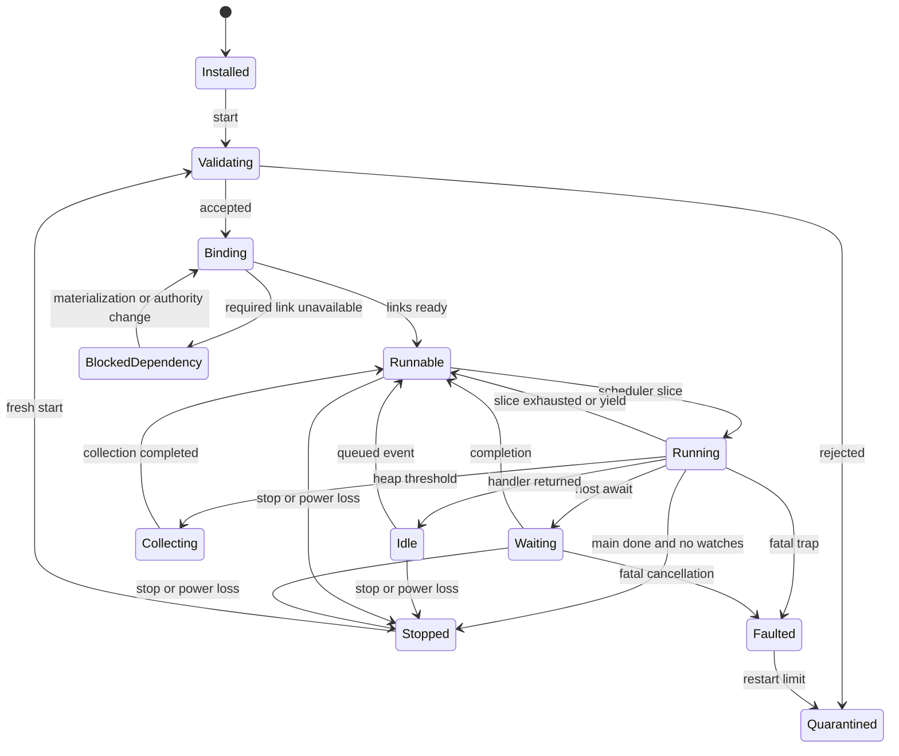
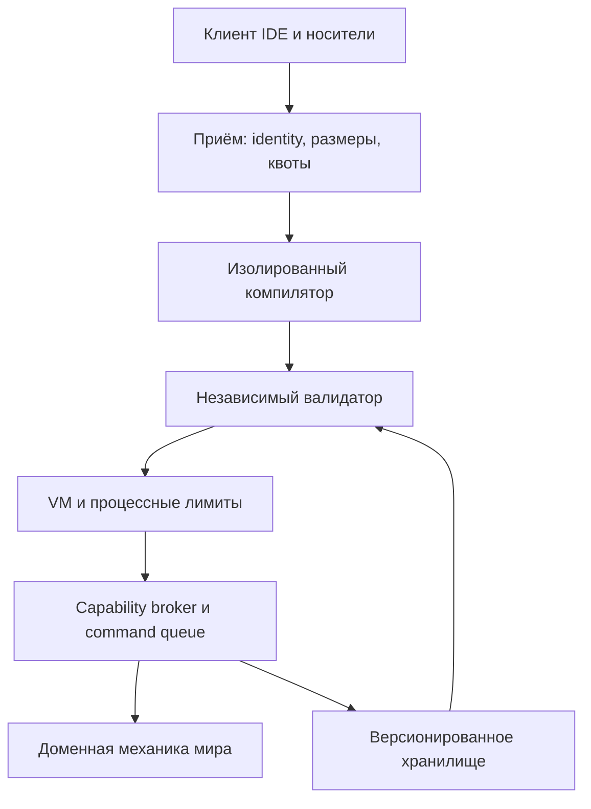
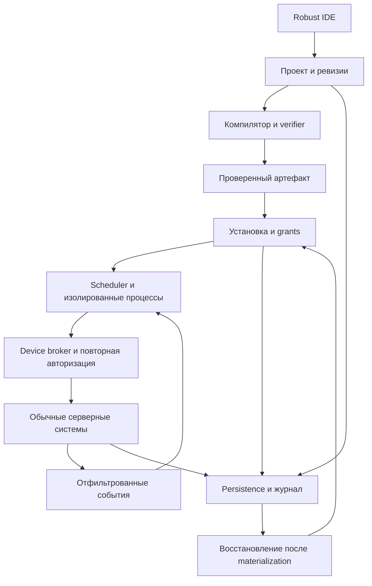

# META Hybrid normative source snapshot

Source: https://app.notion.com/p/4018867306b180c2a1b9ffe68cf4c5ff
Retrieved 2026-10-22. This is the source baseline used by ImplementationPlan.md.

Here is the result of "fetch" for the Page with URL https://app.notion.com/p/4018867306b180c2a1b9ffe68cf4c5ff as of 2026-10-22T08:07:09.363Z:
<page url="https://app.notion.com/p/4018867306b180c2a1b9ffe68cf4c5ff">
<ancestor-path>
<parent-page url="https://app.notion.com/p/3738867306b1808fb570c3d83674bac6" title="Night City 2045"/>
</ancestor-path>
<properties>
{"title":"28 — META"}
</properties>
<iconMetadata>null</iconMetadata>
<content>
<page url="https://app.notion.com/p/4018867306b1808b9045ddc39ce996a5">
META UI Framework — полноценная экосистема интерфейсов Night City 2045
</page>

**Night City 2045 — META Programming Language & Runtime**

**Game Design and Technical Design Specification v1.0**

# Назначение и статус спецификации

Дата спецификации: 22 октября 2026 года. Язык документа: русский. Назначение: основной архитектурный документ для разработки META в Night City 2045, от игрового цикла до проверяемых контрактов компилятора и сервера.

**Принятое решение.** META Hybrid — собственный статически типизированный текстовый язык, компилируемый в проверяемый байткод. Один интерпретатор исполняет изолированные процессы на совместимом игровом оборудовании. Доступ к миру проходит через ограниченные типизированные Device API и обычные серверные системы. Проекты, выпуски программ, установки, лицензии и разрешённое состояние сохраняются; живые стеки VM и временные полномочия после рестарта создаются заново.

Документ задаёт целевую систему и порядок её реализации. Он не является отчётом о существующей реализации META. Коммерческое название «v1.0» относится к версии спецификации; готовность компилятора, VM и нагрузочных сценариев должна подтверждаться указанными acceptance gates.

## Статус утверждений

 | Обозначение| Значение| Подтверждено кодом| Файл и конкретный контракт проверены на указанном commit. Это не означает, что подсистема прошла эксплуатационное тестирование| Решение META v1| Нормативное предложение этой спецификации для реализации| Проектируемый API| Новый интерфейс, компонент, событие или сервис; его пока нельзя вызывать в текущем билде| Исследование| Выбран перспективный вариант, но решение зависит от измерений или интеграционного spike| Начальная настройка| Проверяемая гипотеза для стенда; не гарантированная ёмкость сервера и не окончательный баланс«Должен» означает обязательное свойство совместимой реализации. «Рекомендуется» допускает альтернативу с зафиксированным основанием. Любые лимиты из разделов VM и производительности хранятся в версионируемой конфигурации сервера; изменение лимита не меняет синтаксис языка.

## Источники и приоритет решений

Основа — приложенное ТЗ на META \[U1\], исходники `NightCity2045/night-city` на `612529554ec12457ca9c2c34f86b9a8631e23ef0`, его фактическая версия RobustToolbox `81e82b01d6cc5957015a8c9f3baf5e573b0a5217`, связанные страницы Notion \[N08, N09, N16, N07\] и предоставленный Cyberpunk RED Core \[L1\]. Анализ кода фиксирует конкретный снимок, а не обещает соответствие будущему `master`.

При противоречии явное текущее ТЗ имеет приоритет над исторической документацией. AstraGraph не участвует. META не зависит от A-Life, от визуального скриптинга, от браузера или от заранее определённой формулы RED Core. Существующая страница нетраннинга прямо оставляет систему разрешения действий открытой \[N09\]; ниже вводится сменный контракт этой системы, а не скрытое утверждение новой системы характеристик.

## Границы первой версии

Язык v1 включает реальные алгоритмы, функции, структуры, коллекции, модули, обработку ожидаемых ошибок и события. Первая поставка платформы включает компилятор, проверку байткода, VM, IDE, проекты, носитель, контроллер двери и сохранение. API транспорта, дронов, медицинского оборудования и нетраннинга развиваются отдельными фазами без изменения основы языка.

Слово «универсальный» означает общую вычислительную модель. Оно не означает наличие двигателя в любом устройстве, право видеть любую камеру или возможность запустить тяжёлую программу на дешёвом импланте. Аппаратный профиль, доступные интерфейсы, физическая связь и выданные полномочия проверяются независимо.

## Основные архитектурные решения

 | Вопрос| Решение| Почему| Отложенная альтернатива| Исполнение| Собственный стековый интерпретатор| Маленькая проверяемая поверхность инструкций, контроль стоимости и остановки| Собственный backend в WASM после стабильной спецификации, если оправдан измерениями| Изоляция| Отдельные heap, стек, очередь и grants процесса| Код одной установки не читает память другой| Отдельный процесс ОС для всей VM-службы при выявленном риске или необходимости| Потоки| ECS и фиксация команд в серверном потоке; компиляция вне него| Сохраняется порядок игровой логики| Распараллеливание чистых вычислений после воспроизводимого профиля| События| Последовательный обработчик и ограниченная очередь| Простая модель состояния и отладки без скрытых гонок| Явные изолированные акторы в будущей версии языка| Привязка оборудования| Типизированный `link` к слоту установки| Исходник переносим, идентификатор не становится полномочием| Нет глобального lookup по строке| Постоянное состояние| Явные сериализуемые данные и восстановление| Нет старых handles, стеков и зависших операций после рестарта| Миграции данных, но не восстановление произвольного VM snapshot| UI| Robust UI в Content| Совместим с клиентом и существующей моделью BUI| Небольшой engine PR только после доказанного ограниченияЗагрузка недоверенного C# через `AssemblyLoadContext` не является альтернативным sandbox: документация .NET прямо указывает отсутствие у него защитной границы \[W1\]. Поэтому META не генерирует и не исполняет произвольные CLR-сборки игроков.

---

# 0. Проверка текущего Night City и точки внедрения

## 0.1 Проверенный снимок

Проектирование опирается на `NightCity2045/night-city`, ветку `master`, commit `612529554ec12457ca9c2c34f86b9a8631e23ef0`. Gitlink движка указывает на RobustToolbox `81e82b01d6cc5957015a8c9f3baf5e573b0a5217`. В `global.json` выбран SDK 10.0.100 с `latestFeature`; импортируемый движком build target задаёт `net10.0`, Content.props — C# 14 \[R01–R03\]. Это фактическая база для интеграции; переносить примеры на случайный актуальный upstream нельзя.

Аудит выполнен статически: проверены деревья каталогов, build files и конкретные исходники. Сборка, запуск игрового сервера, нагрузочные тесты и профилирование в рамках документа не проводились. Указание «существует» означает наличие реализации в проверенном коде, а не доказанную готовность к production.

В текущем дереве уже имеются развитые подсистемы транспорта, Агента, медицинской кибернетики и персистентности. META должна расширить их через узкие адаптеры. Новые `NCMeta...` системы размещаются в Content/\_NC с обычным разделением клиентского интерфейса, общей модели и серверной авторитетности \[R04\].

## 0.2 Матрица фактической готовности

 | Область| Уже найдено в исходниках| Разработка для META| Двери| TryOpen/TryClose, access checks, состояние, питание, bolts и collision safety| Типизированный удалённый доступ, grants, очереди, события и стабильная привязка| DeviceNetwork| Адреса, частоты, сообщения, broadcast, очереди доставки| Per-process/per-owner quotas, bounded payload, ACL, учёт fan-out| Транспорт| Модульная сборка, native physics, диагностика, температурные/жидкостные состояния, ABS/ESC/traction control, калибровка| ECU/TCU API, supervisory requests и арбитраж с водителем| Агент/CitiNet| Native UI, shards, связь, звонки, записи, authentication/PIN, данные БД| META app host, установка пакетов и ограниченные программные права| Киберимпланты| Slots, power/heat/EMP/neural state, persistent module ID, filtered diagnostics| Firmware ABI и capabilities конкретных моделей имплантов| Дроны| Общие NPC steering/pathfinding исполнители| Device controller, ownership/lease, quotas, completion/cancel и sensor contract| Persistence| Идентификаторы, durable mutations, journal/receipts/outbox, aggregate и round snapshots| META schema, проект/пакет/установка, safe state, rebind и recovery| Robust UI| TextEdit, Rope, BUI identity/validation| Полноценный редактор IDE, language service, debugger, chunk/revision protocol| META и NET runtime| Выделенный META runtime и полная NET/ICE подсистема не обнаружены в просмотренных \_NC trees и targeted search| Собственные язык, compiler, VM, broker и gameplay gatewayОтрицательные результаты поиска не доказывают отсутствие каждого legacy упоминания. Однако готовые `MetaRuntime`, `EngineController`, `Cyberdeck` или `BlackIce` API из этой спецификации нельзя считать существующими.

## 0.3 Три существенные границы доступа

**Дверь.** `SharedDoorSystem.TryOpen` вызывает обычные проверки, но `HasAccess` разрешает доступ при `user == null` \[R05–R09\]. Это доверенный внутренний путь. Поэтому META bridge обязан отдельно проверить service principal/grant, либо использовать действительного actor там, где подходит существующая ID-механика. Вызов `TryOpen(door)` без такого bridge обходил бы нужную границу. Успешный вызов начинает открытие; физическое завершение отслеживается по состоянию.

**Автомобиль.** `NCVehicleControlSystem.TryControl(uid,user,authority,action)` требует текущего сидящего водителя и правильную authority \[R12–R13\]. Автономный скрипт нельзя подключать подделкой Driver или BUI input. Runtime ECU policy — новый контролируемый вход в родную физику. Она продолжает рассчитывать момент, расход и сцепление по реальной сборке, condition и разрешённой calibration \[R14–R17\]. Уже существующая калибровка требует мастерской, инструмента, открытого капота и DoAfter с повторной проверкой revision; META не отменяет эти требования.

**Медицина.** `NCDiagnosticsSystem.TryBuildForActor` проверяет actor, инструмент, питание, пациента, дистанцию и разрешённый уровень диагностики; AdminExact явно отклоняется \[R24\]. Пользовательский API должен возвращать именно отфильтрованные сведения. Существующие trusted методы `TrySetLoad` и `AdvanceModule` киберимплантов не являются готовой ACL: последний вообще нельзя отдавать игроку для управления течением симуляции \[R22–R23\].

## 0.4 Сеть и планирование

В `DeviceNetworkSystem` двойная очередь не допускает синхронного зацикливания доставки, но active queue вычитывается целиком. Это не защита от массового потока программ и не общий бюджет META \[R10–R11\]. Новый broker должен ограничить входящий объём и стоимость рассылки до вызова существующего транспорта. Адрес и частота не заменяют полномочия.

NPCSteeringSystem предоставляет реальные `Register`, `TryRegister` и `Unregister`; PathfindingSystem уже имеет собственное планирование запросов \[R25–R26\]. META передаёт цель ограниченному доменному исполнителю. Наличие native pathfinder не гарантирует ёмкость 500 программ или пригодность ground steering для любого летающего дрона.

## 0.5 Персистентность надо расширять, а не дублировать

В проекте уже есть `NCItemId`, `NCCharacterId`, `NCPartyRef`, `NCSessionEpoch` и `NCActiveWorldTime` \[R28–R29, R47\]. Durable устройство связывается с существующей физической идентичностью; EntityUid остаётся временным.

`IServerDbManager.ApplyNCPersistentMutationAsync` и batch-вариант используют version checks, command receipts, journal и outbox в serializable transaction \[R41–R42\]. На них можно строить атомарные изменения META projects/installations. Для данных нужны новые schema contracts и необходимые индексы, а не вторая конкурирующая система транзакций. Проверенный mutation API требует активного мира и совпадения SessionEpoch; сохранение авторских проектов вне активного раунда требует отдельной явно заданной политики, а не обхода этой проверки.

`NCRoundSnapshotCaptureEvent.TryAddSection` — существующая точка добавления immutable snapshot sections; coordinator собирает их синхронно и затем коммитит общий snapshot \[R30–R31\]. Реализация snapshot commit объединяет manifest/sections и связанные удаления в одной транзакции \[R43\]. Это end-of-epoch путь. Для сохранения исходника, установки или checkpoint внутри раунда требуется отдельный подтверждённый durable commit.

Восстановление распределено: city-map-delta загружается на старте сессии, инвентарь — при появлении персонажа \[R45–R46\]. META rebind выполняется после появления конкретного устройства; запуск всех программ сразу в одном OnRoundStart некорректен. Старые handles и authority не восстанавливаются. Для согласованного междоменного recovery нужен выбранный SnapshotId; имеющийся latest-sections API сам выбирает последний снимок для каждого вызова \[R44\], поэтому фиксированное чтение одного снимка — предлагаемое расширение.

## 0.6 Стоимость IDE и проверок

В закреплённом Robust `TextEdit` — `sealed`, использует Rope и поддерживает multiline, selection и IME. Публичный syntax-span API в просмотренном коде не найден; renderer, scrollbar и line index внутренние \[R34–R35\]. Нельзя обещать полноценную подсветку простой производной `NCMetaEditor : TextEdit`. Для раннего среза годится композиция; готовая IDE требует отдельного Content-side control и проверки Unicode/IME/undo/large-file latency.

BUI устанавливает Actor по реальному sender и проверяет подписку/validation hooks \[R36\]. Это транспортная основа; права на проект, устройство, chunk size и revision проверяются Content отдельно.

В репозитории есть Content.Tests, Content.IntegrationTests и Content.Benchmarks с NUnit/BenchmarkDotNet и примером DeviceNetworkingBenchmark \[R37–R40\]. Они дают инфраструктуру для будущих gates. Ни одно значение производительности META в документе не является результатом запуска этих тестов.

---

# I Концепция и геймдизайн

## 1.1 Роль META в жизни города

META превращает программное обеспечение в предмет производства, владения и обслуживания. Игрок может написать систему охраны склада, подобрать обработку телеметрии автомобиля, создать инструмент диагностики или продать библиотеку. Другой игрок покупает готовый продукт, подключает совместимое оборудование и получает понятный пользовательский интерфейс. Разработка создаёт взаимодействие между профессиями без обязательной системной роли «Программист».

Базовый цикл: обнаружить задачу → получить спецификацию оборудования и доступ → собрать проект → проверить его на стенде → выпустить версию → установить и настроить → наблюдать работу → обслуживать и обновлять. В этом цикле есть заказчик, риск, проверяемый результат и последующая поддержка. Написание более длинного кода само по себе не приносит денег или опыта.

 | Ситуация| Игровая ценность| Возможное злоупотребление| Правило системы| Охрана мастерской| Заказы инженеру и охраннику, полезные журналы| Универсальная камера видит весь город| Только реальные сенсоры и видимые ими данные| Прошивка автомобиля| Совместная работа механика и разработчика| Множитель мощности без деталей и последствий| Команды ограничены физической моделью и установленными блоками| Лабораторная автоматика| Воспроизводимые рецепты, контроль партий| Производство веществ из воздуха| Реальные ёмкости, реагенты, оборудование, время и отходы| Инструмент нетраннера| Разведка, сравнение маршрутов, подготовка| Код отменяет проверки и ICE| Каждое действие проходит серверное разрешение и цену| Приложение Агента| Сервис, связь и личные данные| Спам или массовая выгрузка чужих сообщений| Отдельные права, квоты, существующие блокировки и область видимости| Сервис обновления| Длительные отношения разработчика и клиента| Тайная выдача новых прав через обновление| Новые права требуют нового предоставления, существующая установка фиксирует digest## 1.2 Лор и авторская адаптация

Предоставленный Corebook связывает META с объединением разнородных платформ примерно с 2035 года и с современной локальной СЕТью; в нём описаны кибердеки, локальные точки входа, защитные программы и последствия опасного отключения \[L1, печатные с. 196–198; PDF с. 197–199\]. Грамматика, типы, байткод, аппаратные профили и API данного документа являются авторской реализацией для Night City, а не реконструкцией опубликованного стандарта.

Визуальная и техническая атмосфера строится на локальных сетях зданий, сервисных разъёмах, несовместимых ревизиях оборудования, физических носителях, ремонте и доверии к поставщику. CitiNet предоставляет городские услуги, но не является универсальным туннелем к защищённой NET-архитектуре. Удалённый доступ возможен только через конкретный работающий шлюз с соответствующей политикой.

Настольная дистанция входа и число действий не переносятся автоматически в тайлы и server ticks. Для них предусмотрены параметры access-point profile и action profile. До выбора баланса вводится явная локальная область подключения, визуальная индикация её границ и серверная проверка сохранения контакта. Это сохраняет командную игру вокруг нетраннера, не закрепляя неподтверждённую формулу.

## 1.3 Категории пользователей

 | Пользователь| Что делает| Что ему необходимо понимать| Покупатель| Устанавливает приложение, выбирает устройство, запускает| Совместимость, цена, запрашиваемые права и понятные ошибки| Оператор| Настраивает пределы и расписания| Назначение параметров, режимы отказа и ручное управление| Техник| Подключает контроллер, тестирует сенсоры, восстанавливает прошивку| Физическая схема и документация Device API| Разработчик| Пишет алгоритм, библиотеку, тесты и обновления| META, типы, события и ограниченные ресурсы| Нетраннер| Использует и сочетает инструменты в доступной архитектуре| Риски соединения, защита, оборудование и правила действий| Аудитор или администратор| Разбирает сбой или злоупотребление| История установки, происхождение артефакта и журнал действийИгрок может совмещать категории. Допуск к занятиям не определяется скрытым классом. Если конкретное действие требует квалификации персонажа, инструмента или лицензии внутри игрового мира, проверку выполняет соответствующая механика. Умение игрока писать код не подменяет квалификацию персонажа и не должно блокировать покупателя готового приложения.

## 1.4 Сценарии сложности

Первое знакомство занимает один законченный сценарий: открыть шаблон сигнала перегрева, изменить порог, увидеть результат на учебном датчике. Следующая ступень — две зоны температуры и предупреждение с гистерезисом, чтобы лампа не мигала на границе. Затем добавляются журнал, диагностика неисправного датчика, настройка нескольких устройств и обслуживание версий.

Сложность развивается через качество решений: обработку потери связи, совместимость, защиту от устаревших данных, измерение расхода ресурсов, продуманное управление. Она не создаётся обязательными опечатками в командах или искусственным ожиданием компиляции. Учебный проект показывает реальный код того же языка, который используется в коммерческих продуктах.

Для игрока без опыта программирования предусмотрены готовые приложения, локализованные описания, настройки с диапазонами, диагностика подключения и восстановление известной рабочей версии. Форма настроек хранится как ограниченная схема продукта: числа, строки, переключатели, enum, группы и справка. Это средство эксплуатации программы; редактором алгоритма остаётся текстовая IDE.

## 1.5 Специализация и универсальные программы

Сильная библиотека или хороший универсальный диагностический пакет допустимы. Система не должна ломать корректный алгоритм только потому, что он популярен. Однако программный пакет не получает все функции мира: нужные сенсоры должны существовать, полномочия выдаются на конкретную установку, память и пропускная способность ограничены, тяжёлые модули конкурируют за ресурсы оборудования.

Разделение рынка поддерживают реальные условия: документация производителя, версии интерфейсов, обслуживание старых устройств, заказные требования, конфиденциальные данные заказчика, репутация, стоимость интеграции и поддержка. Нельзя сделать специализацию исключительно через случайную несовместимость идентичных API или искусственные запреты на чтение открытого исходника.

Возможность объединить десяток утилит в один пакет не обходит бюджет. Все дочерние функции, библиотеки и сетевые запросы оплачиваются из той же установки и её principal. Запуск копий на соседних носителях не создаёт новый общий бюджет владельца. При распределённой обработке появляются реальные сетевые задержки и необходимость владеть узлами.

## 1.6 Кооперация и контригра

Механик устанавливает датчик и обеспечивает охлаждение; разработчик обнаруживает режим отказа и пишет сигнализацию; владелец определяет полномочия; охрана реагирует на событие. Ни один участник не получает скрытого доступа к остальным профессиям через язык.

Противодействие остаётся игровым: отключить питание, разорвать кабель, закрыть шлюз, заменить повреждённый датчик, отозвать credential, найти подозрительную установку, восстановить доверенную прошивку. У злоумышленника должны быть следы и условия доступа. У владельца — способ диагностики и восстановления. Блокировка доступа не стирает историю операции из административного аудита.

Отказ программы создаёт локальную неисправность с объяснимым состоянием. Он не обрушает весь механизм, если у него предусмотрено штатное ручное управление. Для опасных сценариев есть локальная политика fallback: медицинский прибор останавливает пользовательский сценарий и сохраняет базовое обслуживание; двигатель переходит к штатному ограниченному режиму; дрон выполняет заданное безопасное действие.

## 1.7 Принципы допуска и измерения игрового результата

Качество системы оценивается по законченным задачам: способен ли покупатель установить продукт без IDE, может ли техник установить причину отказа, приносит ли поддержка полезную работу, остаётся ли ручное управление, есть ли осмысленная контригра, не выигрывает ли один универсальный скрипт во всех ситуациях за счёт обхода правил.

До массового запуска собираются длительность первого успешного проекта, число ошибочных предоставлений прав, доля установок с rollback, частота непонятных отказов, количество повторных заказов и влияние автоматизации на занятость других игроков. Эти показатели не превращаются в обязательную систему опыта или в вознаграждение за строки кода.

---

# II. Нормативная спецификация META Hybrid 1.0

## 2.1. Статус и границы

Весь синтаксис, типы и правила ниже — **проектная спецификация Night City**, а не опубликованный синтаксис META из настольной игры. Версия языка `1.0` не означает, что перечисленные интеграции уже реализованы. Версия языка, формат байткода и версии Device API имеют независимые номера. Одна реализация META обслуживает автомобиль, компьютер и кибердеку; доступные модули и аппаратные возможности определяются профилем установки.

META 1.0 — статически типизированный императивный язык с функциями, составными данными, модулями и последовательной обработкой событий. Статическая типизация выбрана потому, что ошибка в имени датчика, типе температуры или способе ожидания должна обнаруживаться до установки прошивки. Динамическая типизация упростила бы первый интерпретатор, но перенесла бы эти ошибки в игровую эксплуатацию и усложнила проверку байткода. Системы классов, наследования, пользовательских дженериков, указателей, рефлексии, динамической загрузки кода и исполнения C#/JavaScript нет. Это ограничение поверхности первой версии, а не ограничение языка списком игровых команд: алгоритмы, рекурсия, коллекции, библиотеки и собственные типы остаются полноценными.

Нормативные слова: **должен** — требование совместимости; **может** — разрешённое поведение реализации; **целевой лимит** — первоначальный инженерный параметр, подлежащий измерению. Аппаратный профиль может уменьшить лимиты, но не менять семантику оператора или тип функции.

## 2.2. Исходный текст и лексика

 | Правило| META 1.0| Кодировка| UTF-8 без недопустимых последовательностей; исходный файл после импорта содержит LF. BOM допускается только в начале и удаляется до фиксации ревизии.| Идентификатор| `[A-Za-z_][A-Za-z0-9_]*`, кроме единственного `_` и ключевых слов. ASCII выбран для предотвращения невидимых различий и похожих букв в именах.| Регистр| Значим: `engine` и `Engine` — разные имена.| Текст и комментарии| Полный Unicode; кодировка не ограничивает русский текст интерфейса или журналов.| Пробелы| Пробел, tab, LF и CR между токенами игнорируются. CR в зафиксированном исходнике отсутствует после нормализации.| Комментарии| `//` до конца строки; `/* ... */` без вложенности. Незакрытый комментарий — ошибка компиляции.| Целые литералы| Десятичные цифры или `0x` и шестнадцатеричные цифры; `_` разрешён только между цифрами. Знак — отдельный унарный оператор.| Дробные литералы| Десятичная точка с цифрами с обеих сторон и/или экспонента: `110.0`, `1e3`, `2.5e-2`; `1.` запрещён.| Строки| Двойные кавычки; `\"`, `\\`, `\n`, `\r`, `\t`, `\u{1F680}`. Неэкранированные LF и управляющие символы запрещены.| Логические литералы| `true`, `false`.| Пустое значение| `()` имеет тип `void`, то есть единичный тип с единственным значением.| Максимальное совпадение| Лексер выбирает самый длинный допустимый токен: `<=` раньше `<`, `->` раньше `-`.Строки не интерполируются автоматически. Для журнала применяются `text.fromInt`, `text.fromFloat` и `+`. Это исключает скрытые вызовы форматирования произвольных объектов. Unicode в строках не нормализуется: изменение содержимого файла или сетевого сообщения не должно происходить при компиляции. В логах редактора управляющие символы показываются безопасно и не интерпретируются как разметка.

Ключевые слова: `module import as pub link fn async watch let var const struct enum if else while for in return break continue match some none ok err true false await yield new`. Имена примитивов и контейнеров (`void bool byte int float string array list map option result`) также зарезервированы как токены и не используются как пользовательские идентификаторы. `null`, `class`, `throw`, `catch`, `spawn`, `eval`, `unsafe`, `typeof`, `using` также зарезервированы для будущих версий, но не имеют конструкции в v1 и дают диагностику, а не скрытый путь исполнения. Ключевые слова `some`, `ok`, `err` являются встроенными конструкторами вариантов, не библиотечными функциями.

## 2.3. Типы и значения

 | Тип| Представление и семантика| `void`| Единичное значение `()`; `return;` равнозначно возврату `()`. `result<void>` содержит только тег успеха или ошибку.| `bool`| `true`/`false`; числа не приводятся к bool.| `byte`| Беззнаковое целое 0–255; используется для двоичных данных. Арифметика требует явного преобразования в `int`.| `int`| Знаковое 64-битное целое; переполнение арифметики — фатальная VM-ошибка текущего процесса.| `float`| IEEE 754 binary64, только конечные значения. NaN, ±Infinity и переполнение дают `NumericFault`; деление на ноль запрещено. −0 нормализуется в +0 на границе операций/сериализации.| `string`| Неизменяемая последовательность Unicode scalar values, хранится UTF-8. Сравнение — порядковое, без локали.| `enum`| Именованный конечный набор вариантов без произвольного преобразования из числа.| `struct`| Именованный набор полей; копируется по значению, поля контейнерного типа копируют ссылку на коллекцию того же процесса.| `array<T>`| Массив с фиксированной после создания длиной; изменяемые элементы, ссылки не выходят за пределы процесса.| `list<T>`| Изменяемая последовательность переменной длины.| `map<K,V>`| Ассоциативная коллекция; `K` — int, byte, bool, string или enum. Порядок перебора ключей — порядок вставки.| `option<T>`| Только `some(T)` или `none`; отдельного null нет.| `result<T>`| Только `ok(T)` или `err(Error)`. `Error` — тип из `meta.system`, доступный также как предопределённый тип результата.| Тип capability| Неподделываемая ссылка на выданный интерфейс устройства; может появиться только через `link` или явно разрешённый API выдачи.| Тип opaque reference| Ограниченный сервером игровой идентификатор, например `NetNodeRef`; читать/передавать разрешённому API можно, конструировать из строки/числа нельзя.Прямые и косвенные циклы в определениях пользовательских `struct` первой версии запрещены, включая циклы через контейнеры. `struct Node { children: list<Node>; }` не проходит проверку v1. Деревья и графы представляются массивом узлов и индексами, то есть сложные алгоритмы сохраняются без циклической системы типов. VM всё равно обязана корректно обрабатывать и отбрасывать повреждённые объектные графы при проверке чужого байткода или сериализованных данных; запрет в исходном языке не заменяет sandbox.

Размер `struct` и глубина вложения типов ограничены. Базовый верхний предел — 64 поля, 16 уровней вложения и 4 KiB плоского значения; это форматные ограничения первого ABI, а не характеристики физической памяти устройства. Большие данные хранятся в коллекциях. Capability, opaque reference и объект Promise не сериализуются в пользовательское постоянное состояние.

### Преобразования и арифметика

Неявного преобразования между `int` и `float`, между строкой и числом, между enum и числом нет. Контекстный целочисленный литерал может иметь тип byte, если явно ожидается byte и значение входит в диапазон; во всех остальных случаях он имеет тип int. `-9223372036854775808` обрабатывается как допустимый особый случай унарного минуса над величиной литерала, которая не может существовать как положительное int.

Явные преобразования выполняют функции `numeric.toFloat(int) -> float`, `numeric.toInt(float) -> result<int>`, `numeric.toByte(int) -> result<byte>` и `numeric.byteToInt(byte) -> int`. `byteToInt` точно расширяет 0–255 до int64 без ошибки; это отдельное имя, поскольку пользовательских перегрузок и неявных преобразований нет. `toInt` округляет к нулю и возвращает `OutOfRange`, если результат не помещается; `toFloat` может округлить целое, что отражено в контракте. Нельзя считать преобразование int→float точным для всех int64. Парсинг текста использует `text.parseInt(string) -> result<int>` и `text.parseFloat(string) -> result<float>` с точкой, без локали и с обязательным потреблением всей строки.

Операторы `+ - * / %` применяются к одинаковым числовым типам int или float; `+` также соединяет две строки. Для int деление округляется к нулю; остаток имеет знак делимого. Для float `%` означает остаток после деления с частным, усечённым к нулю, а не IEEE remainder с округлением к ближайшему; результат проходит общую finite/zero нормализацию. Переполнение `minInt / -1` обрабатывается до вызова инструкции хост-языка и даёт NumericFault. Отдельно `minInt % -1` определено как 0; VM/const evaluator проверяют этот случай до потенциально переполняющей операции хоста. Делитель 0 всегда NumericFault для обоих операторов. `<<` и `>>` требуют int, величина сдвига 0–63; левый сдвиг сохраняет младшие 64 бита, правый арифметический. Это явно определённое побитовое поведение, в отличие от проверяемых `+`, `-`, `*`. Унарный `~`, `&`, `|`, `^` работают с int. Функции тригонометрии не входят в обязательный профиль v1: их можно добавить версионированным чистым математическим модулем без изменения языка.

`==` и `!=` определены для одинаковых скалярных/enum типов и рекурсивно сравнимых struct, option, result. Коллекции и capabilities напрямую не сравниваются; поэлементное сравнение массива пишется функцией. Отсутствие сравнения capability не даёт извлекать внутренние идентификаторы. `< <= > >=` работают для одинаковых int, float, byte и string. `&&`, `||` и `!` требуют bool. `&&` и `||` вычисляются с сокращением.

## 2.4. Переменные, области видимости и инициализация

`let` создаёт неизменяемую привязку, `var` — изменяемую, `const` — вычисляемое компилятором неизменяемое значение. `let` не делает содержимое list/array/map неизменяемым; это прямо указывается в IDE. Для неизменяемого API-входа сервер получает сериализованную копию, а не ссылку на коллекцию, которую программа продолжит изменять.

```txt
let limit: float = 110.0;
var consecutive: int = 0;
const VERSION: string = "1.0";
let values: array<int> = [3, 7, 9];
values[0] = 4;
// limit = 100.0;  // E210: привязка let неизменяема.
```

Тип локального let/var может выводиться из инициализатора. Параметры, возвращаемый тип функции, поля struct, link, публичные const и глобальные let/var всегда имеют явный тип. Инициализатор обязателен; неинициализированных переменных и неявных нулей нет. Пустой массив `[]`, `none` и `err(e)` требуют ожидаемого типа, если его невозможно вывести из окружающей позиции.

Области видимости: пакет → модуль → функция/обработчик → блок → ветвь match/итерация for. Повторное объявление в одной области запрещено; затенение локальной переменной внешнего блока в v1 также запрещено, чтобы ошибка в прошивке не маскировалась похожим именем. Поле struct может совпадать с именем локальной переменной, поскольку доступ явный через точку. Параметры неизменяемы; их контейнеры изменяемы как обычные ссылки процесса. Для локального изменяемого значения параметр копируют в var.

Глобальные let/var — состояние отдельного процесса; несколько установок одного пакета не разделяют его. Инициализаторы глобальных значений состоят только из констант, литералов агрегатов, встроенных конструкторов пустых коллекций и именованных инициализаторов struct без вызовов пользовательских функций. Инициализация выполняется в зависимости от графа глобальных выражений; цикл зависимостей — ошибка. Нельзя вызывать Device API, ожидать сеть или запускать файловое чтение из инициализатора. Состояние глобальных var не становится постоянным автоматически: после перезапуска оно создаётся заново, затем main явно читает разрешённый файл состояния.

`const` разрешает только скаляры, enum и struct, состоящие из таких значений; массивы и другие изменяемые ссылки не являются const. Компилятор вычисляет выражения const своим ограниченным evaluator, не запускающим META-функции.

## 2.5. Выражения и приоритеты

Операнды вычисляются слева направо. Присваивание — отдельный statement, не выражение; цепочка `a = b = 1` запрещена. Индекс массива/list имеет тип int, отрицательный индекс не обращается с конца. Выход за границы — `BoundsFault`, останавливающий процесс; для ожидаемо отсутствующего ключа map используется option.

 | Приоритет, сверху сильнее| Операторы| Ассоциативность| 1| `call(...)`, `.field`, `[index]`| слева| 2| `await`, `!`, `~`, унарные `+` `-`| справа; await ограничен async-вызовом| 3| `*` `/` `%`| слева| 4| `+` `-`| слева| 5| `<< >>`| слева| 6| `< <= > >=`| слева; цепочка допустима синтаксически, но обычно не проходит типизацию| 7| `== !=`| слева| 8| `&`| слева| 9| `^`| слева| 10| `|`| слева| 11| `&&`| слева, сокращённо| 12| `||`| слева, сокращённоТернарного оператора, инкремента, перегрузки операторов, неявного вызова getter с побочным эффектом нет. Чтение `snapshot.temperatureC` — чтение локального поля, а не запрос в ECS.

## 2.6. Управление потоком и функции

`if (condition) { ... } else { ... }` требует bool и фигурные скобки. `while (condition)` поддерживает break/continue. `for (let item in collection)` перебирает array или list в порядке индексов; тип item выводится. Во время for запрещено менять длину перебираемого list; VM проверяет structural-version и выдаёт `CollectionModified`. Изменение значений существующих элементов допускается. map перебирается через `map.keys()`, возвращающий ограниченный снимок ключей. Выражение коллекции вычисляется один раз.

Функция объявляется `fn name(arg: Type, ...) -> Type { ... }`; возвращаемый тип обязателен. Вызовы позиционные; число и типы аргументов должны совпадать. Перегрузок по типам, optional parameters, variadic, пользовательских generic functions и функций как значений в v1 нет. Экспорт через `pub fn`; локальные вложенные функции не поддерживаются. Рекурсия и взаимная рекурсия разрешены, если типы вызовов известны; лимиты глубины стека и gas всё равно обязательны. Оптимизация tail-call не является гарантией языка и не отменяет лимит логической глубины, если будет добавлена.

Все пути обычной функции с возвращаемым типом, отличным от void, должны завершаться return либо доказанно не возвращающимся вызовом. Для v1 компилятор не пытается доказать произвольное условие бесконечного цикла: после while требуется return. В функции `-> void` допустим неявный `return;` в конце. return внутри watch завершает только текущий обработчик. break/continue вне цикла — ошибка.

Конструктор пользовательского struct имеет явную форму `new Reading(temperatureC: 102.0, rpm: 3100)`. Все поля перечисляются ровно один раз; их порядок в исходнике свободен, вычисление аргументов идёт в записанном порядке, а размещение — по схеме типа. У struct нет методов-конструкторов, наследования или исполняемых field initializers. Публичная функция с публичным типом не может использовать скрытый тип в своей сигнатуре.

## 2.7. Модули, импорты и библиотеки

Каждый файл начинается ровно с одного `module qualified.name;`, затем идут import, затем объявления. Каждый модуль занимает один исходный файл; многим файлам соответствуют разные модули одного проекта. Package manifest сопоставляет пути и имена модулей, запрещает дубликаты и имена стандартного пространства `meta.*` у пользовательского кода.

`import meta.system;` связывает namespace alias `system`. `import owner.tools as tools;` задаёт другой alias. Публичные функции/константы другого модуля используются через alias: `tools.calibrate(...)`. Экспортированные имена типов импортируются также в пространство типов: после `import meta.vehicle;` разрешено `EngineController`, а полное `vehicle.EngineController` снимает неоднозначность. Если два импорта экспортируют одинаковое короткое имя типа, короткая запись даёт E224; порядок import ничего не меняет. Имена alias не могут совпадать с локальными или глобальными переменными.

В собственном модуле объявления типов, функций и глобальных имён видимы независимо от текстового порядка. Экспортируются только `pub fn`, `pub struct`, `pub enum`, `pub const`. Глобальные var/let, link и watch не экспортируются. В root-module может находиться main, link и watch; библиотечные модули могут содержать функции, типы, const и приватное состояние, но не link/watch/main. Библиотека получает capability только явным параметром функции, сохраняющим ограничения handle. Это исключает скрытые фоновые подписки библиотеки при import. Циклы import запрещены в v1, взаимная рекурсия внутри модуля разрешена.

В v1 в одном resolved project допускается одна версия каждого package identity; конфликт зависимостей даёт диагностику, а не скрытую загрузку двух модулей с одним именем. Одна разрешённая библиотека инстанцируется один раз на процесс, даже если импортирована несколькими другими модулями; разные процессы не разделяют её mutable globals.

Import — разрешение зависимости при сборке, а не сетевое скачивание во время игры. Lockfile фиксирует точный artifact hash, версию API и compiler ABI. Библиотеки проверяются сервером и статически связываются в пакет. Отсутствующая коммерческая библиотека даёт ошибку сборки; клиент не может подменить её содержимое ссылкой на файл хоста. Лицензия библиотеки и право скачать исходник — отдельные игровые разрешения. Установка dependency автоматически не выдаёт ей доступ к новым устройствам.

## 2.8. `link`: привязка к выданному интерфейсу

```txt
module shop.frontdoor;
import meta.doors;
link door: Door = "front-door";
link panel: DoorPanel = "front-panel";
```

`"front-door"` — имя слота в подписанном сервером deployment manifest, а не EntityUid, адрес произвольного устройства, пароль или право доступа. При установке пользователь выбирает доступное устройство через интерфейс; сервер записывает persistent device identity, требуемый interface/version, grants, маршрут связи и generation. При запуске `link` получает непрозрачный handle только после проверки профиля и grant. Строка не предоставляет authority.

В v1 все link обязательные. Если слот не связан, несовместим или отозван, процесс остаётся `BlockedDependency` и не исполняет main; IDE объясняет конкретную причину владельцу без раскрытия чужих устройств. Отключение питания/связи после успешного binding не подменяет handle новым устройством: API возвращает `PowerOff`/`Disconnected`, а lifecycle broker сообщает изменение доступности. Уничтожение, перепривязка слота или смена поколения отзывают старые handles. Автоматическая повторная привязка по совпадению имени запрещена.

Библиотека может принимать `Door` параметром, но не конструировать его. Нельзя сериализовать capability, преобразовать его в int/string, передать в сетевое сообщение, сохранить на диск или получить через reflection. Список разрешённых интерфейсов IDE получает от broker; пользовательский код получает только сведения своих выданных handles и не может перечислить ECS.

## 2.9. `watch`: события, а не реактивные выражения

```txt
watch ecu.telemetryChanged(sample) {
    system.log(text.fromFloat(sample.temperatureC));
}
```

Цель watch имеет ровно форму `linkName.eventName`. Имена и типы параметров берутся из версионированного контракта события; список names в watch должен совпадать по числу и порядку. Подписка фиксируется при сборке и активируется после binding. В v1 нельзя написать `watch (ecu.temperatureC > 100.0)` или динамически подписываться в цикле. На один event одного link разрешён один watch данного процесса; объединение действий делает обычная функция. Несколько разных событий могут вызывать одну функцию.

Источник события — проверенная игровая система. Пользовательский META не может отправить искусственный `DoorPanel.requested` как будто это физическое действие игрока. Сериализованный DTO с теми же полями не обладает доверенным metadata события. Epoch, sequence, actor principal, delivery kind и права авторства хранятся также в недоступном программе envelope.

Одновременно у процесса исполняется только одна активация: main или один watch. При await текущий обработчик приостанавливается, но другой watch этого же процесса не начинает выполнение. Это убирает скрытые гонки глобального состояния. Завершения host operation проходят отдельным каналом supervisor и могут возобновить ожидающий обработчик, не ожидая очереди watch. Обработчик не должен ждать событие, для обработки которого требуется завершение этого же обработчика; API не предлагает такой механизм.

Семантика доставки определяется каталогом событий. Телеметрия `Latest` объединяется по `(link,event)` с сохранением последнего SampleStamp; потеря промежуточных значений допустима. Дискретное событие `Ordered` сохраняет порядок в ограниченной очереди, а переполнение приводит к явно зарегистрированному `EventOverflow` и политике остановки/безопасного режима, а не бесконечной памяти. Событие не обещает exactly-once через рестарт. После запуска приходит актуальный snapshot или новый sample; старый event queue не восстанавливается с диска.

## 2.10. Асинхронность, `await` и `yield`

`async fn` и `async watch` разрешают `await`. Заявленный возвращаемый тип async fn — тип результата после ожидания. Например, `async fn load() -> result<string>` при вызове порождает внутреннее ожидание, но тип `task<T>` не существует в исходном языке v1.

Фрагмент ниже предполагает импорты `meta.system`, `meta.files` и ранее объявленный `link data: FileStore = "data";`.

```txt
async fn loadTitle(store: FileStore) -> result<string> {
    return await store.readText("title.txt");
}

async fn main() -> void {
    let title = await loadTitle(data);
    match (title) {
        ok(value) => { system.log(value); }
        err(error) => { system.log(error.message); }
    }
}
```

Каждый async-вызов должен быть непосредственным операндом await. Нельзя сохранить task в переменную, отбросить async-вызов, запускать parallel-all, spawn или тайно продолжать его после return. Внутренние async-функции используют те же кадры единственной активации; host call создаёт не более одного ожидаемого внешнего запроса процесса. Вызов, требующий async, из обычного fn/watch даёт ошибку компиляции. `await` в const/global initializer запрещён.

`yield;` разрешён в fn и watch обоих видов и приостанавливает активацию не ранее следующего доступного scheduler slice следующего игрового тика. Это точка добровольной уступки, не sleep на заданное число миллисекунд. `yield`, await и смена tick не обнуляют суммарный gas/лимит продолжительности активации. Бесконечный цикл с yield также конечен с точки зрения квот и будет остановлен как Runaway. Для многосуточной автоматики используются короткие watch, а не вечный main.

Async Device API ставит валидированную команду в broker; авторитетная игровая система повторно проверяет права и состояние при commit. Возвращённый `ok(state)` обычно подтверждает принятие управляющего намерения и снимок на этот момент. Если дверь ещё движется, `phase == Opening` допустим; завершение движения наблюдается отдельным событием. Конкретное исключение — явно документированный API ожидания готового результата, например `readText`. Отмена ожидания не откатывает уже принятый игровой эффект. Метод никогда не вызывает синхронный блокирующий I/O игрового потока.

## 2.11. Ошибки и проверки полноты

Ожидаемые отказы выражаются result. Для его разбора используется только исчерпывающий match; свойства `.value`, `.unwrap`, исключения языка и неявное распространение `?` в v1 отсутствуют. Программа может оставить result в переменной, передать функции или возвратить его. Отбрасывание непустого результата выражением-statement запрещено: отдельный вызов без присваивания допустим лишь с результатом void. Поэтому `await door.setOpen(true);` без обработки — E240, а `let response = await door.setOpen(true);` допустим и даёт IDE warning, если response не прочитан. Производственный профиль может трактовать такой warning как ошибку публикации.

```txt
match (reply) {
    ok(value) => { system.log("accepted"); }
    err(problem) => { system.log(problem.message); }
}
match (cached) {
    some(value) => { system.log(value); }
    none => { system.log("empty"); }
}
```

`ok(_)` игнорирует успешную нагрузку; для result\<void> это обычный вариант. Match поддерживает option, result, enum и bool. Ветки различимы по тегу, должны покрывать все случаи; `_` последним означает остальные варианты. Переменная pattern видна только внутри своей ветви. Вложенных patterns и pattern guards в первой версии нет. Числовые диапазоны обрабатываются if. Необработанная Error не превращается в .NET exception.

Для собственных ожидаемых отказов существует `system.error(code: ErrorCode, message: string) -> Error`: безопасная чистая фабрика ограничивает message до 512 UTF-8 bytes, задаёт retryAfterMs=0 и не создаёт authority или серверное происхождение. Например, `return err(system.error(ErrorCode.InvalidArgument, "negative amount"));` допустим внутри `fn ... -> result<T>`. Error, созданный программой, является обычными данными; broker никогда не принимает его как доказательство результата чужой операции.

Общий `Error` имеет readonly поля `code: ErrorCode`, `message: string`, `retryAfterMs: int`; сообщение ограничено 512 UTF-8 bytes и не содержит серверных stack traces. Нормативные коды: `InvalidArgument`, `OutOfRange`, `NotFound`, `Conflict`, `AccessDenied`, `PermissionRevoked`, `Disconnected`, `PowerOff`, `DeviceDestroyed`, `Incompatible`, `Busy`, `RateLimited`, `QuotaExceeded`, `Timeout`, `Cancelled`, `Unsupported`, `IoFailure`, `StaleState`, `Interlock`, `PathUnavailable`, `ActionRejected`, `OutcomeUnknown`, `ControlLost`. `OutcomeUnknown` означает, что отсутствие подтверждения не позволяет безопасно считать действие невыполненным; автоматический повтор неидемпотентной команды запрещён до сверки operation status. `ControlLost` означает отзыв arbitration lease. `retryAfterMs == 0` не обещает немедленного успеха, а означает отсутствие рекомендации. Игровой проигрыш NET-проверки — данные `ProbeOutcome`, а не повреждение VM.

Фатальные ошибки VM (`GasLimit`, `StackLimit`, `HeapLimit`, `BoundsFault`, `NumericFault`, `InvalidBytecode`, `CollectionModified`, `InternalFault`) не перехватываются программой. Они останавливают процесс, сохраняют безопасную диагностику и передают управление supervisor устройства. Это принципиально: catch не может превратить исчерпание ресурсов в ещё один бесконечный цикл.

## 2.12. Память и стандартные операции данных

У каждого процесса собственные globals, кадры и heap. Передача int/string/struct функции не даёт доступа к памяти другого процесса; коллекции передаются по handle только внутри процесса. Строки могут физически интернироваться как неизменяемые, но квота процесса учитывает его логическую нагрузку. Индексирование, создание строк, push, копирование, сериализация и сравнение оплачиваются gas пропорционально ограниченной работе. Хост не может скрыть O(n) обработку строки за инструкцией с постоянной ценой.

 | Операция| Контракт| `[a, b, c]`| Создаёт array\<T>; элементы одного типа. Пустой массив требует контекста.| `new array<T>(length, fill)`| 0 ≤ length ≤ квоты; скаляр/struct fill копируется, вложенные ссылки сохраняют aliasing.| `array.length` / `list.length`| readonly int.| `a[i]`, `a[i] = value`| Проверяемый доступ; тип элемента T.| `new list<T>()`| Пустой список; резервирование оплачивается по мере роста.| `list.push(T) -> void`| Добавить элемент; рост capacity учитывается в gas и RAM.| `list.pop() -> option<T>`| Удалить последний либо none.| `new map<K,V>()`| Пустая map с допустимым K.| `map.get(K) -> option<V>`| Поиск без исключения при отсутствии.| `map.set(K,V) -> void`| Вставить/заменить; замена сохраняет позицию порядка.| `map.remove(K) -> bool`| Удалить; повторная вставка перемещает в конец.| `map.keys() -> array<K>`| Снимок ключей в порядке вставки, с квотой памяти.| `string.length`| Число Unicode scalar values; реализация хранит/кэширует метаданные, не делает скрытый unbounded scan.| `text.slice(string,start,count) -> result<string>`| Индексы по Unicode scalar, range проверяется.| `text.byteLength(string) -> int`| Длина UTF-8, используемая сетевыми/дисковыми квотами.| `text.parseInt`, `text.parseFloat`| Строгий полный парсинг; неверный текст — InvalidArgument, не trap.| `text.fromInt`, `text.fromFloat`| Инвариантный формат; float — round-trip representation, без локали.| `numeric.absInt` / `absFloat`| Перегрузок пользовательского языка нет; поэтому отдельные `absInt`, `absFloat`; `absInt(minInt)` — NumericFault.Встроенные API методов контейнера определены типом VM, а не найденными методами CLR. Нет `GetType`, `ToString`, файловых объектов .NET или методов, появляющихся через reflection.

## 2.13. Жизненный цикл

1. Проверка artifact, ABI, manifest и профиля.
2. Создание отдельного process context и глобальных значений.
3. Binding всех обязательных link; неуспех оставляет процесс заблокированным.
4. Регистрация watch и ограниченных буферов доставки.
5. Вызов необязательного `fn main() -> void` либо `async fn main() -> void` ровно один раз на cold start; main только в root-module. Перегрузок/параметров main нет.
6. После main — обработка накопившихся событий в порядке scheduler. Event-only программа переходит сюда сразу.
7. Программа без watch после main завершается успешно. Программа с watch остаётся ожидающей; ожидание не расходует VM gas, хотя метаданные и buffers учитываются в памяти.
8. Остановка/отзыв/поломка отменяют будущие запросы, очищают очередь и вызывают supervisor, не пользовательский бесконечный cleanup. В v1 нет пользовательского finally или onStop, выполнение которого требуется для безопасности.

Start policy (`Manual`, `OnPower`, `OnInstall`) — свойство установки, а не скрытая семантика main. После рестарта постоянного мира запуск происходит только после восстановления устройства, владельца, питания, grants и маршрутов. Live call stack, queued events и внутренние ожидания не сохраняются. При необходимости приложение загружает свой версионированный файл данных. Инсталлятор не обещает, что обычный main бездумно повторит денежную/медицинскую операцию после аварии.

## 2.14. Формальная грамматика

Ниже приведена нормативная EBNF. Терминалы в кавычках; `{ X }` означает повторение, `[ X ]` — необязательность. `IDENT` исключает keywords и `_`. Лексика чисел/строк определена выше. Выражение присваивания ограничено семантически lvalue. `qualifiedName` в позиции типа разрешается через таблицу типов; member/call выражения разрешаются после разбора. Это не подстановка названий CLR.

```txt
program       = "module", qualifiedName, ";", { importDecl }, { declaration } ;
qualifiedName = IDENT, { ".", IDENT } ;
importDecl    = "import", qualifiedName, [ "as", IDENT ], ";" ;
declaration   = globalDecl | functionDecl | structDecl | enumDecl | linkDecl | watchDecl ;
globalDecl    = [ "pub" ], "const", IDENT, ":", type, "=", expression, ";"
              | ( "let" | "var" ), IDENT, ":", type, "=", expression, ";" ;
functionDecl  = [ "pub" ], [ "async" ], "fn", IDENT, "(", [ parameters ], ")",
                "->", type, block ;
parameters    = parameter, { ",", parameter } ;
parameter     = IDENT, ":", type ;
structDecl    = [ "pub" ], "struct", IDENT, "{", { fieldDecl }, "}" ;
fieldDecl     = IDENT, ":", type, ";" ;
enumDecl      = [ "pub" ], "enum", IDENT, "{", IDENT, { ",", IDENT }, [ "," ], "}" ;
linkDecl      = "link", IDENT, ":", typeName, "=", STRING, ";" ;
watchDecl     = [ "async" ], "watch", IDENT, ".", IDENT, "(", [ names ], ")", block ;
names         = IDENT, { ",", IDENT } ;
type          = primitive | typeName | singleType | mapType ;
primitive     = "void" | "bool" | "byte" | "int" | "float" | "string" ;
typeName      = qualifiedName ;
singleType    = ( "array" | "list" | "option" | "result" ), "<", type, ">" ;
mapType       = "map", "<", type, ",", type, ">" ;
block         = "{", { statement }, "}" ;
statement     = localDecl | ifStmt | whileStmt | forStmt | matchStmt | returnStmt
              | "break", ";" | "continue", ";" | "yield", ";" | simpleStmt | block ;
localDecl     = ( "let" | "var" ), IDENT, [ ":", type ], "=", expression, ";"
              | "const", IDENT, ":", type, "=", expression, ";" ;
ifStmt        = "if", "(", expression, ")", block, [ "else", ( block | ifStmt ) ] ;
whileStmt     = "while", "(", expression, ")", block ;
forStmt       = "for", "(", "let", IDENT, "in", expression, ")", block ;
matchStmt     = "match", "(", expression, ")", "{", matchArm, { matchArm }, "}" ;
matchArm      = pattern, "=>", block ;
pattern       = ( "some" | "ok" | "err" ), "(", binding, ")"
              | "none" | "true" | "false" | qualifiedName | "_" ;
binding       = IDENT | "_" ;
returnStmt    = "return", [ expression ], ";" ;
simpleStmt    = expression, [ "=", expression ], ";" ;
expression    = logicalOr ;
logicalOr     = logicalAnd, { "||", logicalAnd } ;
logicalAnd    = bitOr, { "&&", bitOr } ;
bitOr         = bitXor, { "|", bitXor } ;
bitXor        = bitAnd, { "^", bitAnd } ;
bitAnd        = equality, { "&", equality } ;
equality      = relation, { ( "==" | "!=" ), relation } ;
relation      = shift, { ( "<" | "<=" | ">" | ">=" ), shift } ;
shift         = additive, { ( "<<" | ">>" ), additive } ;
additive      = product, { ( "+" | "-" ), product } ;
product       = unary, { ( "*" | "/" | "%" ), unary } ;
unary         = ( "!" | "~" | "+" | "-" | "await" ), unary | postfix ;
postfix       = primary, { ".", IDENT | "[", expression, "]" | "(", [ arguments ], ")" } ;
arguments     = expression, { ",", expression } ;
primary       = INTEGER | FLOAT | STRING | "true" | "false" | IDENT | "none"
              | ( "some" | "ok" | "err" ), "(", expression, ")"
              | "(", [ expression ], ")"
              | "[", [ arguments ], "]"
              | "new", type, "(", [ constructorArgs ], ")" ;
constructorArgs = namedArgs | arguments ;
namedArgs     = IDENT, ":", expression, { ",", IDENT, ":", expression } ;
```

Дополнительные статические ограничения делают разбор пригодным для реализации: после `new` допустимы пользовательский constructible struct, array/list/map, но не option/result/capability/opaque/native DTO; struct требует namedArgs, массив — ровно `(int,T)`, list/map — пустые скобки. Пустые `()` — unit; непустые — группировка. В типовом контексте `>>` лексически разбивается на два `>` при закрытии вложенных generic types; вне типа это shift. `await` должен после снятия скобок иметь operand CallExpression с async target; общее правило unary не разрешает `await 42`. Lvalue — имя var, доступ к полю изменяемого struct либо индекс изменяемой коллекции. Namespace/type имена не являются значениями и не вызываются как функции.

## 2.15. Примеры отклоняемых программ

 | Исходник| Диагностика и причина| `var t: float = 110;`| E201: int не преобразуется в float неявно; написать `110.0`.| `if (1) { ... }`| E202: условие должно иметь bool.| `link d: Door = entityId;`| E103: слот link должен быть строковым литералом.| `watch (temperature > 100.0) { ... }`| E104: watch ожидает `link.event(names)`.| `fn f() -> void { let r = await door.setOpen(true); }`| E231: await требует async fn/watch.| `async fn f() -> void { door.setOpen(true); }`| E232: async-вызов должен непосредственно ожидаться.| `let h = door.GetType();`| E225: такой member не существует в capability-каталоге.| `let x = none;`| E203: отсутствует контекст option\<T>.| `match (r) { ok(v) => { ... } }`| E241: отсутствует ветвь err.| `new Door(id: 17)`| E226: capability не имеет пользовательского конструктора.| `fn f() -> int { if (true) { return 1; } }`| E214: компилятор v1 не гарантирует return всех путей без else.| `module meta.system;`| E301: стандартное пространство зарезервировано.| `import vendor.a; import vendor.b; link d: Door = "x";` при двух Door| E224: короткое имя типа неоднозначно.| `const a: array<int> = [1,2];`| E216: изменяемая коллекция не является const.| `var n: int = 0; while (true) { n = n + 1; yield; }` внутри main| Допустимо синтаксически; runtime остановит по lifetime gas/deadline.Последняя строка специально не маскируется под ошибку компиляции: проверка завершимости общего языка неразрешима в общем случае, поэтому безопасность обеспечивает VM.

## 2.16. Стабильность версии

Совместимая minor-версия может добавлять library API или новые диагностические сообщения, но не менять результат старого корректного выражения. Новые keywords и изменение правил float/overflow/import требуют нового language version. Пакет объявляет точные `languageVersion`, `bytecodeVersion`, `runtimeAbi`, `apiContractHashes`, `dependencyHashes`. Сервер сохраняет исходник, compiler version и artifact hash. Автоматическая перекомпиляция чужой коммерческой программы при смене сервера не допускается без отдельной политики, поскольку способна изменить поведение и подпись производителя.

Обязательное ядро v1 содержит все конструкции этой части. Расширения платформы (ECU, дроны, кибероптика) могут поставляться позже без урезания языка. Для MVP допустима поэтапная реализация, но сборка с неподдерживаемой конструкцией должна выдавать честный `FeatureNotImplemented`, а не тихо менять смысл.

---

# III. Компилятор, анализатор и проверка артефакта

## 3.1. Границы компилятора

Компилятор — собственная библиотека C# с входом из неизменяемого снимка META-проекта и выходом в META bytecode. Он не вызывает Roslyn для выполнения пользовательского исходника, не генерирует загружаемую .NET assembly и не использует JavaScript как скрытый runtime. Внутренний C# implementation является доверенной частью игры; входной META остаётся недоверенными данными.

Одинаковая front-end библиотека используется серверным compiler worker и клиентской IDE для диагностики/дополнения. Клиентский результат предварительный. Исполняемый артефакт создаётся либо повторно компилируется сервером и обязательно проходит независимый bytecode validator. Сервер не доверяет клиентскому AST, списку требуемых capabilities, рассчитанному gas, исходным диагностическим сообщениям или подписи, которую прислал клиент.

Предлагаемое размещение без правок движка: нейтральные `Content.Meta.Language` и `Content.Meta.Bytecode` библиотеки без ECS dependencies; server worker и installation broker — в Content.Server; editor adapter — Content.Client. Если политика репозитория требует только три существующих Content assembly, те же namespace можно поместить в Content.Shared, сохранив отсутствие обращения к EntityManager/сети из compiler core. Вынесение в отдельный проект — инженерный выбор для изоляции и тестирования, не новая обязательная технология.

## 3.2. Конвейер и промежуточные контракты

 | Стадия| Вход → выход| Обязательные проверки| Snapshot admission| ProjectId + exact Revision + files/lockfile → CompilationInput| Авторизация чтения проекта, количество файлов, байты, одинаковая ревизия, допустимые пути, dependency hashes.| Source normalization| UTF-8 → SourceText| UTF-8, LF, BOM, NUL/управляющие символы, byte-span map. Нормализация завершается до фиксации compile revision.| Lexer| SourceText → bounded TokenStream| Максимальное совпадение, string escapes, числовая форма, длина токена, комментарии.| Parser| Tokens → immutable syntax tree/AST| Грамматика части II, nesting/AST лимиты, восстановление после ошибки без бесконечного цикла.| Module resolver| AST + lockfile → module DAG| Namespace ownership, один module/file, import cycles, exact dependency selection, уникальные aliases.| Declaration pass| Modules → symbol tables| Дубликаты, доступность pub, сигнатуры, типы struct/enum, reserved namespaces.| Binding| AST names → BoundTree| Каждая ссылка указывает на конкретный symbol/type/interface member, никакого runtime поиска CLR member.| Type/effect checking| BoundTree → TypedBoundTree| Типы, lvalues, return completeness, match exhaustiveness, await context, link/watch contracts, запрещённые типовые циклы.| Constant evaluation| Const expressions → typed constants| Checked arithmetic, предел работы, запрет side effects/user-function calls.| IR lowering| TypedBoundTree → typed control-flow IR| Явные basic blocks, порядок вычисления, короткое замыкание, async resume points, event entrypoints.| Bounded optimization| IR → canonical IR| Только доказуемо сохраняющие смысл локальные преобразования; никакого unbounded solver.| Bytecode emission| Canonical IR → sectioned container| Проверенные индексы, jump boundaries, ABI, debug spans, gas-table version.| Independent verification| Container → VerifiedArtifact| Повторная структурная/типовая/effect/limit проверка, entrypoint metadata, host allowlist, импортированные contract hashes.| Publication| VerifiedArtifact + build inputs → ArtifactId| Content hash, server trust record, source revision, license metadata; grants устройств при этом ещё не выдаются.Успех front-end не достаточен: исполнять можно только `VerifiedArtifact`, созданный verifier. Host API bindings при запуске заново проверяются по актуальному catalog, поэтому старая проверка байткода не сохраняет отозванное право доступа.

## 3.3. Source model, AST и таблицы символов

`SourceText` хранит идентификатор файла, hash содержания, нормализованные UTF-8 bytes и индекс начала строк. Все SourceSpan — полуинтервалы `[startByte,endByte)` внутри одной ревизии файла. Сетевые редакторские patches также используют UTF-8 bytes и проверяют границы Unicode scalar; GUI переводит в свои UTF-16/grapheme позиции. Не следует считать русский символ одним byte либо вычислять caret через длину C# string.

Syntax tree сохраняет tokens/trivia для редактора, а compiler AST содержит только семантически значимые узлы с SourceSpan. Предлагаемые node families:

- `CompilationUnit`, `ModuleDeclaration`, `ImportDeclaration`.
- `FunctionDeclaration`, `Parameter`, `StructDeclaration`, `FieldDeclaration`, `EnumDeclaration`, `GlobalDeclaration`.
- `LinkDeclaration`, `WatchDeclaration` с неразрешёнными slot/event names.
- `BlockStatement`, `VariableDeclaration`, `IfStatement`, `WhileStatement`, `ForStatement`, `MatchStatement`, `ReturnStatement`, `BreakStatement`, `ContinueStatement`, `YieldStatement`, `AssignmentStatement`, `ExpressionStatement`.
- `LiteralExpression`, `NameExpression`, `UnaryExpression`, `BinaryExpression`, `CallExpression`, `MemberExpression`, `IndexExpression`, `ArrayExpression`, `NewExpression`, `VariantExpression`, `UnitExpression`.

Parser не вставляет в AST ссылки на EntityUid или экземпляры Device API. Разрешение имён создаёт BoundNode, где каждый `SymbolId` однозначно указывает на symbol table. `TypeId` номинальных типов включает package identity, module, name и schema hash. Два одинаково названных struct из разных пакетов не совместимы автоматически, даже если поля совпадают.

Таблицы создаются несколькими проходами. Сначала объявляются имена модулей/типов/функций; затем разрешаются сигнатуры; затем тела. Поэтому взаимная рекурсия функций в одном модуле допустима. DAG import сортируется топологически; на обнаружении цикла выдаётся диагностическая цепочка import, а не случайный NullReferenceException. Отдельные пространства имён для типов и значений допускаются там, где грамматика задаёт контекст, но namespace aliases не затеняются переменными. Перегрузки отсутствуют: lookup функции должен дать ровно один symbol.

Watch descriptor после проверки содержит `(LinkSlotId, InterfaceContractHash, EventMemberId, ParameterTypeIds, DeliveryPolicy, EntrypointFunctionId)`. Link descriptor содержит `(SlotName, RequiredInterfaceHash)`; выбранное физическое устройство хранится в deployment, а не в bytecode. Это позволяет продавать один пакет для нескольких дверей без выдачи всем экземплярам одинаковых прав.

## 3.4. Статические проверки эффектов

META не требует сложной системы effect polymorphism. Для v1 достаточно фиксированных признаков функций: `MaySuspend`, `CallsHost`, `ReadClock`, `UsesMutableGlobal`, `Allocates`, плюс перечень использованных interface member IDs. Эти признаки вычисляются по графу вызовов с ограниченной fixed-point итерацией/SCC. Они нужны compiler/IDE и verifier, а не для предоставления полномочий.

Основные правила:

1. Вызов async function/capability member допустим только как непосредственный operand await внутри async fn/watch. Обычный вызов возвращающей void функции допустим statement; непустой результат нельзя молча отбросить.
2. `yield` сохраняется явно и допускается в обоих видах функции. Любой вызов может быть приостановлен scheduler по gas; `async` означает право ожидать внешнюю операцию, а не отсутствие временной уступки у обычного fn.
3. Пользовательский код не определяет host imports. Импортируемые host signatures выбираются только из server-controlled API catalog.
4. Link может иметь только capability type; watch — только event такого link. Подписка на произвольное поле/boolean expression запрещена.
5. Public signatures не раскрывают private nominal types; library modules не содержат main/link/watch.
6. Result/option/enum match проверяется на полноту и недостижимые ветви. Wildcard допускается последним; duplicate ok/err запрещён.
7. Статически обнаруженные out-of-range literal и const overflow — compile error. Runtime значения всё равно проверяются VM.
8. Capability/opaque types не участвуют в persistent serialization или сетевой payload schema. Операция, которая хочет сохранить такой объект, не получает скрытый `ToString`.

Проверка return использует обычный control-flow analysis. Для v1 достаточно правил блока/if/match; сложные доказательства terminating loops не нужны. Рекурсивная функция корректна по типам, но её безопасную глубину обеспечивает runtime.

## 3.5. Typed IR

IR представляет функции как basic blocks с типизированными temporaries и явными переходами. Это не программирование графами: IR — внутренний формат компилятора текстового языка. Пользователь не редактирует его. V1 может использовать простую three-address IR с locals вместо полного SSA; SSA имеет смысл лишь после измерения пользы оптимизаций. В каждой инструкции хранится SourceSpan и EffectFlags. Calls и branches сохраняют порядок исходного языка.

### Пример A: чистое вычисление

Исходник:

```txt
module compilerdemo.add;
fn add(a: int, b: int) -> int {
    return a + b;
}
```

Упрощённый AST:

```txt
CompilationUnit(module=compilerdemo.add)
  Function(add, parameters=[a:int,b:int], return=int)
    Block
      Return
        Binary(+, Name(a), Name(b))
```

Bound IR:

```txt
function add(a:int, b:int) -> int
entry:
  t0:int = load.parameter a
  t1:int = load.parameter b
  t2:int = checked.add.i64 t0, t1
  return t2
```

Stack-bytecode lowering по таблице части IV:

```txt
LOAD_LOCAL 0
LOAD_LOCAL 1
IADD
RETURN
```

`IADD` сам проверяет overflow; ни compiler optimization, ни отсутствие source map не убирают эту обязанность.

### Согласование unit языка и void calling convention

Исходный `void` имеет значение `()`, но bytecode ABI не кладёт возвращаемый void в operand stack. Compiler обязан соединить эти два уровня явно. Слот локального let может переиспользоваться в следующей итерации/новом входе блока: compiler предваряет новый lexical lifetime инструкцией RESET\_LOCAL(localId), затем STORE\_LOCAL инициализирует его ровно один раз в этом lifetime. RESET\_LOCAL запрещён для параметров; verifier отслеживает Uninitialized, а отсутствие closures/reference-to-local в v1 исключает захват прежнего lifetime. Для `helper();` генерируется CALL без UNIT; для `let value:void = helper();` — CALL, UNIT, STORE\_LOCAL; для `ok(helper())` — CALL, UNIT, VARIANT\_NEW. Для `return helper();` в функции `-> void` выполняется CALL и RETURN без возвратного operand; если общее вычисление выражения уже материализовало unit, compiler убирает его перед RETURN. Нельзя изменить calling convention только потому, что результат вызова использован внутри result\<void>.

Golden test: функции `fn helper() -> void { return; }` и `fn make() -> result<void> { return ok(helper()); }` дают успешный result\<void>, а функция `fn main() -> void { let value:void = helper(); helper(); }` оставляет пустой operand stack при RETURN. Verifier проверяет форму каждого CALL/RETURN независимо от source compiler. UNIT является обычным типизированным единичным значением там, где оно требуется локальному слоту/полю/варианту; число stack slots возвращаемого void функции остаётся нулём.

### Пример B: событийная дверь

Исходник:

```txt
module compilerdemo.door;
import meta.system;
import meta.doors;
link door: Door = "front-door";
link panel: DoorPanel = "front-panel";
async watch panel.requested(request) {
    let reply = await door.setOpen(request.open);
    match (reply) {
        ok(_) => { system.log("accepted"); }
        err(problem) => { system.log(problem.message); }
    }
}
```

AST сохраняет `WatchDeclaration(target=panel.requested, async=true, names=[request])`, далее `VariableDeclaration(reply, Await(Call(Member(door,setOpen),Member(request,open))))`, затем Match с ok/err ветвями. После binding тип request — `DoorRequest`, reply — `result<DoorState>`; имена door/panel указывают на LinkSlot symbols, не на переменные из словаря JavaScript.

```txt
watch_entry watch_0(request:DoorRequest) -> void
entry:
  c0:cap<Door> = load.link slot(front-door)
  t0:bool = record.get request, open
  reply:result<DoorState> = host.await c0, member(Door.setOpen), [t0]
  branch.variant reply, ok:accepted, err:failed
accepted:
  intrinsic.log "accepted"
  return unit
failed:
  problem:Error = variant.payload reply
  msg:string = record.get problem, message
  intrinsic.log msg
  return unit
```

HostAwait является terminator/suspension boundary с нормальным resume successor; IR явно хранит локальные значения, нужные после возобновления. Bytecode использует `LOAD_LINK`, `RECORD_GET`, `HOST_AWAIT`, типизированный `BR_VARIANT(typeId, tag, target)` и `VARIANT_PAYLOAD`; отдельного пользовательского task value нет. BR\_VARIANT сохраняет вариант на стеке и уточняет его тег на успешном ребре, поэтому verifier не обязан доказывать произвольное сравнение tag через пользовательскую арифметику. Важное условие корректности: значение variant payload извлекается только после доказательства тега по пути CFG. Verifier запрещает чтение Error-полей из ok payload.

### Пример C: короткое замыкание и отсутствие нежелательной команды

```txt
module compilerdemo.check;
fn hotAndRunning(temperatureC: float, rpm: int) -> bool {
    return temperatureC > 110.0 && rpm > 0;
}
```

```txt
entry:
  a:bool = compare.gt.f64 temperatureC, 110.0
  branch a, check_rpm, false_result
check_rpm:
  b:bool = compare.gt.i64 rpm, 0
  return b
false_result:
  return false
```

`&&` не превращается в безусловное вычисление правого операнда. Это необходимо и для выражения, правый операнд которого вызывает разрешённую функцию с локальным побочным эффектом или потенциальной runtime ошибкой.

### Пример D: async-функция и результат файла

`await data.readText("config/mode.txt")` понижается в `HOST_AWAIT(FileStore.readText)` и resume block. `await myLibrary.load(data)` понижается в `CALL_ASYNC`, использующий обычный стек той же активации. Если внутри функции нет host wait, отдельная .NET Task не создаётся. При реальном I/O broker создаёт один bounded operation object вне VM, результат кодируется как проверенное result\<string> и возвращается в сохранённую точку. Состояние этого кадра не включается в постоянный checkpoint.

## 3.6. Оптимизации и gas

Разрешены folding констант проверенной арифметики, удаление недостижимого кода после return, устранение лишних локальных copies скалярного значения и объединение одинаковых неизменяемых literal entries в constant pool. В v1 не нужны loop unrolling, JIT, спекулятивная векторизация, глобальная автоматическая специализация, сложные solver passes или parallel execution.

Нельзя переставлять host calls, создавать call только из-за проверки выражения, удалять `yield`, объединять два чтения датчика через await, превращать повторную команду с отдельным operation ID в одну без доказанного контрактом условия. Нельзя вычислить `0 * dangerous()` как 0, если dangerous мог вызвать ошибку/эффект. Оптимизатор не меняет short-circuit, finite float policy или checked overflow. Нельзя использовать небезопасный fast-math.

Gas измеряет исполняемый валидированный bytecode плюс host cost, а не число строк исходника. Разные compiler versions могут менять требуемый gas; поэтому версия компилятора и gas-table входят в artifact identity. Обновление компилятора не пересобирает молча установленные пакеты. V1 оптимизации намеренно небольшие, чтобы стоимость обучения/отладки и предсказуемость оборудования оставались устойчивыми. Допустимость sandbox не зависит от оптимизатора: любой корректный/повреждённый bytecode проходит те же лимиты.

## 3.7. Source maps и диагностический протокол

Предлагаемый DTO (проектируемый, не существующий класс Robust):

```cs
public sealed record MetaDiagnostic(
    string Code,
    MetaDiagnosticSeverity Severity,
    string FileId,
    string SourceRevision,
    int StartUtf8Byte,
    int EndUtf8Byte,
    string MessageKey,
    IReadOnlyList<string> Arguments,
    IReadOnlyList<MetaRelatedLocation> Related);
```

Основные диапазоны кодов: E1xx lexer/parser; E2xx binding/types/effects; E3xx modules/dependencies; E4xx compile limits; E5xx bytecode validation; W1xx unused symbols/result/нежелательный polling. Код стабилен для документации и автоправок; локализованный MessageKey не используется как логика программы. Diagnostic содержит проверенную ревизию: ошибка от старой компиляции не подчёркивает случайный участок нового текста. CLI/IDE показывает строку/колонку, вычисленную из SourceSpan; сервер не принимает номер строки как адрес для записи файла.

Parser после ошибки пропускает до `;`, закрывающей `}` или следующего безопасного declaration start, но каждый шаг обязан потреблять токен. Максимум 100 diagnostic messages на job; дальше summary `TooManyErrors`. Этот лимит защищает и CPU, и трафик клиента. Related locations нужны для duplicate symbol, ambiguous import и type mismatch и также ограничены (например, не более 8 на diagnostic).

Source maps сопоставляют bytecode offsets исходным spans, local slot names, function symbols и async resume points. Они доступны только пользователю с правом debug данного исходника; покупатель закрытого binary не получает текст зависимостей. Breakpoint привязан к ArtifactHash + FileId + SourceRevision + span, затем к валидным instruction boundaries. Невозможно прислать произвольный PC и заставить VM продолжить посередине инструкции.

## 3.8. Кеш, воспроизводимость и версии

Ключ compile cache:

```txt
hash(
  canonical project files + module map + dependency artifact hashes +
  language version + compiler build id + optimization flags +
  bytecode ABI + gas table version + API catalog contract hashes
)
```

Настенные часы, machine path и случайные GUID не входят в исполняемый blob. При одинаковых входах compiler выдаёт одинаковые bytes; build timestamp хранится отдельными metadata. Incremental IDE analysis может кешировать syntax tree по file hash и semantic graph по dependency signatures. Серверный publish повторно проверяет manifest и право использовать dependencies даже при cache hit. Cache entry не является grant и не предоставляет чужой исходник/закрытую библиотеку. Авторизация проверяется до выдачи bytes; отсутствие права не маскируется возвратом cached diagnostics чужого проекта.

Пакет фиксирует точные зависимости, не `latest`. Внешняя библиотека имеет ABI/schema hash; добавление совместимой функции не требует менять старые function IDs; несовместимое изменение полей/типов/semantics требует новый major contract. Во время запуска допустим только установленный набор API, который удовлетворяет точным bindings. Если старый runtime/contract снят сервером по исправлению безопасности, пакет блокируется и получает actionable migration diagnostic, а не исполняется на несовместимом adapter.

## 3.9. Ограничение компиляторных атак

Компиляция — отдельная поверхность отказа в обслуживании; ограниченная VM не спасает от гигабайтного AST. Первоначальные верхние пределы для испытания:

 | Ресурс| Предел/политика| Исходник| 256 KiB на файл, 1 MiB на project, максимум 64 файлов.| Tokens / AST| 200 000 tokens и 100 000 AST nodes суммарно; лимит проверяется до очередного allocation.| Синтаксическая глубина| 128 для выражений/блоков; глубина типов 16. Parser использует явный bounded stack либо guards на рекурсию.| Строковый literal| Максимум 64 KiB UTF-8; строка всё равно учитывается в source/constant/bytecode квоте.| Модули и зависимости| До 64 видимых module entries, суммарные bytes/depth отдельно ограничены; transitive dependencies входят в лимит, а не обходят его.| Константные выражения| 50 000 шагов evaluator на job; нет user-function execution, recursion и filesystem access.| Выход| Bytecode container ≤1 MiB по части IV; source size и bytecode size — независимые ограничения. Debug sections также учитываются согласно формату контейнера.| Диагностика| До 100 diagnostics × bounded fields, максимум 64 KiB ответа.| Очередь| Один pending/running job на principal, до двух running jobs сервера; per-principal cooldown/backoff и fair queue.| Worker| Начальный watchdog 5 s wall time на job, 256 MiB working-set budget на процесс worker; параметры проверяются на реальном сервере.Compiler worker не получает ECS, database credentials, host project paths или внешнюю сеть. Входной snapshot передаётся ограниченным протоколом; output снова проверяет основной сервер. Рекомендуется отдельный worker process для возможности аварийно завершить runaway compiler без блокировки server tick. Если MVP запускает compiler в thread pool, он обязан иметь те же явные лимиты и cancellation checkpoints, но это не эквивалентно жёсткому memory/process isolation; выпуск для произвольных игроков требует измерить и закрыть этот риск.

Архивы с исходниками не распаковываются автоматически. Если импорт ZIP будет добавлен, archive admission отдельно ограничивает число entries, общий uncompressed size, коэффициент сжатия, пути и дублирование Unicode names; compiler работает только с уже нормализованным project snapshot. Regex backtracking не используется для синтаксического анализа; lexer реализуется конечным проходом по bytes/scalars. Типы без пользовательских дженериков уменьшают риск взрыва специализаций; проходы имеют ограниченный объём работы и cancellation checks.

## 3.10. Критерии готовности компилятора

Компилятор готов к VM-интеграции, когда все 15 обязательных программ собираются с одним API catalog и manifest fixtures; некорректные примеры части II получают стабильные диагностики; сериализованный bytecode проходит отдельный verifier; Unicode spans совпадают с редактором; одинаковые inputs дают одинаковый artifact hash; cancellation/limit cases не задерживают игровой tick; закрытые dependencies не раскрывают исходник в diagnostics. Проверяется также обратное: изменение source revision/API hash/lockfile меняет cache identity либо приводит к явной несовместимости. Обязательные будущие type/runtime tests преобразований: byte 0 и 255 через numeric.byteToInt дают int 0 и 255; numeric.toByte(256) возвращает OutOfRange; неявный byte→int и int→byte вне контекстного литерала отвергаются. Вспомогательная синтаксическая проверка этих файлов не считается выполнением данных type/runtime tests.

На момент подготовки спецификации компилятора META в поставляемом результате нет. Приложенный вспомогательный syntax-checker при наличии лишь сверяет форму примеров с выбранной грамматикой; он не заменяет C# compiler, type checker, bytecode verifier, запуск в SS14 или нагрузочное тестирование.

---

# IV. Байткод и виртуальная машина

## 4.1. Решение и границы доверия

**Проектируется одна META VM со стековым байткодом и изолированным контекстом каждого процесса.** Компьютер, автомобильный ECU и кибероптика исполняют один формат инструкций. Различаются доступные интерфейсы, квоты, набор установленных пакетов и политика запуска. «VM внутри устройства» означает игровой экземпляр исполнения; отдельный поток ОС, CLR, JIT или копия интерпретатора на устройство не создаются.

Процесс содержит идентификатор установки, ссылку на неизменяемый проверенный артефакт, heap, стек кадров, глобальные переменные, очередь событий, таблицу capability-дескрипторов и учёт ресурсов. Сам артефакт может совместно использоваться тысячей установок; изменяемая память, разрешения и очереди не разделяются. Вызов функции остаётся в том же процессе. Асинхронная функция не создаёт новый процесс или поток.

Стековая модель выбрана ради небольшого проверяющего модуля, простого компилятора и явных точек ограничения исполнения. Регистровая VM потенциально уменьшает число диспетчеризаций, но требует другого распределения временных значений и дополнительной проверки. Переход к регистровому внутреннему представлению допустим после измерений; публичный формат и семантика не должны зависеть от такого перехода. Выполнение сгенерированного C#, JavaScript и загружаемых CLR-сборок не допускается.

Гарантия изоляции основана на совместной работе валидатора, VM, серверного посредника API и квот. Управляемый C# облегчает реализацию, но сам по себе не доказывает безопасность интерпретатора: ошибка в адаптере может выдать слишком широкое право, а неквотируемая строковая операция способна задержать сервер.

## 4.2. Контейнер META Bytecode 1.0

Все поля записываются little-endian. Заголовок имеет фиксированные 64 байта; длины проверяются до выделения памяти. Неизвестные обязательные секции, флаги и коды инструкций отклоняются. Декомпрессия исполняемого контейнера в первой версии отсутствует: это убирает отдельный класс архивных бомб.

 | Смещение| Поле| Формат и правило| 0| Magic| 4 байта ASCII `META`| 4| BytecodeMajor, BytecodeMinor| Два `u16`; первая версия 1.0| 8| LanguageMajor, LanguageMinor| Два `u16`; выбранная спецификация Hybrid| 12| FeatureFlags| `u32`; только известные биты| 16| TotalLength| `u32`; равен фактической длине| 20| SectionCount| `u16`; не более 16| 22| Reserved| `u16`, обязательно 0| 24| ContentDigest| 32 байта SHA-256 от всего файла с нулевым полем digest| 56| Reserved| 8 байт, обязательно 0Следом идут `SectionCount` записей каталога по 16 байт: `Kind:u16`, `Flags:u16`, `Offset:u32`, `Length:u32`, `ItemCount:u32`. Секции не перекрываются, лежат за каталогом и полностью входят в `TotalLength`; арифметика смещений выполняется с проверкой переполнения. Пустая секция имеет нулевое количество элементов. Заголовок не содержит имени CLR-типа, пути на сервере или исполняемой ссылки.

 | Секция| Содержимое| Manifest| ID пакета, версия, требуемые языковые возможности, runtime ABI, контракт состояния, требуемые capability-интерфейсы| Types| Таблица разрешённых скалярных, структурных, enum и коллекционных типов; layout и сигнатуры| Constants| Типизированные числа, строки UTF-8 и неизменяемые литералы; без capability-дескрипторов| Functions| Сигнатуры, флаг async, диапазон кода, число локальных слотов, вычисленный максимум стека| Code| Последовательности инструкций; функции не пересекаются| Imports| Точные версии библиотек, content hash и ABI; все зависимости закрыты при установке| Links| Символьный слот установки, ожидаемый интерфейс; все link в v1 обязательны| Watches| Link-слот, ID события, ID обработчика, схема аргументов и политика очереди| Debug| Необязательные диапазоны исходника, имена переменных и исходных файлов| Globals| Типы/имена/изменяемость global slots; initializer задан ManifestРазмеры, строки и количество элементов ограничены независимо. Предварительный предел артефакта — 1 MiB, функций — 4096, импортов — 256; это защитные начальные настройки, которые меняются только с нагрузочными тестами. Возможность установить большой артефакт также ограничивается storage конкретного устройства. Необязательная debug-секция не выдаётся покупателю закрытого продукта без отдельного права чтения исходников/символов.

Hash обнаруживает изменение содержимого, но не доказывает происхождение. Авторитетный сервер хранит собственную запись `ArtifactId -> digest, compilerBuild, verifierPolicyVersion, admissionStatus`. Клиент не может объявить произвольный файл «проверенным». При переносе артефакта между серверами файл снова проходит проверку; чужая отметка доверия прав не создаёт. Подпись разработчика игрового ПО и серверное подтверждение допустимости исполнения являются разными сущностями.

## 4.3. Представление значений и кадров

Предлагаемый `MetaValue` — структура из `Kind:u32`, `TypeId:u32`, `Payload:u64`. Это 16 логических байт; фактический layout проверяется реализационным тестом. Числа, bool и enum без полезной нагрузки хранятся непосредственно. Ссылки на строки, записи и коллекции представлены индексом и поколением в таблице объектов процесса. Индекс никогда не преобразуется в указатель или ссылку на CLR-объект, полученную от пользователя.

`int` — знаковое 64-битное число с проверяемым переполнением. `float` — конечное binary64; получение NaN или бесконечности завершает процесс trap `NumericFault`. Неявного преобразования между числом, bool, строкой и capability нет. Результат операции с отрицательным нулём нормализуется согласно языковой спецификации; байткод не получает доступ к произвольному представлению указателей.

Пользовательские структуры имеют семантику значения. Практичная реализация — неизменяемые записи heap с операцией создания копии при изменении поля; компилятор обновляет содержащую переменную. Копирование структуры сохраняет значения скалярных полей. Ссылочные коллекции в её полях сохраняют определённую языком семантику совместного доступа внутри одного процесса. Нельзя незаметно дать структурам полную ссылочную семантику ради удобства C#.

Кадр содержит `FunctionId`, `InstructionOffset`, `LocalsBase`, `OperandBase`, `ReturnOffset` и данные отображения исходника. Все кадры находятся в явном буфере VM. Рекурсивный META-вызов не вызывает рекурсивный C#-метод интерпретатора. Глубина кадров, число слотов и суммарные байты проверяются до `CALL`; лимит 64 кадров выбран первоначальным общим пределом, профиль устройства может его уменьшать. Хвостовая оптимизация не нужна для безопасности и не отменяет учёт gas.

Глобальные переменные принадлежат процессу, а не общему артефакту. Литералы общего артефакта доступны только для чтения. Полученные из API snapshots копируются или представлены неизменяемыми данными; передача ссылки на живой ECS-компонент запрещена. При входе в guest все изменяемые коллекции графа DTO становятся собственностью данного процесса через deep copy либо корректный copy-on-write: запись в array/list/map меняет только его локальную копию, никогда snapshot другого процесса или native мир. Readonly поля DTO не делают вложенный массив неизменяемым. Внутреннее переиспользование snapshot на стороне host допустимо лишь до этой границы, а логические bytes результата учитываются каждому получателю.

## 4.4. Нормативное ядро инструкций

Каждая инструкция начинается с `u16 Opcode`. Следующие операнды имеют фиксированную форму, определяемую opcode: индексы и смещения `u32`, локальные индексы `u16`; числа берутся из таблицы констант. Переходы адресуются смещением относительно начала текущей функции. Валидатор заранее отмечает все границы инструкций. Числовые opcode и операнды закреплены в §4.11 и runtime/bytecode-opcodes.json; ниже дан обзор.

 | Группа| Инструкции| Эффект и проверка| Константы| `CONST`, `UNIT`| Помещают типизированное значение; `UNIT` — значение `()` для `void`| Переменные| `LOAD_LOCAL`, `STORE_LOCAL`, `LOAD_GLOBAL`, `STORE_GLOBAL`| Проверка индекса, типа и определённости; const нельзя записать| Стек| `POP`, `DUP`| Не допускают underflow; копирование не создаёт новую capability| Арифметика int| `IADD`, `ISUB`, `IMUL`, `IDIV`, `IREM`, `INEG`| Проверка переполнения, деления на 0, `MinValue / -1`| Битовые операции| `IAND`, `IOR`, `IXOR`, `INOT`, `ISHL`, `ISHR`| Только int; count 0..63, сдвиг обрезает выходящие биты согласно языку, не является checked умножением| Арифметика float| `FADD`, `FSUB`, `FMUL`, `FDIV`, `FREM`, `FNEG`| Конечные аргументы и результат; деление на 0 даёт trap| Сравнения| `EQ`, `NE`, `LT`, `LE`, `GT`, `GE`| Только разрешённые одинаковые типы; стоимость строк зависит от длины| Логика| `NOT`| Только bool; `&&` и `||` понижаются в переходы с short-circuit| Переходы| `BR`, `BR_FALSE`, `BR_VARIANT`| Цель внутри функции, совместимые состояния стека| Функции| `CALL`, `CALL_ASYNC`, `RETURN`| Сигнатура, depth, async-effect; возвращаемое значение соответствует типу| Структуры| `RECORD_NEW`, `RECORD_GET`, `RECORD_SET`| Только объявленные поля; `RECORD_SET` создаёт обновлённое значение| Варианты| `VARIANT_NEW`, `VARIANT_TAG`, `VARIANT_PAYLOAD`| Enum, option и result; payload разрешён только после проверки тега| Коллекции| `ARRAY_NEW`, `ARRAY_LITERAL`, `ARRAY_LEN`, `ARRAY_GET`, `ARRAY_SET`| Предварительная проверка размера, индексов, типа и памяти| Intrinsics| `CALL_INTRINSIC`| ID из фиксированного реестра; строковые/коллекционные операции с размерным gas| Capability| `LOAD_LINK`, `HOST_READ`, `HOST_AWAIT`| Только дескриптор данного процесса; ABI, права, поколение и квоты| Планирование| `YIELD`, `SAFEPOINT`| Передают управление; бюджет активации не восстанавливается| Авария| `TRAP`| Фиксированный код; завершает процесс без выполнения пользовательского cleanup`HOST_READ` предназначен для ограниченного чтения уже подготовленного snapshot без блокирующего I/O. Если конкретному API нужна сеть, диск, поиск маршрута или другая отложенная работа, его контракт использует `HOST_AWAIT`. Даже «быстрая» операция обязана иметь известную верхнюю границу работы или продолжение, которое обрабатывается порциями.

`await asyncFunction(...)` понижается в `CALL_ASYNC`; вызов проходит по обычному стеку кадров и может приостановить всю текущую активацию. `await device.operation(...)` понижается в `HOST_AWAIT`. В языке нет first-class `Task`, `spawn` и массива ожидающих задач. Единственная активная активация процесса имеет не более одной ожидаемой host-операции; отдельная очередь входящих событий не исполняется параллельно ей. Пакетная серверная операция допустима только как отдельный заранее ограниченный API-контракт, а не обход этого ограничения.

## 4.5. Независимая проверка байткода

Компилятор и загрузчик используют общий формат, но **загрузчик не доверяет успешной компиляции**. Валидатор выполняет следующие шаги:

1. Проверяет заголовок, digest, пределы, диапазоны секций, UTF-8 и отсутствие лишних исполняемых данных.
2. Разрешает типы, отклоняет бесконечные value-layout, все прямые и косвенные циклы пользовательских struct, включая через контейнеры, неподдерживаемые generics и недопустимые capabilities в константах/состоянии.
3. Проверяет границы функций и инструкций, размеры операндов, индексы и все branch-цели.
4. Строит CFG и абстрактно исполняет типы стека. В точках слияния совпадают высота и типы; читаемые локальные переменные должны быть инициализированы на всех путях.
5. Проверяет сигнатуры вызовов, effect async и тип результата; обычный обработчик не может вызвать async-функцию без предусмотренной семантики.
6. Подтверждает соответствие watch-события и параметров обработчика. Link не может быть создан инструкцией из числа или строки.
7. Проверяет declared max stack по независимо вычисленному максимуму, ресурсные пределы, таблицы импортов и соответствие реестру host API.
8. Выдаёт `VerifiedArtifact` только после завершения всех стадий. На диске хранится hash плюс версия policy; после изменения security policy кэш проверки инвалидируется.

CFG-проверка использует worklist с пределами числа блоков/рёбер и шагов анализа. Даже корректный файл, слишком дорогой для установленной квоты проверки, получает диагностируемый отказ `ValidationBudgetExceeded`. Валидатор не обязан решать остановку циклов; остановку обеспечивает runtime. Недостижимые инструкции тоже должны корректно декодироваться и не содержать неизвестных opcode.

## 4.6. Память и сборка мусора

Каждому процессу назначается лимит **полностью учтённой памяти**: heap, stack, globals, таблица объектов, входящие события, ожидаемый запрос, результат API, debug snapshots и память сборщика. Ограничение только «полезных пользовательских байт» недостаточно. Пулы памяти также имеют общий серверный предел; возврат в пул не означает бесплатную неограниченную память.

Перед выделением вычисляется полная стоимость объекта с округлением и служебными данными; вычисление `length * elementSize + header` проверяется на переполнение. Расширение списка резервирует одновременно старый и новый буфер либо выполняется сегментно. Строковая конкатенация проверяет размер до создания новой строки. Успешный сетевой ответ не может выделить больше свободного лимита: размер ограничивается при постановке запроса и повторно при приёме. Admission резервирует одновременно encoded bytes, decoded values и mailbox: временное двойное представление входит в cap. Compiler output и проверка ограничены отдельными global/principal caps до переноса в cache.

Для первой версии предлагается **порционная mark/sweep-сборка с паузой только этого процесса**. Когда heap достигает порога, процесс переходит в `Collecting`, его пользовательские инструкции не исполняются. Await-кадры и GC roots продолжают занимать RAM и учитываются в cap. Корни — globals, stack, текущие аргументы и временные VM-roots. Маркировка и очистка идут ограниченными пакетами объектов/байт под тем же общим CPU-бюджетом. Входящие host-результаты сохраняются в отдельной ограниченной mailbox и включаются в heap только после сборки. Поэтому heap не меняется во время обхода и не нужен сложный concurrent write barrier. После сборки процесс продолжается; если памяти всё ещё недостаточно, возникает `HeapLimit`.

Это не сборка мусора всего сервера и не обещание отсутствия CLR GC. Реализация использует ограниченные переиспользуемые буферы и не должна создавать CLR-объект на каждую META-инструкцию. Процесс может получить `HeapLimit` с причиной остановки `GcWorkExceeded` при чрезмерной стоимости собственной памяти; атакующий не вправе заставить мир бессрочно обслуживать сборку. Release больших буферов, очистка конфиденциальных данных и возврат в pool тоже выполняются порционно. Остановленный процесс больше не читает память, а pool не выдаёт неочищенные данные чужому процессу.

## 4.7. События, порядок и обратное давление

`watch` создаёт подписку на конкретное объявленное событие конкретного bound link. Подписка существует, пока живы процесс, link lease и разрешение. Это не проверка произвольного выражения каждый тик. Изменения мира собираются адаптером в типизированные события; арбитр назначает `ServerTick`, `DeviceEpoch` и монотонный `Sequence`.

На старте процесс разрешает link, устанавливает подписки в режиме буферизации, выполняет `main`, затем начинает последовательную доставку. Это устраняет промежуток между инициализацией и подпиской, но не превращает запуск в транзакцию мира. При неудаче инициализации процесс завершается, подписки снимаются. `main`, зависший на внешней операции, не позволяет очереди расти бесконечно.

 | Класс события| Политика очереди| Температура, заряд, текущая скорость| Coalesce latest по `(link, eventId)`; хранится последнее значение и счётчик пропусков| Состояние двери| Latest по каталогу части XVII; пропуски промежуточных состояний допустимы, последнее состояние читается snapshot| Дискретное Ordered-событие панели/камеры/завершения навигации| Ограниченная FIFO; overflow останавливает процесс с supervisor-причиной EventOverflow, вместо молчаливой потери команды| Завершение ожидаемой host-операции| Отдельное зарезервированное место; не вытесняется телеметрией| Отзыв доступа, уничтожение, остановка| Управляющий флаг supervisor вне пользовательской очереди; применяется немедленно в ближайшей безопасной точке| Входящий пользовательский пакет| Ordered FIFO; переполнение принимающей очереди вызывает EventOverflow; admission отказ отправителю — QuotaExceeded/RateLimited; бесконечной буферизации нетВ первой версии не обещается «каждое событие будет доставлено». События — уведомления; authoritative state читается snapshot-методом. Данные, которые нельзя терять, оформляются транзакцией/журналом доменной системы, например подтверждением платежа. Latest и Ordered имеют разные гарантии по частям II/XVII; loss counter Latest не означает разрешение silently drop Ordered. EventOverflow — причина остановки supervisor, не вымышленный ErrorCode или VmFaultCode. Overflow не вызывает рекурсивную отправку нового overflow-события. Подписки, очереди, fan-out и payload квотируются на всех уровнях.

При отключении питания подписки уничтожаются, RAM теряется, базовый контроллер переходит в свой режим отказа. Потеря сети делает link недоступным, но не обязательно выключает локальную программу; host-call завершается сетевой ошибкой. Смена владельца увеличивает permission epoch и отзывает старые handles; программа не получает права нового владельца автоматически.

## 4.8. Планировщик и gas

Gas — детерминированная единица вычислительной работы META, а не миллисекунда и не частота CPU. У каждой операции есть базовая цена плюс размерная часть. До исполнения операция резервирует gas; если среза недостаточно, VM сохраняет позицию перед ней. Операция, которая никогда не помещается в допустимый максимальный срез, должна быть либо разбита на resumable intrinsic, либо заранее отклонена, иначе возникает вечное голодание.

Иерархия квот: **сервер → principal/организация → устройство → процесс**. Создание сотни процессов не умножает общий ресурс владельца. Рабочая очередь реализуется weighted deficit round-robin; неиспользованный долг ограничен, спящие процессы не накапливают бесконечный burst. Установленные, но не запущенные пакеты в runnable-очередь не входят. Таймеры используют heap/wheel пробуждений; полный обход тысяч спящих установок каждый тик не нужен.

 | Ограничитель| Назначение| Gas одного среза| Не даёт одному процессу занять весь проход| Gas всей активации| Завершает бесконечный обработчик, даже если тот регулярно вызывает `yield`| Суммарный gas за окно| Ограничивает процесс, устройство и владельца при частых коротких событиях| Время активного исполнения| Защищает от неверно оценённой цены intrinsic/API/GC| Deadline host-операции| Не оставляет activation и lease в бесконечном ожидании| Event age/activation wall deadline| Обнаруживает бесполезно устаревший обработчик; политика зависит от класса задачиОдна длительно живущая служба оформляется как короткие watch-обработчики. `while(true)` с `yield` остаётся конечной по бюджету активацией и в конце получает VmFaultCode.GasLimit с причиной Runaway; это осознанная семантика первой версии. Периодическая работа в v1 использует sampling-события каталога API: например ECU 5 Hz или load sensor 2 Hz. Универсальный пользовательский timer требует отдельного версионированного API и не подразумевается существующим. Ожидание длительного законного задания, например маршрута, имеет отдельный ограниченный deadline и не расходует VM-инструкции в спящем состоянии.

Предлагаемый порядок прохода в игровом тике:

```txt
Collect completions/events into bounded inboxes
Apply revocations, power changes and stop flags
Commit bounded batch of commands accepted before this tick
Run a bounded verifier/compiler-result admission batch
Until META wall deadline or global gas exhausted:
    pick next eligible principal/device/process fairly
    run VM, intrinsic continuation or process-GC slice
    charge actual work and update quotas
    enqueue validated command intents for a later commit phase
Publish bounded state/log deltas; queue persistence snapshots
```

Псевдокод описывает проектируемую фазу Content-систем, а не существующий метод RobustToolbox. Конкретное место и порядок относительно двери, физики и питания подтверждаются интеграционными тестами. Команды из текущего прохода не исполняются реентрантно из callback той же VM. Минимум одна граница планирования между намерением и подтверждением упрощает причинный порядок и исключает глубокие циклы «изменение мира → event → VM → изменение мира» в одном стеке.

Явный YIELD устанавливает NextEligibleTick = currentTick + 1; истечение обычного gas-среза и SAFEPOINT не обязаны откладывать продолжение на следующий тик. Счётчики gas, bytes, sequence и epochs используют проверяемую или насыщаемую арифметику; wraparound никогда не восстанавливает quota/старое поколение.

Stopwatch-проверка выполняется перед каждым потенциально дорогим действием и через ограниченное число простых opcode; после host-вызова проверяется снова. Она не может прервать уже запущенный произвольный C#-метод. Поэтому непрерываемые долгие host-функции недопустимы. Это ограничение аналогично отмеченному в документации Wasmtime: fuel/epochs не решают блокировку внутри host-call; данный проект использует собственную VM и собственные отменяемые операции, а не Wasmtime \[R-VM-1\].

## 4.9. Остановка, ошибки и последствия

Ожидаемые отказы API возвращают `result<T>`: например `AccessDenied`, `Disconnected`, `RateLimited`, `InvalidArgument`, `Conflict`, `Busy`, `Unsupported`, `Timeout` и `OutcomeUnknown`. Программа обрабатывает их обычным `match`. Код и сообщение ограничены; сообщение не содержит стека C#, SQL, абсолютного пути или скрытого состояния цели.

Нарушение модели VM создаёт неотлавливаемый VmFaultCode из части II: GasLimit, StackLimit, HeapLimit, BoundsFault, NumericFault, InvalidBytecode, CollectionModified, InternalFault. Подробная причина дополняет код: overflow/divide-by-zero/nonfinite относятся к NumericFault; бесконечная активация — GasLimit с StopReason.Runaway; чрезмерная сборка — HeapLimit с GcWorkExceeded. EventOverflow, PowerLost и явная Stop — supervisor-причины, не новые ErrorCode. Supervisor останавливает процесс, пишет bounded diagnostics и включает fallback. InternalFault дополнительно блокирует hash до анализа. Законно отозванный handle возвращает PermissionRevoked/DeviceDestroyed; повреждённый дескриптор означает InvalidBytecode либо InternalFault по источнику. Это различает отказ доступа и defect VM.

Отмена до принятия команды снимает её без эффекта. Отмена после принятия, но до commit пытается удалить intent; commit всё равно проверяет поколение и разрешения. После commit эффект не откатывается автоматически: открывшуюся дверь нельзя объявить неоткрывавшейся, а выданный предмет — невыданным. Ответ показывает подтверждённый, отменённый или неизвестный результат. Повтор неидемпотентной операции допустим только через доменный idempotency-контракт.

Пользовательский `finally` или callback завершения не должен быть обязательным для безопасности. Снятие аренды исполнительного механизма, прекращение подачи газа, освобождение отладчика и очистка подписок делает доверенный supervisor независимо от программы. Некритические фоновые программы могут иметь ограниченную политику автоматического перезапуска с backoff; повторяющийся trap переводит установку в `Quarantined`.

## 4.10. Состояния и детерминизм



Диаграмма сокращена: stop/power/revocation доступны из всех активных состояний через supervisor. Переход Running → Waiting означает host await, а Running → Runnable — yield или исчерпание среза. Возврат Waiting → Runnable происходит после completion; Collecting → Runnable — после завершения GC; Idle → Runnable — по новому событию. Фатальная отмена переводит Waiting в Faulted. Новый запуск Stopped проходит Validating заново; простой main без watches заканчивается Stopped. Debug-paused — ортогональный признак активного процесса с предельной длительностью и отзывом actuator lease; пауза никогда не останавливает игровой мир.

При одинаковом артефакте, gas policy, входных данных и порядке событий чистые целочисленные вычисления и обходы коллекций должны давать одинаковый результат. Для map задаётся стабильный порядок вставки; внутренний хеш может быть защищён от коллизий, но не должен менять наблюдаемый порядок. Время приходит от игровой временной шкалы, случайность — только от явного разрешённого источника с server seed. Реальное wall-time влияет на расписание, поэтому точное воспроизведение требует записи порядка событий, ответов API, seed и решений scheduler.

Binary64 не используется как обещание побитового совпадения всех математических библиотек на любой платформе. Сервер остаётся авторитетным; для повторяемых тестов задаются версия runtime и платформы, а чувствительные к экономике/правам расчёты выполняются доменными системами. В сетевой клиент не переносится право предсказывать авторитетный результат META.

**Источник R-VM-1:** Wasmtime, Config — Interaction with blocking host calls: [https://docs.wasmtime.dev/api/wasmtime/struct.Config.html](https://docs.wasmtime.dev/api/wasmtime/struct.Config.html) . Использован как подтверждение ограничения прерывания host-вызовов; конкретная META-архитектура выше является предлагаемым решением.

## 4.11. Числовой реестр инструкций и операндов

Нормативный машинный реестр: runtime/bytecode-opcodes.json. Код 0x0000 зарезервирован и отклоняется. Все неизвестные значения отклоняются. Opcode — u16; u16/u32 операнды следуют сразу, без padding. Аргументы расположены на стеке слева направо, последний — сверху. Цель branch — byte offset от начала текущей функции. Таблица описывает только стек операндов текущего frame; нижние кадры недоступны.

 | Opcode| Инструкция и операнды| Снимает со стека| Помещает на стек| 0x0001| `CONST constantId:u32`| —| constant.type| 0x0002| `UNIT`| —| void| 0x0003| `LOAD_LOCAL localId:u16`| —| local.type| 0x0004| `STORE_LOCAL localId:u16`| local.type| —| 0x0005| `LOAD_GLOBAL globalId:u32`| —| global.type| 0x0006| `STORE_GLOBAL globalId:u32`| global.type| —| 0x0007| `POP`| T| —| 0x0008| `DUP`| T| T, T| 0x0009| `RESET_LOCAL localId:u16`| —| —| 0x0010| `IADD`| int, int| int| 0x0011| `ISUB`| int, int| int| 0x0012| `IMUL`| int, int| int| 0x0013| `IDIV`| int, int| int| 0x0014| `IREM`| int, int| int| 0x0015| `INEG`| int| int| 0x0016| `IAND`| int, int| int| 0x0017| `IOR`| int, int| int| 0x0018| `IXOR`| int, int| int| 0x0019| `INOT`| int| int| 0x001A| `ISHL`| int, int| int| 0x001B| `ISHR`| int, int| int| 0x0020| `FADD`| float, float| float| 0x0021| `FSUB`| float, float| float| 0x0022| `FMUL`| float, float| float| 0x0023| `FDIV`| float, float| float| 0x0024| `FREM`| float, float| float| 0x0025| `FNEG`| float| float| 0x0030| `EQ typeId:u32`| T, T| bool| 0x0031| `NE typeId:u32`| T, T| bool| 0x0032| `LT typeId:u32`| T, T| bool| 0x0033| `LE typeId:u32`| T, T| bool| 0x0034| `GT typeId:u32`| T, T| bool| 0x0035| `GE typeId:u32`| T, T| bool| 0x0036| `NOT`| bool| bool| 0x0040| `BR target:u32`| —| —| 0x0041| `BR_FALSE target:u32`| bool| —| 0x0042| `BR_VARIANT typeId:u32, tag:u16, target:u32`| variant\<T>| variant\<T>| 0x0043| `CALL functionId:u32`| parameters...| result if nonvoid| 0x0044| `CALL_ASYNC functionId:u32`| parameters...| result if nonvoid after resume| 0x0045| `RETURN`| result if nonvoid| —| 0x0050| `RECORD_NEW typeId:u32`| fields in declaration order...| record\<T>| 0x0051| `RECORD_GET typeId:u32, fieldId:u16`| record\<T>| field.type| 0x0052| `RECORD_SET typeId:u32, fieldId:u16`| record\<T>, field.type| record\<T>| 0x0053| `VARIANT_NEW typeId:u32, tag:u16`| payload if any| variant\<T>| 0x0054| `VARIANT_TAG typeId:u32`| variant\<T>| int| 0x0055| `VARIANT_PAYLOAD typeId:u32, tag:u16`| variant\<T>| payload.type| 0x0060| `ARRAY_NEW typeId:u32`| int length, T fill| array\<T>| 0x0061| `ARRAY_LEN typeId:u32`| array\<T>| int| 0x0062| `ARRAY_GET typeId:u32`| array\<T>, int| T| 0x0063| `ARRAY_SET typeId:u32`| array\<T>, int, T| —| 0x0064| `ARRAY_LITERAL typeId:u32, count:u32`| count values of T| array\<T>| 0x0070| `CALL_INTRINSIC intrinsicId:u16, typeId:u32`| per intrinsic signature| per intrinsic signature| 0x0071| `LOAD_LINK linkId:u16`| —| capability\<interface>| 0x0072| `HOST_READ importId:u32`| capability, parameters...| result\<T>| 0x0073| `HOST_AWAIT importId:u32`| capability, parameters...| result\<T> after resume| 0x0080| `YIELD`| —| —| 0x0081| `SAFEPOINT`| —| —| 0x0082| `TRAP faultId:u16`| —| —RESET\_LOCAL очищает непараметрический slot и его definite-assignment состояние перед новым lexical lifetime. Это нужно для let-переменной for на следующей итерации: первый STORE в новом lifetime снова допустим. Параметры сбрасывать нельзя. В v1 нет closures или ссылок на local storage, поэтому прежний lifetime не остаётся доступным; ранее скопированное значение на стеке остаётся самостоятельным значением. Verifier считает LOAD после RESET ошибкой до нового STORE. Это не разрешает запись readonly native DTO или global.

Для CALL/CALL\_ASYNC/RETURN с результатом void стек не получает UNIT автоматически. UNIT создаёт значение (), например payload ok(()), либо materializes результат void-call в value context: CALL; UNIT; STORE\_LOCAL. Source void остаётся unit-типом, локальные/global значения допустимы. Вызов-statement не требует UNIT; return выражения void удаляет временный UNIT перед RETURN. BR\_VARIANT сохраняет проверяемое значение на вершине и уточняет его tag на успешной ветви; после join несовместимые tag-refinements теряются. VARIANT\_PAYLOAD требует это доказательство и дополнительно проверяет tag в runtime. Так verifier не обязан выводить факт из произвольной булевой арифметики.

FREM использует остаток от деления с округлением частного к нулю; это не IEEE remainder с округлением к ближайшему. Любое получение nonfinite, запрещённое деление или неверный shift-count создаёт NumericFault. После каждой float-операции -0 нормализуется в +0. IREM(minInt,-1) возвращает 0: для остатка переполнение результата отсутствует; IDIV(minInt,-1) остаётся NumericFault.

Список intrinsics также фиксирован реестром. ID 0x0001..0x0004 — system.log/isFresh/nowMs/error; 0x0010..0x0017 — текст; 0x0020..0x0025 — numeric; 0x0100..0x0107 — list; 0x0110..0x0114 — map. Пропуски зарезервированы, не разрешают host lookup. CALL\_INTRINSIC передаёт concrete TypeId коллекции для generic-операции и 0xFFFFFFFF для monomorphic. Signatures сверяются с реестром, а не берутся на доверие из файла. ReadClock не является Pure и не переносится оптимизатором через yield/await.

RECORD\_NEW/RECORD\_SET запрещены для native DTO, Error, SampleStamp и opaque/capability типов. Native enum literal разрешён только если это явно публичный constructible enum реестра (например EngineMode); NetNodeRef нельзя создать через VARIANT\_NEW. DTO создаёт проверенный native adapter. Явная безопасная factory system.error(code,message) создаёт обычные Error-данные с retryAfterMs=0 и не даёт authority.

## 4.12. Схемы секций контейнера

Формат v1 использует бинарный Code и канонические JSON-метаданные остальных секций. Это упрощает диагностику и миграции при небольшом лимите артефакта; исполнение не разбирает JSON на каждой инструкции. Loader один раз читает bounded DTO, проверяет их и строит внутренние компактные таблицы.

В v1 FeatureFlags и Flags записей каталога равны 0. Kind секции: 1 Manifest, 2 Types, 3 Constants, 4 Functions, 5 Code, 6 Imports, 7 Links, 8 Watches, 9 Debug, 10 Globals. Debug необязателен, остальные присутствуют, даже если массив пуст. Дубли и неизвестный Kind отвергаются. Секции следуют по возрастанию Kind без padding/перекрытий; Code может находиться посередине файла. ItemCount равен длине массива, 1 для Manifest/Debug и числу полностью декодированных инструкций для Code. TotalLength включает всё содержимое.

Канонический metadata JSON: UTF-8 без BOM и пробелов вне строк, ключи объекта отсортированы по ASCII, дубли/неизвестные keys запрещены; известные optional поля присутствуют как null. Кавычка, обратный слэш и control characters экранируются, остальные Unicode scalar записываются UTF-8 без нормализации. Control characters кодируются lowercase JSON escape с обратным слэшем перед u, например U+000A как `\u000a`; короткие escapes n/t не применяются в канонической записи. Все JSON numbers — неотрицательные целые в диапазоне u32 без знака/ведущих нулей; int64 constants представлены десятичной строкой, float constants — 16 lowercase hex-символами bits binary64. Это не разрешает arbitrary JSON object polymorphism.

 | Секция| Обязательная схема записи| Manifest| Объект: formatVersion=1; packageName:string; packageVersion:string; languageVersion:string; runtimeAbi:string; compilerBuild:string; gasPolicyVersion:u32; sourceTreeHash:hex64; lockHash:hex64; apiCatalogHash:hex64; rootModule:string; mainFunctionId:u32/null; initializerFunctionId:u32/null; requiredScopes:array\<string>. Нет владельца, EntityUid, ключей или выданных прав.| Types| Array TypeDef: id:u32; kind:string; name:string; args:array\<TypeId>; fields:array\<FieldDef>; variants:array\<VariantDef>; contractHash:hex64/null. Неиспользуемые arrays пустые.| FieldDef| name:string; typeId:u32; readonly:bool. User struct допускает обновление через RECORD\_SET, native fields всегда readonly.| VariantDef| name:string; tag:u32; payloadTypeId:u32/null. User enum не имеет payload. option: none=0 без payload, some=1 с T; result: ok=0 с T, err=1 с Error. Для result\<void> ok логически содержит unit.| Constants| Array ConstantDef: typeId:u32; kind:string; value:string/null; items:array\<ConstantId>. Kind Unit/Bool/Byte/Int/Float/String/Enum/Struct. Bool value — true/false как строка, Byte/Int — десятичная строка, Enum — ordinal-строка допустимого constructible enum, Struct — items по полям. Вложенные refs указывают только на предыдущие entries.| Functions| Array FunctionDef: id:u32; name:string; parameterTypes:array\<TypeId>; returnType:u32; async:bool; initializer:bool; locals:array\<LocalDef>; codeOffset:u32; codeLength:u32; maxStack:u32. ID равен индексу. Начальные locals соответствуют параметрам.| LocalDef| typeId:u32; mutable:bool; parameter:bool. Parameter slots инициализированы на входе и immutable; первый STORE\_LOCAL остальных slots инициализирует их.| Code| Бинарные инструкции §4.11. Function ranges покрывают Code целиком, без перекрытий и дыр; branch не выходит за свой диапазон.| Imports| Array ImportDef с общими полями kind:string; name:string; version:string/null; contentHash:hex64/null; contractHash:hex64; capabilityTypeId:u32/null; parameterTypes:array\<TypeId>; returnType:u32/null; effect:string. Kind Library/BuiltinModule/HostMethod/HostEvent; effect=None для Library/BuiltinModule, Read/Await для HostMethod, Event для HostEvent; остальные поля проверяются по виду.| Links| Array LinkDef: id:u32; slotName:string; capabilityTypeId:u32; contractHash:hex64. Все links обязательны. Выбранная физическая цель находится только в deployment manifest.| Watches| Array WatchDef: linkId:u32; eventImportId:u32; functionId:u32; delivery:string; capacity:u32. Parameter types и async function проверяются по event catalog; delivery/capacity не могут быть шире каталога и профиля.| Debug| Объект files:array\<FileInfo>; spans:array\<SpanInfo>; locals:array\<LocalName>. FileInfo содержит id/path/sourceHash; SpanInfo — functionId/pcOffset/fileId/utf8Start/utf8Length; LocalName — functionId/localId/name. Нет абсолютного host path.| Globals| Array GlobalDef: id:u32; typeId:u32; mutable:bool; name:string. Глобалы инициализирует единственная initializer-функция, если они существуют.В Debug точные вложенные схемы: FileInfo \{ id:u32, path:string, sourceHash:hex64 \}; SpanInfo \{ functionId:u32, pcOffset:u32, fileId:u32, utf8Start:u32, utf8Length:u32 \}; LocalName \{ functionId:u32, localId:u32, name:string \}. Все references и UTF-8 spans проверяются; полные исходники могут храниться отдельно под своим ACL.

TypeId совпадает с индексом в Types. Первые шесть entries обязательны: 0 void, 1 bool, 2 byte, 3 int, 4 float, 5 string. Для них fields/args/variants пусты, contractHash=null. Остальные kinds: Array, List, Map, Option, Result, Struct, Enum, Capability, Opaque, NativeDto. Scalar kinds в первых entries: Unit, Bool, Byte, Int, Float, String. Для map задаются ровно два args; для однопараметрических контейнеров ровно один. NativeDto/Capability/Opaque и native enum сверяются с доверенным каталогом по полному имени, ABI и contractHash; совпадение только имени ничего не доказывает.

Имя символа ограничено 128 UTF-8 bytes, debug virtual path — 192, string constant — 64 KiB. Все суммы, offsets, counts и product allocations проверяются до выделения. Общая metadata depth не выше 16. Type graphs не содержат запрещённых циклов, включая struct → collection → тот же struct. Размер struct не больше 64 полей/4 KiB logical flat layout; ограничения части II также действуют. Неизвестные enum tag, NaN/Infinity и отрицательный ноль в ConstantDef отвергаются: compiler обязан записать canonical +0.

BOOL и Unit имеют единственные допустимые представления, byte — 0..255, int — canonical signed decimal int64 без +/ведущих нулей и -0. Для Unit value=null, items=\[\]; для Bool/Byte/Int/Float/String/Enum items=\[\]; для Struct value=null. Capability, opaque handle, массив или изменяемый контейнер не могут появиться в Constants. Константный Struct содержит только разрешённые константные поля, как требует язык.

ImportDef.Library фиксирует версию и contentHash библиотеки; её код статически включается в Functions при сборке. В v1 нет динамической загрузки функции из неизвестного файла. BuiltinModule фиксирует contractHash разрешённого стандартного модуля. У Library/BuiltinModule capabilityTypeId/returnType=null, parameterTypes пуст; у HostEvent returnType=0 (void), capabilityTypeId обязателен; у HostMethod оба поля обязательны. version/contentHash заполнены у Library, у остальных version=null/contentHash=null. HostMethod/HostEvent указывают полное имя члена, capability type и точную сигнатуру; контракт должен существовать в серверном whitelist. HOST\_READ принимает только effect Read, HOST\_AWAIT — Await; event записи не вызываются. Native method names никогда не преобразуются в CLR reflection lookup.

Initializer: fn()->void, async=false, initializer=true. Разрешены bounded константные/агрегатные вычисления, чтение ранее инициализированных globals, их начальная запись, constructors пустых list/map, ARRAY/RECORD операции, SAFEPOINT и RETURN. CFG ацикличен; пользовательские CALL/CALL\_ASYNC, host API, Log/ReadClock intrinsics и YIELD запрещены. Начальные значения следуют dependency order исходника. Initializer получает отдельный activation budget и остаётся прерываемым по срезам. После него immutable globals нельзя записать повторно. Только один entry main без параметров возвращает void; watches имеют event-signature и возвращают void.

Для CALL\_INTRINSIC signatures берутся только из runtime/bytecode-opcodes.json. Generic typeId задаёт concrete list/map; type constraints проверяются. Упоминание собственного intrinsicId в контейнере не добавляет функцию. Аналогично ImportDef не выдаёт прав: receiver handle должен принадлежать данному процессу, а broker применяет действующие grants/epoch независимо от декларации.

Машинное описание структуры находится в runtime/bytecode-container-format.json. Это проектируемый нормативный формат v1, не уже работающий loader. Его реализация обязана иметь round-trip/golden binary fixtures и отдельные отрицательные тесты на каждое поле.

## 4.13. Нормативный реестр intrinsics

ID intrinsics имеет отдельное пространство от opcode. В сигнатурах T/K/V конкретизируются typeId операнда CALL\_INTRINSIC; текстовые и числовые функции monomorphic. Полные правила ошибок и лимиты приведены в частях II/XVII, native costs включают размерные расходы. Служебные list-операции iterationVersion/checkIterationVersion генерирует compiler и они не добавляют пользовательских методов CLR.

 | ID| Имя| Сигнатура| Effect| 0x0001| system.log| (string)->void| Log| 0x0002| system.isFresh| (SampleStamp,int)->bool| ReadClock| 0x0003| system.nowMs| ()->int| ReadClock| 0x0004| system.error| (ErrorCode,string)->Error| Pure| 0x0010| text.fromInt| (int)->string| Pure| 0x0011| text.fromFloat| (float)->string| Pure| 0x0012| text.parseInt| (string)->result\<int>| Pure| 0x0013| text.parseFloat| (string)->result\<float>| Pure| 0x0014| text.slice| (string,int,int)->result\<string>| Pure| 0x0015| text.byteLength| (string)->int| Pure| 0x0016| string.length| (string)->int| Pure| 0x0017| string.concat| (string,string)->string| Pure| 0x0020| numeric.toFloat| (int)->float| Pure| 0x0021| numeric.toInt| (float)->result\<int>| Pure| 0x0022| numeric.toByte| (int)->result\<byte>| Pure| 0x0023| numeric.absInt| (int)->int| Pure| 0x0024| numeric.absFloat| (float)->float| Pure| 0x0025| numeric.byteToInt| (byte)->int| Pure| 0x0100| `list.new`| ()->list\<T>| Allocate| 0x0101| list.length| (list\<T>)->int| ReadLocal| 0x0102| list.get| (list\<T>,int)->T| ReadLocal| 0x0103| list.set| (list\<T>,int,T)->void| MutateLocal| 0x0104| list.push| (list\<T>,T)->void| MutateLocal| 0x0105| list.pop| (list\<T>)->option\<T>| MutateLocal| 0x0106| list.iterationVersion| (list\<T>)->int| ReadLocal| 0x0107| list.checkIterationVersion| (list\<T>,int)->void| ReadLocal| 0x0110| `map.new`| ()->map\<K,V>| Allocate| 0x0111| map.get| (map\<K,V>,K)->option\<V>| ReadLocal| 0x0112| map.set| (map\<K,V>,K,V)->void| MutateLocal| 0x0113| map.remove| (map\<K,V>,K)->bool| MutateLocal| 0x0114| map.keys| (map\<K,V>)->array\<K>| ReadLocal---

# V. Универсальная аппаратная модель

## 5.1. Аппаратный профиль и совместимость

**Все поля ниже проектируются для META.** `MetaHardwareProfile` — versioned data definition/prototype в Content, описывающий ресурсный класс устройства. Это не эмуляция процессора Intel/ARM: игроку нужны различия между дешёвым контроллером, кибердекой и сервером, а серверу SS14 — предсказуемые пределы работы.

 | Поле| Значение и инвариант| `ProfileId`, `Revision`| Стабильное имя профиля и версия; revision не меняет уже выданные права молча| `RuntimeAbi`, `LanguageFeatures`| Поддерживаемые версии байткода и возможности; общая VM одна| `CpuWeight`, `GasPerWindow`, `MaxBurst`| Вес в общем scheduler и расходуемая игровая вычислительная квота| `RuntimeMemoryBytes`| RAM всего устройства: все процессы, очереди, stack и heap вместе| `MaxProcesses`, `MaxStackFrames`| Одновременные процессы и граница глубины вызовов| `StorageBytes`, `MaxFileBytes`| Постоянное хранилище; не зависит от лимита RAM| `CapabilityInterfaces`| Установленные аппаратные интерфейсы с ABI и ограничениями| `Ports`| Физические/радиоинтерфейсы, игровые сети, скорость и дальность| `PowerModel`| Потребление на холостом ходу и при разрешённой нагрузке| `ThermalPolicy`| Наличие датчика температуры, пороги штатного throttling/отключения| `FirmwarePolicy`| Режим обновления, совместимость, recovery image и условие physical maintenance| `FailurePolicy`| Поведение при потере питания, связи, зависании пользовательского процесса| `BootPolicy`| Что допускается запускать автоматически и от какого service principalПрофиль не является permission grant. Устройство может физически поддерживать открытие двери, но установленная программа вправе только читать её состояние. Наличие API в импорте также не выдаёт физическое оборудование: модуль `meta.vehicle` задаёт типы, а `link` требует реально установленного и разрешённого контроллера.

Совместимость проверяется по четырём независимым осям: формат байткода; ABI конкретных Device API; наличие аппаратных возможностей; предоставленные полномочия. Пятая практическая проверка — ресурсный admission: программу, которой нужен 1 MiB RAM, нельзя запускать в контроллере с 256 KiB. Статически объявленный минимум не доказывает отсутствие будущего превышения; runtime-лимит остаётся обязательным.

## 5.2. Классы устройств

Таблица — **начальные проектные профили для стенда**, а не канонические характеристики Cyberpunk и не измеренная вместимость сервера. RAM и CPU делятся между процессами устройства; значения должны быть откалиброваны вместе с общим серверным лимитом до выпуска.

 | Класс| RAM устройства| Storage| Процессы| CPU-вес| Типичная задача и граница| Встроенный контроллер| 256 KiB| 1 MiB| 1| 1| Дверь, сигнализация, датчик; короткие обработчики| Персональный компьютер| 8 MiB| 64 MiB| 8| 8| IDE, приложения и локальные базы; компиляция всё равно через общий сервис| Промышленный компьютер| 4 MiB| 32 MiB| 4| 4| Несколько производственных линий; обязательные fail-safe выходы| Сервер| 16 MiB| 256 MiB| 16| 16| Городская услуга, аналитика, обработка запросов; общий quota владельца сохраняется| Кибердека| 4 MiB| 32 MiB| 4| 6| NET-инструменты и их локальная координация; NET-actions имеют отдельный лимит| Мобильный терминал| 2 MiB| 16 MiB| 4| 2| Приложения, связь, пользовательские уведомления| Агент| 2 MiB| 16 MiB| 4| 2| Контакты, CitiNet, покупки, панель устройств; нет глобального поиска ECS| Автомобильный ECU/TCU| 512 KiB| 4 MiB| 2| 2| Настройка разрешённых режимов и диагностика; физика остаётся в транспортной системе| Контроллер дрона| 1 MiB| 8 MiB| 2| 3| Маршруты, цели, реакции на сенсоры; pathfinding — ограниченный доменный сервис| Контроллер киберимпланта| 128 KiB| 1 MiB| 1| 1| Фильтрация сенсорных данных и UI; базовые аппаратные функции независимы от VMВес 16 не означает гарантированные шестнадцать ядер или разрешение занять весь тик. Сначала действует общий лимит сервера, затем квота principal и устройства. Совместимость программы должна описываться минимальными ресурсами и интерфейсами, а не «только корпоративная модель X», если модель не имеет реального аппаратного отличия.

Хранилище игровое и виртуальное. Указанные MiB не дают право создаваемому игроком файлу стать произвольным файлом хоста. Пакеты и библиотеки дедуплицируются по hash в серверном blob-хранилище, а каждый носитель/устройство получает учёт своих логических байт, файлов и entitlement. Две копии программы физически могут ссылаться на один blob; игровая вместимость носителя списывается за обе независимые установки согласно правилам экономики.

## 5.3. Единый контракт устройства

```txt
ProgrammableDevice
  StableDeviceId
  DeviceEpoch
  ProfileId + ProfileRevision
  PowerState
  HealthState
  FirmwareSlots { Active, Staged, Recovery }
  InstalledPackages[]
  ServicePrincipal + AccessPolicyVersion
  CapabilityDescriptors[]
  NetworkPorts[]
  PersistentVolumeId
  RuntimeStatus
```

`DeviceEpoch` меняется при уничтожении/замене логического устройства, отзыве привязок и существенной смене authority. Он позволяет отличить старый доступ от нового объекта с тем же визуальным названием. Строка `"ECU_01"` в исходнике — имя слота, которое установщик сопоставляет с доступным устройством; это не поисковый запрос по всему миру.

Состояния питания: `Off`, `Booting`, `On`, `Brownout`, `ShuttingDown`. Состояния исправности: `Operational`, `Degraded`, `HardwareFault`, `FirmwareFault`, `Maintenance`. Они ортогональны: повреждённое устройство может иметь питание, а исправное — быть выключенным. `RuntimeStatus` показывает отсутствие поддерживаемого runtime, остановку, запуск, работу, перегрузку или карантин конкретной установки.

Базовый supervisor обрабатывает включение, питание, watchdog, обновление и отзыв прав. Пользовательские программы не могут отключить серверный watchdog. `Brownout` имеет аппаратно заданный эффект: временный сброс, снижение квоты или штатное отключение. Он не превращается в случайный C#-exception.

## 5.4. Прошивка, пользовательское ПО и обновления

Слои устройства разделены следующим образом:

1. **Доверенная доменная реализация:** физические пределы, проверка доступа, серверные правила повреждения, питания, сетевой доступности. Это Content-код.
2. **Базовая прошивка/supervisor:** старт, минимальная ручная управляемость, безопасное поведение при аварии и разрешённая политика пользовательского управления.
3. **Установленные META-программы:** алгоритмы, обработчики, приложения, UI-данные и настройка доступных параметров.

Игровой «перепрошивкой» можно менять разрешённые функции второго и третьего слоёв в границах профиля. Нельзя установить META-пакет, который отменяет серверные пределы тяги, расхода топлива, выстрела или числа устройств. При этом игра вправе разрешать опасные настройки и саботаж: физический вред персонажу моделируется обычной доменной механикой. Серверная безопасность не означает обязательную доброжелательность любой игровой программы.

Установка прошивки проходит стадии `Stage -> Validate -> ResolveDependencies -> CheckPermissions -> PersistIntent -> Activate -> HealthCheck`. Пока пакет не готов целиком, активный слот не меняется. Структурно некорректный пакет отклоняется до активации. При сбое health-check устройство возвращается к последнему работоспособному слоту, если его политика и сохранённое состояние это допускают. Прерванная запись не оставляет «половину байткода» активной.

Rollback программы и rollback её данных различаются. Если новая версия необратимо изменила схему состояния, старый код нельзя просто запустить на новых данных. Миграция сначала создаёт новую версию состояния в staging; переключение кода и состояния выполняется одной DB-транзакцией. Контроллер, уже совершивший физическое действие, не может отменить прошлое только возвратом firmware image.

Неофициальная прошивка может иметь игровой риск совместимости, отсутствия гарантии, ложной телеметрии и санкций владельца. Проверку структуры байткода, sandbox и host permission проходят все пакеты одинаково. «Уличная прошивка» не означает непроверенный код сервера.

## 5.5. Питание, нагрев и ресурсная цена

CPU, RAM, storage, сеть и энергия — разные ресурсы. Быстрый сервер не увеличивает дальность радио; пустой накопитель не повышает gas; мощная батарея не разрешает неподдерживаемый API. Разделение создаёт осмысленную сборку: заменить радиомодуль для устойчивой связи, добавить память для истории данных, купить сервер для вычислений.

Предлагаемая игровая модель энергопотребления: `P = P_idle + P_active * loadFactor + P_radio * txFactor`, где коэффициенты определены профилем и ограничены диапазоном 0..1. `loadFactor` зависит от **разрешённой игровой нагрузки**, сглаженной за окно, а не от микросекунд конкретного хост-процессора. Устанавливать программу-пустышку для получения отрицательного энергопотребления невозможно. Тепло и отказ рассчитывает имеющаяся или проектируемая аппаратная система; META читает её датчики и просит допустимые режимы.

В первой версии достаточно idle/busy и опционального throttled-состояния. Детальная электротехника без связанного геймплея не входит в META. Питание — реальная зависимость устройства, поэтому у отключённого контроллера нельзя продолжать локальные вычисления. Допустимое поведение без питания обеспечивается механикой двери, импланта или машины.

## 5.6. Локальные процессы и центральные вычислительные узлы

Выбран гибрид на игровом уровне: малые устройства выполняют короткую локальную логику; тяжёлую обработку могут запрашивать у купленного вычислительного узла через явную игровую сеть. На уровне реализации обе стороны обслуживает один общий механизм VM с изолированными контекстами.

Пример: камера локально создаёт ограниченный поток обнаруженных объектов. Сервер охраны агрегирует события нескольких камер и хранит историю. Дверной контроллер сохраняет собственный ручной доступ и реакцию на пожар при потере сервера. Программе нельзя получить изображение любого игрока: данные зависят от реального поля зрения, датчика, разрешений и канала.

Вычисления не переносятся автоматически «в облако», если устройство не справилось. Вызов центрального узла проходит auth, расходует bandwidth, имеет задержку/timeout, размер запроса и ответа, тариф и предел очереди. Результат не даёт вызывающему дополнительных прав. Подписанная команда сервера охраны всё равно проверяется на двери. При потере узла устройство использует заранее заданный fallback; отсутствие сервера не блокирует весь игровой процесс.

Для автора программы полезны два отдельных контракта: вычислительная функция, возвращающая данные, и команда исполнительному устройству. Делегировать анализ безопаснее, чем пересылать широкую capability. В v1 capability не сериализуются в сообщения: права на удалённый сервис предоставляются отдельно через installation policy.

## 5.7. Игровые и эксплуатационные критерии

 | Проверка| Ожидаемый результат| Одно и то же приложение на двух совместимых моделях| Один байткод; разная доступная квота и скорость обслуживания| Программа камеры установлена на ECU| Отказ по отсутствующему capability, а не авария VM| Отключён сервер охраны| Локальный контроллер сохраняет базовую аппаратную логику| Новый владелец купил устройство| Старые handles отозваны; запуск и grants проверены заново| Превышена RAM программы| Остановлен её процесс, а не сервер SS14| Пользовательская прошивка зависла| Supervisor освобождает actuator lease и включает заданный fallback| Пользователь обновляет программу| Старый пакет работает до атомарной активации нового либо объявленной maintenance-паузы| Хозяин вышел из игры| Разрешённая unattended-служба работает от device/service principal; личные временные grants не продлеваютсяГлавный компромисс: качественное оборудование даёт удобство, автономность и ёмкость, но общий server admission может отказать в запуске ещё одного процесса даже на дорогом устройстве. Такой отказ отображается как перегрузка инфраструктуры и сопровождается диагностикой для администратора; он не маскируется обещанием бесконечной вычислительной мощности.

---

# VI Device API и интеграция с ECS

## 6.1 Граница ответственности

Device API — версионируемый набор игровых операций. Это не обёртка над `EntityManager`, не механизм вызова C# по имени и не сериализация компонентов. VM получает копии допустимых значений, непрозрачные capability handles и результаты операций. `EntityUid`, компоненты, сервисы IoC, CLR delegates и файловые пути хоста не являются значениями META.

Три вида операций разделены явно. Чистая функция выполняет вычисление над собственными данными. Синхронный getter читает подготовленный ограниченный snapshot, на который у процесса есть право. Асинхронная команда ставит запрос в очередь брокера; её результат появляется после серверной проверки и принятия команды контроллером. Принятая команда ещё не гарантирует завершения физического движения: это отражают последующие snapshots и события.

Все названия `NCMeta...`, интерфейсы и сетевые сообщения в этом разделе **проектируемые**. Проверенные точки подключения текущего билда указаны в аудите и реестре источников; фрагменты C# ниже задают форму контракта, не являются готовым патчем.

## 6.2 Регистрация возможностей

На старте сервера реестр загружает встроенные дескрипторы API. Дескриптор содержит `ApiId`, semantic version, стабильные `TypeId` и `MemberId`, типы параметров, возможные результаты и ошибки, вид эффекта, требуемое право, размер payload, класс затрат, deadline и политику идемпотентности. Дескрипторы поставляются разработчиком сервера и проходят проверку совместимости; игрок не регистрирует свой native adapter.

 | Элемент| Где определяется| Кто может менять| Структура API и идентификаторы методов| Версионируемая схема разработчика| Обновление сервера| Наличие интерфейса на модели устройства| Прототип оборудования и состояние установленных блоков| Контент и игровая установка оборудования| Привязка `link` к устройству| Installation binding| Уполномоченный установщик| Разрешённые действия| Выданный grant и политика устройства| Владелец, организация или разрешённая игровая механика| Конкретная программа| Immutable artifact digest| Автор выпуска; установка нового digest отдельной операцией| Текущее состояние мира| Обычные игровые системы| Только авторитетная серверная логикаРеестр использует явную регистрацию адаптеров. Если генератор C# создаёт таблицы DTO и dispatch из схемы, он работает во время разработки сервера. Код игрока не запускает генератор и не добавляет отражением методы. Enum и строка из META не становятся именем произвольного метода C#.

## 6.3 Идентичность и полномочия

`link front: Door = "front";` означает требование типизированного слота `front` в установке. Компонент подключения разрешает этот слот в конкретное устройство и выдаёт handle. Строка не ищет сущность в городе и не является паролем. UI связывания показывает только физически обнаруженные или разрешённые политикой endpoints.

Эффективные права вычисляются как пересечение прав principal установки, области выданного grant, требуемых прав выпуска, прав текущего подключения, политики оборудования и ограничений action profile. Подмена редактора или автора исходника не меняет principal процесса. Получатель сетевого сообщения видит удостоверенную сервером идентичность отправителя отдельно от текста payload.

Установка имеет service principal, ограниченный назначением. Интерактивная команда может дополнительно нести контекст живого инициатора: например, нажатие панели двери. Этот контекст прикладывает серверный источник события. Пользовательская структура `requestId` и произвольная строка с именем персонажа ничего не удостоверяют. Отложенная интерактивная команда повторно проверяет, сохраняется ли допустимость действия; сам факт старого нажатия не выдаёт бессрочного доступа.

## 6.4 Двухступенчатое выполнение команды

1. VM проверяет сигнатуру, локальный handle и стоимость. Брокер резервирует квоты, назначает уникальные идентификатор операции и deadline.
2. Admission проверяет, что процесс, установка, источник события, версия binding и соединение ещё действительны. Запрос получает ограниченный immutable payload.
3. На серверном тике очередь выбирает запрос в пределах общего бюджета.
4. Commit повторно проверяет owner/ACL epoch, жизненный цикл устройства, power/connection epoch, право на операцию, текущую блокировку управления и игровые предпосылки.
5. Доменный адаптер вызывает обычный игровой путь `Try...`, фиксирует результат и создаёт отфильтрованное событие.
6. VM получает `result<T>` и возобновляет ожидающий обработчик. Успех, ошибка, timeout и неизвестный исход различаются в журнале.

Между admission и commit могут измениться владелец, расстояние, питание, инструменты или доступ. Поэтому один раз проверенного permission недостаточно. При отмене до commit команда не применяется. После commit остановка процесса не отменяет физический эффект; результат сверяется со snapshot и журналом операций.

<image source="notion-file-block://c0463775-5919-49dc-89c9-6e7832d51b1d/0b3f32e2-183d-474d-a913-ded65a6f16e0?space_id=e2386979-4ffd-46d4-9668-262b09fb4378&name=META_Command_Authorization.png" />

<i>Admission и повторная проверка перед воздействием на устройство.</i>

```cs
// Проектируемые контракты. Все значения Meta* определяются платформой META.
public interface IMetaDeviceAdapter
{
    MetaApiDescriptor Descriptor { get; }
    MetaAdmissionResult TryAdmit(
        in MetaCallContext context,
        in MetaCommandEnvelope command);
    MetaCommitResult TryCommit(
        in MetaValidatedCommand command);
    MetaReadResult ReadSnapshot(
        in MetaCallContext context,
        MetaMemberId member);
}

public readonly record struct MetaCallContext(
    MetaProcessId Process,
    MetaInstallationId Installation,
    MetaPrincipalId Principal,
    MetaGrantId Grant,
    ulong InstallationEpoch,
    ulong BindingEpoch,
    MetaEventAuthority? EventAuthority);

public interface IMetaCommandBroker
{
    MetaAdmissionResult TryEnqueue(
        in MetaCallContext context,
        in MetaCommandEnvelope command);
    void RevokeInstallation(MetaInstallationId id, MetaStopReason reason);
}
```

Контекст создаёт сервер, а не сетевой десериализатор клиента и не программа. `MetaValidatedCommand` закрыт для конструирования за пределами брокера. Его наличие доказывает admission, но `TryCommit` всё равно проверяет актуальные epochs. Реальные типы `EntityUid` используются только внутри конкретного серверного адаптера после разрешения стабильного ID.

## 6.5 Минимальный публичный набор

Нормативные сигнатуры META, типы DTO и полный каталог использованных библиотечных функций приведены в части XVII. Минимальная платформенная поставка обязана реализовать следующий набор.

 | Интерфейс| Публичная операция| Доступ и эффект| `meta.system`| `log(string)`| Ограниченный журнал собственной установки; не глобальный чат| `Door`| `snapshot()`| Только разрешённый снимок связанной двери| `Door`| `async setOpen(bool)`| Принять желаемое состояние после access/power/physics checks| `Door`| `stateChanged(DoorState)`| Изменение разрешённого состояния, epoch и sequence| `DoorPanel`| `requested(DoorRequest)`| Подлинное событие серверной панели; запрос не является самостоятельным credential| `FileStore`| Чтение и атомарная запись текстового файла| Только смонтированный виртуальный том, ACL и quota| Runtime lifecycle| Запуск, остановка и статус из IDE| Управление установкой владельца; не вызовы произвольного ECSДля вертикального среза файловый том хранит программу и конфигурацию контроллера; он не открывает реальную директорию сервера. Надёжное состояние установки обслуживает persistence subsystem, а не автоматическое сохранение всех переменных.

## 6.6 Дверь и существующая серверная логика

В проверенном `SharedDoorSystem` существуют `TryOpen`, `TryClose` и `HasAccess`; важная особенность: `HasAccess` разрешает вызов при `user == null` \[R07\]. Следовательно, `TryOpen(door)` нельзя считать достаточной проверкой права игрока на удалённое открытие.

Проектируемый `NCMetaDoorAdapter` сначала проверяет полномочие установки, источник интерактивного запроса и актуальную политику доступа. Если контекст действительно представляет персонажа и существующая проверка ему подходит, bridge передаёт действительный `user`. Для сервисного principal нужен узкий новый remote-authority путь, который подтверждает разрешение до входа в существующий код. Bridge не выдаёт произвольный `user`, не создаёт фиктивного администратора и не рассылает сырые пакеты DeviceNetwork как доказательство доступа.

После разрешения используются обычные проверки двери: блокировки, приводы, питание, приваривание и другие ограничения конкретного типа. Успешное `setOpen(true)` может вернуть фазу `Opening`; об окончательном открытии сообщает `stateChanged`. Если механика блокирует закрытие, адаптер возвращает соответствующую ошибку или состояние `Blocked`, а не меняет поля компонента напрямую.

## 6.7 Состояния устройств и конкуренция

 | Изменение| Реакция платформы| Видимый результат| Уничтожение| Tombstone стабильного ID, отмена ещё не принятых операций, отзыв handles| `DeviceDestroyed`, запись причины остановки| Отключение питания| Пауза или остановка по hardware profile, сброс временных сессий| `PowerOff`; базовая механика определяет физическое состояние| Разрыв сети| Увеличение connection epoch, завершение ожиданий с ошибкой, очередь ограничена| `Disconnected`; нет магического завершения доставки| Смена владельца| Отзыв grants и control leases, остановка или повторное одобрение установок| Новый владелец видит список ПО и его права| Несовместимая замена блока| Инвалидация descriptor binding, безопасный отказ| `Incompatible`| Два контроллера| Арбитр допускает действующего владельца control lease| `Busy` или `ControlLost`, предсказуемый приоритет| Переполнение данных| Политика очереди зависит от вида события| Coalescing телеметрии или обнаруживаемый gapПриоритет управления: физическая аварийная защита → явное ручное или аварийное управление → текущий разрешённый control lease → автономная программа. Конкретное устройство может уточнять этот порядок, но не позволяет программе отменить серверную защиту. Lease имеет срок, epoch и владельца; его нельзя восстановить из сохранённой строки. Частые конфликты не разрешаются бесконечной борьбой «последний записал».

## 6.8 Поток событий

Адаптер подписывается на существующие серверные события и публикует маленькие DTO. Фильтрация по видимости и праву происходит до помещения в очередь программы. Подписка одна на объявление `watch`; повторная загрузка не удваивает подписки. Runtime владеет таблицей подписок и снимает их при остановке независимо от поведения пользовательского кода.

Телеметрия допускает замену старого значения новым; событие изменения владельца или отзыва полномочий обрабатывается управляющей частью платформы и не ждёт заполненной очереди пользовательских событий. Надёжные предметные события имеют sequence и возможность сверить состояние; обещание «ничего никогда не потеряется» для неограниченного потока не даётся.

## 6.9 Разделение по проектам

 | Область| Проектируемое содержимое| `Content.Shared/_NC/Meta`| ID, DTO, enums, схемы интерфейсов, BUI-протокол, чистый lexer/parser, модель диагностики и типов; data-only компоненты| `Content.Server/_NC/Meta`| Авторитетный compiler service, verifier, VM, scheduler, command broker, grants, adapters, storage, persistence, аудит| `Content.Client/_NC/Meta`| Редактор, presentation model, подсветка, дерево проекта, панели отладки, локальная предварительная диагностика| `Content.Server.Database/_NC/Meta`| EF-модели и model configuration; миграции обоих providers в общем `Content.Server.Database/Migrations`| `Content.Server/Database/_NC/Meta`| Repositories и manager implementations существующего persistence контура| `Content.Tests`| Язык, верификатор, VM и чистые модели| `Content.IntegrationTests`| Реальные двери, питание, сессии BUI, ownership, install и restart| `Content.Benchmarks`| Воспроизводимые профили VM, API, сериализации и тикаЧистые части языка при необходимости выделяются в Content-библиотеку без Robust-зависимостей для compiler worker. Это изменение сборки контента, а не изменение движка. Серверная авторитетность не зависит от того, умеет ли клиент предварительно разбирать тот же язык.

Проектируемые data-only компоненты: `NCMetaHostComponent`, `NCMetaDeviceComponent`, `NCMetaStorageComponent`, `NCMetaPortComponent`, `NCMetaTerminalComponent`. Системы: `NCMetaRuntimeSystem`, `NCMetaSchedulerSystem`, `NCMetaDeviceRegistrySystem`, `NCMetaCommandSystem`, `NCMetaPermissionSystem`, `NCMetaInstallationSystem`, `NCMetaProjectSystem`, `NCMetaPersistenceSystem`, `NCMetaAuditSystem`. Компилятор и VM оформляются обычными сервисами с тестируемым ядром; не каждый класс обязан быть `EntitySystem`.

## 6.10 Протокол UI

Клиент посылает намерения: `OpenProject`, `ReadFileChunk`, `ApplyFileEdit`, `CompileRevision`, `InstallArtifact`, `StartInstallation`, `StopInstallation`, `AttachDebugger`, `StepDebugger`, `QueryLogs`. Ответы несут request ID, ревизию, ограниченный payload и структурированную ошибку. Сервер сам определяет сессию пользователя, доступный терминал и владельца; поля client principal и client artifact trusted отсутствуют.

Ни одно сообщение не содержит запрос «вызвать C# метод». Ввод разметки и логов рассматривается как текст; пользовательская строка не создаёт markup controls, ссылки-команды или запрошенную загрузку ресурса. Конкретные размеры и revision handshake заданы в части VII.

---

# VII Внутриигровая IDE

## 7.1 Рабочее пространство

IDE открывается на совместимом терминале, ноутбуке, серверной консоли или Агенте с соответствующим модулем. Один проект состоит из исходников, manifest, lockfile зависимостей, разрешённых ресурсов, тестовых fixtures и истории выпусков. Устройство редактирования, устройство сборки и устройство исполнения могут различаться; UI показывает, где находятся проект и целевой контроллер.

Основные области интерфейса: дерево проекта, вкладки файлов, редактор, панель диагностики, документация символа, терминал логов, список устройств и режим отладки. Горячие клавиши охватывают поиск, переход к определению, build, run/stop и шаг. Каждая потенциально опасная установка показывает устройство, версию и изменение прав; компиляция не устанавливает программу автоматически.

 | Возможность| Модель реализации| Критерий результата| Многофайловый проект| FileId, path, revision и lazy content cache| Переключение вкладки сохраняет несохранённый буфер| Подсветка| Incremental lexer по изменённым строкам| Изменение комментария не требует нового world state| Номера строк| Line index и виртуальный gutter| Совпадают с координатами ошибок при wrap и Unicode| Скобки и отступы| Token-aware editor operations| Пары внутри строк и комментариев не ломают структуру| Автодополнение| Каталог схем + локальный синтаксический контекст| Не показывает недоступные секретные endpoints| Символы и документация| Revision-tagged symbol index| Переход ведёт в правильную версию файла| Поиск и замена| Ограниченный literal search в выбранной области| Массовая замена одна undo-группа, не silent overwrite| Диагностика| SourceSpan + build revision + stable code| Ошибка старой сборки явно помечена как устаревшая| Библиотеки| Версии и content digest из lockfile| Пакет не меняется между test и install| Устройства| Capability bindings и health state| Потеря связи видна до следующего действия| Отладка| Отдельная debug session и ограниченные snapshots| Пауза одного процесса не останавливает сервер| Проекты и выпуски| Сохранение revision отдельно от release| Покупатель получает ровно выбранный выпуск## 7.2 Реализация средствами Robust

В закреплённом Robust `TextEdit` — `sealed partial class`. Он уже поддерживает многострочный ввод, Rope, выделение, вставку, clipboard и IME. При этом не подтверждён публичный API произвольных цветных syntax spans; существенная часть line layout и renderer приватна \[R34, R35\].

Для первого compiler spike допустим `TextEdit` в композиции с файловыми вкладками и списком ошибок. Готовая IDE v1 требует проектируемого `NCMetaCodeEditor : Control`: отдельная text model на Rope, индекс строк, кэш видимых строк, gutter, выделение, caret, подсветка, обработка ввода и IME. Это работа в `Content.Client`, без обязательного WPF, HTML, webview или изменения RobustToolbox.

Реализация не копирует слепо внутренний renderer. Сначала проводится spike с кириллицей, combining marks, emoji, IME composition, переносами и многострочной вставкой. Только доказанное отсутствие необходимой публичной input/layout возможности оправдывает маленький отдельно рассмотренный engine PR. Наследование от `TextEdit` не является таким решением.

XAML задаёт иерархию окон и контейнеров; используются существующие Robust controls, например BoxContainer, GridContainer, SplitContainer и ScrollContainer по фактически доступной версии. Редактор рисует только видимые строки. Семантическая диагностика и сборка не выполняются в методе отрисовки.

## 7.3 Модель текста и ревизий

Текст проекта хранится в UTF-8 с единым LF. У каждого файла есть стабильный FileId и монотонная revision. Операция редактирования задаёт `baseRevision`, `startUtf8Byte`, `deleteUtf8Bytes`, `insertUtf8`, `editId`; сервер проверяет границы кодовых точек, размер и право записи, затем выдаёт новую revision. UI переводит эти позиции в свои индексы caret/selection и не смешивает байты, UTF-16 code units и пользовательские графемы.

Первая версия использует одну активную write lease на файл. Другие сессии читают и могут сохранить отдельную копию. Lease — средство разрешения конфликтов, а не владение проектом. При несовпадении revision сервер возвращает `RevisionConflict` и актуальную ревизию; клиент предлагает перезагрузку или трёхстороннее сравнение, не применяет молча старую правку. CRDT и совместный realtime editor не являются условием первой поставки.

Отправка изменений объединяется коротким debounce и ограничивается общим бюджетом. Сохранение явно дожидается подтверждения durable revision. Надпись «сохранено» не появляется после одной только локальной вставки в очередь. При разрыве соединения несохранённый буфер остаётся в текущем клиентском процессе и может быть экспортирован по доступным возможностям клиента; гарантии пережить закрытие приложения без специального локального механизма не заявляются.

## 7.4 Сетевые ограничения

Начальная конфигурация для интеграционного стенда: файл до 256 KiB UTF-8, проект до 1 MiB и 64 исходных файлов, chunk до 32 KiB, не более четырёх неподтверждённых chunks на сессию. Эти значения проверяются end-to-end и согласуются с лимитами компилятора, а не превращаются в обещание производительности `TextEdit` на таком файле.

Файл передаётся по FileId, revision и offset. Финальный hash подтверждает полноту. Клиент запрашивает содержимое только открытых файлов; дерево проекта передаёт метаданные. Изменённые диапазоны обновляют сервер, повторная компиляция ссылается на подтверждённую immutable project revision. Полный исходник не пересылается каждый tick и не включается в общую BUI state.

Логи передаются страницами с cursor, sequence и признаком утраты старых записей. Просмотр переменных ограничивается глубиной, числом объектов и количеством байтов. Отладочная панель не сериализует весь heap. Сжатие допускается только с ограничением распакованного размера; полагаться на размер сжатого запроса нельзя.

Существующий BUI устанавливает `Actor` из реального отправителя и проверяет подписку UI \[R36\]. Система META дополнительно проверяет права проекта, наличие терминала, режим устройства, file revision, chunk bounds и частоту запросов. Открытое окно не выдаёт доступ к проектам, которые позже были переданы другому владельцу.

## 7.5 Языковая служба

Локальный lexer и parser обеспечивают отзывчивую подсветку и ранние сообщения. Сервер выполняет авторитетную сборку. Symbol index содержит module, symbol kind, definition span, тип, документацию и revision. Глобальные API-дескрипторы доступны локально, но каталог конкретных устройств формируется сервером для текущего разрешённого контекста.

Автодополнение предлагает синтаксис, имена функций, поля структур, экспортированные символы импортов и методы типизированного `link`. Оно не придумывает команды, которых нет в версии API. Компиляторный diagnostic содержит code, severity, file ID, byte span, краткое сообщение, уточнение и безопасное исправление; локализуется UI, а stable code используется в документации и тестах.

## 7.6 Отладка живого мира

Breakpoints связываются с source digest и instruction offset. Отладка другого выпуска требует пересопоставления, иначе breakpoint остаётся pending. `StepInto`, `StepOver` и `StepOut` исполняют ограниченное количество инструкций и возвращают управление планировщику. Длительный цикл не делает кнопку Step блокирующей сервер.

При паузе останавливается только процесс, мир продолжает жить. Telemetry coalesces, reliable event queue остаётся ограниченной, leases и соединения могут истечь. `Resume` повторно проверяет жизненный цикл. Выход из IDE не оставляет бесконечную debug lease: timeout прекращает отладку согласно политике стенда или установки.

Основной режим обучения и детальной отладки — виртуальный стенд с mock-устройствами и воспроизводимым временем. Отладка установленного оборудования разрешается владельцу, требует режима обслуживания или безопасного fallback для опасных устройств. Процесс нельзя поставить на breakpoint, оставив дозатор или боевой исполнитель без штатного надзора.

Просмотр переменных read-only. Expression evaluator допускает только ограниченные чистые выражения; вызовы Device API, изменение grants и произвольная запись в память запрещены. Breakpoints в закрытой коммерческой библиотеке не открывают покупателю отсутствующие исходники и символы.

## 7.7 Тестирование в IDE

Проект содержит fixtures с начальными данными, доступными mock interfaces, входными событиями и ожидаемыми командами. Запуск теста происходит в изолированном test host без реального ECS. Один сценарий проверяет нормальную работу, другие — потерю питания, выход датчика за диапазон, старый epoch, timeout и очередь событий.

Отчёт содержит версию компилятора, bytecode ABI, API schema digests, seed, затраты gas, max heap и результат assertions. Успех на стенде не выдаёт permission на реальные устройства. Отдельный integration режим доступен разработчикам сервера, а не произвольной программе игрока.

## 7.8 UX установки и восстановления

Установка показывает продукт и digest, источник, поддерживаемые hardware/API версии, используемые ресурсы, запрашиваемые права, планируемую замену и доступную резервную версию. После проверки image staging выполняется атомарное переключение активного release. Ошибка совместимости оставляет прежний image активным.

Владелец видит «остановлено владельцем», «нет питания», «нет соединения», «лимит ресурсов», «потерян доступ», «требуется миграция» и конкретную диагностическую запись. После покупки устройства список стороннего ПО доступен до первого автозапуска. Удаление пакета и удаление пользовательских данных — разные действия. Восстановление known-good firmware не требует знания META.

---

# VIII Нетраннинг и локальные сети

## 8.1 Три разных слоя

Сетевая подсистема разделяет транспорт игровых сообщений, модель NET-архитектуры и программируемые инструменты. Существующий `DeviceNetworkSystem` предоставляет доставку пакетов; он не является готовой моделью ICE, политик доступа или ресурсов нетраннера. Его очередь и broadcast требуют дополнительного учёта стоимости на стороне META \[R10, R11\]. CitiNet также не выдаёт автоматически доступ к защищённым устройствам \[N08, N09\].

 | Слой| Что моделирует| Чего не предоставляет| Транспорт| Порты, каналы, маршруты, задержку, байты, разрыв связи| Право читать или изменять конечное устройство| NET-архитектура| Достижимые узлы, защиты, sessions, trace и control rights| Доступ к физически несоединённым целям| META-инструмент| Алгоритм, анализ уже известных данных, последовательность разрешённых действий| Прямую запись результата проверки или обход ICEПроектируемые сущности: `NCNetArchitecture`, `NCNetNode`, `NCNetAccessPoint`, `NCNetSession`, `NCNetCredential`, `NCNetDefenseInstance`, `NCNetActionRecord`. Названия и schema пока новые; направление LocalNetworkId и отдельной системы разрешения действий согласуется с действующей страницей проекта \[N09\].

## 8.2 Локальная архитектура

Архитектура — ограниченный граф узлов с входами, сервисами, разрешёнными переходами и защитами. У каждого узла есть стабильный ID, owner, security profile, device binding и текущая версия. Топология не обязательно повторяет расстояние между физическими тайлами, но её входы и устройства привязаны к реальному миру. Обнаружение показывает только разрешённую часть графа; скрытые узлы не передаются клиенту или программе под видом «серого» объекта.

Кибердека входит через доступную точку: порт, терминал или локальную радиосвязь с проверяемой дистанцией и препятствиями. Для авторизованного администратора возможен служебный путь через конкретный шлюз. При физическом разрыве возникает событие disconnect; зависимые grants и операции прекращают действие. Автоматический reconnect не сохраняет достигнутые полномочия без повторной проверки.

Для физического подключения используются кабель, занятый порт, питание и допустимый adapter. Для беспроводного — coverage profile, препятствия, помехи и наличие модуля. Общая CityNet-связность Агента не подменяет эти условия. Программа не может передать неизвестный `NodeId`, чтобы заставить сервер вернуть сведения о скрытой цели.

## 8.3 Разрешение действий

Каждое действие проходит существующий или проектируемый доменный gateway: контекст персонажа и оборудования → capability → доступная операция → action profile → актуальная защита → авторитетное разрешение → эффект → доказательства и аудит. Формула навыков, вероятность успеха и численные цены не зафиксированы этим документом. API возвращает результат доменной системы и никогда не принимает от клиента готовый успех.

 | Действие| Полезная автоматизация| Что всё равно проверяет сервер| Обследование| Сравнить обнаруженные узлы, построить карту| Видимость, доступ, время сканирования| Подготовка инструмента| Выбрать стратегию для известного типа защиты| Совместимость программы, память и оборудование| Попытка обхода| Выполнить явно выбранную последовательность| Навык или иной action profile, cooldown, trace, ICE| Копирование| Фильтровать разрешённые файлы и отслеживать прогресс| Read grant, канал, объём носителя, последствия обнаружения| Управление| Задать состояние связанной двери или камеры| Control grant, физические условия, конфликт управления| Защита| Сравнивать журналы, отключать скомпрометированный сегмент| Владение, политика организации и реальные доступыВсе программы одного нетраннера разделяют общий бюджет NET-действий и cooldown по сессии, деке и principal. Десять скриптов не дают десятикратную скорость действия. Чистая сортировка данных может выполняться быстрее, но не ускоряет физическую передачу или доменную проверку.

## 8.4 ICE и Black ICE

ICE — штатные серверные защитные агенты с собственными конечными состояниями и профилями, а не код, загруженный в CLR. Они обнаруживают активность, закрывают разрешённые каналы, отзывают credentials, блокируют узлы и взаимодействуют с NET actions. Black ICE дополнительно может воздействовать на аппаратный интерфейс и медицинское состояние через отдельную серверную механику, если соблюдены условия подключения.

META не исполняет произвольный «вредоносный пакет» в серверном процессе. Внутриигровой вредоносный продукт — обычный валидный артефакт или допустимый эффект NET-системы, который получает ограниченные права игровым путём. Взломанная дверь может открыться; ошибка верификатора или выход из heap является реальной уязвимостью платформы и никогда не награждается игровой механикой.

Таймер угрозы, обнаружение и последствия отключения принадлежат native NET subsystem. Приостановка VM, закрытие окна IDE, лаг клиента или уничтожение пользовательского процесса не ставят Black ICE на паузу. Аварийный выход доступен стандартным управлением кибердеки и не зависит от работоспособности загруженной программы. Его возможные последствия определяет action profile, заранее объяснённый игроку.

## 8.5 Жизненный цикл сессии

Состояния: `Disconnected`, `Connecting`, `Attached`, `Disconnecting`, `Lost`, `Closed`. `Attached` имеет актуальные network epoch, origin port, deck identity и authority context. Сеанс может пережить завершение вспомогательного процесса, но не потерю обязательного физического условия. Выданные ему scoped handles не переносимы в другую деку и не сериализуются на носитель.

Если закрывается путь к узлу, неотправленная команда отменяется, принятая помечается своим фактическим результатом, а неопределённый исход требует сверки. Повтор попытки не бесплатен: он вновь проходит действие и может создать след. Trace имеет источник и серверный timestamp. Инструмент скрытия следов меняет только разрешённые игровые evidence records; административный аудит остаётся защищённым.

## 8.6 Пользовательские инструменты и рынок

Продаваемый инструмент может делать удобную карту уже раскрытой архитектуры, сводку известных защит, проверку конфигурации, пакетирование разрешённых данных, распознавание паттернов логов или подготовку последовательности действий. Его достоинство — качество анализа, UX, совместимость и эффективность. Он не обязан иметь эксклюзивный бонус к броску лишь потому, что написан игроком.

Коммерческие библиотеки описывают форматы конкретного производителя, помогают с диагностикой или предоставляют стратегию обработки. Покупатель видит требуемые rights и оборудование. Платные инструменты могут иметь уязвимости внутри игрового мира и плохую поддержку, однако даже такой продукт обязан проходить серверный verifier.

## 8.7 Протокол сообщений META

Приложения обмениваются ограниченными типизированными payload через разрешённые endpoints. Сообщение содержит protocol version, type tag, correlation ID, ограниченное тело и server-authenticated sender context. Sender ID в пользовательском теле считается обычными данными. Дедупликация и подтверждения относятся к конкретному каналу и scope.

Доставка может быть запоздалой, потерянной или повторной согласно transport profile. Автор программы должен обрабатывать эти состояния. Брокер учитывает bytes, recipients и вычисление маршрута; одна multicast-команда не считается одним дешёвым действием при тысяче получателей. Программы не открывают реальные TCP/UDP sockets, не выполняют DNS-запросы хоста и не обращаются к реальному интернету.

---

# IX Программируемый транспорт

## 9.1 Опора на имеющуюся модель

В текущем билде присутствуют расчёт тяги, топлива, состояний двигателя, сборки, калибровки, управления и электронных помощников. Физический путь задаёт `NCVehicleDriveSystem`, а `NCVehicleControlSystem.TryControl` проверяет реального водителя и authority. Прямое выполнение этого метода от вымышленного driver нарушило бы его контракт \[R12–R17\].

META получает слой надзорного управления: наблюдает разрешённые датчики, выбирает режим из поддерживаемых, выдаёт ограниченное намерение и контролирует результат. Быстрый физический цикл остаётся у native системы. Процесс META не обязан отрабатывать каждый physics tick для устойчивого торможения или сохранения автомобиля в мире.

## 9.2 Модули и полномочия

 | Модуль| Данные| Разрешённые настройки| Необходимое оборудование| ECU| Обороты, температура, разрешённые коды неисправностей| Штатный профиль, ограничение тяги в допустимом диапазоне| Совместимый контроллер и нужные датчики| TCU| Передача, состояние трансмиссии, запрос переключения| Поддерживаемая стратегия и допустимый запрос передачи| Электронно управляемая коробка| ABS| Диагностический статус, доступная телеметрия колёс| Только разрешённые режимы контроллера| Датчики и тормозной исполнитель| Бортовой компьютер| Скорость, расход, сообщения узлов| Приборная панель и предупреждения| Питание и шина| Охрана| Двери, зажигание, сигнализация, известные ключи| Разрешённый arm/disarm и уведомления| Реальные замки и охранный блок| Сервисный терминал| Снимок диагностики, конфигурация, revision| Установка ПО и аппаратная калибровка через мастерскую| Инструменты и условия ремонтаИмена ECU/TCU и события температуры в публичном META API — новые адаптеры. Наличие поля `EngineTemperature` в компоненте ещё не означает готовое событие `telemetryChanged`. Система телеметрии должна формировать это событие с ограниченной частотой, timestamp, sequence и epoch.

## 9.3 Надзорный контур

Проектируемый `NCVehicleMetaSupervisorSystem` принимает управляющую политику с owner, lease, revision, TTL и допустимыми bounds. Нативная физика учитывает эту политику вместе с вводом водителя, установленными деталями, состоянием двигателя, топливом и энергией. Если программа зависла, истёк TTL или исчез контроллер, supervisor возвращает штатную политику профиля автомобиля.

Между «снизить допустимую нагрузку двигателя» и «установить силу на тело автомобиля» проходит принципиальная граница API. Первое является игровым намерением, второе остаётся внутренним расчётом. META не записывает velocity, torque impulse, коэффициент трения или произвольный EngineMultiplier.

При ручном управлении водитель сохраняет предусмотренный приоритет. Запрос TCU не переключает механическую коробку, если аппаратного исполнителя нет. У автомобиля с автоматом он не обходит ограничения скорости, сцепления и текущего состояния передачи. Режим автопилота — отдельная функциональность оборудования, а не следствие наличия языка.

## 9.4 Программная настройка и физический тюнинг

Физические детали определяют возможности. Программа может выбрать компромисс между откликом, экономией, теплом и ресурсом в разрешённом диапазоне. Она не создаёт турбину, охлаждение, полный привод или электронный тормоз.

В текущем tuning path `TryStartCalibration` и `CanCalibrate` проверяют инструмент, открытый капот, рабочее место, поддерживаемую chassis-калибровку. При завершении DoAfter повторно проверяются условия и revision операции \[R16\]. META-установщик прошивки использует аналогичный сервисный путь и не заменяет его прямой записью прототипа.

Разрешение неофициальных прошивок — игровая политика. Сервер может допускать более агрессивный, но заранее ограниченный профиль с увеличением расхода, тепла, износа или риска поломки. Абсолютные границы физической модели и sandbox остаются неизменными. Нельзя считать arbitrary положительный конечный multiplier сбалансированной настройкой: нужен диапазон конкретного аппаратного профиля.

## 9.5 Телеметрия и отказ датчиков

Snapshot включает значение, единицу, качество, возраст, epoch и поддерживаемый диапазон. Неустановленный датчик не выдаёт «0 градусов» как нормальное чтение; API возвращает отсутствующее измерение или определённую ошибку. Программа отличает перегрев от обрыва датчика, старые данные от свежих и новый контроллер от прежнего.

Для предупреждения перегрева используются верхний порог, нижний порог возврата, минимальное время между уведомлениями и безопасное поведение при недостоверных данных. Порог в учебном примере — демонстрационная настройка, не универсальная температура всех двигателей. Реальные thresholds задаёт документация конкретной сборки.

 | Отказ| Поведение native системы| Поведение пользовательской программы| Неверный или исчезнувший датчик| Сохраняет аппаратные ограничения| Уведомляет, прекращает опору на недостоверное значение| VM trap или исчерпание бюджета| Supervisor возвращает fallback| После диагностики возможен ручной restart| Потеря связи с сервером телеметрии| Локальные контроллеры продолжают базовый цикл| Удалённая аналитика помечает gap| Перегрев| Реальные повреждения и штатные ограничения| Может раньше запросить разрешённый Safe mode| Смена водителя или владельца| Меняет control authority| Повторное получение lease и актуализация grants## 9.6 Приборная панель

Программа выдаёт ограниченную модель отображения: показания, строки, индикаторы, полосы и actions, описанные UI schema. Она не передаёт XAML, C# или arbitrary renderer. Клиент строит Robust controls из доверенных типов и экранирует текст. Число элементов, частота обновления, длина строк и число видимых графиков ограничены.

Наличие интерфейса прибора не даёт права водить машину. Кнопка dashboard создаёт обычное серверное действие с проверкой инициатора. График температуры может использовать локальный ring buffer с ограниченным количеством отсчётов; полная телеметрия не реплицируется всем игрокам.

## 9.7 Приёмка транспорта

Интеграция готова, когда один автомобиль с теми же деталями, режимом и вводом даёт одинаковые физические ограничения при включённом и выключенном META, кроме явно разрешённых надзорных параметров. Проверяются ручное перехватывание управления, исчезновение ECU, неправильный профиль коробки, отсутствие датчика, перегрузка VM, установка под движением, смена владельца и восстановление после рестарта. Бенчмарк отдельно учитывает физику, телеметрию и пользовательский процесс.

---

# X Дроны роботы и промышленная автоматика

## 10.1 Командная модель

Программа задаёт цели и реакции: посетить точку, выполнить разрешённое наблюдение, доставить предмет, начать станочную операцию или перейти в безопасный режим. Навигация, моторы, столкновения и применение инструментов исполняются native системами. Частота команд соответствует скорости осмысленных решений, а не частоте инструкций VM.

В текущем коде есть `NPCSteeringSystem.Register`, `TryRegister`, `Unregister` и планировщик pathfinding \[R25, R26\]. Это пригодные нижние слои для совместимого mover. Они не подтверждают готовность полного управляемого дрона, летающей навигации, камер, собственности и передачи управления. Все эти контракты проектируются отдельно.

## 10.2 Сенсоры и знание

Сенсор возвращает наблюдение с его источником, временем и качеством. Camera capability не возвращает список всех сущностей зоны сервера. Проверяются поле зрения, дальность, свет или предусмотренный режим, препятствия, видимость и достоверность классификации. Полученный ранее контакт может стать устаревшим; программа обязана учитывать возраст.

Автономная программа может хранить маршрут и уже известную карту. Она не получает скрытые комнаты, актуальные координаты цели за стеной или содержимое чужого контейнера без разрешённого источника. Server-side исполнение не превращает доступ к серверной памяти в игровое восприятие.

## 10.3 Навигация и патрулирование

Маршрут — список допустимых waypoint IDs или координат в разрешённой системе карты, с режимами прибытия и ожидания. Контроллер проверяет достижимость, тип поверхности, уровень или этаж, габариты и зоны доступа. Переход между этажами требует существующего перехода; изменение Z не является телепортацией.

Один контроллер держит ограниченное число активных navigation jobs. Повтор той же цели объединяется, новая команда отменяет или заменяет предыдущую по явной политике, перепланирование имеет cooldown. Переходное `Accepted` отличается от `Arrived`, `Blocked`, `Cancelled` и `NoPath`. Это исключает необходимость бесконечно опрашивать позицию.

Для патруля предпочтителен небольшой конечный автомат: ожидает команды → движется к waypoint → наблюдает → переходит к следующему; при препятствии выбирает заранее заданную retry policy, затем сообщает оператору. Отмена задачи не оставляет старый path request, который позже восстановит движение. Каждое завершение сверяется с generation текущей задачи.

## 10.4 Автономия и ручной контроль

 | Режим| Кто управляет| Поведение при потере связи| Ручной| Авторизованный оператор с control lease| Заданная аппаратным профилем остановка или возврат| Помощник| Оператор задаёт цели, локальная программа обрабатывает события| Продолжает только разрешённую ограниченную задачу| Автономный| Установленная программа с service grant| Действует по локальной политике и запасу энергии| Обслуживание| Техник на стенде| Исполнители блокированы или ограничены стендом| Аварийный| Native safety supervisor| Выполняет физически доступное безопасное действиеРучное перехватывание увеличивает control epoch. Старые команды программы не применяются после него. Автономность не требует симуляции разума или LLM, а наличие нескольких дронов не подразумевает отдельную A-Life систему.

## 10.5 Боевые дроны

Боевой capability существует только на оборудованной модели. Команда на применение оружия проходит те же native ограничения: установленное оружие, боезапас, питание, cooldown, прицеливание, доступный сенсорный контакт и допустимость режима. Скрипт не создаёт projectile напрямую и не записывает урон цели.

Оптимизация алгоритма может улучшать выбор известных целей, но не даёт сверхсенсорных данных, нулевого времени поворота или обхода задержки оружия. Если проект допускает опасные или незаконные режимы, они реализуются как игровые permissions/action profiles с последствиями. Запрет sandbox не зависит от легальности поведения дрона в лоре.

## 10.6 Манипуляторы и производство

Станочная операция описывается целевой программой обработки, подготовленными ресурсами, инструментом и условиями запуска. Контроллер резервирует реальные предметы или партии, запускает штатную производственную операцию и возвращает её статус. Повторный запрос с тем же server operation ID не расходует ресурс дважды.

Пользовательская программа может составить очередность подачи, контроля качества, охлаждения и выгрузки. Она не создаёт результат до завершения процесса, не копирует содержимое контейнера и не обходит доступность материалов. При остановке или аварии фиксируется реальное состояние партии; автоматический повтор возможен только после сверки доменного receipt.

## 10.7 Отказоустойчивость

При потере владельца, power или grants обрабатывается состояние control supervisor, даже если текущий META handler завис. Базовый контроллер не вызывает пользовательский обработчик, чтобы попросить разрешения остановить привод. Fallback зависит от машины: торможение, прекращение подачи, удержание безопасной позиции при достаточной энергии или штатное отключение.

Удалённые вычислительные узлы полезны для анализа маршрутов и истории сенсоров. Они не держат единственную копию аварийной логики. Каждое предложение от узла имеет data version, deadline и epoch; устаревший результат отклоняется. Сетевой round trip никогда не является обязательным для ограничения опасной native операции.

## 10.8 Приёмка

Проверяются отсутствие пути, закрывшаяся дверь, новая цель до завершения старого поиска, удаление дрона, задержанный результат worker, перехват оператором, потеря батареи и mass replan. При 100 дронах с одинаковыми целями система должна сохранять заданные лимиты запросов, а не умножать pathfinding на число VM-инструкций. Конкретная допустимая численность определяется нагрузочным стендом, не этим примером.

---

# XI Киберимпланты и медицинское оборудование

## 11.1 Базовая прошивка и пользовательское приложение

Имплант разделён на доверенный аппаратный контроллер и пользовательскую программу. Контроллер поддерживает существующие функции, питание, температуру, нейронную нагрузку, состояние EMP и механические ограничения. META получает только интерфейс функций, предусмотренных моделью импланта. Прекращение пользовательского процесса не удаляет базовую прошивку и не заставляет нативную симуляцию ждать ответа скрипта.

Это не отменяет игровые риски. Неофициальная прошивка может выбрать разрешённый опасный профиль, увеличить расход энергии или перегрев в рамках механики. Но она не исполняет произвольный C#, не записывает здоровье и не добавляет отсутствующий аппаратный модуль. Владелец видит допустимые последствия конкретного профиля до его установки.

 | Категория| Что можно программировать| Что остаётся у native механики| Сенсорная| Фильтрацию, предупреждения, историю доступных измерений| Наблюдаемость, дальность, качество сенсора и цена режима| Функциональная| Последовательность поддерживаемых действий| Сила, скорость, нагрузка, анатомическая совместимость| Боевая| Настройки и разрешённые команды штатного оружия| Боезапас, cooldown, прицеливание, урон и физика| Диагностическая| Анализ разрешённых snapshots| Право обследовать пациента, инструмент, точность и range| Медицинская| Протокол процедуры на совместимом приборе| Реальные расходники, дозирование, насосы и медицинские последствия| Лабораторная| Очередность обработки, маркировку и контроль партий| Реакции, температура, энергия, материал и качество## 11.2 Подключение к текущей кибернетике

`NCCyberwareSystem` уже обслуживает физическое размещение, питание, тепло, EMP и нейронное состояние. У модуля есть стабильная идентичность и профиль. Детальное состояние намеренно раскрывается через отфильтрованную диагностику \[R22–R24\]. Поэтому META API добавляет интерпретатор к совместимым моделям и использует существующее управление; оно не создаёт параллельную модель «здоровья импланта».

Существующий `TrySetLoad` является доверенным методом сервера и сам по себе не доказывает право игрока менять модуль. Адаптер проверяет owner, доступ обслуживающего специалиста, установленное оборудование и scope операции. Методы продвижения симуляции, например `AdvanceModule`, не экспортируются: программа не может ускорить расчёт времени или обойти износ.

## 11.3 Сенсорные и функциональные сценарии

Кибероптика может выбирать поддерживаемый фильтр, уменьшать навязчивость интерфейса, выдавать предупреждение при сильной засветке или собирать заметки по полученным наблюдениям. Режим LowLight допустим только при наличии соответствующего блока, текущего питания и аппаратных условий. Обычный глаз не приобретает ночное зрение после установки файла.

Киберрука может исполнять разрешённую последовательность точных операций или изменять назначение управляющих команд. Её native контроллер проверяет удерживаемый инструмент, силу, доступность действия и состояние конечности. Программа не вызывает внутреннюю хирургию над произвольным пациентом и не создаёт прямой доступ к содержимому инвентаря.

## 11.4 Медицинская диагностика

Проверенный `NCDiagnosticsSystem.TryBuildForActor` проверяет актёра, пациента, тип инструмента, возможности диагностики, range, питание и другие условия; AdminExact выделен отдельно \[R24\]. Публичный META-адаптер должен использовать этот путь либо новый эквивалент для разрешённого стационарного прибора. Он не вызывает административный exact snapshot.

Snapshot содержит только то, что прибор способен определить: наблюдение может быть диапазоном, признаком или неполным списком. Диагностическая программа может сопоставлять серию измерений, но не получать скрытый точный диагноз из сервера «для лучшего алгоритма». Запись в историю пациента требует отдельного write grant, не следует из права измерить температуру.

Автономный bedside-контроллер привязывается к конкретному размещённому пациенту и рабочему комплекту оборудования. Смена пациента увеличивает context epoch. Старая очередь команд не применяется к новому пациенту. Для дистанционного обслуживания сохраняются реальные канал, права и состояние аппаратуры.

## 11.5 Процедуры и лекарственные системы

Дозатор предоставляет допустимые операции над установленными ёмкостями и расходниками. Команда содержит целевую физическую операцию в ограниченном диапазоне; доменная система проверяет вещество, остаток, исправность прибора, размещение, допустимость режима и необходимое вмешательство оператора. META не имеет функции «вылечить на N» или записи в HP органа.

Сценарий может последовательно измерить параметры, запросить разрешённую процедуру, проверить результат, сформировать отчёт и прекратить операцию при отказе. Для необратимой процедуры применяются operation receipt и запрет слепого replay после crash. Один JSON со значением «успех» не заменяет реальное лечение.

Медицинский прибор должен отличать команду настройки от подтверждения завершения процедуры. При потерянном ответе сначала проверяется актуальное состояние и журнал; повтор инъекции не является безопасной идемпотентной операцией. Этот класс команд имеет более строгую recovery policy, чем `setOpen(true)`.

## 11.6 Прошивки и обслуживание

Прошивка проверяет hardware model/revision, API ABI, набор возможностей, объем памяти и миграцию данных. Для опасных устройств установка требует режима обслуживания и допустимого физиологического состояния согласно игровой механике. Staging image не становится активным до проверки; last-known-good image и локальный сервисный разъём позволяют восстановление.

Подпись выпуска подтверждает происхождение и неизменность, но не доказывает медицинскую корректность алгоритма. «Уличная» подпись и отсутствие корпоративной лицензии — свойства игровой экономики, а не разрешение загрузить повреждённый байткод. Любой исполняемый пакет проходит один verifier и одинаковые ограничения сервера.

## 11.7 Приёмка

Обязательны тесты смены пациента, исчезновения импланта, отсутствия требуемого модуля, неверной версии API, EMP, перегрева, потери питания, отзыва обслуживания и падения процесса в момент процедуры. Проверяются отсутствие доступа к AdminExact, отсутствие записи в органы из VM и отсутствие повторной необратимой операции после восстановления.

---

# XII Программное обеспечение и экономика

## 12.1 Что является товаром

Экономика различает авторский проект, выпущенный продукт, экземпляр носителя, лицензию и установку. Они связаны, но не являются одной записью. Один digest исполняемого файла может находиться на нескольких законных носителях. Удаление носителя не обязательно отзывает уже купленную лицензию; это определяется моделью продукта и отображается покупателю.

 | Объект| Содержание| Владелец и передача| Проект| Исходники, ресурсы, история и настройки сборки| ACL персонажа или организации; передача отдельной операцией| Выпуск| Immutable bytecode, manifest, lockfile digest, symbols policy| Автор и publisher; изменение создаёт новую версию| Носитель| Физический предмет и содержимое тома| Существующая модель имущества и stable item ID| Лицензия| Scope использования, grant записи продукта, условия версии| Владение или право использования, а не копия VM capability| Установка| Привязанный выпуск, аппаратный профиль, grants, config| Конкретное устройство и его principal| Контракт| Условия разработки, приёмка, цена, поддержка| Серверная сделка заказчика и исполнителяИдентичность носителя использует существующий `NCItemId` или согласованную ссылку на этот объект. Размножение metadata записи не создаёт новый физический предмет или платёж. Деньги переводятся обычной серверной транзакцией, как предусмотрено экономикой проекта \[N07\].

## 12.2 Источники спроса

Практические товары: ремонт существующих программ под новую ревизию контроллера, настройка сигнализации бизнеса, набор приборов механика, оптимизация журнала телеметрии, библиотека диагностики производителя, панель лаборатории, инструмент нетраннера, поддержка парка дронов. Программирование входит в эти отношения как навык игрока и услуга, без обязательной роли.

Стоимость определяется пользой, редкостью совместимой интеграции, репутацией, объёмом поддержки и условиями поставки. Система не назначает цену по числу строк, размеру байткода или искусственной «сложности» алгоритма: такие метрики легко накрутить. Стандартные базовые приложения доступны как достаточная опора для обычной игры, чтобы отсутствие программиста не отключало все профессии.

## 12.3 Модель продажи

Для v1 основной продукт — бессрочная лицензия на выбранную major-версию для одного устройства либо явно определённого набора устройств организации. Подписка допустима как дополнительный сервис обновлений и поддержки. Потеря сети лицензирования не должна мгновенно выключать жизненно важный аппаратный контроллер; для уже активированной установки действует объявленная offline policy.

Покупатель перед оплатой видит совместимые модели, API версии, область лицензии, перечень прав, требования ресурсов, публичную историю версий и условия поддержки. После оплаты один transaction receipt связывает передачу лицензии, выпуск и платёж. Повтор сетевого запроса возвращает существующий результат, а не списывает деньги второй раз.

Проектируемый `NCMetaMarketplaceAdapter` использует действующий экономический сервис. У самой программы по умолчанию нет банковского capability. Если позднее он появится, это будет отдельный scoped сервис с суммовыми пределами, подтверждением и журналом, а не прямой доступ к таблице баланса.

## 12.4 Заказная разработка и приёмка

Контракт фиксирует целевые устройства, необходимую функциональность, условия отказа, ограничения прав, срок, цену, передачу исходников и поддержку. Заказчик может прикрепить испытательный fixture: сигнализация должна сработать на видимом движении и не зависнуть при исчезновении камеры. Автоматический тест подтверждает конкретное условие, но не заменяет всё содержание RP-договора.

Escrow освобождается существующей моделью сделки по установленному правилу приёмки. Разработчик не вызывает выплату из собственного скрипта и не может сформировать поддельное «тест пройден» вместо серверного receipt. Независимый технический аудит и испытание на стенде являются отдельной услугой.

## 12.5 Обновления и совместимость

Установка фиксирует конкретный artifact digest. Выпуск новой версии не изменяет уже установленный код. Владелец получает предложение с changelog, совместимостью, изменением ресурсов и прав. Обновление без новых прав может быть разрешено заранее политикой организации; расширение scope требует нового предоставления.

Миграция настроек — ограниченная чистая функция над старой схемой и данными. В v1 её реализует доверенный серверный transformer, зарегистрированный разработчиками игры; пользовательского `migrate()` hook в META 1.0 нет. Она запускается с отдельным бюджетом, без Device API и без повторения игровых эффектов. Ошибка оставляет прежний выпуск и данные. Необратимая миграция требует retention и отдельного плана восстановления; rollback к старому image не должен молча читать несовместимую новую схему. Полный протокол и границы версии описаны в XIV.

Коммерческая библиотека включается по фиксированному digest и разрешённой лицензии build. Если право использования истекло, это регулирует новую сборку или выпуск по условиям продукта, но не переписывает уже исполняемый bytecode посреди команды. Запрет повторной выдачи закрытой библиотеки не должен нарушать законно приобретённую offline установку без объявленного условия.

## 12.6 Пиратство и промышленный шпионаж

Кража исходника — получение защищённого файла игровым путём с реальным доступом, носителем и следами. Пиратская копия — экземпляр продукта с обходом игровой лицензии через отдельную механику. Эта механика меняет разрешённые license records или выдаёт ограниченный нелегальный grant; она не отключает verifier, memory limits или контроль доступа к серверу.

Скопировать бинарник и владеть правом его эксплуатации — разные факты. При этом байткод не обещает абсолютной защиты от обратного анализа. Коммерческий режим ограничивает выдачу исходников и debug symbols клиенту, но не изображает технически невозможную гарантию, что алгоритм никто не восстановит. Защита репутации и договорные последствия существуют в игровом мире, а не заменяют sandbox.

Для устойчивой игры публичный аудит может показывать автора, release, установщика, запрошенные права и выполненные операции. Секретные исходники не раскрываются всем участникам расследования автоматически; административный доступ к ним определяется серверной политикой. Это позволяет расследовать саботаж, сохраняя полезность коммерческого ПО.

## 12.7 Кража устройства и смена владельца

Физическое обладание, разблокировка, юридическое владение и технический доступ разделены. Украденный терминал не выдаёт root права на все программы прежнего владельца. Возможность обхода блокировки определяется отдельной игровой механикой, а аппаратные атаки не получают реальный host filesystem.

При законной передаче устройство отзывает прежние служебные grants, control leases и автозапуски, требующие пересогласования. Новый владелец видит установленное ПО, неподдерживаемые пакеты и возможную очистку. Данные и лицензии передаются только согласно типу сделки; перенос одного физического предмета не дублирует лицензии и не сохраняет тайное удалённое управление бывшего владельца.

## 12.8 Устойчивость рынка

Система должна допускать бесплатные и открытые библиотеки, конкуренцию, распространение полезных стандартов и перепродажу законных продуктов. Нельзя поддерживать рынок обязательной поломкой программ по таймеру. Обслуживание возникает из изменения оборудования, требований, инфраструктуры и владельцев.

Персистентные процессы не превращаются в бесконтрольный источник дохода в downtime. Во время закрытой сессии VM не выполняет симуляцию скрытно. Если экономика допускает межсессионное производство, его обслуживает отдельная ограниченная модель, с которой META хранит конфигурацию; оно не эмулирует пропущенные миллионы ticks пользовательского кода.

---

# XIII. Модель угроз и защита

## 13.1. Что защищается и от кого

Сервер принимает недоверенный исходный код, проектные файлы, сетевые сообщения IDE, запросы установки, сохранённые данные и игровые пакеты. Даже корректно вошедший игрок считается потенциальным источником ошибочного или враждебного ввода. Купленный программный продукт может быть намеренно вредным для персонажа; его автор не получает право вредить процессу сервера.

Защищаемые ресурсы: время игрового тика; RAM и дисковая ёмкость; целостность мира и экономики; исходники и закрытые данные других владельцев; права управления устройствами; целостность сохранений; доступность для остальных игроков. Доверенная вычислительная база включает серверный transport handler, компилятор, валидатор, VM, реестр intrinsics, Device API, persistence adapters и доменные системы. Уменьшать её полезнее, чем добавлять «защищённый» флаг пакету.

Границы доверия:



Данные после чтения из собственной БД тоже проверяются: они могли быть созданы старой версией, повреждены, содержать больше допустимого по новой policy или восстанавливать отозванный пакет. Отсутствие клиентского API для произвольного байткода уменьшает поверхность атаки, но не отменяет валидатор.

## 13.2. Матрица угроз

 | Угроза| Где возникает| Обязательное противодействие| Наблюдаемый результат| Бесконечный цикл| Bytecode loop, `while`, callback| Gas среза + конечный gas активации; `yield`/`await` не обнуляют расход| Процесс приостановлен либо завершён `Runaway`; тик продолжает работу| CPU exhaustion без цикла| Длинная строка, sort, hash, копирование| Цена по размеру, границы входа, порционные intrinsics и общий wall deadline| Ограниченная задержка, отказ до дорогого выделения| Memory exhaustion| Огромные коллекции/ответы/очереди| Полный byte accounting, overflow-safe размеры, квоты reserved capacity и ingress| `HeapLimit`/`QuotaExceeded`, другие процессы живы| Stack overflow| Прямая/косвенная рекурсия| Явный стек VM, depth/slot budget, отсутствие рекурсивного CLR dispatch| Trap в META; CLR stack не растёт от guest recursion| Fork bomb| Запуск новых программ| В языке нет `spawn`; installation/start API проверяет global/principal/device quotas| Следующий запуск отклонён, существующие процессы обслуживаются| Event storm| Много событий и подписок| Publisher/subscriber/fan-out quotas, coalescing, bounded queues, gap indicators| Потеря уведомлений видна, память ограничена| Await/timeout storm| Быстрые асинхронные запросы| Один pending host-call на процесс, shared admission, лимит запросов/ответов/таймеров| `RateLimited`; нет Task на каждую попытку| Permission bypass| Адаптер действует от `null` actor, owner из клиента| Server principal + explicit capability; проверка при admission и commit; no ambient admin| Отказ, даже если низкоуровневый метод допускает вызов без игрока| Подмена ID| Чужой DeviceId/ProjectId/NetEntity| ID только адресует; ACL отдельно. Handle — slot+generation в серверной таблице| Нет доступа по знанию UUID или entity ID| TOCTOU| Права/владелец/питание изменились в очереди| `AuthorityEpoch`, `DeviceEpoch`, ожидаемая версия; повторная проверка на commit| Устаревшая команда отклонена| Confused deputy| Программа просит сервер выполнить более привилегированную операцию| Effective authority — пересечение install grants, runtime principal и текущего device policy| Авторский сертификат не превращается в полномочия владельца| Повреждённый байткод| Подменённый blob, секции/переходы| Строгий loader, независимая type/CFG validation, exact hash, versioned cache| Файл не допускается к исполнению| Поддельный проверенный пакет| Клиент заявил compilerHash/signature| Admission только по серверной записи; все внешние bytes проверяются| Нет доверия клиентской отметке| Сетевой DoS| Большие chunks, частая компиляция, логи| Per-session bytes/messages, project edit budget, bounded compile queue, log quotas| Backpressure/отказ до parse/allocate| Path traversal и архивная бомба| Импорт проекта/носителя| Виртуальная FS, нормализованные относительные пути, запрет `..`, symlink и абсолютных путей; предел распаковки| Невозможно выйти из volume; oversized import отклонён| Вредоносный serializer payload| `$type`, глубокие DTO, циклы| Allowlist DTO, depth/count/string limits, никаких CLR type names или object graphs| Ошибка формата без создания произвольных классов| Sandbox escape| Reflection, OS, socket, native binding| В bytecode нет таких инструкций; whitelist intrinsics, отсутствие FFI/dynamic loading| Недоступно на уровне модели; найденный обход считается серверной уязвимостью| Compiler denial-of-service| Глубокий AST, зависимости, type explosion| Лимиты lexer/parser/type work, запрет неограниченных generic/macro механизмов, isolated worker deadline| Компиляция отменена/worker остановлен без остановки тика| Сохранённая вредоносная программа| Автозагрузка после рестарта| Trust/revocation policy, fresh grants, quarantine, bounded boot admission| Отозванный hash не запускается; процесс не получает старые handles| Экономическое дублирование| Retry покупки/носителя/установки| Durable command receipt, expected version, transactional ownership changes| Повтор возвращает прежний результат, копия имущества не создаётся| Тайная утечка через диагностику| Stacktrace, закрытый snapshot, debug| Filtered DTO, field-level access, bounded/redacted errors и отдельное debug permission| Клиент видит только разрешённые данные| Log/markup injection| Пользовательская строка в UI/админ-логах| Text escaping, запрет произвольного rich markup, byte/rate cap| Текст не меняет структуру интерфейса и не переполняет журналМатрица охватывает механизмы, но не является доказательством отсутствия ошибок. Для каждого опасного host API нужен владелец контракта и негативный тест, который показывает отсутствие обхода доменной проверки.

## 13.3. Компиляция как отдельная граница

Компилятор не выполняет пользовательский META и не импортирует пользовательские сборки. Тем не менее специально подобранный исходник способен использовать ошибку алгоритма компиляции или чрезмерно расходовать память. Внутренний `CancellationToken` полезен только там, где код действительно проверяет отмену; он не прерывает произвольный застрявший managed метод.

Предпочтительная production-модель — небольшой пул ограниченных **отдельных compiler worker-процессов** без ECS, секретов сервера и доступа к игровым файлам. Они получают bounded source/dependency bundle и возвращают diagnostics/bytecode. Лимит wall-time и памяти контролирует parent supervisor; при превышении worker завершается и заменяется. Разрешённые библиотеки приходят готовыми данными из package store, сетевые загрузки и shell-команды отсутствуют. Отдельный worker — для компиляции, а не для каждого устройства.

Ранний прототип может использовать bounded background worker в процессе сервера, если все алгоритмы имеют проверяемые ограничения и это явно помечено как незавершённое усиление защиты. Production admission недоверенного массового кода требует закрыть этот риск. Даже результат отдельного worker проходит серверный validator: компрометация компилятора не должна автоматически стать разрешением произвольного исполнения.

Compile cache ключуется полным hash исходников, зависимостей, compiler build, language/ABI, feature policy. В negative cache записывается hash неудачной компиляции с коротким сроком. Cache не распространяет закрытые исходники между владельцами и не должен выдавать их наличие по диагностике. Одинаковое содержимое может дедуплицироваться внутренне, но права выдачи результатов проверяются независимо.

## 13.4. Capability и authority

Handle хранит серверную ссылку на разрешённую цель, интерфейс, scope операций, limits, principal, process generation, device epoch, authority epoch и срок lease. Передаваемый игроком номер handle не интерпретируется вне конкретного процесса. `link` не обходит проверку физической связности и proximity maintenance. После потери связи handle может остаться типизированным, но обращения возвращают `Disconnected` до разрешённого переподключения.

Права должны быть узкими: `Door.ReadState`, `Door.RequestOpen`, `Door.RequestClose`, `Camera.ReadDetections`, `Vehicle.ReadTelemetry`, `Vehicle.SelectApprovedMode`. Право чтения не включает изменение, установка приложения не включает администрирование, наблюдение камеры не включает чтение невидимых сущностей. Если операция требует одновременного доступа к двум целям, проверяются обе: пример — перенос файла с чужого носителя на свой.

Программа выполняется от явно назначенного service principal. Владелец исходного кода не считается владельцем установленного устройства; вошедший в IDE актёр не подменяет principal уже работающей службы. Передача устройства новому хозяину отзывает прежние leases, но не обязана удалять его ПО — оно может остаться установленным и потребовать нового разрешения. Временный нетраннерский доступ имеет отдельный session lease и прекращается по правилам игровой сети.

Отклонённые вызовы тоже расходуют anti-abuse quota. Иначе программа может бесплатно проверять миллионы идентификаторов. Ошибки не должны раскрывать существование скрытого устройства: неизвестная/недоступная цель возвращается с одинаковым внешним классом там, где актёр не вправе различать причины. Подробная причина доступна администратору в защищённом журнале.

## 13.5. Файлы, сеть и сохранение

Виртуальная файловая система принимает только логические пути внутри предоставленного volume. Имена нормализуются один раз на сервере; сравнение путей, удаление и ACL используют ту же нормализацию. Для v1 рекомендуется ограниченный набор символов в именах файлов проекта при сохранении полного Unicode в содержимом. Ни имя модуля, ни строка импорта не становится абсолютным путём ОС.

Сетевая библиотека обращается к игровым endpoints, а не к Internet sockets. Запрос `CitiNet://service/...` разрешается серверным реестром игрового сервиса. Пользовательский URL не передаётся в `HttpClient`, DNS, почтовый сервис или внешний shell. Перенос пакетов между двумя игровыми компьютерами проходит те же byte quotas и ACL, что запись файла. Содержимое пакета не может содержать сериализованный handle, делегат или ссылку на ECS.

Сохраняются только allowlisted data DTO с номером схемы. В loader отсутствуют произвольный `$type`, `Type.GetType`, `Activator` и десериализация runtime heap. `BinaryFormatter` не используется; Microsoft прямо рассматривает его как небезопасный механизм \[R-SEC-1\]. Глубина JSON настраивается явно, но `MaxDepth` сам по себе не ограничивает суммарный размер или число элементов: эти лимиты проверяются отдельно \[R-SEC-2\].

Source, bytecode, project metadata, histories, diagnostics и state имеют независимые квоты. Старые ревизии не сохраняются бессрочно без retention policy. Сборщик неиспользуемых blob удаляет только подтверждённо не referenced объекты после grace period; незавершённая транзакция или pending outbox не должна лишиться своего пакета.

## 13.6. Игровая кибератака и реальная эксплуатация

**Игровая атака** — вызов предусмотренной операции через доступный интерфейс, который меняет игровые ресурсы, следы, состояния ICE, право доступа или повреждения персонажа по правилам доменной системы. Её можно исследовать, продавать, защищать и отражать внутри игры.

**Реальная эксплуатация** — попытка получить host-файл, прочитать чужой process heap, обойти серверный ACL, выполнить CLR/OS-код, подделать байткод или блокировать тик. Такая попытка не получает игровую награду и не превращается в «успешный взлом». Нужны ограниченный журнал для администратора, incident ID и отключение соответствующего входа/артефакта при воспроизводимом defect. Игроку показывается безопасная ошибка, а разработчик получает минимизированный воспроизводящий пример.

Проверка пакета гарантирует соответствие sandbox, но **не гарантирует добросовестность алгоритма**. Программа с законным правом открыть дверь может открыть её против интересов покупателя. Игровое доверие создают репутация, исходники, независимая проверка, журнал изменений, ограниченные grants и возможность отзыва. Нельзя обещать «антивирус, который математически понимает намерения любой программы».

## 13.7. Обязательные эксплуатационные средства

Администратору нужны остановка процесса/устройства/principal, отзыв capability, блокировка artifact hash, просмотр лимитов и причин отказа, bounded ring buffer последних API-команд и экспорт безопасного reproduction bundle. Экстренная глобальная остановка META должна оставлять доменные системы и ручное управление работоспособными. На исходники админский доступ распространяется только согласно политике проекта и журналируется.

Для пользователя IDE показывает собственные CPU/gas, RAM, очередь событий, dropped/coalesced counts, последние ошибки и используемые права. Доступ к сверхточному host wall-time и чужим метрикам не выдаётся. Нормальная программа с ограниченной квотой не должна раскрывать загрузку других владельцев через произвольный profiler API.

**Источник R-SEC-1:** Microsoft, BinaryFormatter security guide: [https://learn.microsoft.com/en-us/dotnet/standard/serialization/binaryformatter-security-guide](https://learn.microsoft.com/en-us/dotnet/standard/serialization/binaryformatter-security-guide) .

**Источник R-SEC-2:** Microsoft, JsonSerializerOptions.MaxDepth: [https://learn.microsoft.com/en-us/dotnet/api/system.text.json.jsonserializeroptions.maxdepth](https://learn.microsoft.com/en-us/dotnet/api/system.text.json.jsonserializeroptions.maxdepth) .

---

# XIV. Персистентность и восстановление

## 14.1. Основание в текущем Night City

В проверенном коммите `612529554ec12457ca9c2c34f86b9a8631e23ef0` уже есть фундамент persistence: `NCEventJournalEntry`, `NCCommandReceipt`, `NCAggregateSnapshot`, `NCOutboxMessage`, `NCActiveWorldClockRecord`, `NCRoundSnapshot` и `NCRoundSnapshotSection`. Имеются типизированные постоянные идентификаторы, в том числе `NCItemId(Guid)`, `NCActorId(Guid)`, `NCCharacterId(int)` и `NCPartyRef`. META расширяет этот фундамент, а не создаёт вторую независимую систему собственности, отдельный мировой clock или собственную конкурирующую БД \[R-PER-1, R-PER-2\].

Уже существующие `IServerDbManager.ApplyNCPersistentMutationAsync` и `ApplyNCPersistentBatchMutationAsync` используют ожидаемую версию aggregate, command receipt, event journal и outbox в транзакции. META-команды сохранения проекта и установки пакета должны подключаться через этот механизм. `NCRoundSnapshotCoordinatorSystem` собирает immutable sections через `NCRoundSnapshotCaptureEvent`, коммитит общий snapshot и публикует `NCRoundSnapshotCommittedEvent`. Это проверенные точки расширения; новые `NCMeta...` adapters и таблицы ниже проектируются \[R-PER-3, R-PER-4\].

Существенное ограничение существующего mutation API: он требует активную мировую сессию, совпадающий `SessionEpoch` и допустимый `ActiveWorldTicks`; классы записи включают `DurableOutcome`, `CoalescedCheckpoint` и `AdministrativeRepair`. Он не подменяет проверку игровых прав вызывающим доменом. В v1 внутриигровая IDE сохраняет проекты во время активной сессии. Для будущего редактирования вне раунда нужен явно спроектированный repository-контракт проектов без игровых side effects в той же инфраструктуре хранения; нельзя подделывать epoch или использовать administrative repair как обычный пользовательский обход. Blob/cache storage также отделяется от игровых мутаций.

Наличие end-of-round snapshot не доказывает сохранность последнего редактирования при аварии посреди раунда. Поэтому различаются durable mutation, периодический checkpoint native metadata и refs и общий snapshot мира. Документ не утверждает, что восстановление META уже реализовано или испытано.

## 14.2. Каталог постоянных данных

 | Сущность| Ключ и содержимое| Правило изменения| `MetaProject`| ProjectId, owner `NCPartyRef`, ACL, revision, language version| Версионируемый aggregate| `MetaSourceRevision`| ProjectId, revision, parent, file tree hash, author, timestamp| Неизменяемая ревизия| `MetaSourceBlob`| Content hash, UTF-8 bytes, byte count| Неизменяемые bytes; ACL проверяется через project| `MetaPackage`| PackageId, publisher party, display metadata, release policy| Версионируемая карточка продукта| `MetaPackageVersion`| PackageId+version, sourceHash опционально, artifactHash, compiler build, lockfile hash, ABI| Неизменяемая опубликованная версия| `MetaArtifactBlob`| Hash, bytecode bytes, length, verifier-policy version, admission record| Bytes неизменяемы; статус допуска может отзываться| `MetaDependencyLock`| Точные PackageVersionIds и hash полного dependency graph| Новая версия при любом изменении зависимости| `MetaLicense`| LicenseId, product/version range, entitlement owner, seats, transfer terms| Через доменную экономическую транзакцию| `MetaInstallation`| InstallationId, stable device key, package version, desired/current slot, principal, boot policy, grants revision| Версионируемый aggregate, запись установки с receipt| `MetaBinding`| InstallationId+slot, stable target key, interface ABI, requested scopes| Хранит намерение привязки, никогда не runtime handle| `MetaVolume` / `MetaFile`| VolumeId, owner policy, normalized path, file revision, blob hash| Атомарная смена file revision| MetaStateCheckpoint| InstallationId, native config schema/revision, package version, epoch/time, refs к committed user files| Никакого автоматического снимка globals/heap| `MetaAudit`| CorrelationId, actor/service principal, command, target, before/after revision, outcome| Ограниченный по retention журнал| `MetaRevocation`| Artifact/license/install/authority revision и причина| Проверяется при запуске и продолжении правНазвания таблиц являются предлагаемыми. ID существующего имущественного объекта переиспользуется: например контроллер-уникальный предмет связывается с `NCItemId`. Если для неподвижного городского устройства ещё нет стабильного domain ID, его добавление в существующий слой identity — зависимость интеграции; идентификатор создаётся и коммитится до выдачи права на установку. Нельзя использовать `EntityUid`, `NetEntity`, координаты или отображаемое имя как единственный durable ключ. EntityUid может быть лишь временным значением runtime-кэша `stable key -> materialized entity`.

Неизменяемый blob и право читать его разделены. Знание hash закрытого исходника не даёт разрешения скачать bytes. Скомпилированный пакет может продаваться без source blob. На первом этапе небольшие package/source blobs разумно хранить средствами существующего persistence backend, чтобы атомарно подтверждать ссылки; вынос в внешнее object storage — последующая оптимизация с отдельным upload-commit protocol.

## 14.3. Три уровня сохранения

**1. Явные durable операции.** Сохранение ревизии проекта, запись на носитель, покупка лицензии, смена ACL, установка firmware и атомарная запись игрового файла подтверждаются только после DB commit. Пользователь видит `Saving`, затем `Saved revision N`, либо отказ. Отображение уже введённого текста в IDE не является подтверждением записи. Неудачный запрос допускает повтор с тем же command ID.

**2. Checkpoint native metadata и явно опубликованных данных.** В v1 globals никогда не сериализуются автоматически. Для сохранения счётчика, маршрута или курсора событий программа явно кодирует данные и вызывает FileStore.writeTextAtomic; ok возвращается только после durable commit. На cold start main читает файл, проверяет формат/версию и восстанавливает переменные. MetaStateCheckpoint хранит allowlisted native configuration и refs к уже committed файлам. Это не скрытый API state.publish. Некритичные engine-owned caches/диагностика могут объединяться с debounce 5 s и целевой отсрочкой 30 s при исправной БД; потеря caches не отменяет подтверждённый user file и не даёт гарантий для unsaved globals. Метрика checkpoint\_age относится к native данным; для user files действует контракт каждой подтверждённой атомарной записи.

**3. Общая граница мира.** В конце игровой эпохи META provider добавляет refs/состояние в общий `NCRoundSnapshotCaptureEvent` вместе с другими доменами. Это обеспечивает согласованную точку завершения, но не заменяет уровни 1 и 2.

История всех изменений исходника не обязана сохраняться на каждый введённый символ. Клиент хранит ограниченный undo; сервер — согласованные ревизии и autosave chunks в отдельных quota. Долговременная история продукта использует release revisions. Retention для черновиков, исходников, программ и диагностических логов разная; имеющийся лимит числа world snapshots не является политикой хранения пакетов.

## 14.4. Durable команда и идемпотентность

Предлагаемый META adapter переводит операцию в существующий persistence command с ключом, включающим scope, principal и неизменяемый payload hash. Повтор ID с другим payload — конфликт, а не повтор успешного результата. Если существующая receipt-модель этого не проверяет сама, META обязан добавить явную проверку/поле; нельзя считать UUID секретом или достаточной авторизацией.

```txt
Validate authenticated actor and project/install ownership
Normalize payload, compute payload hash, enforce byte/quota limits
Read expected aggregate version and current authority revision
Call existing persistent mutation/batch API:
    return prior receipt only for same authorized command and payload
    compare expected version
    append immutable source/package/state refs
    update aggregate snapshot and ACL/install metadata
    append domain event and necessary outbox item
    store terminal receipt/result in same transaction
After commit:
    publish bounded UI update
    schedule activation or other domain action via bounded outbox consumer
```

Завершение DB-операции не разрешает фоновому потоку читать ECS. Continuation передаёт immutable результат на основной поток и повторно проверяет актуальность installation/device epoch. Если игрок уже уничтожил контроллер, установка не «прикрепляется» к новой сущности с похожим именем. Durable запись получает соответствующий статус и может быть очищена/возвращена по правилам домена.

Outbox устраняет потерю намерения между DB commit и отправкой следующей работы, но consumer может получить сообщение повторно. Он должен быть идемпотентным по message/command ID. Нельзя автоматически выводить из наличия outbox гарантию exactly-once любого физического эффекта.

При конфликте `ExpectedVersion` IDE получает текущую ревизию и описанный conflict; чужие изменения не перезаписываются молча. Для первой версии достаточно одного writer lease и явного merge на уровне файлов. Совместное посимвольное редактирование CRDT/OT не является условием работоспособности языка.

## 14.5. Что сохранять нельзя

В постоянные данные не попадают стек VM, instruction pointer, heap с произвольным object graph, таблица capabilities, CLR exception, delegate, pending task, сетевой session token, текущая actor-ссылка, временный NetEntity или незавершённый actuator lease. Персистентное «продолжить программу с той же инструкции» исключено: оно слишком тесно привязывает save к внутренней реализации и старым полномочиям.

На рестарте создаётся новый процесс. Он получает прежние валидные файлы и настройки, проходит boot/binding и заново регистрирует watch. Законно завершённые экономические операции восстанавливаются через их доменные receipts. Программные counters и настройки не могут подменять авторитетный баланс, здоровье, положение или владельца: истинные значения остаются в соответствующих доменах.

Формат checkpoint — allowlisted DTO с `SchemaId`, `SchemaVersion`, `InstallationId`, `ProgramVersion`, `Revision`, `WorldEpoch`, `ActiveWorldTime`, `Payload`. Даже если выбран JSON, контракт ограничивает depth, строки, количество элементов, bytes и типы. Нельзя сохранить capability «как строку», а затем получить из неё новые права без повторного binding.

Время обслуживания и backoff хранилища может использовать wall clock; игровое время берётся из существующего `NCActiveWorldClockRecord`. Сервер, выключенный на будни, не должен автоматически исполнить тысячи пропущенных игровых timer-событий, если правила мира отдельно не задают offline simulation. В первой версии timers после восстановления планируются заново без replay всех промежуточных тиков.

## 14.6. Восстановление после штатного завершения и аварии

Порядок восстановления проектируется так:

1. Открыть persistence backend, применить совместимые schema migrations, определить последнюю **полностью committed** общую точку мира. Staging/Failed snapshot не использовать.
2. Загрузить неизменяемые package/artifact refs и текущую revocation policy; пока не запускать пользовательские процессы.
3. Восстановить доменные объекты и их стабильные ID. В текущем коде city map delta и имущество персонажа восстанавливаются в разные моменты; предметы игрока могут появиться лишь на `PlayerSpawnComplete`. META ждёт materialization конкретного устройства, а не только общего `SessionStarted`.
4. Проверить uniqueness stable IDs и привязать runtime entities. Дубликат ID блокируется как ошибка целостности; tombstone удалённого устройства не переиспользуется.
5. Загрузить installation/config/state с требуемыми schema/package версиями; проверить hash, лимиты, текущего владельца и boot grants.
6. Создать новые epochs/handles, разрешить доступные link-slots, показать отсутствующие цели как unavailable. Никакого восстановления старого lease из файла.
7. Включить baseline firmware, затем через ограниченную boot-очередь запускать разрешённые META-службы. Одновременный старт всех 2000 установок исключён.
8. Обработать незавершённые durable receipts/outbox по типу операции; неопределённые физические эффекты передать доменному reconciliation, не слепому повтору.

**Согласованность snapshot:** cross-domain restore должен читать секции одной выбранной `SnapshotId`. Если существующий helper возвращает только latest section независимо для каждого домена, требуется новое/расширенное snapshot-pinned чтение. Иначе программа может получить installation из одной эпохи, устройство — из другой. Это конкретная исследовательская/реализационная зависимость, а не уже гарантированное свойство текущего кода.

Для настройки автозагрузки владелец может заранее разрешить ограниченную unattended-службу. При рестарте runtime заново проверяет эту действующую политику и создаёт свежие grants; это не требует присутствия владельца онлайн. Если изменились права, владелец, hardware ABI или trust policy, автоматический запуск может перейти в `NeedsAuthorization`, `Incompatible` или `Quarantined`.

## 14.7. Аварийные окна и предел exactly-once

 | Момент аварии| Ожидаемое восстановление| До commit сохранения проекта| Последняя подтверждённая ревизия; клиентский черновик может быть повторно отправлен| После commit, до ACK клиенту| Повтор command ID возвращает прежний результат; новая ревизия не создаётся| Во время staging firmware| Старый активный image остаётся работоспособным| После durable смены desired installation, до запуска| Outbox/reconciliation завершает активацию или отмечает incompatible target| После запуска нового кода, до health success| Supervisor восстанавливает согласованный slot/state по сохранённой политике, не произвольную половину обновления| После `setOpen(true)`, до ответа VM| После рестарта читать фактическое состояние; повтор допустим только при свежем разрешении и смысле desired-state команды| После физического неидемпотентного действия, до durable результата| `OutcomeUnknown`; запрет автоматического повторения без доменного reconciliation| После платежа в общей DB-транзакции| Domain receipt определяет результат; META не выполняет второй платёж| После отзыва доступа, до checkpoint программы| Отзыв из authority store имеет приоритет; старый checkpoint не возвращает правоSQL-транзакция атомарна для участвующих DB-операций, но не для произвольного изменения ECS и внешнего сервиса. EF Core описывает именно транзакционность данных; это не распределённая транзакция игрового мира \[R-PER-5\]. Поэтому v1 допускает финансовые/необратимые Device API только через домены, которые сами предоставляют корректную durable idempotency. Если доменный контракт ещё не готов, соответствующий API не публикуется.

Существующий `NCCommandReceiptState` имеет `Started`, `Completed`, `Failed`; новый исход «неизвестно после аварии» нельзя объявлять уже существующим enum. META может хранить отдельный reconciliation status или расширить foundation согласованной миграцией. До решения `Started` с неопределённым физическим эффектом не преобразуется автоматически в «безопасно повторить».

## 14.8. Миграции и совместимость

Версии различаются: schema БД, schema checkpoint, bytecode format, language version, Device API ABI, package version и verifier policy. Одна строка `version=1` не заменяет эти измерения. Обновление языка может оставить старые артефакты исполнимыми через совместимый runtime либо потребовать перекомпиляцию; решения фиксируются в compatibility matrix.

Миграция состояния выполняется доверенным серверным transformer с лимитами, в staging, из известной old-schema в известную new-schema. Пользовательский код миграции, если появится позднее, исполняется как отдельная sandbox-задача без Device API и с запретом side effects. Не удалось преобразование — старый image/state остаётся сохранённым, новый пакет помечается `MigrationRequired`; нельзя молча сбросить дорогое имущество/настройки.

Для существующих PostgreSQL и SQLite backend нужны соответствующие миграции и одинаковые смысловые ограничения. Уникальные индексы обеспечивают отсутствие повторных `(aggregate, version)`, duplicate stable identity и duplicate receipt. DB-конкурентность и очереди сохраняются bounded; медленная БД не может удерживать неограниченное число project saves в RAM.

Backup/restore проверяется отдельно от штатного рестарта. Резервная копия включает blob refs, immutable bytes, ACL, licenses, tombstones и текущие revoked hashes. Восстановленная старая копия не должна отменять критические security revocations без явно принятой административной процедуры. Для обычного игрока задача остаётся простой: он видит версию своего сохранения и определённый результат установки.

## 14.9. Контракт provider для общего snapshot

Существующий API добавления секции:

```cs
// Реальный API текущего Night City, NCRoundSnapshotModels.cs.
bool TryAddSection(string sectionType, string ownerType, string ownerId,
    int formatVersion, int entityCount, string payload, int chunkIndex = 0);
void Fail(string error);
```

Проектируемый `NCMetaPersistenceSystem` подписывается на capture, снимает ограниченные immutable DTO из уже подготовленных кешей, добавляет chunks `meta.installations` и `meta.state`. Не выполняет `await` внутри синхронного сбора и не переносит чтение ECS в worker. Большие blobs передаются ссылками на уже committed данные. Если необходимое состояние не удалось зафиксировать согласованно, provider вызывает `Fail`, а не выпускает заведомо неполный snapshot.

Снимок RAM всех процессов здесь не нужен. Перед границей мира scheduler прекращает принимать новые side-effect intents, завершает/отменяет bounded in-flight операции по политике и освобождает leases. Предел ожидания обязателен: повреждённая программа не блокирует конец раунда. Пользователь видит clean stop или faulted stop, а не неопределённую «вечную загрузку».

**Источники текущего кода:**

- **R-PER-1:** [NCPersistenceFoundation.cs](https://github.com/NightCity2045/night-city/blob/612529554ec12457ca9c2c34f86b9a8631e23ef0/Content.Server.Database/_NC/Persistence/NCPersistenceFoundation.cs).
- **R-PER-2:** [NCPersistentAssetIds.cs](https://github.com/NightCity2045/night-city/blob/612529554ec12457ca9c2c34f86b9a8631e23ef0/Content.Shared/_NC/Persistence/Identity/NCPersistentAssetIds.cs).
- **R-PER-3:** [NCPersistentMutationPersistence.cs](https://github.com/NightCity2045/night-city/blob/612529554ec12457ca9c2c34f86b9a8631e23ef0/Content.Server/Database/_NC/Persistence/NCPersistentMutationPersistence.cs).
- **R-PER-4:** [NCRoundSnapshotCoordinatorSystem.cs](https://github.com/NightCity2045/night-city/blob/612529554ec12457ca9c2c34f86b9a8631e23ef0/Content.Server/_NC/Persistence/RoundSnapshot/NCRoundSnapshotCoordinatorSystem.cs) и [NCRoundSnapshotModels.cs](https://github.com/NightCity2045/night-city/blob/612529554ec12457ca9c2c34f86b9a8631e23ef0/Content.Server/_NC/Persistence/RoundSnapshot/NCRoundSnapshotModels.cs).
- **R-PER-5:** Microsoft, Using Transactions: [https://learn.microsoft.com/en-us/ef/core/saving/transactions](https://learn.microsoft.com/en-us/ef/core/saving/transactions) .

---

# XV. Производительность и масштабирование

## 15.1. Что известно и что требуется измерить

В этом проектировании **не выполнялись META-бенчмарки**: компилятор, VM и интеграционные адаптеры ещё должны быть реализованы. Нельзя назвать число программ, которые «точно выдержит» сервер, или процент замедления относительно C# без конкретного оборудования и workload. Числа ниже — воспроизводимые входные сценарии, расчёты объёма и целевые ограничения, а не результаты профилирования.

Количество установленного ПО не равно нагрузке исполнения. Существенны runnable-процессы, частота событий, длина обработчика, стоимость host API, объём очередей и данных IDE. Две тысячи остановленных установок могут требовать меньше CPU, чем десять программ, каждую миллисекунду пересчитывающих маршруты. Квоты должны ограничивать работу, а не только число процессов.

В текущем репозитории есть `Content.Benchmarks` с BenchmarkDotNet и существующий `DeviceNetworkingBenchmark`, а также `Content.Tests` и `Content.IntegrationTests`. Это пригодная инфраструктура для будущих проверок, но существующий benchmark сетевых устройств не является измерением META \[R-PERF-1\].

## 15.2. Сравнение вариантов исполнения

 | Архитектура| Преимущества| Недостатки| Решение| Отдельный interpreter instance на устройство при общем scheduler| Локальная инкапсуляция; не требует отдельного потока| Риск дублирования cache/политик, сложнее общий контроль| Технически допустим, но не предпочтителен| Отдельный поток/процесс ОС или CLR-хост на устройство| Изоляция процессов ОС| Большие stacks/IPC/scheduling расходы, тысячи потоков/процессов| Не использовать для устройств| Один interpreter engine, отдельный context/heap на процесс| Общие immutable artifacts, явные глобальные квоты, проверяемый порядок| Ошибка engine затрагивает сервис в целом; host-call требует дисциплины| Базовая реализация| Один общий heap и произвольный shared state| Дешёвое общение| Слабая изоляция, сложная очистка и ownership, широкие последствия ошибки| Не использовать| Игровые локальные контроллеры + центральные вычислительные узлы поверх общего engine| Автономность устройств, рыночная роль серверов, ограниченная связь| Дополнительная игровая сеть и отказоустойчивость| Выбранная игровая модель| Pure compute VM в worker-потоках, ECS только main thread| Потенциальное ускорение вычислений| Копии snapshots, порядок ответов, отмена, гонки, overhead dispatch| Поздняя оптимизация только после профиляВ первой версии VM-slices и commit Device API выполняются в предсказуемой main-thread фазе под общим бюджетом. Компиляция и обычный DB I/O вынесены из игрового потока. Дорогие операции доменных систем используют собственный bounded scheduler; VM не заменяет его. Если позже pure compute отправляется в worker, immutable входы/результаты и проверка epoch при применении обязательны.

## 15.3. Модель стоимости

Для интервала времени:

`GasDemand = Σ(events_i × averageGasPerHandler_i) + timerGas + maintenanceGas`.

`MetaCpuTime = interpreterDispatch + intrinsics + eventIngress + validation + adapterAdmission + adapterCommit + GC_slices + serialization + scheduler`.

`MemoryResident = sharedArtifacts + Σ(processHeap + stacks + queues + handleTables) + pendingIO + compilerWorkers + caches + metadata`.

`NetworkBytes = sourceDeltas + diagnostics + requestedLogs + device/UI deltas + simulated network payloads delivered to actual clients`.

Нельзя оценивать CPU только количеством VM opcode. Одна команда навигации или чтение большой истории способна стоить больше короткого алгоритма. Если доменный сервис выполняет работу позже, она отражается отдельной метрикой «META-originated domain work», иначе оптимизация просто спрятала нагрузку в соседней системе.

### Начальная шкала gas

 | Операция| Предлагаемая цена для первого стенда| Простая scalar/load/store/branch| 1| Вызов пользовательской функции| 4 + число передаваемых slots| Выделение объекта| 16 + `ceil(chargedBytes / 16)`| Копирование/сравнение строки или bytes| 4 + `ceil(examinedBytes / 16)`| Создание/изменение record| 4 + число полей| Чтение подготовленного snapshot| 20 + `ceil(payloadBytes / 16)`| Постановка host-operation| 50 + `ceil(requestBytes / 16)`; ответ тарифицируется отдельно| GC обход| Цена за посещённый объект и просмотренные bytes| Map/sort/search| Размерная цена и явный предел работы, не одна фиксированная монетаШкала требует калибровки: weight не выражает наносекунды. Она фиксируется в GasPolicyVersion артефакта. Старый пакет сохраняет выбранную таблицу до явной перекомпиляции/повторного admission; runtime не переоценивает живой процесс молча. Если старая policy небезопасна, сервер отзывает допуск и требует миграцию, а не скрытую замену цен. Общие CPU/memory caps по-прежнему действуют независимо от таблицы. Системная безопасность ограничивается дополнительно wall-time, bytes и domain rate limit.

## 15.4. Три обязательных нагрузочных сценария

Для сравнимой отправной точки задаётся синтетическая смесь: в среднем 2 события/с на работающую службу, 500 gas на обработчик, 0,1 Device API-команды на событие, 64 KiB **фактически resident** памяти на процесс. События не обязаны быть равномерными — отдельный этап теста создаёт burst. Память 64 KiB здесь предположение для расчёта, не квота профиля и не измеренная величина реализации.

 | Сценарий| Установок / контекстов| Событий/с| VM gas/с| Команд/с| Расчётная память контекстов| A: 40 игроков, 100 работающих программ| 100 / 100| 200| 100 000| 20| 6,25 MiB| B: 40 игроков, 500 работающих программ| 500 / 500| 1 000| 500 000| 100| 31,25 MiB| C: 40 игроков, 2000 установленных программ| 2000 / 200; 1800 остановлены| 400| 200 000| 40| 12,5 MiB плюс метаданные остановленных«Работающий контекст» может большую часть времени ждать события и не исполнять инструкции. При условных 2 KiB metadata на остановленную установку сценарий C добавляет около 3,52 MiB; реальные metadata, cache, heap overhead и CLR allocations измеряются отдельно. Для 500 процессов, каждый из которых действительно занял 1 MiB, память уже составит 500 MiB без общих расходов. Поэтому лимиты профиля не выделяются eagerly и общий memory admission обязателен.

Дополнительный C-resident: все 2000 установок загружены и ждут watch, но лишь часть получает события. Idle/Waiting удерживает heap, queue и handles: при условных 64 KiB это 125 MiB, а не metadata stopped пакетов. Отсутствие runnable инструкций убирает execution demand, но не RAM, subscriptions и fan-out. Этот вариант проверяется отдельно от C-stopped.

Для каждого сценария выполняются как минимум четыре варианта:

- **Обычный:** смесь событий и команд выше, без перегрузки других систем.
- **Burst:** одновременное пробуждение всех контекстов, сигнализация и потеря/возврат питания.
- **Тяжёлый разрешённый:** рост source/log/state payload, более длинные вычисления, pathfinding и камеры при контрактных лимитах.
- **Враждебный:** бесконечные циклы, максимальный allocation churn, повторные denied API calls, fan-out storms и compile flood.

Дополнительно в C проверяется boot wave после рестарта: 2000 записей читаются порциями, 200 разрешённых служб постепенно запускаются, старые handles не восстанавливаются. В тесте с 2000 фактически одновременно запущенными процессами это уже отдельный сценарий; он не подменяется результатами C.

## 15.5. Целевые бюджеты тика и задержек

Перед тестом фиксируются фактическая частота server tick, модель CPU, число выделенных ядер, RAM, ОС, .NET build, карта, моды, число NPC, состояние БД и сеть. Базовый прогон тех же 40 игроков/ботов выполняется без META. Игроки должны выполнять воспроизводимые действия; 40 неподвижных подключений не представляют обычный RP-сеанс.

**Начальные цели для стенда**, подлежащие пересмотру по baseline:

 | Метрика| Начальная цель| Main-thread работа META p95 / p99 за тик| ≤ 1 ms / ≤ 2 ms в обычной смеси| Общий планировочный ceiling META| 2 ms/тик плюс один уже начатый bounded primitive; такой primitive целится в ≤ 0,1 ms| Дополнительная p99 длительность тика| Не более 2 ms относительно того же baseline; измеряется распределение, а не разница двух случайных максимумов| Event enqueue → начало обработчика p95 / p99| ≤ 100 ms / ≤ 250 ms при admitted load| Команда → доменный admission/отказ p95 / p99| ≤ 100 ms / ≤ 250 ms без учёта штатной длительности самой операции| Старейшее ожидающее событие| Ограничено; overflow/gap не скрывается| CPU при отсутствии runnable-процессов| Не зависит линейно от количества установленных пакетов в каждом тике| Память при враждебной нагрузке| Ограничена установленными global/principal/process caps; стабильна после прекращения атаки| Отсрочка некритичных native checkpoint/cache| Видима, цель ≤30 s; явный FileStore.writeTextAtomic ждёт durable commitДве миллисекунды — предлагаемый расход бюджета, а не гарантированное техническое свойство C#. Проверка времени не прерывает синхронный host method, поэтому превышение одного primitive означает defect/неудачный API-контракт. Для небольшого tick budget этот потолок нужно уменьшить. Для сервера, уже исчерпывающего baseline budget, META не получает «бесплатные» дополнительные миллисекунды: admission ограничивается или оптимизируется основной workload.

Процент CPU вычисляется только после выбора частоты: при тестовых 60 тиках/с потолок 2 ms означает до 120 ms main-thread времени в секунду, то есть 12% одного ядра до учёта остальных потоков. Это арифметический пример настройки, не утверждение, что текущий сервер работает на 60 Hz или использует ровно столько CPU.

Задержка открытия двери включает отдельно ожидание очереди META, доменный admission и физическое время анимации. Нельзя сравнивать «полностью открылась через секунду» с 250 ms целевой задержкой принятия команды. Метрики разделяются, иначе инженер получает ложные сигналы перегрузки.

## 15.6. Очереди, квоты и деградация

Первоначальные caps для испытаний: очередь обычных событий 64 на процесс, не более 64 KiB суммарных payload; отдельно одно место завершения pending host-call и управляющие флаги. Контроллеры малого класса могут иметь меньше. Publisher не может синхронно сформировать 2000 копий больших payload: fan-out обходится пакетами, неизменяемый snapshot переиспользуется без выдачи общей mutable памяти, а доставленные bytes учитываются каждому получателю.

Лимиты применяются до выделения и копирования. Нельзя сначала десериализовать 200 MiB, а затем сравнить с лимитом 64 KiB. Команды, которые не помещаются в общую очередь, возвращают retryable `Busy`/`RateLimited` с ограниченным retry hint; программа обязана backoff, а не крутиться. Сам retry hint не создаёт бесконечный поток timer-событий.

При устойчивом превышении нагрузки система по порядку:

1. Объединяет replaceable telemetry и сокращает debug/log delivery.
2. Отказывает в новых необязательных compile/start/large-read запросах.
3. Применяет fair-share к существующим процессам, не давая одному владельцу занять общий budget.
4. Возвращает явный busy при нехватке API/domain quota.
5. Останавливает повторяющиеся runaway/fault процессы и включает аппаратный fallback.

Критические физические ограничения, ручная остановка дрона, базовое управление машиной и аварийное питание работают вне пользовательских VM. Им не требуется попасть в ту же переполненную watch-очередь. Приоритет пользовательской программы не может подняться выше supervisor. Права на повышенный класс сервиса ограничены администрацией аппаратного профиля, а не полем в исходнике.

## 15.7. Память, GC и кеши

Пустой контекст создаётся минимально; heap, stack и очереди растут в пределах квоты. Большой declared RAM не резервируется целиком при установке пакета. Immutable artifact cache ограничен LRU/clock-политикой, учитывает bytes и references активных процессов. Вытеснение не меняет программу, уже выполняющуюся по ссылке; новый запуск может загрузить её заново.

Метрики разделяют live guest bytes, VM bookkeeping, cached bytecode, pooled capacity, CLR allocated bytes/sec и host GC pause. Если workload создаёт мало live bytes, но гигантский allocation churn, один heap limit не защищает GC: нужен лимит выделенных bytes за окно. Длительный сборщик процесса также оплачивается этим процессом, но общий watchdog ограничивает его долю.

Внутренний лимит RAM не должен исключать события, сохранившие ссылки на большие snapshots, и client diagnostics, ожидающие отправки. Для закрытых/переключённых IDE tabs удаляются ненужные completion sessions и debug snapshots. Offline/неподписанный клиент не получает поток исходников и логов.

## 15.8. Сеть, сериализация и сохранение

Изменения проекта передаются bounded patches с base revision, а не полным workspace при каждом нажатии клавиши. Если patch конфликтует, сервер отвечает revision mismatch и выдаёт нужный диапазон/файл по запросу. Tokenization может выполняться локально, серверная компиляция остаётся авторитетной. Diagnostic update содержит versioned диапазоны; старый результат компиляции не подсвечивает новый текст как будто проверенный.

Device UI получает только запрошенные поля с update rate. Камера передаёт разрешённые detections/семплы, а не огромный ECS snapshot на каждый кадр. Debugger сериализует выбранные переменные с глубиной/числом элементов, а не весь heap. Logs агрегируются и кольцево ограничиваются. Пример нагрузки сохраняет эти channels, иначе benchmark игнорирует значительную часть реальной IDE.

Checkpoint создаётся из immutable DTO на основном потоке, но сериализация больших данных и запись выполняются в bounded очереди с версионированием. Если проектируемая схема требует сериализации на main thread, это время включается в META budget. В v1 это native installation/config caches и refs к уже committed файлам, не сериализация globals. Один некритичный dirty native state заменяет предыдущий ещё не отправленный checkpoint, если подтверждение каждой версии не требуется. Durable покупки/установки таким coalescing не уничтожаются.

Для оценки I/O: 200 программ, явно записывающих по 32 KiB файла состояния раз в 30 секунд дают около 213 KiB/s полезного payload до журналирования, индексов и транзакций. При записи каждого из них раз в 5 секунд это уже 1,25 MiB/s. Эти вычисления показывают цену частоты явных записей и ценность debounce в алгоритме программы, но не заменяют измерение DB latency и fsync.

## 15.9. Профиль и критерии оптимизации

Профайлеру нужны отдельные spans: `meta.vm`, `meta.intrinsic`, `meta.gc`, `meta.event_ingress`, `meta.broker`, `meta.commit`, `meta.serialize`, `meta.compile_admission`, `meta.persist_wait`, `meta.domain_work`. В каждом сохраняются counts/bytes/gas и ограниченные tags без высокой кардинальности имён всех игроков. Detailed trace включается выборочно, иначе сам мониторинг становится нагрузкой.

После каждого изменения сравниваются throughput, p50/p95/p99 и максимальная очередь на **одинаковом** input trace. Среднее время инструкции полезно для калибровки, но не описывает худший host-call или GC spike. Оптимизация допускается, если сохраняет результат, error semantics, permission checks, resource accounting и fairness. Удаление проверок или перенаправление затрат в неучитываемый thread не считается улучшением.

Многопоточность стоит рассматривать, если измерения показывают доминирование чистых вычислений VM. Если основная цена — камеры, pathfinding или BUI-сериализация, перенос interpreter loop не решит проблему. Первый шаг — уменьшить ненужную частоту событий, объём payload и стоимость конкретного API; затем улучшать dispatch/heap. Целевой benchmark публикуется с seed, commit, конфигом и raw distributions, чтобы следующий разработчик мог повторить результат.

**Источник R-PERF-1:** [Content.Benchmarks/DeviceNetworkingBenchmark.cs](https://github.com/NightCity2045/night-city/blob/612529554ec12457ca9c2c34f86b9a8631e23ef0/Content.Benchmarks/DeviceNetworkingBenchmark.cs) и [Content.Benchmarks.csproj](https://github.com/NightCity2045/night-city/blob/612529554ec12457ca9c2c34f86b9a8631e23ef0/Content.Benchmarks/Content.Benchmarks.csproj).

---

# XVI. Проверка корректности, безопасности и нагрузки

## 16.1. Стратегия

Проверяются внешние инварианты: корректность языка, отсутствие доступа без права, ограниченность ресурсов, сохранение подтверждённых данных и управляемый отказ. Тесты, повторяющие внутреннюю реализацию компилятора, недостаточны. Каждый исправленный sandbox-defect добавляет минимальный regression fixture и интеграционный тест, если затронута граница доверия.

В текущем Night City уже есть Content.Tests и Content.IntegrationTests; compiler/VM tests могут работать без запуска мира. Игровые проверки используют настоящие сущности, питание, системы двери, UI и persistence backends. Ниже **план создания тестов**: настоящий META Runtime ещё не был запущен и испытан в рамках документа \[R-TEST-1\].

У fixtures есть ID, вход, ожидаемый outcome, версия спецификации и проверяемое требование. Для случайных тестов сохраняется seed. Демонстрация одной двери и успешная сборка не заменяют негативные проверки.

## 16.2. Матрица уровней

 | Уровень| Проверяемые свойства| Обязательные случаи| Критерий успешности| Lexer| Tokens, literals, UTF-8, comments, source spans| CRLF/LF, escapes, invalid UTF-8, предел числа/строки, comment на EOF| Точные tokens/диапазоны либо bounded diagnostics| Parser| Грамматика, precedence, associativity, recovery| 15 программ, вложенные match/for, malformed declaration, depth 129| Корректный AST либо определённый отказ без зависания| Name resolution| Scope, imports, visibility, lockfile| Import cycle, duplicate symbol, shadowing, missing module| Нет произвольного filesystem/Internet lookup| Type checking| Типы, варианты, async effect| Bool/int, narrowing, invalid match, await error, uninitialized variable| Negative fixtures отвергнуты, valid проходят| Constant evaluation| Семантика и предел работы| MinInt/-1, float infinity, огромная конкатенация| Те же правила, что runtime, с bounded compile work| IR/оптимизация| Control flow и effects| Short-circuit, return, порядок аргументов| Одинаковые observable trace до и после оптимизации| Bytecode verifier| Независимость от compiler| Jump в operand, stack mismatch, forged maxStack, overlapping sections| Отказ до исполнения/опасного allocation| VM unit| Числа, stack, heap, calls, resume| Recursion limit, struct copy, collection alias, GC, yield| Точный результат/fault, bounded memory| Scheduler| Срезы, fairness, deadlines| 500 runnable, один злонамеренный principal, тысячи idle| Нет starvation admitted процессов| Device API| Authority и доменные ограничения| Revoke между enqueue/commit, смена владельца, power loss| Ни одного неавторизованного эффекта| Network| Identity, revisions, chunks| Поддельный owner, replay, stale patch, oversized payload| Reject до тяжёлого parse, чужие данные не раскрыты| Persistence| Atomicity, receipts, epoch| Duplicate command, conflict, inactive world, torn staging| Только согласованные подтверждённые версии| Restart| Materialization и rebind| Поздний инвентарь, удалённая цель, revoked artifact| Нет старых handles/stack; fresh boot| Fuzzing| Комбинации hostile input| Source, bytecode, state DTO, protocol sequences| Нет escape/crash/unbounded work вне bounded отказа| Performance| Полный путь VM+API+UI+DB| A/B/C, burst и hostile| Измеренные бюджеты и задержки соблюдены| Regression| Поддерживаемые старые пакеты| Corpus предыдущей language/ABI версии| Изменение оформлено как versioned breaking change## 16.3. Эталон и property-based проверки

Для чистого подмножества полезен простой тестовый AST-интерпретатор без оптимизаций и Device API. Он служит oracle для bounded сгенерированных программ и не используется как production runtime. Сравниваются результат и trace ошибок. Общая ошибка двух реализаций возможна, поэтому граничные значения имеют отдельные fixtures, выведенные прямо из спецификации.

Основные свойства:

- Один source/dependency bundle при том же compiler build/policy даёт одинаковый artifact hash.
- Сериализация и чтение допустимого DTO сохраняют данные и не добавляют прав.
- Повтор idempotent команды возвращает прежний terminal outcome; другой payload с тем же ID отклоняется.
- Остановка очищает subscriptions/leases; поздний ответ не оживляет старый process generation.
- При отзыве права до commit не возникает side effect независимо от очередности поступления запросов.
- Учтённые live/reserved bytes не превышают принятые caps без явно ограниченного headroom.
- Оптимизация не переставляет host commands и не меняет short-circuit/обязательные faults.
- Распределение scheduler-срезов не меняет чистый результат при одинаковых входах и total gas policy.

Свойство «валидатор принял — сервер никогда не упадёт» нельзя доказать одним генератором. Практический критерий — отсутствие известных нарушений после заданного corpus/fuzz budget и исправление всех воспроизводимых crashes.

## 16.4. Интеграционные acceptance scenarios

### AT-01. Полный вертикальный срез двери

Игрок с правом доступа создаёт проект на terminal. Сервер компилирует его; пакет записывается на физический persistent носитель; устанавливается в контроллер; binding указывает на реальную дверь; событие вызывает setOpen(true). Подтверждение — настоящее доменное состояние двери, а не bool в VM. Контроллер выключается и включается, раунд завершается, сервер перезапускается.

**Успех:** source hash, package version, carrier ownership, installation, grants policy и конфигурация согласованы; fresh VM получает новые handles, ручное управление работает. EntityUid после восстановления вправе измениться.

### AT-02. Доступ к той же двери без права

Повторить запрос через чужой project/device ID, поддельного владельца, старый handle и low-level путь без actor. Проверить отсутствие power, bolt/weld, уничтоженную цель и смену владельца.

**Успех:** forbidden путь не открывает дверь; error не раскрывает скрытые данные. Если native метод пропускает проверку при null user, META adapter перекрывает такой путь explicit authority. Право binding не заменяет доменные правила двери.

### AT-03. Отзыв между запросом и применением

Поставить команду в очередь, изменить grant/owner/epoch до commit. Повторить для pending network operation и ответа после power loss.

**Успех:** stale command отклоняется; поздний ответ не записывается в новый процесс. Тест управляет фазами детерминированно и не надеется случайно попасть в гонку.

### AT-04. Бесконечный цикл и yield

Запустить бесконечный цикл и вариант с yield, одновременно выполняя штатный код другого владельца. Повторить с рекурсией и множеством коротких handlers, суммарно превышающих quota.

**Успех:** срезы ограничены; исчерпание общего activation gas даёт VmFaultCode.GasLimit с причиной Runaway. Yield не сбрасывает счётчик. Другой principal получает fair share. Wall-time assertions используют фиксированный benchmark envelope, а не произвольную машину CI.

### AT-05. Memory/GC pressure

Создавать и отбрасывать строки/массивы, удерживать коллекции в globals/очереди, принимать максимальные payload. Попытаться переполнить арифметику размера.

**Успех:** cap проверяется до allocation; HeapLimit не становится host OOM. GC-slices ограничены; после прекращения нагрузки память стабилизируется с учётом bounded pools/cache. Bytes процесса A не видны процессу B через reused pool.

### AT-06. Событийная перегрузка

Датчик публикует тысячи изменений, много подписчиков получают их одновременно, один handler ждёт долгий API.

**Успех:** telemetry coalesces, строгая Ordered overflow останавливает процесс с EventOverflow, completion/stop не вытесняются; память ограничена. Нет рекурсивного overflow-события и блокировки ручного stop.

### AT-07. Некорректный байткод и compile flood

Проверить пересекающиеся sections, ошибочный hash, invalid variant, forged stack, branch в operand, capability constant, unknown opcode, deep AST/type graph и import cycle.

**Успех:** отказ до исполнения. Compiler worker по deadline прекращает работу и при необходимости завершается supervisor без остановки мира. Diagnostics ограничены по bytes/count.

### AT-08. IDE и Unicode

Открыть максимальный разрешённый файл; вставить кириллицу, emoji, surrogate pair, combining sequence; выполнить undo/redo, поиск/замену, изменить строку перед breakpoint; получить diagnostics предыдущей ревизии.

**Успех:** UTF-8 source spans правильно преобразуются в editor positions; stale diagnostics не применяются к новому тексту. Undo bounded, IME/clipboard работают, каждый символ не отправляет полный workspace.

### AT-09. Авария установки

Принудительно завершить сервер до transaction; после blob staging; после metadata update до commit; после commit до ACK; между durable intent и activation; после activation до health-check.

**Успех:** восстанавливается старая или новая согласованная версия, без смеси code/state schema. Повтор не создаёт второй носитель/установку. Неопределённый физический эффект не повторяется автоматически.

### AT-10. Поздняя materialization

Восстановить controller в city map и controller в инвентаре offline-персонажа. Второй персонаж входит позже. Изменить runtime UID, оставить link на удалённую по tombstone цель.

**Успех:** каждый controller запускается после собственного появления; удалённая цель не воскресает; ID не достаётся похожему объекту. Cross-domain секции используют одну выбранную committed SnapshotId.

### AT-11. Миграция и отзыв

Сохранить state версии 1, установить версию 2 с новой schema. Повторить с ошибкой миграции, revoked artifact и несовместимым ABI.

**Успех:** migration atomic; старый image/state сохранён при отказе; revoked code не стартует. Rollback возвращает совместимую пару кода и данных.

### AT-12. Экономика и закрытые исходники

Повторить purchase/transfer/install с одинаковыми и различными payload hash. Одновременно продать последнюю лицензию двум покупателям. Запросить закрытый source по известному hash.

**Успех:** единственное допустимое владение/receipt, отсутствие двойного списания, source не выдан. META не записывает authoritative balance напрямую.

### AT-13. Аппаратные ограничения

Автомобиль: недопустимая тяга, режим без hardware, управление после отзыва lease. Дрон: скрытая цель, невозможный маршрут, flood повторного pathfinding. Имплант: неподдерживаемый sensor, чужая диагностика, admin-exact режим.

**Успех:** сохраняются физика, line-of-sight, питание, инструментальная точность и manual stop. API не создаёт отсутствующее оборудование.

### AT-14. Игровая атака и sandbox

В NET выполнить предусмотренную доменную атаку со стоимостью/следами. Затем передать OS path, запросить reflection или чужой memory handle.

**Успех:** первое получает игровой outcome; второе отклоняется инфраструктурой без игровой награды. Журнал различает gameplay failure и security incident.

## 16.5. Fuzzing

Генераторы создают и произвольные bytes, и структурно корректные объекты с локальной мутацией. Изменение только magic header не исследует глубокие стадии. Corpus должен доходить до stack join, heap field, ABI arguments, authority epoch и revision sequence.

Parser/validator запускаются с memory/time caps. Fuzzer сохраняет минимальный reproducer, policy, seed и hash build. Stateful последовательности включают install, grant, enqueue, смену owner, power off, поздний reply и restart. DB-тесты охватывают PostgreSQL и SQLite, включая конфликт транзакций и writer contention.

Release gate: известные crashing inputs исправлены и сохранены в regression corpus; нет открытых воспроизводимых обходов authority/resource bounds; nightly fuzz budget пройден на зафиксированном build. Количество часов/входов описывает исследование и не доказывает безопасность математически.

## 16.6. Benchmark-протокол

Pure VM benchmark измеряет dispatch, calls, containers, strings, allocation/GC и suspend. Integration benchmark измеряет весь путь event → VM → broker → domain → response. Compilation, IDE traffic и DB contention измеряются отдельно. Нельзя складывать показатели с разных машин и выдавать сумму за результат сервера.

Для A/B/C выполняются baseline и candidate после прогрева с одинаковыми scripted actions/seed. Интервал включает burst, сохранения, потерю сети и GC. Несколько повторов отделяют шум от изменения. Сохраняются raw samples/histograms, а не только среднее и лучший запуск.

Публикуются tick p50/p95/p99/max, META spans, вызванная META доменная работа, runnable count, event age, drops/coalescing, API retries/timeouts, guest/host bytes, allocations/sec, GC pauses, commit latency, network bytes. Низкий CPU при бесконечно растущей очереди — провал.

Если B не проходит latency/memory/tick критерии, нельзя объявлять поддержку 500 программ только потому, что процесс не упал. Если C проходит с 200 работающими контекстами, это не подтверждает 2000 одновременно работающих программ.

## 16.7. Готовность

Закрытый тест требует AT-01..AT-10 на минимальном API, negative source/bytecode corpus, обе схемы хранения, crash recovery и ограничение hostile workload. Для транспорта, дронов и имплантов добавляются AT-11..AT-14 и domain-specific проверки. При полной остановке META ручное управление и baseline safety должны продолжать работу.

Широкий выпуск требует threat-model review, измеренного поддерживаемого workload envelope, kill/revoke/quarantine средств и инструкции восстановления. Критерий завершения: пользователь выполняет вертикальный сценарий; другой пользователь не перехватывает его права; ошибочный код не нарушает server budget; подтверждённая установка переживает crash по контракту.

**Источник R-TEST-1:** [Content.Tests.csproj](https://github.com/NightCity2045/night-city/blob/612529554ec12457ca9c2c34f86b9a8631e23ef0/Content.Tests/Content.Tests.csproj) и [Content.IntegrationTests.csproj](https://github.com/NightCity2045/night-city/blob/612529554ec12457ca9c2c34f86b9a8631e23ef0/Content.IntegrationTests/Content.IntegrationTests.csproj).

---

# XVII. Контрактная библиотека и 15 согласованных программ

Все API в этой части **проектируемые**. Они не утверждают существование одноимённых методов в Night City или RobustToolbox. Синтаксис соответствует части II; sample-набор служит обязательными fixtures будущего компилятора. Версия устройства может не поддерживать определённый capability — это ошибка совместимости установки, а не право эмулировать отсутствующее оборудование.

## 17.1. Общие правила контрактов

Все native DTO ниже имеют readonly-поля; программа может читать их, но не конструировать как доказательство полномочий. Корреляционные requestId и адреса — данные, не capabilities. Конструкторы `Error`, `SampleStamp`, `DoorRequest`, `NetNodeRef`, `WaypointRef` и прочих серверных DTO закрыты. Пользовательские struct из примеров имеют обычные публичные именованные конструкторы. Массив в DTO — локальная копия: его изменение не меняет серверное состояние.

Каждый async actuator API возвращает результат принятия команды авторитетной системой; перемещение/анимация/выработка эффекта могут продолжаться. Фактическое завершение определяется отдельным событием. Файловое чтение/запись, напротив, завершается после готовности заявленного результата. Broker задаёт deadline каждой операции, не держит процесс в вечном Awaiting и повторно проверяет grant, power, route, ownership generation и аппаратные ограничения при commit. Actor identity и capability scope берутся из server envelope, а не из полей пользовательского объекта.

Ни одна из программ не передаёт EntityUid, C# object или указатель. Network addresses — адреса моделируемой игровой сети; они никогда не интерпретируются как IP/URL хоста. Подписка и команда учитываются одновременно в квотах процесса, устройства, principal и общего scheduler. Численные частоты таблиц — **начальный профиль испытаний**, а не измеренные безопасные пределы и не обещание доставки в указанный срок.

### Общие типы, чистые преобразования и системные сервисы

 | Контракт| Точная семантика| `SampleStamp { epoch:int, sequence:int, tick:int }`| Epoch выдаётся world lifecycle; sequence монотонен в пределах `(device,event,epoch)`; tick — симуляционный тик измерения. Повтор/разрыв последовательности не превращается в новое authority.| `Error { code:ErrorCode, message:string, retryAfterMs:int }`| Общие коды части II; безопасное ограниченное сообщение без host path/stack trace.| `system.error(code:ErrorCode,message:string) -> Error`| Чистая ограниченная фабрика пользовательского Error; message обрезается до 512 UTF-8 bytes по границе scalar, retryAfterMs=0. Не выдаёт capabilities и не создаёт доверенный server receipt.| `system.log(message:string) -> void`| Добавляет запись в журнал процесса. Обрезка до 1024 UTF-8 bytes и rate-limit 10 записей/с, burst 20; счётчик отброшенных сообщений доступен IDE. Не отправляет всем игрокам.| `system.nowMs() -> int`| Читает текущий монотонный симуляционный clock в миллисекундах данной epoch. Не wall-clock хоста; ReadClock effect, нельзя constant-fold или переносить через yield/await.| `system.isFresh(stamp:SampleStamp, maxAgeMs:int) -> bool`| ReadClock effect, не referentially pure; не кешируется через yield/await. False при другой epoch, будущем stamp, отрицательном/более 60 000 ms пороге; иначе сравнение с симуляционным временем. Это удобство алгоритма; сервер независимо валидирует свежесть команд.| `text.fromInt(value:int) -> string`| Десятичная запись со знаком без разделителей/локали; длина ограничена представлением int64.| `text.fromFloat(value:float) -> string`| Инвариантная round-trip запись конечного binary64.| `numeric.toFloat(value:int) -> float`| IEEE преобразование с возможной потерей младших разрядов; без скрытой точной арифметики.| `text.parseInt(value:string) -> result<int>`| Полный строгий десятичный парсинг; InvalidArgument/OutOfRange.| `text.parseFloat(value:string) -> result<float>`| Полный инвариантный парсинг конечного числа; InvalidArgument/OutOfRange.| `numeric.toInt(value:float) -> result<int>`| Округление к нулю с проверкой границ int64.| `numeric.byteToInt(value:byte) -> int`| Точное безошибочное расширение 0–255 до int64; необходимо перед арифметикой байтов.| `numeric.toByte(value:int) -> result<byte>`| 0–255, иначе OutOfRange.| `text.slice(value:string,start:int,count:int) -> result<string>`| Диапазон Unicode scalar; OutOfRange при недопустимом диапазоне.| `text.byteLength(value:string) -> int`| Число UTF-8 bytes; квоты измеряются именно им.| `numeric.absInt(value:int) -> int` / `absFloat(value:float) -> float`| Разные имена, не перегрузка. absInt(minInt) — NumericFault.Модули: `meta.system` экспортирует system-сервисы и общие типы; `meta.text`, `meta.numeric` экспортируют перечисленные функции своих namespace. Контейнерные операции определены в части II и не требуют импорта. Чистые функции оплачивают gas по объёму входа; крупный slice/parse проверяет лимит длины до обработки.

### Файлы, сообщения и двери

 | Модуль / тип| Сигнатуры, события и разрешения| `meta.files` / `FileStore`| `async readText(path:string) -> result<string>` — capability `files.read`; `async writeTextAtomic(path:string,content:string) -> result<void>` — `files.write`. Только выданный virtual volume и заданный path prefix. Нет абсолютных путей, symlinks, `..`, дисков C:, UNC или хостовой FS. Пути состоят из ASCII сегментов `[A-Za-z0-9_.-]+`, разделённых `/`; `.`/`..`, пустые сегменты и ведущий `/` запрещены, максимум 192 bytes.| Файловые лимиты| Для fixtures: файл ≤32 KiB UTF-8, одна операция в ожидании, ≤2 ops/s, burst 4, deadline 3 s. readText — NotFound/AccessDenied/QuotaExceeded/IoFailure и общие lifecycle errors; write — те же кроме NotFound. Atomic write: новая версия целиком либо старая; `ok(())` только после durable commit; barrier означает подтверждённую долговечную транзакцию, а не постановку в очередь/OS buffer. Общий файл нескольких процессов требует отдельного compare-and-swap API; эти примеры используют приватный volume.| `meta.net` / `MessagePort`| `async send(to:string,topic:string,payload:string) -> result<DeliveryReceipt>`; event `messageReceived(message:Message)`. grant `net.send` scoped route/destination/topic + `net.receive`; невозможно принять от имени другого адреса.| `Message`| `{ replyTo:string, topic:string, payload:string, stamp:SampleStamp }`; sender authentication находится в server envelope. `replyTo` — проверенный маршрутизируемый адрес отправителя, но содержимое payload недоверенно.| `DeliveryReceipt`| `{ messageId:string, accepted:bool }`; ok означает enqueue в разрешённую сеть, не гарантированное получение адресатом. Неиспользуемый accepted может быть опущен будущим ABI только при major change; в v1 при ok он true.| Сетевые лимиты| Fixture: address ≤96 bytes, topic ≤48, payload ≤2048; ≤5 sends/s, burst 10; queue 16 сообщений, общая 32 KiB; delivery events Ordered; deadline enqueue 1 s. Ошибки AccessDenied/Disconnected/NotFound/RateLimited/QuotaExceeded/Timeout. Broker не превращает адрес в реальный DNS/socket.| `meta.doors` / `Door`| `snapshot() -> result<DoorState>` — cached local read с `door.read`; `async setOpen(open:bool) -> result<DoorState>` — `door.control`; event `stateChanged(state:DoorState)` с `door.observe`. Изменение desired-state идемпотентно, повторная команда не является toggle.| `DoorState` / `DoorPhase`| `{ desiredOpen:bool, phase:DoorPhase, stamp:SampleStamp }`; enum Closed, Opening, Open, Closing, Blocked. ok setOpen может вернуть Opening/Closing. Механическая блокировка, сварка, interlock и разрешения проверяются базовой дверной системой.| `DoorPanel`| event `requested(request:DoorRequest)` — `doorpanel.observe`; payload `{ open:bool, requestId:string, stamp:SampleStamp }`. Событие создаёт физическая панель через серверную логику; META не имеет метода emit. Конкретная панель проводит свои проверки пользователя; право панели не подменяет door.control.| Дверные лимиты| Fixture: 2 commands/s, burst 2; operation deadline 1 s для принятия; stateChanged Latest, panel.requested Ordered capacity 16. Возможны AccessDenied/Interlock/Busy/StaleState + lifecycle/rate errors. Нельзя передать `force=true`; интеграционный adapter обязан пройти обычную доменную проверку.### Сенсоры, транспорт, дроны и оптика

 | Модуль / тип| Сигнатуры и данные| `meta.security` / `Camera`| event `motionDetected(detection:Detection)`; grant `camera.motion.observe` в пределах реально доступного сенсора. Detection `{ confidence:float, stamp:SampleStamp }`, confidence 0..1; event Ordered с rate filtering ≤2 Hz, capacity 16. Не выдаёт список всех людей или истинное имя за стеной.| `meta.security` / `Alarm`| `async setActive(active:bool) -> result<AlarmState>`; grant `alarm.control`; state `{ requestedActive:bool, stamp:SampleStamp }`; fixture 2/s burst 2. Принятие команды не гарантирует звук при физически сломанном излучателе.| `meta.sensors` / `TemperatureSensor`| event `temperatureChanged(sample:TemperatureSample)`; `{ celsius:float, stamp:SampleStamp }`, Latest ≤2 Hz; grant `sensor.temperature.observe`. Диапазон и погрешность задаёт установленный датчик, недоступность не выдаётся числом 0.| `meta.vehicle` / `EngineController`| `snapshot() -> result<EngineState>`; `async setMode(mode:EngineMode) -> result<EngineState>`; event `telemetryChanged(state:EngineState)`. grants `vehicle.engine.read`, `vehicle.engine.mode`, `vehicle.engine.observe`.| `EngineState`| `{ temperatureC:float, rpm:int, oilPressureKPa:float, coolantFraction:float, faults:array<string>, mode:EngineMode, stamp:SampleStamp }`; faults ≤16 кодов ×32 bytes. Значения определяются действующей физической/автомобильной моделью, не создаются VM.| `EngineMode`| enum Normal, Economy, Safe. Safe ограничивает запрос мощности только в допустимых пределах ECU; не чинит радиатор, не создаёт топливо и не меняет физические характеристики мотора.| ECU timing| telemetry Latest с периодическим sampling 5 Hz; mode commands ≤2/s burst 2, deadline принятия 1 s. Принятый Safe возобновляет lease на 1.5 s; базовый supervisor и штатная тепловая защита продолжают действовать независимо. Обычные ошибки Incompatible/Unsupported/Interlock/Busy/StaleState и общие. Быстрые ABS/TCU loops остаются в штатной автомобильной системе.| `meta.drone` / `DroneController`| `resolveWaypoint(name:string) -> result<WaypointRef>` из уже разрешённой карты миссии; `async setDestination(target:WaypointRef) -> result<NavigationReceipt>`; event `navigationFinished(event:NavigationEvent)`. grants `drone.route.read`, `drone.navigate`, `drone.navigation.observe`.| Drone data| WaypointRef opaque; NavigationReceipt `{ requestId:int, stamp:SampleStamp }`; NavigationEvent `{ requestId:int, status:NavigationStatus, stamp:SampleStamp }`; enum Arrived, Blocked, Cancelled. `requestId` корреляционный, не authority.| Drone timing| Выдача waypoint не ищет весь мир; неизвестное имя NotFound. Command ≤1/s burst 2; bounded path request admission ≤500 ms. setDestination подтверждает принятие, не прибытие. navigationFinished Ordered capacity 8. Навигация и физика выполняются доменной системой; PathUnavailable/Interlock/Busy/RateLimited возвращаются явно.| `meta.industrial` / `LoadSensor`| event `loadSampled(sample:LoadSample)`; `{ kilograms:float, stamp:SampleStamp }`, Latest с периодическим sampling 2 Hz, включая неизменное показание; grant `sensor.load.observe`.| `meta.industrial` / `Conveyor`| `async setEnabled(enabled:bool) -> result<ConveyorState>`; `{ requestedEnabled:bool, stamp:SampleStamp }`; grant `conveyor.control`, fixture 2/s burst 2, deadline 1 s. Каждый принятый setEnabled возобновляет process-scoped lease на 1.5 s; его истечение отключает подачу. Guards/interlocks, включая обязательную свежесть load sensor demo-стенда, нельзя отключить META-командой.| `meta.implants` / `Optics`| event `lightSampled(sample:LightSample)`, `{ normalizedLight:float, stamp:SampleStamp }` в 0..1; `async setFilter(filter:OpticFilter) -> result<OpticState>`; grants `implant.optics.observe` и `implant.optics.filter` владельца/выданного обслуживающего доступа.| `OpticFilter` / `OpticState`| enum Clear, LowLight; state `{ requestedFilter:OpticFilter, stamp:SampleStamp }`. LowLight требует физически установленного модуля; иначе Unsupported. Не добавляет ночное зрение обычному глазу, не раскрывает невидимые сущности и не управляет здоровьем. Latest с периодическим sampling 2 Hz, включая неизменную освещённость; commands ≤2/s burst 2. Ручной takeover отзывает actuator control lease автоматической программы; observation grant может сохраняться. Команды управления дают ControlLost, пока владелец явно не вернёт автоматическое управление. Полный отзыв grant отдельно следует обычному lifecycle с PermissionRevoked.Перед подключением `EngineState` adapter обязан проверить фактическую модель и документировать преобразование каждой единицы. Имена полей существующего компонента сами по себе не доказывают Celsius или kPa. Нормативный API здесь использует Celsius/kPa, rpm — int с документированным округлением к ближайшему целому с ties-to-even и проверкой диапазона; adapter конвертирует входные величины только после подтверждения их исходных единиц. Отсутствие датчика или недостоверная величина не заменяется нулём: метод возвращает Unsupported/StaleState либо устройство предоставляет более узкий capability. Предварительный интерфейс `EngineController` требует поддержки всех полей EngineState; поддержка частичных samples требует отдельного contract version с явным качеством/option полей. Safe — дополнительная ограниченная политика поверх штатной защиты, а не замена существующего ограничения перегрева.

### NET-сессия

 | Контракт| Семантика| `meta.netrun` / `NetSession`| Capability создан только сервером после допустимого физического/сетевого подключения к локальной NET-архитектуре с подходящей кибердекой. link не подключает к городу по имени.| `async listVisibleNodes() -> result<array<NetNode>>`| `netrun.observe`; максимум 64 видимых в текущей сессии узла. Отображает только сведения, раскрытые действующей NET-механикой. Если их больше — QuotaExceeded/пагинация отдельного API, не скрытое сканирование мира.| `NetNode` / `NetNodeKind`| `{ reference:NetNodeRef, label:string, kind:NetNodeKind }`; opaque ref scoped session+epoch. Kind Data, Control, Defense; label ≤64 bytes.| `async probe(node:NetNodeRef) -> result<ProbeOutcome>`| `netrun.probe`, доступное игровое NET-действие и его cooldown/resource cost. Вызов инициирует обычное серверное разрешение действия с текущими навыками/оборудованием/сопротивлением цели; не устанавливает success сам.| `ProbeOutcome`| `{ success:bool, traceLevel:int, detail:string }`; проигрыш допустимой проверки — ok с success=false; `AccessDenied/ActionRejected` означает отсутствие допустимого действия/полномочий, а не автоматическую победу или проигрыш. detail ≤256 bytes без скрытой информации.| Лимиты| Не больше одного активного NET-действия сессии; наблюдение ≤1/s, probe по action budget доменной механики. Deadline — длительность действия плюс 1 s при установленном hard cap; исходное предложение для испытания cap 5 s. Отмена клиентом не отменяет уже запущенные серверные последствия ICE/trace.## 17.2. Пример 01 — Hello World

Задача: проверить сборку, явный запуск и журнал. Manifest не требует устройств; `startMode=Manual`, после main процесс завершается.

```txt
module examples.hello;
import meta.system;

fn main() -> void {
    system.log("META: программа запущена");
}
```

Проверка: ровно одна запись в журнале при каждом отдельном запуске. Программа не получает файловые, сетевые или административные права из-за одного import.

## 17.3. Пример 02 — вычисления и цикл

Задача: рассчитать среднюю мощность по энергии и времени; это обычная алгоритмическая функция, не игровая команда.

```txt
module examples.math;
import meta.system;
import meta.text;

fn power(energyJ: float, seconds: float) -> option<float> {
    if (seconds <= 0.0) {
        return none;
    }
    return some(energyJ / seconds);
}

fn main() -> void {
    var energy: float = 0.0;
    var step: int = 0;
    while (step < 5) {
        energy = energy + 250.0;
        step = step + 1;
    }
    let measured = power(energy, 5.0);
    match (measured) {
        some(value) => { system.log(text.fromFloat(value) + " W"); }
        none => { system.log("Неверная длительность"); }
    }
}
```

Проверка: 250 W. Изменение seconds на 0 даёт ветвь none, а не деление VM на ноль. Энергия — локальные данные расчёта; запись в двигатель этим не производится.

## 17.4. Пример 03 — массив и статистика

```txt
module examples.arraystats;
import meta.system;
import meta.text;
import meta.numeric;

fn mean(values: array<float>) -> option<float> {
    if (values.length == 0) {
        return none;
    }
    var sum: float = 0.0;
    for (let value in values) {
        sum = sum + value;
    }
    return some(sum / numeric.toFloat(values.length));
}

fn main() -> void {
    let samples: array<float> = [92.0, 96.0, 100.0, 104.0];
    samples[0] = 94.0;
    let average = mean(samples);
    match (average) {
        some(value) => { system.log(text.fromFloat(value)); }
        none => { system.log("Нет измерений"); }
    }
}
```

Проверка: 98.5. Изменение элемента разрешено при let; перепривязка `samples` запрещена. Пустой массив обрабатывается отдельно.

## 17.5. Пример 04 — свои структуры и функции

```txt
module examples.readings;
import meta.system;
import meta.text;

struct Reading {
    temperatureC: float;
    rpm: int;
}

enum Health {
    Normal,
    Warning,
    Critical
}

fn classify(reading: Reading) -> Health {
    if (reading.temperatureC >= 120.0) {
        return Health.Critical;
    }
    if (reading.temperatureC >= 105.0 || reading.rpm > 7000) {
        return Health.Warning;
    }
    return Health.Normal;
}

fn main() -> void {
    let sample = new Reading(temperatureC: 108.0, rpm: 3200);
    let health = classify(sample);
    match (health) {
        Health.Normal => { system.log("Норма"); }
        Health.Warning => { system.log("Требуется проверка"); }
        Health.Critical => { system.log("Критическая температура"); }
    }
}
```

Проверка: Warning; match должен покрыть все варианты Health. Reading является локальным типом пользователя, а не способом подделать EngineState для server command.

## 17.6. Пример 05 — файлы и атомарная запись

Manifest выдаёт приватный `FileStore` в слот `data`, prefix пустого приватного volume; `startMode=Manual`.

```txt
module examples.files;
import meta.system;
import meta.files;

link data: FileStore = "data";

async fn main() -> void {
    let saved = await data.writeTextAtomic("config/mode.txt", "economy");
    match (saved) {
        ok(_) => {
            let loaded = await data.readText("config/mode.txt");
            match (loaded) {
                ok(value) => { system.log("mode=" + value); }
                err(problem) => { system.log(problem.message); }
            }
        }
        err(problem) => { system.log(problem.message); }
    }
}
```

Проверка: после успешного durable write и рестарта readText возвращает `economy`. При аварии до commit допустима старая версия, после commit — новая; частичный текст недопустим. Этот пример сохраняет данные, а не VM stack.

## 17.7. Пример 06 — сетевой ответ без бесконечного эха

```txt
module examples.pong;
import meta.system;
import meta.net;

link port: MessagePort = "local-port";

async watch port.messageReceived(message) {
    if (message.topic != "ping") {
        return;
    }
    let sent = await port.send(message.replyTo, "pong", "META online");
    match (sent) {
        ok(_) => { system.log("Ответ принят сетевым контроллером"); }
        err(problem) => { system.log(problem.message); }
    }
}
```

Проверка: ping вызывает один pong, входящий pong игнорируется. Port policy ограничивает разрешённых получателей и темы; даже очень длинный/ложный payload не вызывает исполнение кода. Receipt не означает подтверждение от удалённого получателя.

## 17.8. Пример 07 — дверь и физическая панель

Manifest связывает `front-door` и `front-panel`; `startMode=OnPower`. Никакой команды открытия при запуске нет: восстановление программы лишь возобновляет обработку новых действий панели.

```txt
module examples.doorpanel;
import meta.system;
import meta.doors;

link door: Door = "front-door";
link panel: DoorPanel = "front-panel";

async watch panel.requested(request) {
    if (!system.isFresh(request.stamp, 1000)) {
        return;
    }
    let applied = await door.setOpen(request.open);
    match (applied) {
        ok(state) => {
            if (state.phase == DoorPhase.Blocked) {
                system.log("Привод заблокирован");
            } else {
                system.log("Команда двери принята");
            }
        }
        err(problem) => { system.log(problem.message); }
    }
}

watch door.stateChanged(state) {
    if (state.phase == DoorPhase.Open) {
        system.log("Дверь достигла открытого положения");
    }
}
```

Проверка: блокировка/отзыв доступа не обходятся; повтор open не закрывает дверь; restart не проигрывает старое нажатие. Adapter отдельно повторно проверяет полномочия и ограничения, даже если убрать isFresh из исходника. Если панель позволяет raw presses всем, проектировщик должен сознательно настроить door grants и политику панели: наличие META не превращает любую кнопку в авторизованный ID reader.

## 17.9. Пример 08 — камера и сигнализация

```txt
module examples.motion;
import meta.system;
import meta.security;

link camera: Camera = "entrance-camera";
link alarm: Alarm = "entrance-alarm";

async watch camera.motionDetected(detection) {
    if (detection.confidence < 0.8 || !system.isFresh(detection.stamp, 500)) {
        return;
    }
    let response = await alarm.setActive(true);
    match (response) {
        ok(_) => { system.log("Движение: тревога запрошена"); }
        err(problem) => { system.log(problem.message); }
    }
}
```

Проверка: камеры без питания/вне видимости не создают сведения о сущностях. Частые события ограничены producer и broker; alarm.setActive(true) идемпотентен. Реальная версия товара должна иметь явно спроектированный reset alarm, например физическую кнопку: пример не скрывает самопроизвольное отключение тревоги по timeout.

## 17.10. Пример 09 — фильтрация показаний датчика

```txt
module examples.sensorfilter;
import meta.system;
import meta.text;
import meta.sensors;

link sensor: TemperatureSensor = "room-temperature";
var filtered: option<float> = none;

watch sensor.temperatureChanged(sample) {
    if (!system.isFresh(sample.stamp, 2000)) {
        return;
    }
    match (filtered) {
        none => { filtered = some(sample.celsius); }
        some(previous) => {
            filtered = some(previous * 0.75 + sample.celsius * 0.25);
        }
    }
    match (filtered) {
        some(value) => { system.log(text.fromFloat(value)); }
        none => { system.log("Показание отсутствует"); }
    }
}
```

Проверка: первый sample принимается без искусственного начального нуля; последующие используют экспоненциальное сглаживание. Это фильтр по событиям, а не точный фильтр по физическому времени: при Latest/coalescing интервалы различаются, что товарная документация должна учитывать. После cold start filter сбрасывается.

## 17.11. Пример 10 — диагностика двигателя

```txt
module examples.diagnostics;
import meta.system;
import meta.text;
import meta.vehicle;

link ecu: EngineController = "engine-ecu";

fn main() -> void {
    let response = ecu.snapshot();
    match (response) {
        ok(state) => {
            if (!system.isFresh(state.stamp, 2000)) {
                system.log("Телеметрия устарела");
                return;
            }
            system.log("RPM=" + text.fromInt(state.rpm));
            if (state.coolantFraction < 0.25) {
                system.log("Недостаточно охлаждающей жидкости");
            }
            if (state.oilPressureKPa < 100.0 && state.rpm > 1000) {
                system.log("Низкое давление масла при работе");
            }
            for (let code in state.faults) {
                system.log("FAULT " + code);
            }
        }
        err(problem) => { system.log(problem.message); }
    }
}
```

Числа 0.25/100 kPa/1000 RPM — учебная калибровка конкретного demo engine profile, не универсальная инженерная норма для автомобилей. Производственный пакет обязан получить допустимые диапазоны от калибровки данного оборудования. Пример не чинит неисправности и не получает сведения без ECU/датчика.

## 17.12. Пример 11 — перегрев и гистерезис

```txt
module examples.overheat;
import meta.system;
import meta.vehicle;

link ecu: EngineController = "engine-ecu";
var initialized: bool = false;
var safeRequested: bool = false;
var lastCommandMs: int = -1000;

async watch ecu.telemetryChanged(state) {
    if (!system.isFresh(state.stamp, 1000)) {
        return;
    }
    if (!initialized) {
        safeRequested = state.mode == EngineMode.Safe;
        initialized = true;
    }
    if (state.temperatureC >= 110.0) {
        safeRequested = true;
    } else if (state.temperatureC <= 100.0) {
        safeRequested = false;
    }
    let now: int = system.nowMs();
    if (now - lastCommandMs < 500) {
        return;
    }
    if (safeRequested) {
        lastCommandMs = now;
        let changed = await ecu.setMode(EngineMode.Safe);
        match (changed) {
            ok(_) => { system.log("Ограничение нагрузки подтверждено"); }
            err(problem) => { system.log(problem.message); }
        }
    } else if (state.mode == EngineMode.Safe) {
        lastCommandMs = now;
        let changed = await ecu.setMode(EngineMode.Normal);
        match (changed) {
            ok(_) => { system.log("Температура снизилась"); }
            err(problem) => { system.log(problem.message); }
        }
    }
}
```

Demo profile явно разрешает этому процессу менять только Normal↔Safe и запрещает снятие Safe, введённого базовой защитой или другим владельцем lease. Изменение безопасного режима выполняется через arbitration; при чужой блокировке приходит Conflict/Interlock. Гистерезис хранится в safeRequested; пока он активен, программа возобновляет Safe lease не чаще двух раз в секунду, независимо от пятигерцовой телеметрии. Потеря lease не превращает следующий промежуточный sample в разрешение снять защиту. Гистерезис уменьшает дребезг, но не заменяет штатную быстродействующую защиту двигателя. Пороговые числа — настройки демонстрационного двигателя.

## 17.13. Пример 12 — событийный патруль дрона

```txt
module examples.patrol;
import meta.system;
import meta.drone as robotics;

link drone: DroneController = "patrol-drone";
let route: array<string> = ["gate", "loading", "office"];
var nextIndex: int = 0;
var activeRequest: int = 0;

async fn requestNext() -> void {
    let point = drone.resolveWaypoint(route[nextIndex]);
    match (point) {
        ok(target) => {
            let response = await drone.setDestination(target);
            match (response) {
                ok(receipt) => { activeRequest = receipt.requestId; }
                err(problem) => { system.log(problem.message); }
            }
        }
        err(problem) => { system.log(problem.message); }
    }
}

async fn main() -> void {
    await requestNext();
}

async watch drone.navigationFinished(event) {
    if (event.requestId != activeRequest) {
        return;
    }
    if (event.status != NavigationStatus.Arrived) {
        system.log("Патруль остановлен: маршрут не завершён");
        return;
    }
    nextIndex = (nextIndex + 1) % route.length;
    await requestNext();
}
```

Проверка: VM не строит путь по каждой клетке, не двигает Transform и не получает всевидение. Одновременно один актуальный request; поздний ответ отменённого маршрута игнорируется. При RateLimited/PathUnavailable патруль останавливается с записью: приложение не создаёт бесконечный retry. Demo path producer обязан не выдавать завершение раньше подтверждения request и не генерировать zero-distance arrival storm; broker/quotas защищают сервер независимо от кода. После рестарта маршрут начинается с gate по явной start policy; для сохранения индекса требуется версионированный файл состояния.

## 17.14. Пример 13 — промышленный контроллер

```txt
module examples.conveyor;
import meta.system;
import meta.industrial;

link load: LoadSensor = "buffer-load";
link belt: Conveyor = "input-conveyor";
var requestedRunning: bool = false;

async watch load.loadSampled(sample) {
    if (!system.isFresh(sample.stamp, 1500)) {
        return;
    }
    var desired: bool = requestedRunning;
    if (sample.kilograms >= 100.0) {
        desired = false;
    } else if (sample.kilograms <= 80.0) {
        desired = true;
    }
    let applied = await belt.setEnabled(desired);
    match (applied) {
        ok(state) => { requestedRunning = state.requestedEnabled; }
        err(problem) => { system.log(problem.message); }
    }
}
```

Проверка: 100/80 kg создают гистерезис. На каждом свежем периодическом sample программа повторно утверждает desired-state и возобновляет lease, поэтому постоянная малая нагрузка не выключает conveyor из-за отсутствия изменений. Если samples/программа/связь исчезли, native watchdog отключает подачу через 1.5 s. У demo-стенда также есть native interlock обязательной свежести load sensor: подделанный локальный sample или бессмысленный цикл команд его не обходит. Initial desired=false — безопасная политика cold boot. Readback result обновляет локальное намерение, не объявляя механическое движение уже завершённым.

## 17.15. Пример 14 — кибероптика

```txt
module examples.optics;
import meta.system;
import meta.implants;

link optics: Optics = "my-optics";
var requestedFilter: OpticFilter = OpticFilter.Clear;

async watch optics.lightSampled(sample) {
    if (!system.isFresh(sample.stamp, 1000)) {
        return;
    }
    var desired: OpticFilter = requestedFilter;
    if (sample.normalizedLight < 0.2) {
        desired = OpticFilter.LowLight;
    } else if (sample.normalizedLight > 0.4) {
        desired = OpticFilter.Clear;
    }
    let changed = await optics.setFilter(desired);
    match (changed) {
        ok(state) => { requestedFilter = state.requestedFilter; }
        err(problem) => { system.log(problem.message); }
    }
}
```

Проверка: изменение фильтра доступно лишь поддерживающему модулю и выданному владельцем grant. Unsupported не заменяется созданием новой функции импланта. Базовая прошивка сохраняет жизненно важные функции и manual override; META сбой не удаляет глаз и не меняет здоровье. Программа переутверждает выбранный фильтр при каждом периодическом sample, поэтому не застревает на старом cached state после обычного восстановления. Ручной override отбирает control lease; повторные команды получают ControlLost и не борются с владельцем. При первом sample в диапазоне гистерезиса начальное намерение явно Clear. Частота ограничена producer, а не каждым кадром рендера.

## 17.16. Пример 15 — инструмент нетраннера

```txt
module examples.netprobe;
import meta.system;
import meta.text;
import meta.netrun;

link session: NetSession = "active-net-session";

async fn main() -> void {
    let listed = await session.listVisibleNodes();
    match (listed) {
        ok(nodes) => {
            for (let node in nodes) {
                if (node.kind != NetNodeKind.Data) {
                    continue;
                }
                let checked = await session.probe(node.reference);
                match (checked) {
                    ok(outcome) => {
                        if (outcome.success) {
                            system.log("Проверка успешна: " + outcome.detail);
                        } else {
                            system.log("Проверка не удалась");
                        }
                        system.log("Trace=" + text.fromInt(outcome.traceLevel));
                    }
                    err(problem) => { system.log(problem.message); }
                }
                return;
            }
            system.log("Доступный узел данных не найден");
        }
        err(problem) => { system.log(problem.message); }
    }
}
```

Проверка: максимум один probe на запуск, только видимый допустимый узел текущей сессии. Программа выбирает действие, сервер разрешает его по настоящим правилам нетраннинга. Повторные запуски разными пакетами не сбрасывают общий action budget кибердеки/персонажа/NET-сессии. Black ICE и trace сохраняют свои последствия после завершения main.

## 17.17. Дополнение — библиотека и использование

Два файла демонстрируют, что META не ограничен контроллерами. Они не входят в обязательные пятнадцать и используют ту же грамматику.

```txt
module maker.filters;

pub fn smooth(previous: float, current: float, alpha: float) -> float {
    return previous * (1.0 - alpha) + current * alpha;
}
```

```txt
module examples.libraryuse;
import maker.filters;
import meta.system;
import meta.text;

fn main() -> void {
    let value = filters.smooth(90.0, 110.0, 0.25);
    system.log(text.fromFloat(value));
}
```

Import resolution берёт `maker.filters` из текущего project или lockfile; результат 95.0. Установленная библиотека сама по себе не подписывается на события и не получает link.

---

# XVIII План реализации и критерии выпуска

## 18.1 Принцип поставки

Разработка движется через законченные проверяемые состояния. Все пятнадцать фаз ниже относятся к одной архитектуре; доменные API добавляются после устойчивого ядра. Отдельная ветка с lexer не считается готовым META, а успешный Hello World не считается доказательством sandbox.

Оценка сложности относительная: S — ограниченное расширение проверенного контура; M — самостоятельная подсистема с несколькими интеграциями; L — сложная подсистема с существенными отказами; XL — исследование и многокомпонентная поставка. Календарные сроки без команды, её загрузки и результатов spike не назначаются. Наиболее дорогие работы — язык и верификатор, полноценный редактор, crash recovery и сопряжение с нетраннингом.

## Фаза 1 Спецификация языка

**Цель и зависимости.** Зафиксировать Hybrid 1.0, значения, эффекты, грамматику и корпус примеров. Зависимость — настоящее ТЗ и выбор базовой архитектуры; сложность L.

**Новые компоненты и системы.** ECS-компонентов нет. Появляются versioned language schema, diagnostic catalog, стандартный type catalog и спецификация ABI.

**Данные и API.** SourceFile, SourceSpan, ModuleId, SymbolId, типы и права библиотек; стабильные правила `module`, `import`, `link`, `watch`, `fn`, `await`.

**Тесты и готовность.** Все 15 примеров разбираются одной грамматикой; недопустимые примеры имеют определённый диагностический код. Проверены scope, conversions, async effect, imports и типы каждого используемого вызова.

**Риски и границы.** Риск несогласованных примеров устраняется единым корпусом и независимым review. Полиморфные пользовательские generics, наследование, reflection и графовый редактор не входят.

## Фаза 2 Lexer и parser

**Цель и зависимости.** Реализовать лексический и синтаксический фронтенд из фазы 1; сложность M.

**Новые компоненты и системы.** Чистые `MetaLexer`, `MetaParser`, AST nodes, incremental parse support для IDE. ECS-компонентов нет.

**Данные и API.** UTF-8 input, source ranges, token stream, parser diagnostics, recoverable syntax tree. Синтаксический error recovery не создаёт executable artifact.

**Тесты и готовность.** Golden AST, fuzzing строк/комментариев/глубины, Unicode и boundary tests; время и память ограничены на ошибочных и максимальных входах. Ошибка в одном файле не сдвигает span другого.

**Риски и границы.** Host stack overflow от глубокой грамматики и квадратичное восстановление. Нет исполнения, установки или семантической выдачи прав.

## Фаза 3 Компилятор

**Цель и зависимости.** Получать типизированный IR и воспроизводимый байткод; фазы 1–2; сложность XL.

**Новые компоненты и системы.** Symbol resolver, type/effect checker, module resolver, IR lowering, compiler service и bounded compilation worker. ECS-компонентов нет.

**Данные и API.** BuildRequest с project revision и lockfile, diagnostics, CompiledArtifact, source map, dependency hashes и schema digests. Cache key включает policy/compiler/API версии.

**Тесты и готовность.** Корпус положительных и отрицательных типовых программ, IR snapshots, reproducible build, отмена сборки, module cycles и cache poisoning tests. Клиентская сборка не получает trusted admission.

**Риски и границы.** Dependency explosion, рост AST и компиляторный DoS. Игровые программы ещё не запускаются на реальных устройствах.

## Фаза 4 Байткод и VM

**Цель и зависимости.** Реализовать изолированное исполнение и независимый verifier; фазы 1 и 3; сложность XL.

**Новые компоненты и системы.** Interpreter, verifier, process context, explicit stack, heap, intrinsic registry. Временный console/test host не имеет Device API.

**Данные и API.** Формат частей IV и приложения opcode registry; RunSlice, Trap, Yield, Await и snapshot отладчика. Нет CLR references в MetaValue.

**Тесты и готовность.** Каждая инструкция проверена на тип, границу, overflow и соответствие source semantics. Повреждённые branch targets и forged handles отклоняются. Алгоритмические примеры дают ожидаемые значения.

**Риски и границы.** Ошибки verifier и совпадение одной ошибки compiler/VM. Пока нет public player runtime, персистентности стека или многопоточности.

## Фаза 5 Sandbox и лимиты

**Цель и зависимости.** Сделать стоимость недоверенного исполнения ограниченной; фаза 4; сложность XL.

**Новые компоненты и системы.** Scheduler, hierarchical quotas, bounded event queues, gas accounting, lifecycle supervisor, quarantine и аудит. Prototype `NCMetaHostComponent` описывает только ресурсы и установленные IDs.

**Данные и API.** HardwareProfile, QuotaProfile, process state и stop reason. Учёт включает native операции, heap, очереди, callbacks и очистку.

**Тесты и готовность.** Бесконечные циклы, рекурсия, event storm, allocation storm и множество владельцев не выходят за заданные пределы. Deadline не выдаётся за жёсткое прерывание монолитного native метода. Gate запрещает public запуск до независимого security review.

**Риски и границы.** Обход квот через библиотеки, fork и новый principal, скрытые большие копирования. Не включаются real sockets, host files, C#/JS и неограниченный task spawning.

## Фаза 6 Минимальный Device API

**Цель и зависимости.** Безопасно управлять одной настоящей дверью; фазы 4–5; сложность L.

**Новые компоненты и системы.** `NCMetaDeviceComponent`, `NCMetaPortComponent`, registry, permission broker, Door и DoorPanel adapters, event bridge.

**Данные и API.** Дескрипторы capability, installation slots, server principal/grant/epochs, `Door.snapshot`, `setOpen`, `stateChanged`, panel `requested`.

**Тесты и готовность.** Реальные дверь, access, power, bolts, сварка и смена владельца. Отдельный тест запрещает null-user ACL bypass. Программа получает ошибки, не пишет поля двери. Принятие команды отличается от завершения анимации.

**Риски и границы.** Confused deputy и TOCTOU. Транспорт, вооружение, импланты и произвольный DeviceNetwork payload не экспортируются.

## Фаза 7 Внутриигровая IDE

**Цель и зависимости.** Дать игроку полный цикл редактирования, сборки, теста и отладки; фазы 2–6; сложность XL.

**Новые компоненты и системы.** `NCMetaTerminalComponent`, BUI, project session service, editor model/view, language service, debugger и лог-панель.

**Данные и API.** Revisioned file edits, bounded chunks, build ID, diagnostics, symbol index, breakpoint binding и debug snapshots. Сначала composition spike; готовый editor отдельный Robust Control.

**Тесты и готовность.** IME/Unicode, undo/redo, large paste, conflict revision, stale diagnostic, disconnect и раздельные ACL. Пауза процесса не останавливает мир, debugger не читает чужой heap.

**Риски и границы.** Сложность ввода и синхронизации текста. Совместный CRDT-редактор, браузерный IDE и обязательные изменения движка не входят.

## Фаза 8 Файлы носители и прошивки

**Цель и зависимости.** Выпускать и переносить реальные программные продукты; фазы 3, 5–7 и минимальный durable storage foundation; сложность L.

**Новые компоненты и системы.** `NCMetaStorageComponent`, virtual filesystem, package manager, media writer, installation staging и firmware supervisor.

**Данные и API.** Project/Release/Artifact/Volume/Media/Installation records, lockfile, hash, права, active/staged/recovery slots. `FileStore` не видит host paths.

**Тесты и готовность.** Запись пакета на физический предмет, перенос, install, несовместимый image, нехватка памяти, interrupted write и rollback. Установка не активирует частично записанные байты.

**Риски и границы.** ZIP bombs, подмена выпусков и licence/digest confusion. Маркетплейс и сторонний registry через интернет пока не нужны.

## Фаза 9 Полная персистентность

**Цель и зависимости.** Обеспечить штатное и аварийное восстановление; фазы 6–8, существующий persistence и materialization; сложность XL.

**Новые компоненты и системы.** `NCMetaPersistenceSystem`, EF models/migrations обоих providers, repositories, checkpoint serializer, migration runner и rebind coordinator.

**Данные и API.** Явное состояние, versions, journals, receipts, outbox, snapshot sections, stable device/owner refs. Используется существующий mutation API с его epoch policy; authoring вне активной сессии получает отдельную storage policy.

**Тесты и готовность.** Crash injection до/после durable commit и install activation, поздняя materialization инвентаря, смена owner, несовместимая схема, duplicate operations и отсутствующий blob. Старые handles и стеки не восстанавливаются.

**Риски и границы.** Ошибочное обещание exactly-once между SQL и физическим миром. До прохождения этой фазы первая публичная автономная установка не считается сохранённой надёжно.

## Фаза 10 Сети и нетраннинг

**Цель и зависимости.** Разрешённые сообщения и NET-инструменты с реальными последствиями; фазы 5, 6, 9 и утверждённый доменный action resolution; сложность XL.

**Новые компоненты и системы.** MessagePort adapters, network broker, access points, NET session, defense/ICE и action gateway. LocalNetwork и credential records проектируются в домене сети.

**Данные и API.** Scoped routes, sender envelope, bounded payload, known nodes, session epoch и evidence. NET action budget общий для всех процессов сессии.

**Тесты и готовность.** Разрыв кабеля, потеря зоны, replay сообщения, ложный sender, fan-out, разрыв во время ICE и отсутствие скрытых узлов в payload. Код не меняет исход action resolution.

**Риски и границы.** Баланс и связь с медицинскими последствиями. Формула характеристик не вводится автоматически; глобальное управление городом не входит.

## Фаза 11 Транспорт

**Цель и зависимости.** ECU/TCU telemetry и допустимое надзорное управление; фазы 6, 9 и действующая модель автомобилей; сложность L.

**Новые компоненты и системы.** Telemetry provider, ECU/TCU adapters, `NCVehicleMetaSupervisorSystem`, firmware servicing и dashboard view model.

**Данные и API.** Нормализованные единицы, SampleStamp, режимы, control lease/TTL и связанная аппаратная версия. Настройка компонентов идёт через штатную мастерскую.

**Тесты и готовность.** Перегрев, sensor absence, ручной перехват, смена водителя, устаревшая команда, отказ ECU, несовместимая коробка и установка при движении. Нативные физические пределы сохраняются.

**Риски и границы.** Неверные единицы raw telemetry и конфликт с driver authority. Arbitrary physics control и автопилот без отдельной механики не входят.

## Фаза 12 Дроны и автоматика

**Цель и зависимости.** Event-driven маршруты и безопасные рабочие операции; фазы 6, 9–10, готовые совместимые movers/станки; сложность L–XL.

**Новые компоненты и системы.** Drone host, navigation adapter, bounded task supervisor, filtered sensors, industrial controller adapters.

**Данные и API.** Разрешённые waypoints, task generation, completion receipts, sensor visibility, resource reservations и control leases.

**Тесты и готовность.** NoPath, cancellation, смена цели, прежний worker result, препятствия, manual override, mass replan и остановка производственной партии. Боевые действия проходят обычные native systems.

**Риски и границы.** Pathfinding и сенсоры могут стоить дороже VM. Полноценный ИИ города, LLM и универсальная летающая навигация не являются скрытой частью этой фазы.

## Фаза 13 Импланты и медицинские приборы

**Цель и зависимости.** Программируемая поддержка установленных функций; фазы 6, 9 и действующая медицинская/кибернетическая модель; сложность L–XL.

**Новые компоненты и системы.** Compatible implant host, optics/functional adapters, diagnostics gateway, medical device supervisor, servicing/recovery.

**Данные и API.** Hardware profile/revision, filtered snapshots, пациент/context epoch, bounded procedures и irreversible-operation receipts.

**Тесты и готовность.** Отсутствующий модуль, EMP, перегрев, смена пациента, неавторизованный диагноз, crash во время процедуры и запрет AdminExact. Базовая прошивка работает без VM.

**Риски и границы.** Ошибочное повторение процедуры и раскрытие скрытой медицинской информации. Прямое изменение органов/HP и создание аппаратных функций кодом исключены.

## Фаза 14 Экономика программ

**Цель и зависимости.** Продажа продуктов и услуг, версии и владение; фазы 8–10 и действующая экономическая транзакционная модель; сложность L.

**Новые компоненты и системы.** Marketplace/contract adapter, license/entitlement service, package publication, update policy и audit UI.

**Данные и API.** Product/Release/License/Transaction/SupportContract; scopes и transfer policy. Перевод денег не является свободной инструкцией META.

**Тесты и готовность.** Повтор покупки, crash между payment/license, offline активация по политике, новая major версия, смена владельца и утечка закрытых символов. Пиратство не отключает sandbox.

**Риски и границы.** Неподдерживаемые старые продукты, отсутствие реального спроса и дублирование лицензий. Абсолютная защита от reverse engineering не обещается.

## Фаза 15 Оптимизация и масштабирование

**Цель и зависимости.** Проверить смешанную нагрузку и расширять лимиты на основании измерений; ядро фаз 4–9 и подключаемые домены; сложность XL.

**Новые компоненты и системы.** Bench harness, метрики, admission controller, cost calibration, overload diagnostics; production instrumentation начинается раньше этой фазы.

**Данные и API.** Версионируемые workloads и конфигурации, baseline/candidate результаты, p95/p99 latency, tick, heap, allocations, queues, DB/network backlog.

**Тесты и готовность.** Сценарии 40 игроков с 100/500 активными и 2000 установленными программами, mixed devices, adversarial client и soak. Проходят заданные gates; непрошедший масштаб не объявляется поддерживаемым.

**Риски и границы.** Оптимизация только opcode при дорогих adapters, ухудшение справедливости и скрытый рост очередей. JIT и многопоточность вводятся только для измеренного узкого места и отдельного threat review.

## 18.2 Зависимости и последовательность релизов

Первый релиз ядра объединяет фазы 1–5 без доступа игроков к миру. Первый закрытый вертикальный срез объединяет 6–9 с ядром. Затем выпускаются независимые доменные расширения: сеть и нетраннинг, транспорт, дроны, импланты. Экономика продуктов подключается к готовым артефактам, а показатели производительности собираются на каждом шаге.

Фаза 8 использует минимальную часть persistence foundation для атомарного install уже до полной фазы 9. Это явная зависимость, а не временное хранение авторитетной установки только в RAM. Штатное сохранение программ не откладывается до оптимизации. Безопасность и контроль затрат также не являются финальной «полировкой».

## 18.3 Первая вертикальная демонстрация

**Сцена.** Учебный терминал, физический носитель, отдельный контроллер, панель и существующая powered airlock. Один персонаж имеет право обслуживания и управления, второй такого права не имеет. За дверью нет скрытого тестового bypass. Используется программа из примера 07 части XVII.

**Последовательность игрока.** Открыть проект → написать `link` и `watch` → скомпилировать подтверждённую revision → увидеть диагностику → записать артефакт на носитель → физически перенести его к контроллеру → установить → выбрать слоты door и panel из разрешённых endpoints → выдать конкретные права → запустить. Нажатие панели приводит к принятому желаемому состоянию двери; UI отдельно видит фактическое открытие.

**Сохранение.** Project revision, artifact, media contents, installation, bindings и разрешённая config имеют durable commit. После штатного рестарта контроллер появляется с тем же стабильным ID, получает новые runtime handles и подписку. Он не открывает дверь только от факта старта: действие происходит после нового допустимого события панели.

**Авария.** Повторить сценарий с падением между staging и activation. После восстановления активен целиком старый или целиком новый выпуск. При потере ответа на открытие состояние сверяется, toggle не повторяется. При смене владельца прежний grant не оживает после reboot.

 | Проверка| Обязательный наблюдаемый результат| Синтаксическая ошибка| Ошибка на правильной строке; нет нового executable release| Непривязанный или неверный слот| Отказ установки с конкретной причиной| Авторизованное нажатие| Native дверь принимает запрос и проходит штатные ограничения| Неавторизованный персонаж| Дверь не открывается; нет null-user обхода| Нет питания, болты или сварка| Определённый отказ без direct state write| `while (true)`| Остановлен или ограничен только пользовательский процесс| Уничтожен контроллер| Подписки сняты, pending callbacks не применяют старые команды| Штатный restart| Программа и конфигурация восстановлены по стабильным IDs| Crash при install| Никакого частичного image и потери последней подтверждённой версии| Позднее появление предмета| Bind происходит при materialization, не теряется из-за раннего round startВ инженерном комплекте приложены исходник, manifest и acceptance scenario этого среза. Это спецификация будущей исполняемой демонстрации. Она не выдаётся за уже запущенный в SS14 мод: компилятор, VM и adapters ещё предстоит реализовать по первым фазам.

## 18.4 Критерии расширения на весь Night City

Расширение разрешается после прохождения вертикального среза и независимого анализа безопасности. Должны быть доказаны пределы CPU и памяти на злонамеренных программах, отсутствие обхода domain permissions, восстановление подтверждённых данных, управляемая деградация при перегрузке, возможность отозвать права и штатная работа оборудования без пользовательского процесса.

Для каждого нового capability обязательны schema, effect/permission model, payload/rate limits, native integration, error mapping, жизненный цикл, наблюдаемость, tests и совместимость. Не допускается интерфейс, единственное описание которого — «вызвать метод по строке». Администратор должен увидеть, какой выпуск, кем установленный и с каким grant совершил действие.

Критерии достаточной готовности платформы: обычный игрок способен установить и восстановить продукт; разработчик способен диагностировать ошибку; владелец понимает выдаваемые права; операторы сервера могут остановить нарушителя без перезапуска мира; каждый заявленный масштаб подтверждён отдельным workload. Непроверенные доменные возможности остаются недоступными, сохраняя работу уже принятой платформы.

---

# XIX Сводная архитектура и решения для разработки

## 19.1 Итоговая архитектура

Внутриигровая IDE редактирует версионируемый проект. Авторитетный компилятор создаёт immutable артефакт; независимый verifier подтверждает его структурную и типовую допустимость. Установщик проверяет аппаратный профиль, API ABI, зависимости, права и ресурсы, затем атомарно активирует выпуск на устройстве. Общий scheduler исполняет процессы с отдельными памятью, стеком и очередями. Device broker переводит ограниченные вызовы в обычные серверные операции с повторной проверкой authority. Persistence сохраняет проекты, выпуски, установки и разрешённые данные, восстанавливая временные связи только после появления конкретных устройств.



Артефакт и его hash не дают игровых прав. Главная граница безопасности проходит между данными VM и доверенным Device broker. Отдельные границы также существуют между клиентом и проектом, worker и компилятором, живым миром и постоянным состоянием. Ни одна из них не заменяет остальные.

## 19.2 Полный перечень подсистем

 | Подсистема| Ответственность| Приёмочный артефакт| Language specification| Синтаксис, типы, эффекты, lifecycle| EBNF, каталог ошибок, корпус программ| Lexer/parser| Токены, AST, spans, error recovery| Golden/fuzz corpus| Resolver/type checker| Modules, names, types, async effects| Положительные и отрицательные fixtures| IR/lowering| Явная последовательность и effects| IR snapshots и source maps| Bytecode writer| Версионируемый контейнер| Детерминированный binary output| Verifier| Структура, типы стека, CFG, права формата| Mutation/fuzz результаты| Interpreter| Семантика инструкций| Opcode conformance suite| Guest memory| Heap, stack, handles, GC| Memory/alias/limit tests| Scheduler| Fairness, gas, deadline, lifecycle| Mixed-load trace и latency distributions| Event bus| Подписки, порядок, overflow| Storm/gap/revocation tests| Device registry| Схемы, версии, member IDs| Compatibility registry| Permission service| Principals, grants, scopes, epochs| Revocation и confused-deputy tests| Command broker| Admission, commit, receipts, cancellation| TOCTOU/failure tests| Domain adapters| Дверь, транспорт, дроны, медицина| Native integration fixtures| Hardware supervisor| Power, fallback, leases, recovery| Power/ownership/watchdog tests| Project service| Файлы, revisions, ACL, history| Conflict/save/reconnect tests| Compiler service| Очередь, worker, cache, quotas| Compiler DoS и cancellation tests| IDE editor| Ввод, подсветка, навигация, docs| Unicode/IME/large-source QA| Debugger| Breakpoints, шаги, переменные| Process isolation и bounded inspection| Test host| Mock devices и воспроизводимые события| Fixtures в IDE| Package manager| Releases, imports, lockfile, signatures| Tamper/version tests| Media/virtual filesystem| Носители, volumes, path rules| Atomic write/ACL/quota tests| Installation manager| Staging, activate, rollback| Interrupted install tests| Persistence| Транзакции, journal, snapshots, migrations| Crash/restart/materialization tests| Network broker| Routes, payload, fan-out, backpressure| Network overload и scope tests| NET gameplay gateway| Sessions, actions, ICE, consequences| Action/risk consistency tests| Economy adapter| Licenses, transfers, sales, contracts| Payment/install/entitlement invariants| Audit/observability| Причины, receipts, метрики, расследование| Диагностика живой проблемы без чужих секретов## 19.3 Что представляет собой язык первой версии

META v1 — статически типизированный императивный язык с проверяемыми целыми и конечными вещественными числами, строками, коллекциями, пользовательскими структурами и перечислениями, option/result, функциями, модулями, библиотеками и явными циклами. `link` объявляет требование к типизированному слоту установки; `watch` подписывается на конкретное событие; `async` и `await` допускают ожидающую операцию без создания неограниченных параллельных задач. Полная семантика и ограничения, включая отличие immutable binding от mutable collection, находятся в части II.

Новые возможности синтаксиса требуют изменения language feature version. Новые устройства добавляются через versioned capability schema. Оптимизация интерпретатора не должна незаметно менять порядок эффектов, числовые ошибки или права. Runtime admission policy и gas policy версионируются отдельно от авторского продукта.

## 19.4 Минимальный публичный Device API

Для первого вертикального среза достаточно трёх capability-контрактов и ограниченной стандартной библиотеки. Таблица фиксирует минимальный выпуск; точные типы DTO, grants, очереди и ошибки определены в XVII.

 | Контракт| Публичная поверхность| Условие исполнения| Door| `snapshot() -> result<DoorState>`; `async setOpen(bool) -> result<DoorState>`; `stateChanged(DoorState)`| Scoped read/control/observe grants; обычные проверки двери; ответ команды подтверждает принятие намерения| DoorPanel| `requested(DoorRequest)`| Только серверное событие проверенной панели; actor context приходит отдельно от payload; Ordered queue| FileStore| `async readText(string) -> result<string>`; `async writeTextAtomic(string,string) -> result<void>`| Разрешённый виртуальный том, нормализованный путь, квоты; успех записи после durable commit| system| `log`, `error`, `nowMs`, `isFresh`| Ограниченный журнал и безопасные данные; clock reads не считаются pure| text / numeric| Явные преобразования, форматирование, bounded операции строк| Никаких implicit casts, host object или системных вызововNetworkPort не требуется для первого стенда двери. Его вводят вместе с контролируемой игровой сетью и per-route/fan-out квотами. Общий интерфейс «вызвать любой ECS-метод» не входит ни в минимальный, ни в расширенный API. Экспорт каждого нового домена проходит одинаковый контрактный review.

## 19.5 Ключевые технические риски

 | Риск| Последствие| Решение и критерий закрытия| Разрыв compiler/verifier/VM semantics| Неправильное выполнение или sandbox defect| Единые registries, независимые negative tests и differential checks| Дорогой native primitive| Блокировка тика несмотря на gas| Bounded work или continuation, измерение worst-case| Null-user или service authority bypass| Открытие чужого устройства| Explicit remote authorization и тесты каждого адаптера| Устаревший callback| Команда после смены владельца/устройства| Epoch проверки в completion и commit| Event/compile/message storm| Неограниченная память или CPU| Иерархические квоты до allocation, backpressure и fairness| Неверная crash semantics| Повтор инъекции, покупки, производства| Durable receipts, domain idempotency и состояние OutcomeUnknown| Рестарт до materialization| Потеря bindings или привязка к неверному объекту| Stable IDs и per-device rebind readiness| Сложность полноценной IDE| Негодный ввод и тяжелый UI| Ранний Control/Rope/IME spike и визуальная QA| Нормализация сенсоров| Неверный температурный или силовой порог| Версионируемые единицы, качество и тесты conversion| Универсальная программа обходит геймплей| Автоматизация отменяет профессии и угрозы| Общие action budgets, реальные hardware и права| Legacy grants после обновления| Скрытое расширение доступа| Immutable release, scope diff и явное предоставление| Несогласованный schema rollback| Старый код читает новое состояние| Атомарная пара code+state и versioned migration## 19.6 Порядок начала работ

Первый пакет разработки: заморозить EBNF и 15 сценариев, реализовать фронтенд, независимый verifier и чистую VM, затем проверить лимиты на враждебных программах. Следующий пакет: Door/Panel adapters и IDE, физический носитель, установка и crash-safe восстановление. Только после этого расширяются API предметных систем.

Срез должен показывать весь пользовательский путь: код → сборка → носитель → установка → настоящая дверь → рестарт. Изолированная программа, печатающая Hello World в отдельном консольном интерпретаторе, является полезным промежуточным тестом, но не заменяет этот критерий.

## 19.7 Первая вертикальная демонстрация

Приёмочная демонстрация использует проект `nc.demo.doorpanel`, программу из примера 07, физическую панель, контроллер и настоящую дверь. Игрок редактирует код в Robust IDE, получает artifact из конкретной revision, записывает его на носитель, переносит к контроллеру, связывает разрешённые слоты и запускает. Новое разрешённое нажатие панели меняет desired-state; native система выполняет движение и сообщает фактическую фазу. После рестарта сохраняются подтверждённые исходник, выпуск, носитель, установка и конфигурация; binding и grants проверяются заново после materialization устройства. Неподтверждённые события не воспроизводятся.

Инженерный комплект содержит исходник, проверяемый source manifest и сценарий приёмки с отказами доступа, питания, разрывом установки и поздним появлением устройства. Исполняемая демонстрация считается готовой только после прохождения AT-01–AT-14 и соответствующих gates из XVIII. Приложенный набор является основой реализации; готовый игровой мод и результаты runtime-тестов в этой поставке не заявляются.

## 19.8 Критерии расширения на весь Night City

Перед расширением должны пройти: проверка недоверенного байткода, ограничение бесконечных вычислений и памяти, иерархические квоты, отзыв прав между admission и commit, crash-safe сохранение, поздний rebind и все три сценария масштаба из XV. Каждый домен добавляет versioned schema, реальные единицы измерения, аппаратные interlocks, ограничения стоимости, нормальное ручное управление и собственные интеграционные тесты. Число установок само по себе не является доказательством допустимой нагрузки.

Операционные критерии: администратор способен найти и остановить конкретный процесс; игрок видит причину отказа и выданные права; владелец может вернуть штатное управление; обновление не расширяет grants молча; оборудование сохраняет предусмотренное базовой системой поведение при отсутствии META. Непроверенные API не включаются в публичный каталог.

## 19.9 Готовность самой спецификации

В документе представлены все восемнадцать обязательных тематических частей, спецификация языка и VM, контракты Device API, пятнадцать предметных примеров, пофазный roadmap и проверяемая вертикальная демонстрация. Примеры сопровождаются отдельным синтаксическим проверяющим инструментом и отчётом его запуска. Этот инструмент проверяет грамматику и часть контекстных ограничений; он не является компилятором META и не подтверждает выполнение в SS14.

Открытые исследования названы в соответствующих разделах: размерные native costs, редактор IME/layout, точные единицы адаптируемой телеметрии, согласование snapshot restore, численный баланс NET actions и реальная ёмкость сервера. Для каждого задано направление реализации и gate; отсутствие измерений не замаскировано вымышленными результатами.

---

# Приложение R. Реестр проверенных исходников

Проверка: 22.10.2026. Night City commit `612529554ec12457ca9c2c34f86b9a8631e23ef0`; RobustToolbox commit `81e82b01d6cc5957015a8c9f3baf5e573b0a5217`. Все ссылки ниже закреплены на этих версиях. Проверка статическая: наличие реализации подтверждено чтением кода; сборка, эксплуатационная корректность и производительность не заявляются.

 | ID| Поддерживаемое утверждение| Исходник| R01| Версия SDK 10.0.100 и политика latestFeature.| [R01](https://github.com/NightCity2045/night-city/blob/612529554ec12457ca9c2c34f86b9a8631e23ef0/global.json#L1-L7)| R02| TargetFramework net10.0 и централизованные параметры сборки Robust/Content.| [R02](https://github.com/space-wizards/RobustToolbox/blob/81e82b01d6cc5957015a8c9f3baf5e573b0a5217/MSBuild/Robust.Properties.targets#L1-L9)| R03| C# LangVersion 14 в MSBuild/Content.props.| [R03](https://github.com/NightCity2045/night-city/blob/612529554ec12457ca9c2c34f86b9a8631e23ef0/MSBuild/Content.props#L1-L10)| R04| Разделение \_NC Shared/Server/Client, границы движка, требования к ECS/UI/тестам.| [R04](https://github.com/NightCity2045/night-city/blob/612529554ec12457ca9c2c34f86b9a8631e23ef0/AGENTS.md)| R05| Реальные TryOpen и CanOpen, запуск перехода открытия после проверок.| [R05 opening](https://github.com/NightCity2045/night-city/blob/612529554ec12457ca9c2c34f86b9a8631e23ef0/Content.Shared/Doors/Systems/SharedDoorSystem.cs#L314-L352)| R06| TryClose/CanClose и проверка столкновений при закрытии.| [R06 closing](https://github.com/NightCity2045/night-city/blob/612529554ec12457ca9c2c34f86b9a8631e23ef0/Content.Shared/Doors/Systems/SharedDoorSystem.cs#L419-L459)| R07| HasAccess пропускает проверки при user == null; автоматический путь требует отдельной авторизации META.| [R07 null user](https://github.com/NightCity2045/night-city/blob/612529554ec12457ca9c2c34f86b9a8631e23ef0/Content.Shared/Doors/Systems/SharedDoorSystem.cs#L667-L696)| R08| Airlock подписывается на события before-open/close, power, state и bolts.| [R08 Airlock](https://github.com/NightCity2045/night-city/blob/612529554ec12457ca9c2c34f86b9a8631e23ef0/Content.Shared/Doors/Systems/SharedAirlockSystem.cs#L22-L54)| R09| CanChangeState требует питания и отсутствия bolt.| [R09 power/bolts](https://github.com/NightCity2045/night-city/blob/612529554ec12457ca9c2c34f86b9a8631e23ef0/Content.Shared/Doors/Systems/SharedAirlockSystem.cs#L225-L229)| R10| DeviceNetwork.QueuePacket, двойная очередь, обработка active queue; отсутствие META квот в этом методе.| [R10 queue](https://github.com/NightCity2045/night-city/blob/612529554ec12457ca9c2c34f86b9a8631e23ef0/Content.Server/DeviceNetwork/Systems/DeviceNetworkSystem.cs#L24-L89)| R11| Broadcast и targeted delivery с fan-out по получателям.| [R11 fanout](https://github.com/NightCity2045/night-city/blob/612529554ec12457ca9c2c34f86b9a8631e23ef0/Content.Server/DeviceNetwork/Systems/DeviceNetworkSystem.cs#L267-L310)| R12| Управление транспортом привязано к Driver/Authority; входное steering/sequence валидируется.| [R12 driver authority](https://github.com/NightCity2045/night-city/blob/612529554ec12457ca9c2c34f86b9a8631e23ef0/Content.Shared/_NC/Vehicle/NCVehicleControlSystem.cs#L33-L67)| R13| Проверки запуска двигателя: водитель, состояние, ключ, топливо, сборка, коробка.| [R13 ignition](https://github.com/NightCity2045/night-city/blob/612529554ec12457ca9c2c34f86b9a8631e23ef0/Content.Shared/_NC/Vehicle/NCVehicleControlSystem.cs#L136-L156)| R14| Native расчёт момента, топлива и двигателя с assembly/condition/calibration.| [R14 torque](https://github.com/NightCity2045/night-city/blob/612529554ec12457ca9c2c34f86b9a8631e23ef0/Content.Shared/_NC/Vehicle/NCVehicleDriveSystem.cs#L187-L244)| R15| Реализованные ABS, traction control и stability control с аппаратными ограничениями.| [R15 electronic safety](https://github.com/NightCity2045/night-city/blob/612529554ec12457ca9c2c34f86b9a8631e23ef0/Content.Shared/_NC/Vehicle/NCVehicleDriveSystem.cs#L314-L342)| R16| Калибровка через инструмент, мастерскую, DoAfter и revision с повторной проверкой.| [R16 tuning](https://github.com/NightCity2045/night-city/blob/612529554ec12457ca9c2c34f86b9a8631e23ef0/Content.Server/_NC/Vehicle/NCVehicleServiceSystem.Tuning.cs#L19-L64)| R17| Фактические поля EngineTemperature/BrakeTemperature/battery/fluids/thermal thresholds.| [R17 thermal data](https://github.com/NightCity2045/night-city/blob/612529554ec12457ca9c2c34f86b9a8631e23ef0/Content.Shared/_NC/Vehicle/Components/NCVehicleConditionComponent.cs#L9-L54)| R18| Существующий NCAgentSystem и его системные зависимости/partial initialization.| [R18 Agent root](https://github.com/NightCity2045/night-city/blob/612529554ec12457ca9c2c34f86b9a8631e23ef0/Content.Server/_NC/Agent/NCAgentSystem.cs)| R19| CitiNet posting сохраняется через БД после проверки сервиса и cooldown.| [R19 CitiNet checks](https://github.com/NightCity2045/night-city/blob/612529554ec12457ca9c2c34f86b9a8631e23ef0/Content.Server/_NC/Agent/NCAgentSystem.Persistence.cs#L520-L567)| R20| Server-only PIN, соль/хэш и per-user unlock sessions Агента.| [R20 locks](https://github.com/NightCity2045/night-city/blob/612529554ec12457ca9c2c34f86b9a8631e23ef0/Content.Server/_NC/Agent/NCAgentSystem.Lock.cs#L13-L46)| R21| Определение сети Агента через coverage либо CITYNET fallback.| [R21 network fallback](https://github.com/NightCity2045/night-city/blob/612529554ec12457ca9c2c34f86b9a8631e23ef0/Content.Server/_NC/Agent/NCAgentSystem.Communication.cs#L782-L788)| R22| Физическое состояние имплантов не networked; есть StableInstanceId и filtered disclosure.| [R22 component](https://github.com/NightCity2045/night-city/blob/612529554ec12457ca9c2c34f86b9a8631e23ef0/Content.Shared/_NC/Medical/Cyberware/NCCyberwareComponents.cs#L27-L76)| R23| Trusted load API и native thermal/power advance; не пользовательская граница полномочий.| [R23 native thermal](https://github.com/NightCity2045/night-city/blob/612529554ec12457ca9c2c34f86b9a8631e23ef0/Content.Server/_NC/Medical/Cyberware/NCCyberwareSystem.cs#L711-L793)| R24| TryBuildForActor валидирует инструмент, питание, дистанцию и отвергает AdminExact.| [R24 filtered diagnostics](https://github.com/NightCity2045/night-city/blob/612529554ec12457ca9c2c34f86b9a8631e23ef0/Content.Server/_NC/Medical/Diagnostics/Detail/NCDiagnosticsSystem.cs#L215-L349)| R25| Реальные Register/TryRegister/Unregister NPCSteeringSystem.| [R25 steering](https://github.com/NightCity2045/night-city/blob/612529554ec12457ca9c2c34f86b9a8631e23ef0/Content.Server/NPC/Systems/NPCSteeringSystem.cs#L160-L221)| R26| Существующее планирование pathfinding, PathTickLimit и time slicing; не META benchmark.| [R26 path scheduler](https://github.com/NightCity2045/night-city/blob/612529554ec12457ca9c2c34f86b9a8631e23ef0/Content.Server/NPC/Pathfinding/PathfindingSystem.cs#L63-L130)| R27| EF-модели journal, command receipts, aggregate snapshots, outbox и round snapshots.| [R27 durable foundation](https://github.com/NightCity2045/night-city/blob/612529554ec12457ca9c2c34f86b9a8631e23ef0/Content.Server.Database/_NC/Persistence/NCPersistenceFoundation.cs#L9-L173)| R28| NCItemId на Guid для постоянной идентичности предметов.| [R28 stable item](https://github.com/NightCity2045/night-city/blob/612529554ec12457ca9c2c34f86b9a8631e23ef0/Content.Shared/_NC/Persistence/Identity/NCPersistentAssetIds.cs#L9-L26)| R29| NCActorId/NCCharacterId/NCPartyRef и другие типизированные владельцы.| [R29 party IDs](https://github.com/NightCity2045/night-city/blob/612529554ec12457ca9c2c34f86b9a8631e23ef0/Content.Shared/_NC/Persistence/Identity/NCPartyIds.cs)| R30| Синхронный snapshot capture contract, TryAddSection и committed.AddPending.| [R30 capture contract](https://github.com/NightCity2045/night-city/blob/612529554ec12457ca9c2c34f86b9a8631e23ef0/Content.Server/_NC/Persistence/RoundSnapshot/NCRoundSnapshotModels.cs#L23-L113)| R31| Coordinator capture→DB commit→main-thread committed event.| [R31 coordinator](https://github.com/NightCity2045/night-city/blob/612529554ec12457ca9c2c34f86b9a8631e23ef0/Content.Server/_NC/Persistence/RoundSnapshot/NCRoundSnapshotCoordinatorSystem.cs#L38-L163)| R32| Реальная реализация PostgreSQL ServerDbContext.| [R32 PostgreSQL](https://github.com/NightCity2045/night-city/blob/612529554ec12457ca9c2c34f86b9a8631e23ef0/Content.Server.Database/ModelPostgres.cs)| R33| Реальная реализация SQLite ServerDbContext.| [R33 SQLite](https://github.com/NightCity2045/night-city/blob/612529554ec12457ca9c2c34f86b9a8631e23ef0/Content.Server.Database/ModelSqlite.cs)| R34| TextEdit sealed; Rope, selection, cursor и OnTextChanged, ограничения наследования.| [R34 TextEdit](https://github.com/space-wizards/RobustToolbox/blob/81e82b01d6cc5957015a8c9f3baf5e573b0a5217/Robust.Client/UserInterface/Controls/TextEdit.cs#L19-L203)| R35| Rope immutable, операции возвращают новые узлы; фактический utility path.| [R35 Rope](https://github.com/space-wizards/RobustToolbox/blob/81e82b01d6cc5957015a8c9f3baf5e573b0a5217/Robust.Shared/Utility/TextRope.cs#L11-L52)| R36| BUI subscription/input validation и установка Actor из реального sender.| [R36 BUI sender validation](https://github.com/space-wizards/RobustToolbox/blob/81e82b01d6cc5957015a8c9f3baf5e573b0a5217/Robust.Shared/GameObjects/Systems/SharedUserInterfaceSystem.cs#L113-L172)| R37| Существующий проект Content.Tests и его тестовые зависимости.| [R37 tests](https://github.com/NightCity2045/night-city/blob/612529554ec12457ca9c2c34f86b9a8631e23ef0/Content.Tests/Content.Tests.csproj)| R38| Существующий проект Content.IntegrationTests.| [R38 integration](https://github.com/NightCity2045/night-city/blob/612529554ec12457ca9c2c34f86b9a8631e23ef0/Content.IntegrationTests/Content.IntegrationTests.csproj)| R39| Пример DeviceNetworkingBenchmark для инфраструктуры будущих измерений.| [R39 benchmark](https://github.com/NightCity2045/night-city/blob/612529554ec12457ca9c2c34f86b9a8631e23ef0/Content.Benchmarks/DeviceNetworkingBenchmark.cs)| R40| BenchmarkDotNet-проект Content.Benchmarks.| [R40 benchmark project](https://github.com/NightCity2045/night-city/blob/612529554ec12457ca9c2c34f86b9a8631e23ef0/Content.Benchmarks/Content.Benchmarks.csproj)| R41| Публичные generic durable mutation и batch API через IServerDbManager.| [R41 durable mutation contracts](https://github.com/NightCity2045/night-city/blob/612529554ec12457ca9c2c34f86b9a8631e23ef0/Content.Server/Database/_NC/Persistence/NCPersistentMutationPersistence.cs#L180-L231)| R42| Serializable mutation с optimistic version, receipts, journal/snapshot/outbox.| [R42 durable mutation transaction](https://github.com/NightCity2045/night-city/blob/612529554ec12457ca9c2c34f86b9a8631e23ef0/Content.Server/Database/_NC/Persistence/NCPersistentMutationPersistence.cs#L377-L510)| R43| Serializable общий snapshot commit: manifest, sections, character deletion и retention.| [R43 snapshot transaction](https://github.com/NightCity2045/night-city/blob/612529554ec12457ca9c2c34f86b9a8631e23ef0/Content.Server/Database/_NC/Persistence/NCRoundSnapshotPersistence.cs#L109-L205)| R44| Existing latest-snapshot/sections reads; нет SnapshotId параметра в проверенном методе.| [R44 current latest reads](https://github.com/NightCity2045/night-city/blob/612529554ec12457ca9c2c34f86b9a8631e23ef0/Content.Server/Database/_NC/Persistence/NCRoundSnapshotPersistence.cs#L208-L266)| R45| City delta restore при SessionStarted, loading boundary и baseline fallback.| [R45 city restore](https://github.com/NightCity2045/night-city/blob/612529554ec12457ca9c2c34f86b9a8631e23ef0/Content.Server/_NC/Persistence/RoundSnapshot/NCCityMapDeltaSnapshotSystem.cs#L56-L103)| R46| Поздний player-possessions restore при PlayerSpawnComplete с проверкой current binding.| [R46 possessions restore](https://github.com/NightCity2045/night-city/blob/612529554ec12457ca9c2c34f86b9a8631e23ef0/Content.Server/_NC/Persistence/RoundSnapshot/NCPlayerPossessionsSnapshotSystem.cs#L48-L119)| R47| NCSessionEpoch и монотонное NCActiveWorldTime, исключающее offline progression.| [R47 active time](https://github.com/NightCity2045/night-city/blob/612529554ec12457ca9c2c34f86b9a8631e23ef0/Content.Shared/_NC/Persistence/Time/NCActiveWorldTime.cs#L9-L44)| R48| Native thermal update снижает EnginePower по OverheatTemperature/ShutdownTemperature; META Safe policy дополняет его.| [R48 native thermal protection](https://github.com/NightCity2045/night-city/blob/612529554ec12457ca9c2c34f86b9a8631e23ef0/Content.Shared/_NC/Vehicle/NCVehicleConditionSystem.cs#L65-L89)Источник закреплённого gitlink: [дерево commit Night City](https://api.github.com/repos/NightCity2045/night-city/git/trees/612529554ec12457ca9c2c34f86b9a8631e23ef0). Новый META runtime не реализовывался в ходе этой проверки. Сведения о текущем коде отделены от проектируемых контрактов.

# Дополнительные источники

 | Код| Источник| Что подтверждает| U1| Приложенное ТЗ «Вставлений текст.txt»| Принятые требования, восемнадцать частей и обязательные сценарии| U2| Приложенные «Что я делаю» и «Найт Сити 2045»| Цель life-sim и ссылка на базу проекта; второй файл сам не содержит полного дизайна| L1| Предоставленный Cyberpunk Red Core v1.25.pdf, PDF страницы 197–199, печатные 196–198| Контекст META около 2035 года, локальной СЕТи, кибердек и подключения. Синтаксис этой спецификации авторский| N00| <mention url="https://app.notion.com/p/3738867306b1808fb570c3d83674bac6">Night City 2045</mention>| Карта документации и общий контекст; исторические элементы не отменяют текущего ТЗ| N08| <mention url="https://app.notion.com/p/3b38867306b18136a142df6c010b9954" />| Направление городских цифровых сервисов и ограничения раскрытия информации| N09| <mention url="https://app.notion.com/p/3b38867306b1814b8eb9fcb1b6cffcf2" />| Физический доступ, локальная модель, server authority; численная система разрешения действий остаётся открытой| N16| <mention url="https://app.notion.com/p/3b38867306b1816ca90af041ad7f1414" />| Разделение runtime/durable IDs, journal, optimistic versions и crash recovery как проектное направление| N07| <mention url="https://app.notion.com/p/3b38867306b1818283a2d3788b419fd3" />| Серверные денежные транзакции, собственность и уникальные предметы| W1| [Microsoft AssemblyLoadContext](https://learn.microsoft.com/en-us/dotnet/api/system.runtime.loader.assemblyloadcontext?view=net-10.0)| AssemblyLoadContext не является защитной границей для недоверенного кода| W2| [Microsoft Secure coding guidelines](https://learn.microsoft.com/en-us/dotnet/standard/security/secure-coding-guidelines)| CAS и security-transparent code не подходят как security boundary современного .NET| R-VM-1| [Wasmtime Config](https://docs.wasmtime.dev/api/wasmtime/struct.Config.html)| Fuel/epoch сами не прерывают блокирующую host-функцию; ссылка используется для общей инженерной границыИсточники R-PERF-1 в части XV соответствуют R39 и R40 этого реестра. Источники с отдельными метками в части XIV раскрыты непосредственно возле соответствующих утверждений. Все новые META-контракты являются проектными решениями, если рядом явно не указано существующее API.

# Файлы спецификации v1.0

Полная версия документа для чтения и печати, редактируемый оригинал и инженерный комплект с исходниками примеров, грамматикой, реестрами байткода и материалами первого вертикального среза.

**NightCity2045\_META\_GDD\_TDD\_v1.0.pdf**

<pdf source="notion-file-block://aa7bbe67-a0bf-4f1e-8abd-a72678d0fbc0/3d20b1bb-6977-4912-a221-bce9fc232519?space_id=e2386979-4ffd-46d4-9668-262b09fb4378&name=NightCity2045_META_GDD_TDD_v1.0.pdf" />

**NightCity2045\_META\_GDD\_TDD\_v1.0.docx**

<file source="notion-file-block://5b8f48f1-bb86-47a9-b938-f528d22e1378/3c5c046f-b090-4e16-9eea-96c34cdf45f1?space_id=e2386979-4ffd-46d4-9668-262b09fb4378&name=NightCity2045_META_GDD_TDD_v1.0.docx" />

`NightCity2045_META_Engineering_Kit_v1.0.zip`

<file source="notion-file-block://9a7aceb3-1a9c-4368-a5c2-856927907dfa/31292553-319a-40c8-ac64-b21aa6c911d2?space_id=e2386979-4ffd-46d4-9668-262b09fb4378&name=NightCity2045_META_Engineering_Kit_v1.0.zip" />
</content>
</page>
