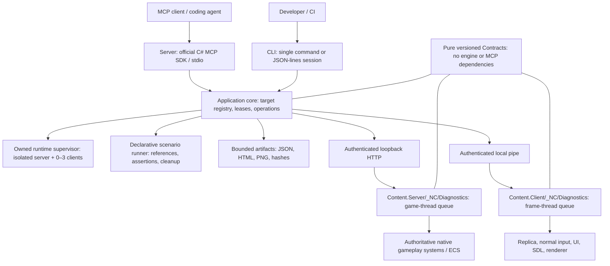

<!-- SPDX-License-Identifier: PolyForm-Noncommercial-1.0.0 -->
# SS14 Developer MCP

Local development and playtest tooling for Night City 2045. The MCP server and CLI share an application core; content-side server/client adapters own all access to ECS, input, UI and rendering. The MCP SDK is never loaded into the game.

## Build and run

Requires the repository's .NET 10 SDK and initialized RobustToolbox submodules. The standalone tooling solution can be built and tested without the engine checkout.

```powershell
dotnet restore Tools/_NC/SS14Mcp/SS14Mcp.slnx
dotnet build Tools/_NC/SS14Mcp/SS14Mcp.slnx --no-restore
dotnet test Tools/_NC/SS14Mcp/Tests/SS14Mcp.Tests.csproj --no-build --no-restore
```

For native playtests, restore/build `Content.Server/Content.Server.csproj` and `Content.Client/Content.Client.csproj` in `DebugOpt` with `-p:EnableNCDiagnostics=true` on both restore and build. Diagnostic code requires both `TOOLS` and `NC_DIAGNOSTICS`; ordinary builds exclude it and retain normal client sandboxing. The opt-in client uses the engine's public trusted `GameControllerOptions.Sandboxing=false` because local IPC, reflection and JSON diagnostic APIs are outside the content whitelist. It requires diagnostic token and pipe environment variables even to start. Use this diagnostic build with trusted local servers; build without the flag for normal play. On constrained Windows hosts use `--disable-build-servers /m:1 -p:MSBuildEnableWorkloadResolver=false` when building.

Start the MCP server as an ordinary stdio process. All host logging goes to stderr; stdout contains MCP messages only.

```powershell
$env:SS14_MCP_WORKSPACE = 'D:\projects\night-city'
dotnet Tools/_NC/SS14Mcp/Server/bin/Debug/net10.0/SS14Mcp.Server.dll
```

Configure your MCP client with executable `dotnet`, the absolute server DLL path as its single argument, and `SS14_MCP_WORKSPACE` pointing at the repository. `mcp-config.example.json` illustrates a stdio configuration; adapt the outer settings structure to your client. `scripts/build.ps1` builds/tests and can publish portable tooling to `artifacts/ss14-mcp-package`.

For Codex, use `codex-config.example.toml` or register the published server with the installed CLI:

```powershell
codex mcp add ss14_dev --env SS14_MCP_WORKSPACE=D:/projects/night-city --env SS14_MCP_MODULES=all -- dotnet D:/projects/night-city/artifacts/ss14-mcp-package/Server/SS14Mcp.Server.dll
codex mcp list
```

The server command, argument list and environment-map syntax follow the [official Codex MCP configuration documentation](https://learn.chatgpt.com/docs/extend/mcp?surface=cli); the command flags were also checked against the installed CLI. These examples do not change your existing Codex configuration automatically.

`scripts/build.ps1 -WithGame -Publish` also builds the opt-in game solution `Game.Diagnostics.slnx` so server and client use the same Shared build. Opt-in native outputs live in `bin/NCDiagnostics/<project>` with separate `obj/NCDiagnostics` compiler inputs, so ordinary builds cannot overwrite them. Launch these through the supervisor: it stages binaries into the engine's required development directory layout with separate per-process user data. Headless clients disable texture preloading because the engine's RSI preload path requires OpenGL. Game resource mounts remain read-only views of the workspace.

Use `SS14_MCP_MODULES` to limit discovery: comma-separated `runtime,entities,content,maps,fixtures,actions,client,ui,replication,scenarios,artifacts,diagnostics`; common session/operation tools remain available. Default `all` exposes the entire catalogue. Module selection limits the discovery list; target profiles enforce actual permissions.

## Architecture



`Core` has no Robust dependency. The MCP SDK is never loaded into the game. Content adapters convert live state into detached JSON on the owning thread; HTTP/pipe handlers never enumerate ECS or UI. Queries and responses are bounded. Requests use API version, request ID, process identity, world generation and deadline. `serverInstanceId` is the historical wire name for the selected process identity, including a client process.

## Existing environments

An existing development server must be started with `NC_DIAGNOSTICS_TOKEN` (32–256 characters) and `NC_DIAGNOSTICS_PROFILE=observe` or `playtest`. Its ordinary status listener serves POST `/nc-diagnostics/v1/request`. The adapter rejects non-loopback peers, non-loopback Host origins, browser Origin headers and invalid bearer tokens.

A client also requires `NC_DIAGNOSTICS_PIPE`, an alphanumeric/hyphen/underscore name up to 100 characters. Pipes are local and current-user-only. Set `SS14_MCP_SERVER`/`SS14_MCP_SERVER_TOKEN` and optionally `SS14_MCP_CLIENT_PIPE`/`SS14_MCP_CLIENT_TOKEN` on the MCP process to register default targets. Alternatively call `environment_attach`; it reads a secret from an existing `SS14_MCP_*TOKEN` environment variable. Token values are never tool arguments or results. Supply a shared `environmentId` when explicitly pairing an attached server and its clients.

`observe` permits inspection. `playtest` additionally permits normal actor actions or client input/UI actions. `fixture-admin` requires `NC_DIAGNOSTICS_ISOLATED=1` and permits fixture setup; without that flag it degrades to observe. The supervisor creates private fixture-admin servers, private client directories, local unauthenticated game connections, fresh SQLite state, Sandbox/Empty configuration and no hub advertisement. Use these profiles for local disposable testing.

## Catalogue and coverage

### Optional pristine SQLite prefill for owned environments

The default creates an empty private database. An explicit prefill can avoid replaying historical migrations for every new owned environment. It copies only a validated pristine schema, migration history and reviewed default rows. The ordinary server `Database.Migrate()` still runs and applies any newer migrations. This disk path never enables the game's separate memory-only diagnostic seed hook.

Build `Tools/_NC/Meta/SqliteSeed/SqliteSeed.csproj` separately, then run its compiled `SqliteSeed.dll stage-helper <workspace> <seedId>`. It stages an append-only, read-only helper bundle at `artifacts/meta-db-bootstrap/<seedId>/materializer/<helperSha256>/`; the small result supplies the fourth pin. The existing seed and its manifest stay unchanged. Start the owning MCP process with all four variables, or leave all four unset:

```powershell
$env:SS14_MCP_SQLITE_SEED_ID = '<canonical lowercase GuidN>'
$env:SS14_MCP_SQLITE_SEED_SHA256 = '<seed.db SHA256>'
$env:SS14_MCP_SQLITE_MANIFEST_SHA256 = '<immutable seed manifest SHA256>'
$env:SS14_MCP_SQLITE_HELPER_SHA256 = '<helper-manifest.json SHA256>'
```

Partial selections fail closed. Before starting the game process, the supervisor pins the helper inventory, reads the actual staged `Content.Server.Database.dll` migration metadata, and invokes the helper with a 20-second deadline and an 8 KiB combined output cap. The helper validates the selected immutable seed, uses real SQLite backup into fresh memory and then a new disk file, compares schema/default/history content, and atomically publishes only `artifacts/ss14-mcp/environments/<newGuidN>/server-data/preferences.db`. Existing data, links, unknown migration history and changed hashes are rejected. The environment manifest records the prefill result. All seed-selection variables, including the memory-only `NC_DIAGNOSTICS_*` seed variables, are stripped from game children.

The standalone CLI also supports `validate <workspace> <seedId> <seedSha256> <manifestSha256> <databaseAssembly> <databaseSha256>` and `materialize <workspace> <seedId> <seedSha256> <manifestSha256> <ownedEnvironmentGuidN> <databaseSha256>`. Materialize derives its database assembly and destination from that environment ID; it does not accept an arbitrary output path. The original four-argument package producer remains supported.

Tool-only tests are in `Tools/_NC/Meta/SqliteSeed.Tests`. The opt-in `SqliteSeedOwnedProcessTests` additionally runs the real pinned helper against a selected package/actual server database assembly, checks no-overwrite/source integrity, and removes only its own fresh test directory. It starts no game processes. Native server startup and its migration pass require a separate runtime verification.

| Area | Tools / behavior | Coverage |
|---|---|---|
| Runtime | `environment_list/attach/start/stop/logs`, `session_get`, `capabilities_get` | Only processes created by this supervisor can be stopped; 0–3 clients, up to 3 active environments |
| Operations | `operation_get/cancel`, `request_status` | Accepted/running/succeeded/failed/cancelled/indeterminate; retained results, no blind mutation retries |
| Entities | `entities_query`, `entity_inspect/snapshot`, `snapshot_diff` | Explicit fields, bounded map regions and short-lived paging snapshots; typed hands, containers, access and power readers |
| Content | `prototype_search/get`, `resource_inspect`, `validation_run` | Composed prototypes and parents; bounded resource text, PNG header and RSI metadata; fixed validator profiles |
| Maps | `maps_list`, `map_region_inspect/capture` | Region entity inspection; capture is the selected client's current viewport |
| Fixtures | `fixture_create/spawn/reset/destroy/attach/access/power` | Owned maps, floor grid with air, native spawning, client mind transfer, native access and power configuration |
| Actions | `actions_list`, `action_execute` | Native interact, pickup, drop, use-in-hand; actor must be attached player or fixture-owned |
| Client | `client_inspect/input/capture` | Curated normal input functions, auto-release within 1 second; rendered PNG only with graphical backend |
| UI | `ui_inspect/interact` | Bounded live tree with opaque handles; supported button click, text/focus/submit; console/VV interaction blocked and sensitive text redacted |
| Replication | `replication_inspect/watch/unwatch`, `state_compare` | Applied ticks/current replica; authoritative Door state application history when explicitly watched |
| Diagnostics | `logs_read`, `metrics_capture`, `trace_start/read/stop` | Bounded redacted log ring; process/diagnostic counters; sampled observations, no causal event reconstruction |
| Scenarios | `scenario_validate/run/status/cancel`, `condition_wait` | JSON DSL, typed references, assertions, one active scenario, mutation reservation renewal and cleanup |
| Artifacts | `artifacts_list`, `artifact_get/image`, `report_create` | Workspace-confined JSON, escaped static HTML, PNG MCP image content and SHA-256 on creation |

Unknown field types are omitted with reasons. Missing fields differ from explicit null. A submitted action or handled event is not proof of a gameplay outcome: assert a subsequent world observation. A missing client entity may be outside PVS; it does not prove server deletion. Current client component fields can include prediction. `state_compare` reports authoritative conclusive results only for watched Door fields applied during a stable live observation window in a supervisor-owned environment. Manually declared target groups remain unverified and return inconclusive comparisons. Captures carry capture-request frame/tick metadata, not an invented exact rendered server tick.

Prototype mappings are composed values, not precise per-field source-file provenance. Metrics are process/diagnostic counters, not a whole-engine profiler. Resource inspection does not replace validators. Trace sampling can miss transitions between samples. These boundaries are part of the API, not silent fallback behavior.

## CLI and scenarios

```powershell
dotnet Tools/_NC/SS14Mcp/Cli/bin/Debug/net10.0/SS14Mcp.Cli.dll environment_list
dotnet Tools/_NC/SS14Mcp/Cli/bin/Debug/net10.0/SS14Mcp.Cli.dll session
dotnet Tools/_NC/SS14Mcp/Cli/bin/Debug/net10.0/SS14Mcp.Cli.dll environment_start '{"clients":0}' --stay
dotnet Tools/_NC/SS14Mcp/Cli/bin/Debug/net10.0/SS14Mcp.Cli.dll scenario_run --args-file Tools/_NC/SS14Mcp/Scenarios/run-server-smoke.json
```

Single commands await operations and exit 0 only on success, 1 on failure, 2 for malformed input and 130 on cancellation. `environment_start` requires `--stay` or JSON-lines `session`, because the owning process must remain alive. EOF/exit/Ctrl+C disposes its owned processes. Session requests are `{"command":"session_get","arguments":{"targetId":"server"}}` and operations return handles immediately.

Scenario documents have `version:1`, `id`, `maximumSeconds`, optional `environment:{start:true,clients:2,graphics:false}`, and 1–64 ordered steps. A step contains `id` plus either `command`/`arguments` or `assert:{actual,equals,tolerance?}`. A sole object `{"$ref":"/steps/spawn/data/netEntity"}` resolves a JSON pointer against prior results, preserving its type. `/targets/server`, `/targets/client1` and `/targets/client2` identify scenario-created targets. Mutations should carry process/world references from the original session. `condition_wait` polls an explicit read command/path/expected value with a bounded deadline.

Scenarios always attempt fixture cleanup and stop environments they created. Reports retain failure and cleanup evidence. Cancellation stops remaining work; it cannot reverse an already submitted native action. A transport interruption during mutation is `indeterminate`; reconcile with `request_status` using the operation ID on the original process/world, then inspect state before deciding whether another action is needed.

## Limits and retention

Requests: 64 KiB; responses: 2 MiB; queue: 16; at most 2 requests per pump slice with a cooperative 2 ms budget, plus individually bounded handlers. Entity queries: radius ≤16, candidates ≤4096, results ≤500, page ≤100, eight retained snapshots for 30 seconds. Fixtures: eight maps and 32 explicitly spawned entities per fixture. Captures: four pending results, PNG ≤1 MiB. Replication watches: 16 Doors, ≤60 seconds, 16 applied states each. Traces: ≤60 seconds, ≤600 samples, 4 MiB. Scenarios: ≤900 seconds, context ≤4 MiB.

Mutation leases expire after 30 seconds and renew during scenarios; retained native mutation results expire after ten minutes, bounded by count and bytes. Core operations are process-local, with eight active workers and 128 retained handles; new operations stop admitting work at 64 MiB of retained results. Completed handles expire after ten minutes; restarting the MCP process loses them. Artifacts remain under `artifacts/ss14-mcp`, with 16 MiB per file and a 512 MiB top-level report quota. Large `artifact_get` results require `jsonPointer` selection and array paging (`offset`, `limit`). Large operation status results return artifact references. Runtime directories contain staged client binaries, private state, binary hashes and manifests; retain or remove stopped run directories explicitly. A process retains up to 24 environment records. Do not delete an active environment's files. Secret redaction covers recognized credential assignments; avoid logging unrelated confidential data during tests.

## Validation

Verified locally on Windows on 2026-10-22:

| Check | Result |
|---|---|
| `scripts/build.ps1 -WithGame -Publish` | Tooling and opt-in game builds, tests and portable publish passed |
| Standalone NUnit suite | 37 passed; native runtime test skips unless explicitly enabled |
| Native server-only smoke | Spawn, pickup custody, drop and teardown passed |
| Native two-client headless smoke | Attach/control, UI inspection, Door replication comparison and teardown passed |
| Native two-client graphical smoke | Authoritative movement, SDL inventory click, full PNG and viewport capture, Door comparison and teardown passed |
| Final graphical scene inspection | Lit floor, actor and item visibly present in exported viewport PNG |
| Supplied CLI scenarios | Server scenario: 13 steps; two-client scenario: 24 steps; cleanup passed |
| MCP stdio | Official SDK client discovery, module filtering and structured error checks passed |

The GitHub workflow is supplied but has not been run remotely as part of this local task. `Content.IntegrationTests` was not invoked. Existing repository/engine compiler and NuGet audit warnings remain visible. Native startup also required matching the body's EMP subscription ordering with the existing cell EMP subscription in `NCCyberwareSystem`; otherwise the engine refused to initialize its event bus.

Unit tests cover transport framing/limits, authentication, path confinement, idempotency, world fencing, leases/overload, operation cancellation, missing-vs-null comparisons, secret redaction, scenario rejection/cleanup and actual MCP stdio discovery/errors. Native runtime smoke tests are separate from `Content.IntegrationTests` and opt in with:

```powershell
$env:SS14_MCP_RUNTIME_TESTS = '1'
$env:SS14_MCP_WORKSPACE = 'D:\projects\night-city'
$env:SS14_MCP_TEST_CLIENTS = '2'
# Optional graphical pass:
$env:SS14_MCP_TEST_GRAPHICS = '1'
dotnet test Tools/_NC/SS14Mcp/Tests/SS14Mcp.Tests.csproj --no-build --no-restore --filter Category=Runtime
```

`validation_run` accepts fixed build-server/build-client/content/yaml/mcp/rsi profiles. The integration profile additionally requires the MCP process to start with `SS14_MCP_ALLOW_INTEGRATION_TESTS=1`. RSI validation requires Python, Pillow and jsonschema. Graphical validation needs a working display/renderer; headless clients explicitly reject screenshot requests.

## Boundaries

The external process uses ordinary DTOs from `Contracts`. Server requests are authenticated and local-only, then processed on the game thread through a bounded queue. Client IPC is local and authenticated; UI/input/render work remains on the client thread. No arbitrary console commands, C# evaluation, method reflection, or network-message injection are exposed. Owned processes monitor their owner's PID and creation time and shut down when that owner exits.

Mutations use native gameplay APIs. Fixture administration is restricted to explicitly selected isolated test environments. Entity references include the process instance and world generation. Long operations have handles; cancellation cannot undo an action already performed. Reconnection never blindly retries a mutation.

Version 1 targets Windows development and Linux server CI. Graphical checks require a rendering environment. Integration tests are an explicit opt-in profile.
